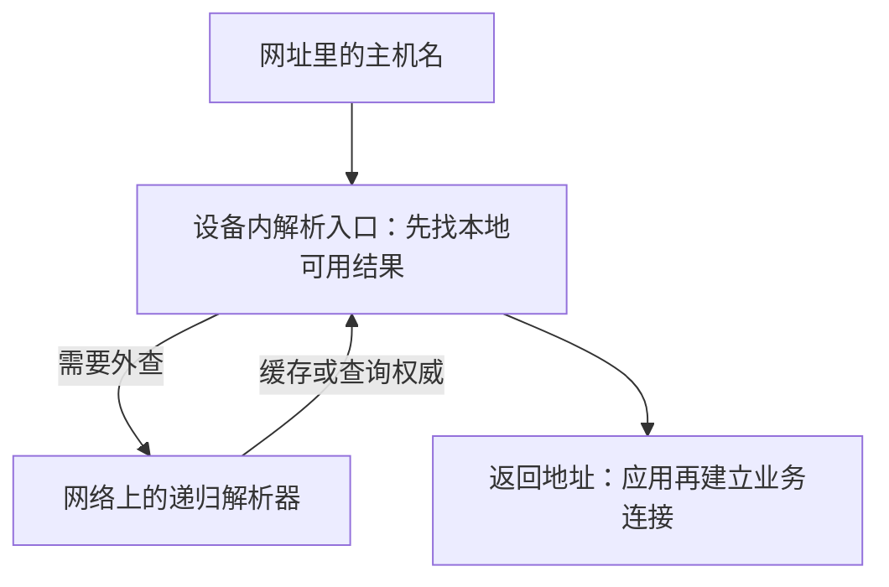
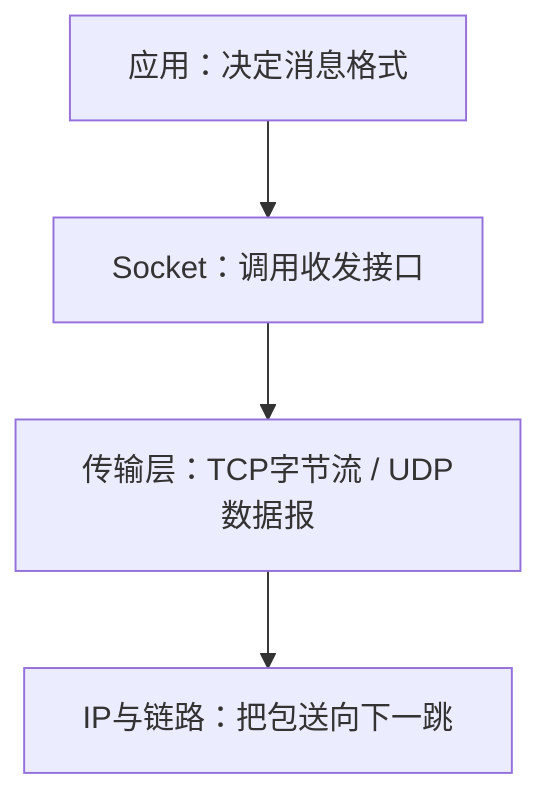
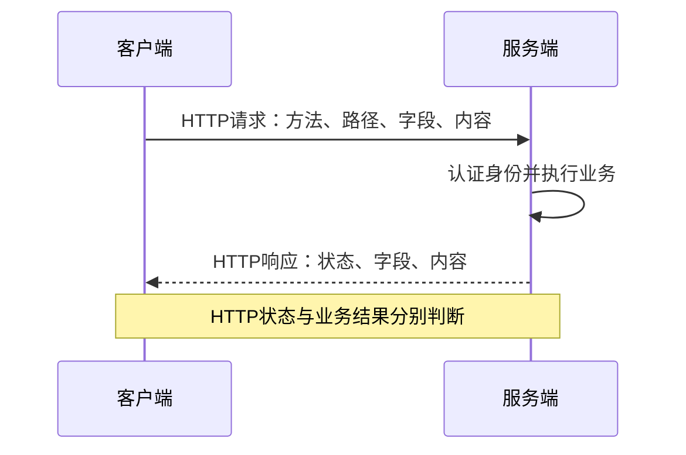
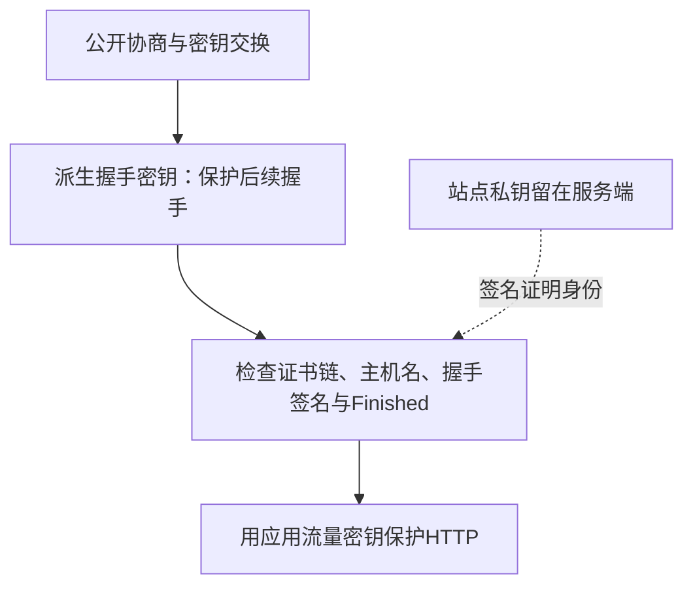
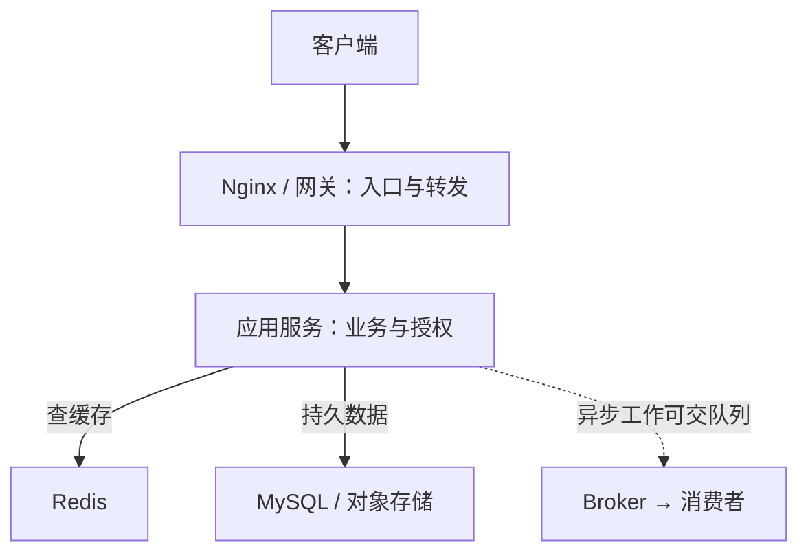
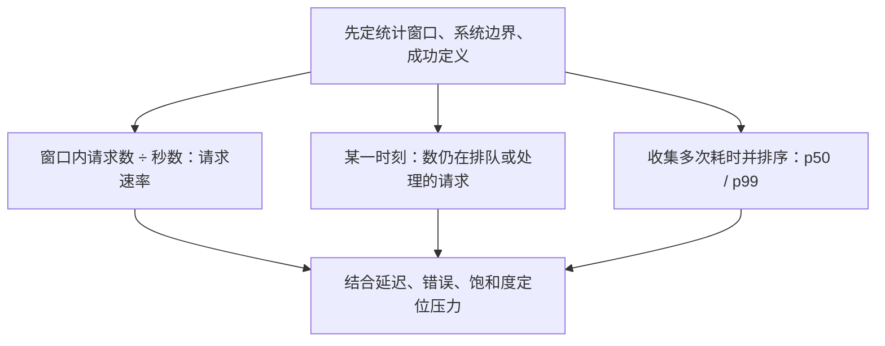

# 网络与运维术语：按场景查词

遇到生词先定位场景：**找地址 → 建通道 → 约定业务 → 保护通信 → 服务处理 → 衡量运行**。每词只记作用和一个易错点，原理看组末链接。

## 1. 找地址：域名、DNS 与 IP

- **URL**：一个资源的定位信息，包含协议、主机及路径等部分。 `https://api.example.com/notes/7`；[访问全景](./overview.html)
- **域名 / 主机名**：便于记忆的名字；主机名是在具体访问中标识对端的名字。 `api.example.com`；购买域名不等于部署服务
- **DNS：域名系统**：查询名字关联的记录，不负责传输网页内容。 [域名与 DNS](./dns.html)
- **注册商 / 注册局**：注册商提供域名注册服务；注册局维护相应顶级域的注册体系。 注册、NS 委派、托管解析是不同操作
- **本机解析入口 / 存根解析器（stub resolver）**：应用调用的地址解析设施 / 通常向配置的DNS服务查询的客户端角色。 系统API不等于远端递归服务；浏览器可能使用自己的解析路径
- **hosts / 本地地址缓存**：本机的静态名称映射 / 已保存且可用的解析结果。 命中时可能不发远端DNS查询；各系统查找规则不同
- **递归解析器 / 递归缓存**：为客户端寻找答案的服务 / 该服务保存的DNS结果。 可直接命中缓存、转发或按需查询权威；[谁运营、部署在哪](./dns.html#operators)
- **权威 DNS**：对其管理区域提供权威记录的服务。 [域名管理者维护记录，托管商运维服务器](./dns.html#hosting)
- **A / AAAA**：分别关联 IPv4 / IPv6 地址的记录。 一域可以有多个地址，也可能只配置其中一种
- **CNAME**：把一个名字指向另一个名字的别名记录。 不是浏览器的 HTTP 跳转
- **NS / MX / TXT**：分别用于权威服务器委派、邮件路由、文本数据等。 TXT 常见于域名验证；[记录与查询](./dns.html)
- **TTL**：一条记录可被缓存的时间参数。 不是强制所有客户端在同一时刻更新
- **Anycast / 任播**：多个服务节点宣告相同IP，由路由选择到达的节点。 一个DNS地址不等于一台机器；[部署方式](./dns.html#operators)
- **IP / 子网 / CIDR**：网络地址及其前缀范围；CIDR 用前缀长度表示范围。 [IP、端口与路由](./ip-routing.html)
- **网关 / 路由**：网关是下一跳入口；路由选择去目的地址的下一跳。 不在本地网段时常先交给默认网关
- **NAT / NAPT**：转换地址；NAPT 还转换传输端点的端口标识。 家庭多设备共用一个公网 IPv4 出口
- **localhost / 回环**：当前设备访问自己。 手机的 localhost 指向手机，不能代替电脑

记录、递归和缓存的具体过程见 [DNS 原理](./dns.html)；角色定义：[RFC 9499 §6](https://www.rfc-editor.org/rfc/rfc9499.html#section-6)，基础规范：[RFC 1034](https://www.rfc-editor.org/rfc/rfc1034.html)、[URI 结构 RFC 3986](https://www.rfc-editor.org/rfc/rfc3986.html)。

## 2. 建通道：连接、Socket 与传输

- **端口**：TCP / UDP 等传输端点中的标识。 它属于 TCP / UDP 等传输端点，不是 IP 层的应用编号。
- **Socket**：程序使用网络通信的接口与端点抽象。 它是接口，不替你规定 HTTP 或业务消息格式。
- **TCP**：可靠、有序的字节流传输。 一次 send 不对应一次 recv；可靠传字节不等于业务成功。
- **UDP**：有报文边界的数据报传输。 保留数据报边界；不保证送达、顺序，也不保证一定更快。
- **QUIC**：运行于 UDP 上的安全传输协议，提供流等机制。 不是把 HTTP 文本直接装进 UDP；它自己实现安全传输与流。
- **RTT**：一次往返所需时间。 只是一来一回，不等于整个业务完成时间。
- **MSS / MTU**：TCP 段的数据大小上限参数 / 一跳链路可承载的 IP 包大小上限。 两者不能混用，也不是应用消息的长度上限。
- **流量控制**：避免发送速度超过接收方可接纳能力。 看接收方能否接得住，与网络拥塞是两个问题。
- **拥塞控制**：根据网络状况约束发送，避免持续压垮路径。 看路径承受能力，不只看接收端内存。
- **keep-alive / 心跳**：连接复用、传输探测、应用保活等不同机制都可能这样称呼。 不同层含义不同；心跳通了不证明数据库或业务健康。
- **epoll / I/O 多路复用**：让线程观察多个描述符的就绪事件。 报告就绪事件，不会替应用完成业务，也不自动成为异步读写。

继续看 [传输协议](./transport.html)与 [Socket 收发模型](./socket.html)。TCP 的边界见 [RFC 9293 §2.2](https://www.rfc-editor.org/rfc/rfc9293.html#section-2.2)，QUIC 见 [RFC 9000](https://www.rfc-editor.org/rfc/rfc9000.html)。

## 3. 约定业务：HTTP 与身份

- **HTTP / API**：HTTP 约定请求响应语义；API 是系统对外提供的调用接口。 API 不一定使用 HTTP
- **Header / Body**：描述消息的字段 / 消息承载的内容。 JSON 通常是 Body 的一种数据格式
- **JSON / 序列化**：JSON 是数据表示格式；序列化把内存数据转成可传输形式。 JSON 不是加密，也不是 HTTP 协议本身
- **状态码 / 业务 code**：HTTP 层结果 / 应用自定义结果。 200 也可能携带业务失败
- **幂等**：同一请求重复执行，其预期服务端效果与执行一次相同。 不要求每次响应完全相同；重复请求仍可产生日志。
- **Cookie / Session**：浏览器按规则保存发送的字段 / 服务端会话状态机制。 Cookie 可承载多种字段，不限于会话 ID；按规则限制发送范围。
- **Token / JWT**：凭证的一种通称 / 一种结构化令牌格式。 JWT 内容通常可读；验签之外，还要校验有效期、签发者和受众等。
- **CORS**：浏览器对跨源响应读取的授权机制。 约束浏览器跨源读取，不替服务端做身份认证。
- **ETag / 304**：资源验证标识 / 表示已有缓存可继续使用的响应。 304 不返回完整资源；ETag 不一定是文件摘要。
- **Range / 206**：请求指定部分 / 返回部分内容。 收到 200 不能盲目续写；先核对响应状态、资源版本与范围。
- **WebSocket / SSE**：双向消息通道 / 基于 HTTP 的服务端事件推送。 连接不等于持久消息；断线补齐、去重需要另行设计。
- **RPC / gRPC**：远程过程调用模型 / 一套具体 RPC 框架。 远端调用有超时与未知执行结果，不能按本地函数理解失败。

[HTTP 原理](./http.html)、[版本演进](./http-versions.html)和 [实时协议](./realtime.html)展开这些词。HTTP 语义以 [RFC 9110](https://www.rfc-editor.org/rfc/rfc9110.html)为入口；浏览器跨源规则见 [Fetch CORS 协议](https://fetch.spec.whatwg.org/#http-cors-protocol)。

## 4. 保护通信：密码学、TLS 与证书

图示常见的 TLS 1.3 证书握手，不含 0-RTT；握手保护与应用保护使用不同密钥。

- **Base64**：把字节表示成文本。 任何人都能解码，不提供保密性。
- **哈希 / 摘要**：计算内容指纹，用于校验等。 预期摘要的来源要可信；普通快速哈希不适合直接存口令。
- **HMAC**：用共享密钥生成、验证消息认证码。 共享密钥的双方都能生成，不能据此向第三方区分是谁生成的。
- **数字签名**：私钥签名、公钥验证，认证消息来源与完整性。 不等于“私钥加密”，也不保证内容保密。
- **AEAD / nonce**：认证加密 / 按方案要求管理的每次加密输入。 GCM等方案要求同一密钥下不重复；nonce不等于必须随机，CBC的IV要求另看模式。
- **公钥 / 私钥 / 会话密钥**：非对称密钥对中的公开和保密部分 / 会话使用的流量密钥等。 公钥按算法用于加密、验签或协商；私钥留在持有方。
- **TLS / HTTPS**：安全传输协议 / 受 TLS 保护的 HTTP。 连接安全不等于网站业务可信。
- **CA / 证书链**：证书颁发机构 / 从叶子证书到本地信任锚验证的路径。 X.509证书对象不含私钥；合并PEM文件、PKCS#12容器可能同时装有私钥。
- **SNI / ALPN**：TLS握手中指明目标主机名 / 协商上层协议。 它们不携带HTTP资源路径。
- **mTLS**：双方通过 TLS 证书认证彼此。 普通HTTPS通常只认证服务器，客户端证书需要另行配置。

- **AES / 分组模式**：AES的分组固定128位，密钥可为128/192/256位；GCM、CBC、CTR规定怎样处理消息。 模式的IV、认证与padding要求不同，见 [算法与参数](./cryptography.html)。
- **RSA-OAEP / RSA-PSS**：分别是RSA加密方案与RSA签名方案。 不是把同一套“公私钥加解密”反着使用；OAEP还限制明文长度。
- **ECC / ECDH / ECDSA**：椭圆曲线体系 / 密钥协商 / 数字签名。 协商出的秘密还需派生并认证对端；ECDSA不负责加密消息。
- **Ed25519 / X25519**：分别用于EdDSA签名与密钥协商。 名字相近，用途和API不同；Ed25519不是ECDSA。
- **PBKDF2 / HKDF**：口令派生与成本加固 / 从秘密材料派生不同用途的密钥。 PBKDF2要保存salt、PRF、成本和长度等参数；HKDF不能替代口令加固。
- **CSR / 数字证书**：带申请者签名的公钥与身份申请 / CA签名绑定的身份、公钥、约束等信息。 CSR的签名不证明域名归属；证书认证身份也不自动授予业务权限，见 [证书机制](./tls.html#certificates)。
- **SAN / KU / EKU**：可匹配的身份 / 密钥操作约束 / 证书用途约束。 域名、服务器认证、客户端认证、代码签名的要求不能互换。

算法与密钥工作流看 [密码学与密钥](./cryptography.html)，认证与握手看 [TLS](./tls.html)。AEAD 规则见 [RFC 5116](https://www.rfc-editor.org/rfc/rfc5116.html)，TLS 1.3 见 [RFC 8446](https://www.rfc-editor.org/rfc/rfc8446.html)。

## 5. 谁来处理：Nginx、Redis 与服务端组件

- **Nginx**：可提供静态文件、反向代理和负载均衡等能力的服务器软件。 统一入口、代理到应用、多实例分流
- **正向代理 / 反向代理**：客户端指定代理替自己访问目标 / 网站方部署入口替应用接收访问。 两者都转发请求与响应；见[对照图、TLS边界与配置](./gateway-load-balancing.html#正向代理与反向代理)
- **upstream / 源站**：代理转发的上游服务 / 内容的原始服务来源。 CDN 或 Nginx 后面实际处理内容的服务
- **L4 / L7 负载均衡**：按传输层端点等信息 / 按应用层信息分发流量。 TCP 连接分流与按 HTTP 路径分流不同
- **API 网关**：统一 API 入口，集中处理路由、认证、配额等策略。 能力依具体实现与配置，不能自动替代业务授权
- **CDN**：通过分布式边缘节点交付内容，常结合缓存。 需要正确配置缓存键、过期与回源
- **Redis**：内存数据结构服务，可用于缓存等场景。 热点读取、过期状态；不是随手复制一份数据库就结束
- **TTL / 淘汰**：数据的过期时间 / 达到内存策略条件时移除数据。 未过期的数据也可能被淘汰，两者机制不同
- **MySQL / 索引 / 事务**：关系数据库 / 加速访问的数据结构 / 一组操作的提交与隔离机制。 索引增加写成本；数据库事务不自动覆盖队列发消息
- **消息队列 / Broker**：暂存或传递消息，实现生产者与消费者解耦 / 承载消息的服务。 削峰、异步处理、投递重试；消费仍需幂等
- **Kafka / RabbitMQ**：具体的事件流与消息代理系统。 不能仅凭“都是队列”就认定顺序、确认和持久化语义相同
- **对象存储**：按对象键管理图片、附件等数据的存储服务。 不等同于数据库或本地文件目录
- **连接池**：复用有限连接，控制新建开销与占用。 池过小会排队，过大可能压垮数据库
- **Docker / 容器**：打包和运行进程的工具与隔离形式。 容器不自动等于一台独立虚拟机
- **Kubernetes / 服务发现**：编排容器工作负载的平台 / 找到当前可用实例的机制。 扩缩容后的地址变化、发布与健康治理

从 [服务端全景](./service-architecture.html)进入，再读 [Nginx 与负载均衡](./gateway-load-balancing.html)和 [Redis](./redis.html)。原始入口：[Nginx 指南](https://nginx.org/en/docs/beginners_guide.html)、[Redis 文档](https://redis.io/docs/latest/)、[MySQL 手册](https://dev.mysql.com/doc/refman/8.4/en/)。

## 6. 怎么衡量：QPS、并发、延迟与稳定性

- **QPS / RPS**：Queries / Requests Per Second，查询或请求速率。 先说明计数位置：HTTP入口、应用还是数据库；口径相同才可比较
- **TPS**：Transactions Per Second，事务或业务交易速率。 一个下单事务可能产生多个 HTTP 请求或数据库查询
- **并发数**：同一时刻尚在系统内的请求或任务数量。 不是每秒请求数，也不是线程数
- **吞吐量 / 带宽**：完成工作的速率 / 链路容量；要标明次/秒或字节、比特/秒。 网络带宽高不代表应用处理请求快
- **平均延迟 / p50 / p95 / p99**：平均耗时 / 延迟分布的相应分位数。 平均值会掩盖慢请求；不能把各阶段 p99 相加当整链路 p99
- **超时 / deadline**：某一步等待上限 / 整体完成期限。 客户端超时，不证明服务器没有执行
- **错误率 / 饱和度**：按口径统计的失败比例 / 资源接近容量的程度。 除 HTTP 错误，还可能要统计业务拒绝、排队与丢弃
- **SLI / SLO / SLA**：实际服务指标 / 目标 / 对外服务约定。 一个目标可用性数字需要统计周期与成功定义
- **错误预算**：在既定目标和窗口下可容忍的失败额度。 不是允许随时任意停机的固定时间
- **限流 / 背压**：约束进入速度或数量 / 让上游感知下游承载压力。 一味加长队列通常只会放大延迟
- **熔断 / 降级**：暂停调用持续失败的依赖 / 提供简化或替代结果。 两者不等于自动重试，也不解决数据一致性
- **Metrics / Logs / Traces**：聚合指标 / 单条事件记录 / 一次调用跨组件的关联轨迹。 各有采样、成本和隐私边界，不是收集越多越好
- **灰度 / 滚动发布 / 回滚**：部分流量验证 / 分批替换实例 / 恢复旧版本或配置。 代码回滚不自动逆转已写入的数据

计算、例子和监控图看 [容量与可观测性](./capacity-observability.html)。监控方法参考 [Google SRE](https://sre.google/sre-book/monitoring-distributed-systems/)，信号与追踪参考 [OpenTelemetry](https://opentelemetry.io/docs/concepts/observability-primer/)。

**查完术语，要回到一条真实请求。** 试着指出它经过哪个组件、哪里产生指标、失败时留下什么证据；不知道从哪查时进入 [分层排障](./diagnostics.html)。
