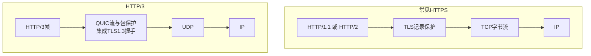
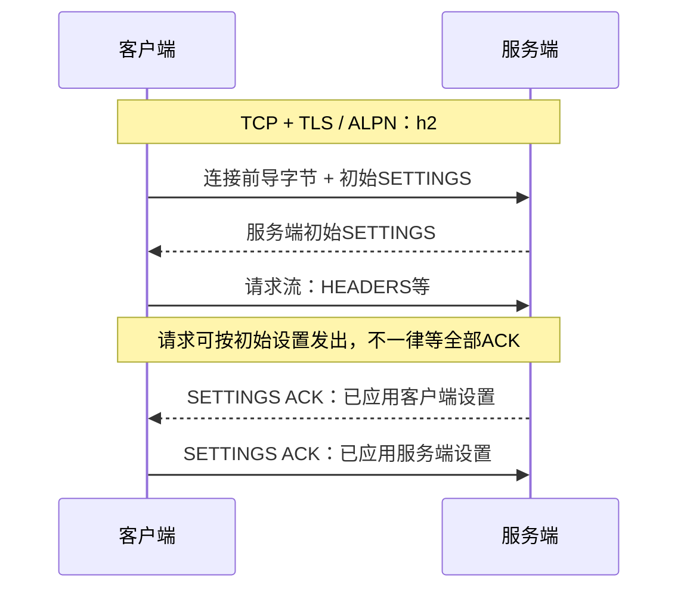
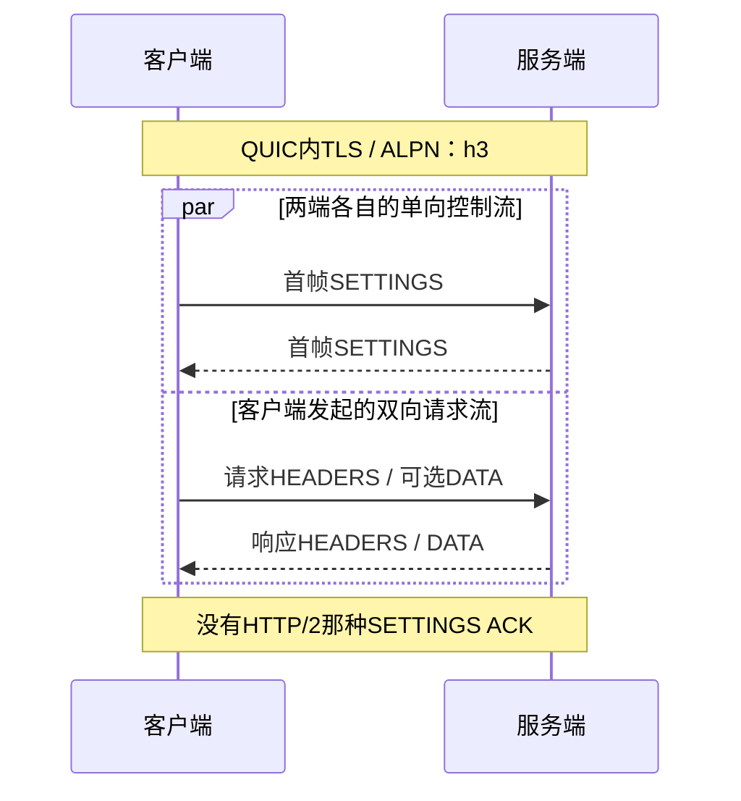

# HTTP 演进：从排队请求到多路复用

一页笔记同时要下载**图片A、样式B、正文C**。版本演进的主线：能否共用连接？慢资源会挡住谁？丢失一段数据后，又是谁必须等？


前置：[HTTP](./http.html)、[TCP与QUIC](./transport.html)。图中的色块代表资源片段，**不是TCP段或UDP包**；HTTP方法、状态码等语义仍共用。

## 1. 先把协议栈放对位置 {#stacks}



- HTTP/2的多个流共享TCP；**不需要每个请求新建TCP**。
- QUIC提供可靠流、流控、拥塞控制和加密；**不是把HTTP直接塞进裸UDP**。
- 图选HTTPS。HTTP/1.1也能明文运行；HTTP/2规范允许已知对端能力的直接明文连接，浏览器主线使用TLS。

[共享语义：RFC 9110 §1.3](https://www.rfc-editor.org/rfc/rfc9110.html#section-1.3)、[QUIC映射：RFC 9114 §2](https://www.rfc-editor.org/rfc/rfc9114.html#section-2)

## 2. HTTP/1.1：先复用连接，再解决排队 {#http1}

### 持久连接节省了什么

**握手只做一次，后续请求继续用这条连接。** HTTP/1.1默认持久连接，但双方仍可能关闭；只有消息边界合法、Body正确处理等条件满足，连接才能继续复用。[RFC 9112 §9.3](https://www.rfc-editor.org/rfc/rfc9112.html#section-9.3)

### 为什么还会慢

回看顶部条带：串行使用时，先收完A再请求B。流水线允许提前发B，**同一连接的响应却仍按请求顺序返回**，慢A仍会挡B。

浏览器也可用多连接并发，代价是更多握手、资源和拥塞竞争。**连接活得久，不等于同一连接能自由交错多个响应。**

## 3. HTTP/2：把消息切成帧，按流编号交错发送 {#http2}

先记三个层次：**连接是共用通道，流是一次请求/响应的逻辑通道，帧是带编号的小块。**


- **用Stream ID认归属：** 流1的DATA交给A，流3的交给B；无需等A全部发完才发B。
- **图只画服务端响应：** 客户端先发GET；分流不会凭空生成响应或把图片当GET请求体。
- **每个流仍有顺序：** 帧可跨流交错，流内部仍遵守HEADERS/DATA规则。

[帧与流：RFC 9113 §4–5](https://www.rfc-editor.org/rfc/rfc9113.html#section-4)、[请求/响应 §8.1](https://www.rfc-editor.org/rfc/rfc9113.html#section-8.1)

### 核心帧长什么样

**HEADERS承载字段，DATA承载Body片段，SETTINGS通告本端参数；WINDOW_UPDATE是接收窗口更新，不是业务确认。**

<details>
<summary>9字节帧头与边界细节</summary>

```text
Length(24位) | Type(8位) | Flags(8位) | R + Stream ID(32位)
后接 Frame Payload
```

头字段过长还可用CONTINUATION。HTTP消息、帧、TLS记录与TCP段没有固定一一对应关系，不能按TCP分段来切HTTP消息。

</details>

### TLS 完成后，还需要 HTTP 连接初始化

**HTTPS的HTTP/2：TLS/ALPN选中h2，接着才是HTTP连接前导与参数。**



两端分别通告自己的参数和接收限制，**不是共同协商出一个设置值**；图中请求与ACK的先后只示意一种情况。[连接前导 §3.4](https://www.rfc-editor.org/rfc/rfc9113.html#section-3.4)、[SETTINGS §6.5](https://www.rfc-editor.org/rfc/rfc9113.html#section-6.5)

**HTTP/3：控制流与请求流分开，初始化可并行推进。**



[HTTP/3初始化 §3.2](https://www.rfc-editor.org/rfc/rfc9114.html#section-3.2)、[控制流 §6.2.1](https://www.rfc-editor.org/rfc/rfc9114.html#section-6.2.1)

### 常见字段如何变化

HTTP语义仍是GET、路径与目标站点；HTTP/2用伪头字段表示，经HPACK编码，**不是将下面的可读文本直接搬上线**。HPACK不压缩图片或JSON正文。

<details>
<summary>文本请求与HTTP/2解码后的字段对照</summary>

```text
HTTP/1.1：                  HTTP/2解码结果：
GET /notes HTTP/1.1         :method: GET
Host: notes.example.com    :scheme: https
                           :authority: notes.example.com
                           :path: /notes
```

[HPACK：RFC 7541](https://www.rfc-editor.org/rfc/rfc7541.html)

</details>

## 4. 多路复用之后，为什么仍然会“卡一起” {#head-of-line}

**队头阻塞（HOL）：后面的数据已经到达，却因为前面的缺口不能交付。** 先看哪个层次在等：


- HTTP/2不再要求不同响应依次返回，**TCP仍须整条字节流有序交付**。
- QUIC把有序交付限定到各流；A缺口不直接阻止字节已齐的B交付。
- **共享拥塞、连接资源、QPACK依赖仍可造成等待**，HTTP/3不是“完全无阻塞”。

[TCP HOL：RFC 9113 §1](https://www.rfc-editor.org/rfc/rfc9113.html#section-1)、[独立流：RFC 9114 §2](https://www.rfc-editor.org/rfc/rfc9114.html#section-2)、[QPACK阻塞：RFC 9204 §2.1.2](https://www.rfc-editor.org/rfc/rfc9204.html#section-2.1.2)

## 5. HTTP/3：哪些能力交给 QUIC {#http3}

| 关注点 | HTTP/1.1 | HTTP/2 | HTTP/3 |
| --- | --- | --- | --- |
| 共用连接 | 常见串行；流水线响应有序 | HTTP/2多流 | QUIC多流 |
| 头部编码 | 文本 | HPACK | QPACK |
| 有序交付范围 | TCP整条字节流 | TCP整条字节流 | QUIC各流 |

每个HTTP/3请求/响应对使用客户端发起的双向QUIC流。流管理和可靠交付交给QUIC；HTTP/3仍有自己的HEADERS、DATA等帧。[RFC 9114 §4.1](https://www.rfc-editor.org/rfc/rfc9114.html#section-4.1)

QUIC集成TLS1.3握手，**不用TCP路径上同一套TLS记录层**。连接标识可支持地址迁移，但受双方和路径条件限制；不是换网必不断线。

### 客户端怎么知道能用 HTTP/3

**先发现入口，再尝试连接。** `Alt-Svc`可公布入口，DNS HTTPS记录也可提供参数；首次访问不保证直接h3。缓存、已有连接和网络环境都会影响选择。

QUIC失败可退回h2/h1；允许TCP/443不代表UDP/443也通。[端点发现：RFC 9114 §3.1](https://www.rfc-editor.org/rfc/rfc9114.html#section-3.1)

## 6. 实际观察自己正在用哪个版本 {#practice}

### 浏览器观察

访问自己的站点，开发者工具Network面板显示**Protocol**列，查看 `http/1.1`、`h2`、`h3`；再看连接复用与缓存命中。**页面快，不足以证明协议版本或优化收益。**

### curl 观察

先查构建能力，再对自己启用相应协议的HTTPS服务执行；用自己的域名替换占位名。Windows PowerShell用 `curl.exe` 避免别名。

```bash
curl --version
curl --http1.1 -I https://notes.example.com/
curl --http2 -I https://notes.example.com/
curl --http3-only -I https://notes.example.com/
```

`--http2`会协商，不能保证最终h2；`--http3-only`不回退，客户端没编译支持、服务未启用或UDP不通都可能失败。[curl官方参数](https://curl.se/docs/manpage.html#--http3-only)

**本课程的 `network_lab.py http-server` 只演示HTTP/1.1，不能验证h2/h3。**

## 7. 开发时真正需要关心什么 {#pitfalls}

- **先复用，再谈版本：** 客户端/连接复用，并正确消费或关闭响应Body。
- **多路复用仍会排队：** 并发流配额、流控、线程池与慢消费都有上限。
- **版本不等于业务可靠：** 断线时请求可能已执行，仍需幂等与受控重试。
- **保留合理回退：** 是否启用h3看客户端、UDP可达性与实测收益。
- **h2c Upgrade不是浏览器主线：** 该机制在RFC9113中已废弃；HTTPS通过ALPN选h2。

## 8. 自测 {#check}

1. h2的A很慢时，B一定等A吗？TCP丢包时又怎样？
2. h3使用UDP，为何仍能可靠传文件？
3. 已到达缓冲区，为何不一定已交给HTTP？
4. 客户端不支持h3选项，能否证明服务端不支持h3？

下一篇：[密码学与密钥](./cryptography.html)。
