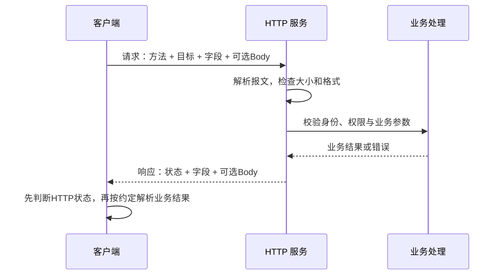
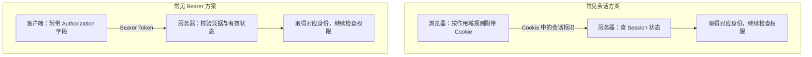
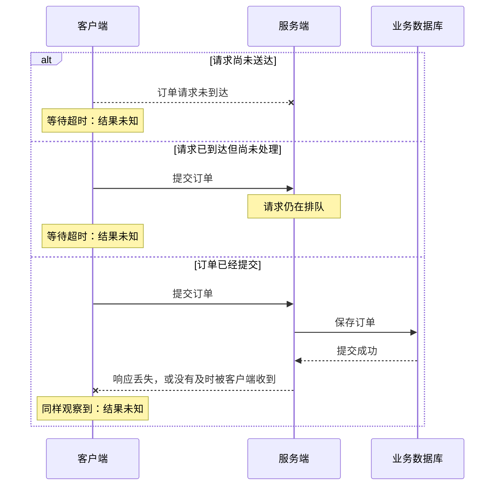
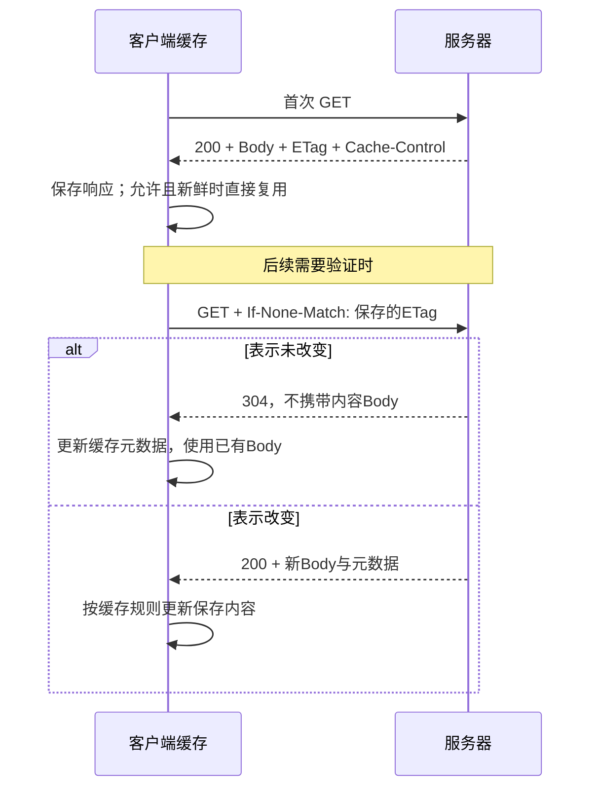
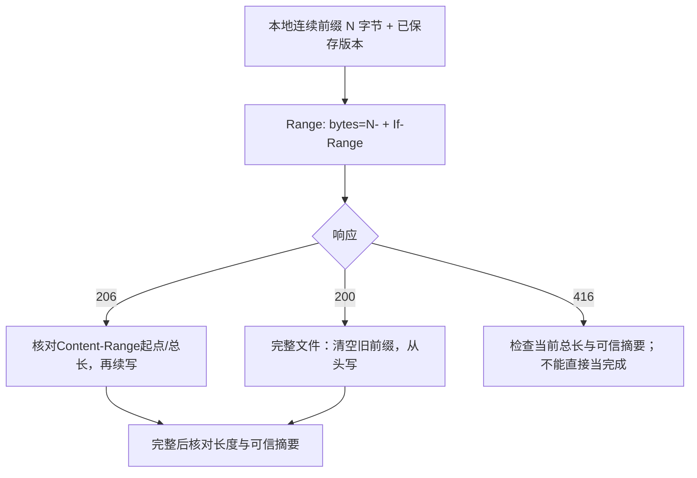

# HTTP：请求、响应与接口规则

**TCP 负责把字节送到对端，HTTP 约定这些字节表达什么请求、什么结果。** JSON 只是 Body 的一种数据格式，不是另一套传输协议。

前置：[Socket 与消息边界](./socket.html)。先看能直接读懂的 HTTP/1.1，再比较 [HTTP/2 与 HTTP/3](./http-versions.html)。

## 1. 一次请求，客户端和服务器各做什么



HTTP 是**请求—响应**协议，不保证一个连接只发生一次交互。一次连接可以承载多个请求；响应到达也不等于业务一定成功。[HTTP 语义](https://www.rfc-editor.org/rfc/rfc9110.html#section-3)

### 直接拆开一份报文


- **先读首行，再看字段，空行之后才是 Body。** 本例 GET 请求没有 Body，响应有。
- **长度数的是字节。** 线上行结束为 `CRLF`；不是编辑器里显示多少个汉字。

图中域名是保留示例名，JSON 用来解释结构；实验响应的字段和正文以脚本实际输出为准。

`Content-Type` 说“我发的是什么”；`Accept` 说“我愿意接收什么”。JSON、图片、文件都可通过 HTTP 传输，客户端必须选择相应读取方式。

## 2. 方法与状态：先看约定，再看实现

### GET、POST、PUT、DELETE 怎么理解

| 方法 | 常见用途 | 按语义是否幂等 |
| --- | --- | --- |
| GET | 读取资源 | 是；安全方法不应被设计为发起业务修改 |
| POST | 提交处理、创建、执行动作 | 不保证，需看业务约定 |
| PUT | 将目标资源替换为给定表示 | 是 |
| DELETE | 删除目标资源的关联 | 是 |

**幂等描述重复请求的预期效果，不是“每次返回一样”。** 重复 DELETE 可能先返回成功、后返回未找到；服务端若把扣款放进 GET，方法名也不会自动保护数据。[方法语义](https://www.rfc-editor.org/rfc/rfc9110.html#section-9)

### 三种“失败”不要混在一起

| 观察层 | 例子 | 接下来检查什么 |
| --- | --- | --- |
| 连接/传输失败 | 拒绝连接、读取超时、TLS失败 | 地址、网络、连接与证书；可能没有HTTP响应 |
| HTTP 错误 | 400、401、403、404、503 | 状态、字段和错误Body；已经有HTTP响应 |
| 业务失败 | HTTP200，JSON里的业务code表示失败 | 按接口约定处理登录态、余额、参数等 |

`401` 与认证凭据有关，`403` 表示服务器拒绝执行；`404` 表示未找到或不愿披露资源。`502` 常见于网关拿到无效上游响应，不能直接归因于客户端网络差。

## 3. JSON 如何变成对象，身份信息放哪里

### JSON 是字节之上的结构

发送端：对象 → JSON 序列化 → UTF-8 字节 → HTTP Body。接收端反过来解析，并校验必需字段、类型与业务取值。

```http
POST /echo HTTP/1.1
Host: notes.example
Content-Type: application/json
Content-Length: 15

{"name":"Lily"}
```

不要手工拼接带用户输入的 JSON。收到 `Content-Type: text/html` 的代理错误页时，也不能不检查就当 JSON Bean 解析。

下面把对象真正发给本机实验的 `/echo`：先按[实验说明](/assets/network/README.txt){download="network-README.txt"}启动 HTTP 服务，把代码保存到 `network_lab.py` 同一目录后运行。

```python
import http.client
import json
from network_lab import HOST, HTTP_PORT, IO_TIMEOUT

value = {"name": "小明", "tags": ["网络", "HTTP"]}
body = json.dumps(value, ensure_ascii=False, allow_nan=False).encode("utf-8")
conn = http.client.HTTPConnection(HOST, HTTP_PORT, timeout=IO_TIMEOUT)
try:
    conn.request("POST", "/echo", body=body, headers={
        "Content-Type": "application/json",
        "Content-Length": str(len(body)),  # UTF-8字节数，不是len(JSON字符串)。
    })
    response = conn.getresponse()
    print("HTTP", response.status, response.getheader("Content-Type"))
    print(json.loads(response.read()))  # 本实验的成功/错误Body都约定为JSON。
finally:
    conn.close()  # 请求、读取或解析失败也释放连接。
```

预期得到 HTTP200，`data` 中还原原对象。`ensure_ascii=False` 保留中文，`allow_nan=False` 拒绝输出非标准 NaN/Infinity；普通中文经 UTF-8 编码后，一个字符可能占多个字节。[Python JSON](https://docs.python.org/3.11/library/json.html#json.dumps)、[HTTPConnection.request](https://docs.python.org/3.11/library/http.client.html#http.client.HTTPConnection.request)

### Cookie、Session、Token 各是什么

先分清**怎么携带凭据**与**服务器怎么判断身份**：



- **Cookie 是浏览器的数据保存与附带机制**，可由 `Set-Cookie` 设置；Session 是服务端状态，标识本身不是整份状态。
- **Token 是凭据**，不一定是 JWT。图中是两种常见组合，Token 也能放进 Cookie，它们不互斥。

Bearer 的含义是持有者可使用凭据，应通过 HTTPS 传输并避免泄漏到 URL 和日志。Cookie 常用 `Secure`、`HttpOnly` 和恰当的 `SameSite`；它们各有限定，不能替代服务端授权。[Cookie](https://developer.mozilla.org/en-US/docs/Web/HTTP/Guides/Cookies)、[Bearer 凭据](https://www.rfc-editor.org/rfc/rfc6750.html#section-2.1)

**CORS 是浏览器的跨源访问机制，不是服务器的身份认证。** 页面能发出或读取什么，与服务端是否允许这个账号执行操作，是两件事。

## 4. 超时以后，能不能重试

下单后一直转圈，不能据此认定“没下单成功”。**读取超时是客户端的观察，不是业务回滚证明。**



图只列几种可能，不列举所有超时原因。服务端还可能正在执行；客户端要查询状态或按约定重试，而不是自行断言结果。

对会产生副作用的操作，应使用服务端支持的幂等键、订单号或查询确认机制；服务端需要记录和复用结果，不能只给请求加一个字段就宣称幂等。

重试还要限制次数与总时间，并考虑退避、`Retry-After` 和业务状态。不要把所有 HTTP 错误都当成可以自动重试的网络错误。[重试边界](https://www.rfc-editor.org/rfc/rfc9110.html#section-9.2.2)

## 5. 缓存：不必每次重新传完整内容

缓存先检查已有响应是否允许复用、是否仍然新鲜；需要验证时，再向服务器确认版本。



- `max-age`：控制新鲜期；还需考虑响应年龄和请求约束。
- `no-cache`：可以存，但复用前需要成功验证；不是“不保存”。
- `no-store`：要求不要存储这次请求/响应；不是自动删除所有历史缓存的命令。
- `private`：限制共享缓存存储，不是把内容加密。

`ETag` 是表示的版本校验标识，不保证是文件哈希。缓存键还可能受到 `Vary` 等字段影响，不能只拿 URL 查一个字典就完整实现 HTTP 缓存。[HTTP 缓存规范](https://www.rfc-editor.org/rfc/rfc9111.html#section-4)

## 6. Range：只取文件的一部分

假设文件有 10 字节，本地已连续保存 4 字节。**下一字节编号是 4**，所以请求 `Range: bytes=4-`。




例如 `Content-Range: bytes 4-9/10`：本次 Body 是 6 字节，完整表示是 10 字节。`206` 的 Content-Length 若存在，描述本次片段，不是完整文件大小。

资源可能换版本，因此还要带 `If-Range`；不能把新版后半段拼到旧版前半段。只允许强 ETag 用作 If-Range 的实体标识；完整流程见 [OkHttp 断点续传](../android/libraries/okhttp.html#resumable-download)。

### HTTP/1.1 怎样知道 Body 在哪里结束

常见方式是有效的 `Content-Length`、`Transfer-Encoding: chunked`，或适用时以连接关闭结束响应。HEAD 响应、204、304 等还有无内容的专门规则。

**chunked 分块不是断点续传，也不是 TCP 分段。** 本实验普通响应给出长度，SSE 用合法的连接关闭定界；生产程序应交给成熟 HTTP 实现解析。[HTTP/1.1 消息长度](https://www.rfc-editor.org/rfc/rfc9112.html#section-6.3)

## 7. 动手：看到真实请求和响应

下载 [实验脚本](/assets/network/network_lab.py){download="network_lab.py"}和[实验说明](/assets/network/README.txt){download="network-README.txt"}，在终端 A 运行：

```sh
python network_lab.py http-server
```

终端 B 查看正常、HTTP错误、业务错误和缓存：

```sh
python network_lab.py http-client --path /health
python network_lab.py http-client --path /status/503
python network_lab.py http-client --path /business-error
python network_lab.py http-client --path /cache
python network_lab.py http-client --path /echo --method POST --data 42
```

记录 `/cache` 返回的 ETag，下一次通过 `--header` 传入原值；请求格式见脚本说明。应看到 304 无内容 Body，而不是完整 JSON 再传一次。

这里的 `42` 是合法 JSON 数字，避免不同终端的复杂引号差异。POST `/echo` 可以观察编码和 Body；`/file` 可以观察范围响应。端口来自脚本常量，不需要猜测。

**这些是本机 HTTP/1.1 实验，不验证公网 HTTPS 或 HTTP/2/3。**

自测：200 一定业务成功吗？为什么 no-cache 仍可保存？POST 超时为何不能直接重试？收到 200 完整文件时为什么不能续写？

下一篇：[HTTP/1.1、HTTP/2 与 HTTP/3](./http-versions.html)。
