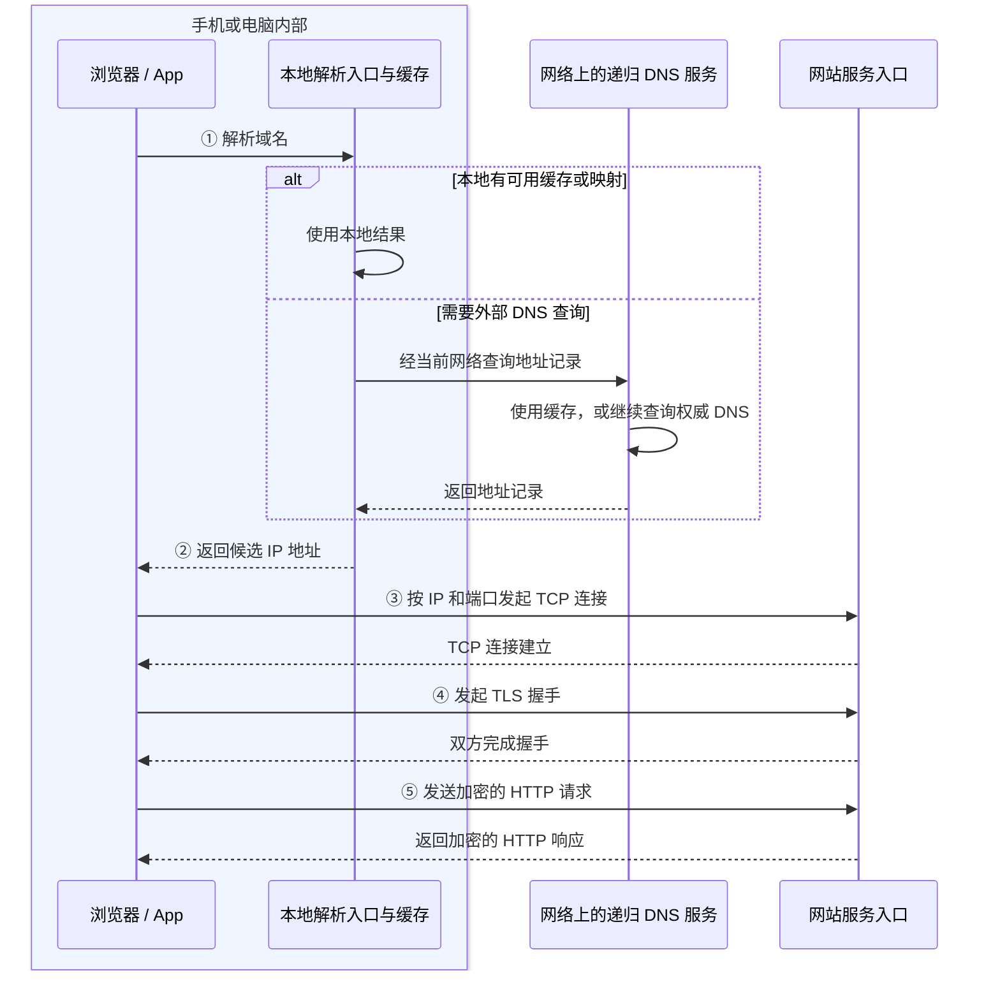
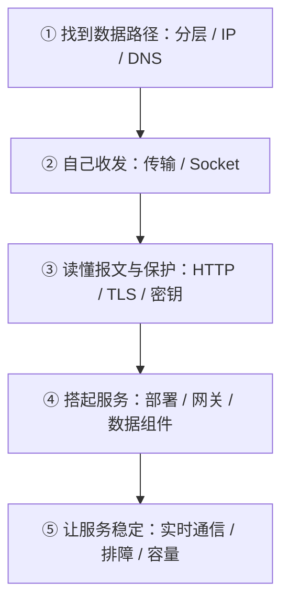

# 网络通信：从一串字节到可用的服务

**手机输入一个网址，另一台机器为什么能收到请求，再把页面送回来？** 先沿着这件事建立全景，再逐层拆开协议，最后自己编程、部署和排错。

先看图找到数据经过谁，再读关键报文、代码和易错点。下面五个阶段可以顺序学，也可以直接进入正在遇到的问题。

## 先建立这张地图

<figure>
  
  <figcaption>设备怎样连在一起：双向箭头表示可以往返通信，不表示调用先后。点击图片可放大。</figcaption>
</figure>

- **从哪里上网？** 手机可选 Wi-Fi 或移动网络；图中的电脑通过网线连接路由器，也可以改用 Wi-Fi。
- **怎么找到服务？** 应用先从设备内的解析入口取得地址；本地没有可用结果时，解析器再通过网络询问 DNS 服务。
- **谁来处理请求？** 请求经互联网到达服务入口，再交给应用服务；需要时读写缓存或数据库，结果沿网络返回。

### 一次新连接：先解析地址，再连接网站

下面选择**设备使用系统解析器、直接连接 HTTPS 网站、没有现成连接**的场景。设备已经能上网；DNS 查询本身也要使用网络，不是联网之前的步骤。



**记住两条路：** DNS 帮应用找地址；业务连接负责传内容。设备内解析入口与网络上的递归服务是两个角色。[AOSP DNS Resolver](https://source.android.com/docs/core/ota/modular-system/dns-resolver)、[DNS 角色](https://www.rfc-editor.org/rfc/rfc9499.html#section-6)

- 缓存命中、直接用 IP 或复用连接时，可能无需外部 DNS 查询；浏览器 DoH、代理代解析见 [DNS](./dns.html)。
- 图按阶段合并握手：HTTP/3 改用 QUIC；入口之后是否继续加密，取决于部署。

## 按五个阶段学习



## 第一阶段：看懂一次通信

先解决“谁和谁说话、对方在哪里”，暂时不钻进算法。

- **[一次访问与网络分层](./overview.html)**：网址、浏览器、操作系统和服务器分别做什么？为什么分层？
- **[IP、端口与路由](./ip-routing.html)**：怎样找到机器和进程？数据为什么先经过网关？
- **[域名与 DNS](./dns.html)**：域名怎样得到地址？改完解析为什么没有立即生效？

## 第二阶段：自己收发字节

从“网络帮我传数据”进入“程序怎样使用网络”。

- **[TCP、UDP 与 QUIC](./transport.html)**：区分字节流和数据报，解释握手、重传、流控与拥塞控制。
- **[Socket 与消息边界](./socket.html)**：写客户端与服务端，正确处理短读、长度前缀、超时和关闭。

## 第三阶段：读懂协议与安全通信

先读懂明文请求，再看为什么需要新传输方式，以及怎样保护内容。

- **[HTTP 报文、缓存与重试](./http.html)**：方法、状态、Header、Body、JSON、身份、缓存、续传怎样配合？
- **[HTTP/1.1、HTTP/2 与 HTTP/3](./http-versions.html)**：多路复用解决什么，为什么仍会有队头阻塞？
- **[加密、签名与密钥](./cryptography.html)**：编码、哈希、HMAC、签名、AEAD、密钥协商有什么不同？
- **[HTTPS、TLS 与证书](./tls.html)**：证书怎样证明身份？两端怎样得到相同密钥，却不传输私钥？

## 第四阶段：服务端组件与部署

让原理变成一个能访问、能观察、能定位问题的系统。

- **[服务端架构与组件分工](./service-architecture.html)**：MySQL、Redis、消息队列、对象存储分别存什么、负责什么？
- **[服务器部署与反向代理](./deployment.html)**：分清域名、监听、入口、代理、应用、数据库及 TLS 终止位置。
- **[Nginx、网关与负载均衡](./gateway-load-balancing.html)**：正反代理、四层七层分发、健康判断和故障转移怎样工作？
- **[Redis 原理与缓存实践](./redis.html)**：数据结构、TTL、持久化、复制与缓存一致性怎样配合？

## 第五阶段：实时通信、排障与运维

- **[长连接、推送与实时协议](./realtime.html)**：按通信方向、消息模型与恢复要求选择 SSE、WebSocket、MQTT 或 gRPC。
- **[分层排障与性能分析](./diagnostics.html)**：根据证据区分解析失败、拒绝连接、证书错误、HTTP 错误与业务失败。
- **[QPS、容量与可观测性](./capacity-observability.html)**：理解请求速率、并发、尾延迟和可用性，用指标、日志和追踪定位瓶颈。

遇到 Nginx、QPS、TPS、p99、熔断等陌生词，先看 [网络与运维术语速查](./glossary.html)，再回到对应原理篇；不必一次背完。

## 一套可以跑起来的本地实验

先把 [network_lab.py](/assets/network/network_lab.py){download="network_lab.py"} 保存到自己的实验目录，需要 **Python 3.11 或更高版本**，不需要第三方依赖。所有默认服务仅监听当前电脑的回环地址，不会自动发布到公网。

终端 A 启动服务：

```sh
python network_lab.py http-server
```

终端 B 发起请求：

```sh
python network_lab.py http-client
python network_lab.py http-client --path /status/503
python network_lab.py http-client --path /events --stream
```

再用启动时打印的地址打开**本地实验页面**，点击 Receive SSE 看事件逐条出现。不同终端命令如何配对，以及 Socket、缓存、Range 实验，见 [实验说明](/assets/network/README.txt){download="network-lab-README.txt"}。


脚本中的 `HOST`、`TCP_PORT`、`UDP_PORT`、`HTTP_PORT`、`MAX_FRAME` 是实验参数的唯一来源；用 `python network_lab.py urls` 查看地址。手机上的 localhost 指向手机自己，不能直接代替电脑的监听地址。

**知识站负责展示笔记，实验脚本在你电脑上运行。** GitHub Pages 可以展示 HTML 和提供附件下载，不能执行这些 Python 服务；本地 HTTP 演示也不等于完成公网 HTTPS 部署。

## 怎样从看懂走向熟练

用四步自测：**看图复述路径 → 跑通示例 → 改一个参数 → 按证据解释结果**。TLS、HTTP/2、HTTP/3 与公网部署另有环境前提，见对应章节。

已经在写 Android 网络代码，可以把这里的协议原理与 [OkHttp / Retrofit 实战](/android/libraries/okhttp.html)对照；需要 HTTP 文件续传代码时，直接看 [完整续传示例](/android/libraries/okhttp.html#resumable-download)。
