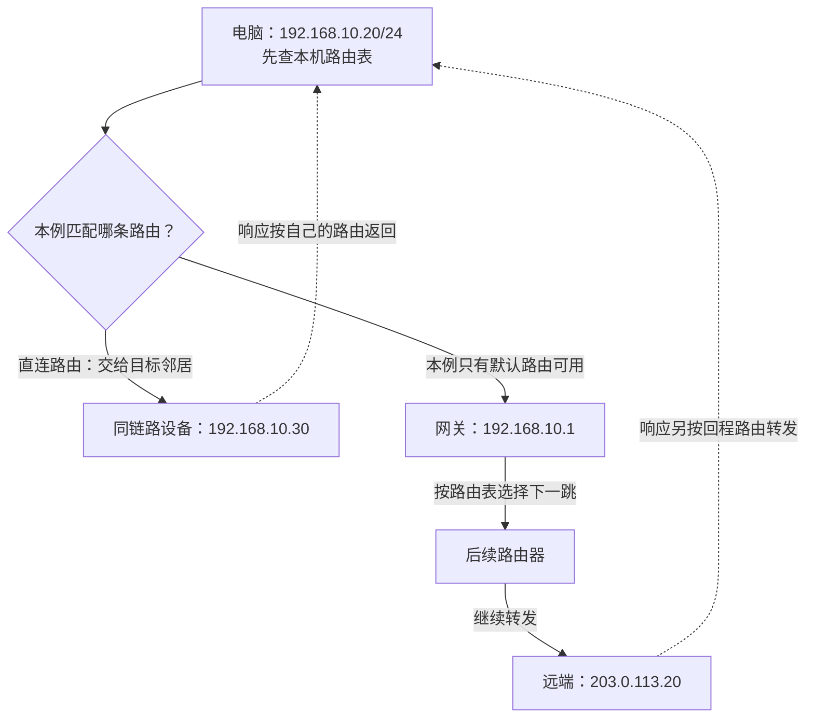
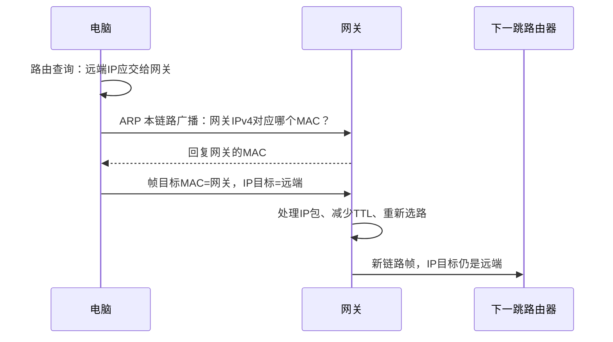

# IP、端口与路由：数据怎样找到另一端

像送快递：同一栋楼可以直接送；远方地址先交给负责下一段的人。电脑也是先查路由表，**确定出接口与下一跳，再封装当前链路的帧。**

## 1. 先分清：机器地址和程序端点

- **IP 地址**：网络接口在某个地址范围中的地址；设备可以有多个接口、多个 IP，地址也会改变。
- **端口**：TCP/UDP 等传输协议用来区分端点的编号；IP 头里没有 TCP 端口。
- **网关**：通向其他网络的下一跳路由器；默认网关只是在没有更具体匹配路由时使用。

```text
https://notes.example/
        ↓ 名称解析和地址选择
目标IP + TCP端口443
        ↓ IP路由
下一跳 + 出接口
        ↓ 当前链路交付
到邻居，再由它继续转发
```

图中的公网地址使用文档保留地址；私网地址也仅用于示意，不是当前设备实测结果。[文档地址范围](https://www.rfc-editor.org/rfc/rfc5737.html#section-3)

## 2. 同网段直接交给对方，跨网段先交给网关

假设电脑地址是 `192.168.10.20/24`，当前网络前缀是 `192.168.10.0/24`。访问同链路的 `192.168.10.30` 与远端 `203.0.113.20`，下一跳不同。



实线是去程；虚线概括响应，不表示中间没有路由器，**回程也不保证沿原路**。下面另加一条更具体路由，看下一跳怎样变化。

### `/24` 到底是什么意思

IPv4 地址有 32 位；`/24` 表示前 24 位是网络前缀，对应掩码 `255.255.255.0`。判断目标是否匹配该前缀，看前缀位是否相同，**不是固定比较“前几个点分数字”**。

```python
import ipaddress

network = ipaddress.ip_network("192.168.10.0/24")
print(ipaddress.ip_address("192.168.10.30") in network)  # True
print(ipaddress.ip_address("203.0.113.20") in network)  # False
```

CIDR（Classless Inter-Domain Routing，无类别域间路由）让前缀长度可变，不需要按旧式 A/B/C 类地址判断网络范围。[CIDR 原理](https://www.rfc-editor.org/rfc/rfc4632.html#section-3.1)、[Python ipaddress](https://docs.python.org/3/library/ipaddress.html)

### 路由表怎样选：先比谁更具体

下面是概念路由表，不是当前机器的输出：

```text
目的前缀             下一跳             出接口
192.168.10.0/24       直连               LAN
203.0.113.0/24        192.168.10.2       LAN
0.0.0.0/0            192.168.10.1       LAN
```

去 `203.0.113.20` 同时匹配 `/24` 与 `/0`，选**最长匹配前缀 `/24`**。同等前缀还有优先级、度量等选择规则；策略路由、VPN 与多网卡也会影响最终路径。

**默认路由是兜底，不是所有包都先送给默认网关。** 目标在本机、直连网段或存在更具体路由时会走其他路径。[IPv4 路由选择](https://www.rfc-editor.org/rfc/rfc1812.html#section-5.2.4.3)

## 3. IP 找远方，链路地址找当前邻居

以以太网承载 IPv4 为例：IP 层选择下一跳后，还要知道这个邻居的 MAC 地址，才能构造当前链路的帧。ARP（Address Resolution Protocol，地址解析协议）负责在本链路查询 IPv4 邻居的链路地址。



- 电脑通常查的是**网关 MAC**，不是跨互联网广播查询远端服务器的 MAC。
- 路由器转发时换成下一段链路的封装；目标 IP 通常不变，但 NAT、隧道等场景有额外处理。
- ARP 查询可能命中邻居缓存，不会每个包都重新广播。[ARP 定义](https://www.rfc-editor.org/rfc/rfc826.html)

IPv6 使用邻居发现 NDP（Neighbor Discovery Protocol），通过 ICMPv6 完成邻居链路地址解析等工作，**不使用 IPv4 的 ARP**。[IPv6 邻居发现](https://www.rfc-editor.org/rfc/rfc4861.html#section-3.1)

### 把 IP 头当成转发说明书

```text
IPv4头的部分字段
源IP / 目标IP      从哪里来、准备到哪里去
TTL                转发跳数预算，避免无限循环
Protocol           后面交给TCP、UDP还是其他协议
Total Length       当前IP包长度
分片相关字段        当前包是否是一个大包的片段
```

IPv4 路由器转发时减少 TTL（Time To Live），降为零时丢弃并通常返回 ICMP 超时报文；IPv6 对应字段叫 **Hop Limit**。TTL 不等于 DNS 的缓存 TTL，也不是应用超时时间。[IPv4 头](https://www.rfc-editor.org/rfc/rfc791.html#section-3.1)、[IPv6 基本头](https://www.rfc-editor.org/rfc/rfc8200.html#section-3)

## 4. 家里很多设备，为什么能共用一个公网地址

家用路由器常用 NAPT：Network Address Port Translation，网络地址端口转换。它记录私网端点与公网映射端点，让返回数据能找到内部设备。


- **出去改源，回来还原目标**：到 `q` 的回包查表送给 A，到 `r` 的送给 B。
- 映射不只是一张永久端口表：协议、目标、过滤规则和状态超时都可能影响处理。[传统 NAT/NAPT](https://www.rfc-editor.org/rfc/rfc3022.html#section-2)

**NAT 不是加密，也不能代替业务授权或防火墙。** 外部主动访问私网服务，还涉及公网可达性、端口映射、运营商级 NAT 与入站规则；仅把本机程序运行起来并不足够。

### 常见地址不要混用

- `127.0.0.1` / `::1`：回环，访问当前设备自己。
- `192.168.0.0/16`、`10.0.0.0/8`、`172.16.0.0/12`：IPv4 私网范围，不能当作公网全局地址直接路由。
- `0.0.0.0` 作为服务端 IPv4 监听地址：绑定所有本地 IPv4 接口；它不是应该填到手机浏览器里的服务器目标地址。
- 有公网 IP：也不代表端口已开放、程序已监听或 TLS 配置正确。

[私有地址范围](https://www.rfc-editor.org/rfc/rfc1918.html#section-3)、[Python Socket 地址与绑定](https://docs.python.org/3/library/socket.html#socket-families)

## 5. 深入一层：包太大时会发生什么

**MTU 管整只箱子，MSS 管其中的 TCP 数据。** IP 头、TCP 头也占空间，不能直接把两者画等号。


- **MTU**（最大传输单元）是单条链路的限制；路径 MTU 看沿途最小限制。
- **MSS**（最大报文段大小）针对 TCP 数据，不包含 IP/TCP 头。通告的 MSS 是上限，不保证每段发满。[MSS 与实际发送大小](https://www.rfc-editor.org/rfc/rfc9293.html#section-3.7.1)

IPv4 在条件允许时可分片；设置 Don't Fragment 时，过大的包需要依赖 ICMP 提示与路径 MTU 发现等机制调整。**IPv6 的路由器不替源端分片**，源端需调整包大小，必要时由源端使用分片扩展头。[IPv4 PMTUD](https://www.rfc-editor.org/rfc/rfc1191.html#section-2)、[IPv6 MTU 与分片](https://www.rfc-editor.org/rfc/rfc8200.html#section-5)

隧道与 VPN 增加额外头部，可能压缩可用空间；“小请求能通、大文件卡住”时，要把 MTU/ICMP/丢包作为候选，而不是立即归因于 HTTP。

## 6. 在自己的电脑上看证据

下列只读命令适用于标注的平台。看实际输出中的**接口、地址前缀、下一跳**，不要把示例网段当成自己的网络。

```powershell
# Windows PowerShell
Get-NetIPConfiguration
Get-NetRoute -AddressFamily IPv4
```

```sh
# 安装了iproute2的Linux
ip address show
ip route show
```

命令依据：[Windows IP 配置](https://learn.microsoft.com/en-us/powershell/module/nettcpip/get-netipconfiguration)、[Windows 路由表](https://learn.microsoft.com/en-us/powershell/module/nettcpip/get-netroute)、[Linux 地址](https://man7.org/linux/man-pages/man8/ip-address.8.html)、[Linux 路由](https://man7.org/linux/man-pages/man8/ip-route.8.html)。

可以从[统一实验脚本](/assets/network/network_lab.py){download="network_lab.py"}启动本机 HTTP 服务：

```sh
python network_lab.py http-server
python network_lab.py http-client
```

这个请求走回环，不经过家中路由器。想验证局域网跨设备路径，需要另行配置自有服务的监听与防火墙；见[部署笔记](./deployment.html)，不要把公共实验端口擅自暴露出去。

## 7. 用三个问题检查理解

1. 目标在远端时，电脑发出的帧目标 MAC 是服务器的，还是下一跳的？**下一跳的。**
2. 默认路由与更具体的路由都匹配时选谁？**通常先选最长匹配前缀，再比较同级规则。**
3. 手机打开 `127.0.0.1` 能访问电脑上的程序吗？**不能；它指向手机自己。**

[上一篇：一次通信全景](./overview.html) · 下一篇：[域名与 DNS](./dns.html)
