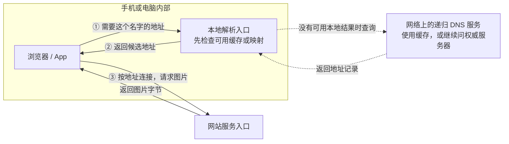
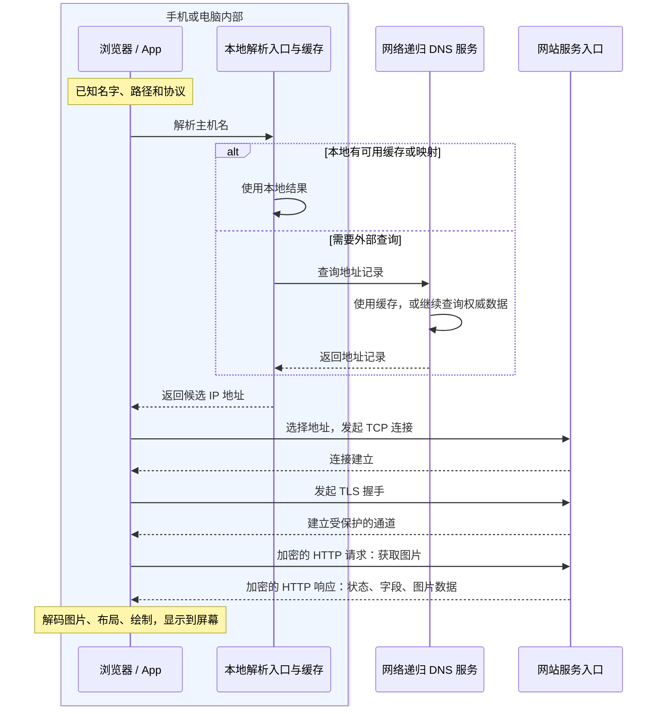

# 一次通信：从手机点开图片开始

点开一张照片，屏幕上不会凭空出现图片：**先找到服务入口，再请求图片，收到字节后才解码显示。** 网络负责交换数据，图片长什么样由应用解释。

## 1. 先分清设备内外的角色



- **App 发业务请求，网站服务返回内容。** 两者是客户端与服务器，描述本次交互的职责。
- **本地入口查名字，递归服务按需继续查。** DNS（域名系统）只提供记录，**不转发图片**。

本地解析入口与网络递归服务是两个角色；**本地已有可用结果，就跳过虚线外查**。图选择应用使用系统解析器的路径，浏览器自带 DoH 等例外见[域名与 DNS](./dns.html)。[DNS 解析角色](https://www.rfc-editor.org/rfc/rfc9499.html#section-6)

同一台电脑可以同时运行客户端和服务器，不需要给设备永久贴上其中一种身份。

### 地址、名字和门牌分别是什么

用这个示例地址拆开看：

```text
https://notes.example:443/photos/cat.webp
└ 协议  └ 主机名      └端口 └ 资源路径
```

**域名方便人记忆，IP 地址用于网络寻址，端口用于区分传输端点，路径由应用解释。** `https` 没写端口时默认使用 443；路径不是服务器磁盘文件路径的保证。

`notes.example` 与后文的 `203.0.113.20` 都是文档示例，不能拿来连接真实服务。[保留示例域名](https://www.rfc-editor.org/rfc/rfc2606.html#section-3)、[文档示例 IPv4 地址](https://www.rfc-editor.org/rfc/rfc5737.html#section-3)

## 2. 从“想要图片”到“拿到图片”

下图选择**应用使用系统解析器、直接连接网站、需要新建 HTTPS/TCP 连接**的路径。设备已经联网，外部 DNS 查询也要经过网络；HTTP/3 使用 QUIC，不照搬 TCP 阶段。



TCP 与 TLS 按阶段合并展示，省略各自报文；TLS 仍要验证服务身份并建立密钥，HTTP/2 还会初始化连接参数。名称解析得到的是连接线索，**网站内容随后经业务连接传输**。[AOSP DNS 模块的查询与缓存职责](https://source.android.com/docs/core/ota/modular-system/dns-resolver)

把过程压成一条线：**查地址 → 建通道 → 请求内容 → 应用显示**。DNS、连接、HTTP 是不同工作；前一步成功不保证后一步成功。

真实访问可能命中 DNS 缓存、复用已有连接或命中内容缓存，**不是每次点图片都会重新做所有步骤**。代理、CDN 也可能让浏览器连接到边缘节点，而不是最终业务机器。[HTTP 连接与中间节点模型](https://www.rfc-editor.org/rfc/rfc9110.html#section-3)

### 请求和响应长什么样

先看没有 TLS 的 HTTP/1.1 概念报文，便于看见边界；HTTPS 中这些内容会受加密保护。

```http
GET /hello HTTP/1.1
Host: notes.example
Accept: text/plain

```

```http
HTTP/1.1 200 OK
Content-Type: text/plain; charset=utf-8
Content-Length: 5

hello
```

- 空行把字段区与正文分开；线上换行是 `\r\n`。
- `Content-Length: 5` 说的是正文的**字节数**，不是“5 个任意语言字符”。
- `200` 是 HTTP 状态；业务是否成功，还要看接口定义与正文。

这里的报文只解释结构，不是下方实验接口的逐字输出。HTTP/2、HTTP/3 沿用请求/响应语义，但在线路上不用这样的文本首行传输。[HTTP/1.1 报文格式](https://www.rfc-editor.org/rfc/rfc9112.html#section-2)

## 3. 为什么要分层：各做一件事

应用说“取 `/cat.png`”；传输层管字节交付，IP 层管逐跳寻址，链路层和物理传输把数据送到当前邻居。**每层只需理解自己负责的信息。**

### 看图认识 OSI 七层 {#osi-layers}


先记三句话：**上三层管“怎么说”，传输层管“端点间怎么交付”，下面三层管“怎么送过去”。**

- **OSI 是职责模型**，不是每次请求都调用七个独立模块；会话层也不等于网站的登录会话。
- **Internet 常讲四层**；把物理传输单列，就得到常见五层教学图。
- **TLS 不硬塞一层**：常见 HTTPS 是 `HTTP → TLS → TCP → IP`；HTTP/3 走 QUIC，见[协议演进](./http-versions.html)。

依据：[OSI 基本模型 X.200 §6–7](https://www.itu.int/rec/T-REC-X.200-199407-I/en)、[Internet 分层 RFC 1122 §1.1.3](https://www.rfc-editor.org/rfc/rfc1122.html#section-1.1.3)。

### 封装：同一份内容，外面逐层加信息 {#encapsulation}


- **发送时加，接收时拆**；路由器转发 IP 包，换上下一跳需要的链路封装。
- **不是一条消息一个包**：TCP 只看字节流，一条 HTTP 消息可能跨多个 TCP 段，多次写入也可能合并。
- 图用明文 HTTP 简化封装；HTTPS 先经过 TLS，TCP 承载的是 TLS 字节。[字节流边界](https://www.rfc-editor.org/rfc/rfc9293.html#section-2.2)

### 数据进入内核后，谁接手


- **send 把字节交给本机，recv 从本机接收缓冲取字节。** 传输确认不等于对方业务完成。
- 发送受窗口与拥塞约束；对方应用不读，积压会影响整条链路。消息怎样拼完整，见[Socket 分帧](./socket.html)。

<details>
<summary>为什么抓包中的段大小不一定等于应用写入大小</summary>

TCP 自己选择分段；网卡卸载与抓取位置也影响看到的形态。一次写入、一个 TCP 段、一次读取没有固定对应关系。

</details>

<details>
<summary>想看其他图解：本节参考的讲解方式</summary>

- [小林 coding：TCP/IP 网络模型](https://xiaolincoding.com/network/1_base/tcp_ip_model.html)：用具体协议与封装图逐层解释。
- [Practical Networking：OSI Model](https://www.practicalnetworking.net/series/packet-traveling/osi-model/)：把每层职责放回设备、链路与逐跳传递中理解。
- [Beej：The Layered Network Model](https://beej.us/guide/bgnet0/html/split/the-layered-network-model.html)：从实际 HTTP 请求看头部逐层包裹。

本站图为重新绘制；模型定义与协议行为以上面的标准为依据。

</details>

## 4. 通信模型：谁先说，谁能说

**客户端—服务器**描述角色：一方提供服务，另一方使用服务。**请求—响应**描述交互：发一个请求，得到对应响应；二者不是同一个分类维度。

看图片采用**请求—响应**：浏览器要某张图片，服务端返回对应结果。TCP 能双向传字节，不代表应用已实现心跳、断线补发或业务确认。

<details>
<summary>还有哪些常见交互方式</summary>

- **发布—订阅**：设备把消息交给代理，订阅者接收关心的主题；还要约定保留、重复和投递语义。
- **点对点 P2P**：参与者也为其他参与者提供能力；发现、穿透和身份验证仍需解决。

请求—响应描述交互方式，P2P 描述参与者组织方式，不宜当作互斥的协议分类。

</details>

## 5. 第一次动手：在自己电脑里走通一轮

下载[统一实验脚本](/assets/network/network_lab.py){download="network_lab.py"}，保存后进入所在目录；运行环境与所有子命令见[实验说明](/assets/network/README.txt){download="README.txt"}。

```sh
# 终端一：启动本机HTTP服务，地址与端口由脚本打印。
python network_lab.py http-server

# 终端二：请求同一个服务，打印状态、字段与正文。
python network_lab.py http-client
```

再用电脑浏览器打开脚本打印的 `/health` 地址，开发者工具的 Network 面板看：请求方法、状态、字段、正文。该实验只监听回环地址；服务器运行在电脑时，**手机的 `127.0.0.1` 指向手机自己**，不能直接照抄电脑的本地地址。

这一步验证本地 HTTP 请求/响应，不代表已经验证 DNS、TLS 或公网部署；如何把自己的服务给其他设备访问，见[服务器部署](./deployment.html)。

## 6. 先避开这些误解

- **“域名就是服务器”**：名字可以指向不同地址，地址后也可能是代理或多台后端。
- **“连上就代表成功”**：TCP 连接成功、TLS 握手成功、HTTP 成功、业务成功是不同阶段。
- **“包收到就是处理完成”**：传输确认不等于应用已经保存或执行业务。
- **“上网一定每次重新建连接”**：缓存、连接复用会改变实际路径。
- **“读完分层就会排障”**：要能用实际报错和阶段耗时，把问题定位到具体环节。

合上这一页，尝试说清：**名字找谁查、IP 负责哪段、端口区分什么、HTTP 约定什么、TLS 保护什么。** 能把它们标在第一张图上，就可以继续下一篇。

[学习路线](./index.html) · 下一篇：[IP、端口与路由](./ip-routing.html)
