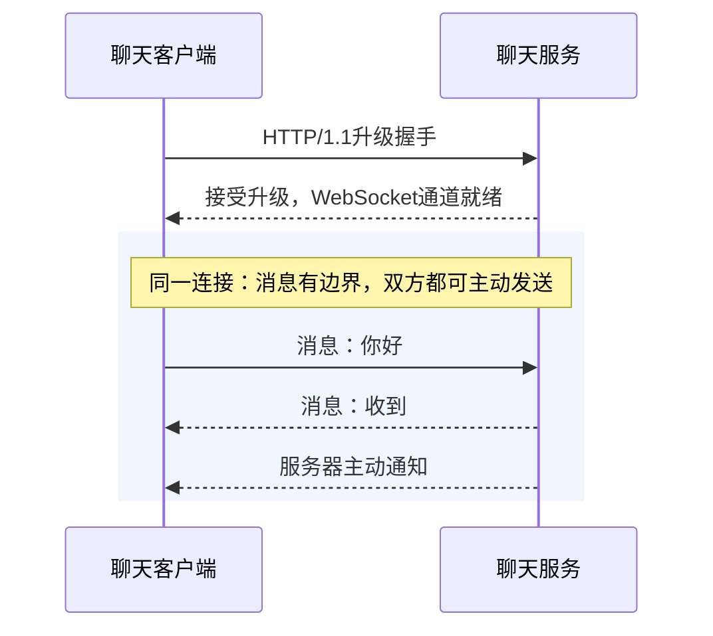
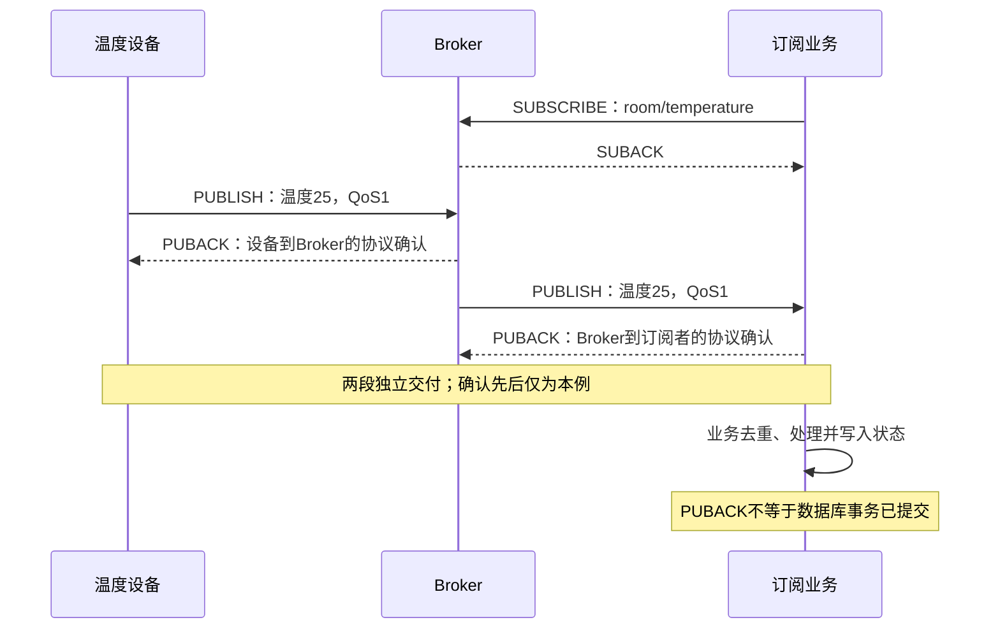
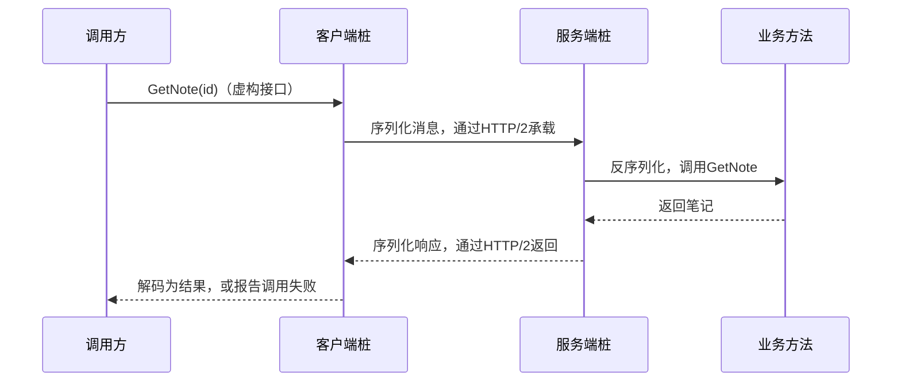
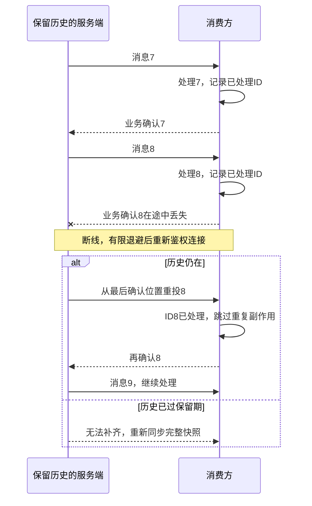

# 实时通信：让新消息及时到达

下载进度只需服务器推送，聊天需要双方主动发消息，设备上报常经消息代理。**先看数据方向和交付模型，再选协议。** “实时”表示及时交互，不保证硬实时截止时间。

前置：[HTTP](./http.html)、[Socket](./socket.html)。连接还在，不代表消息已处理；后面还要解决恢复、去重和积压。

## 1. 先看三种常见的等待方式


- **轮询：** 一次次问；更新延迟受询问间隔影响。
- **长轮询：** 无新结果时先等，有结果或超时就结束，再发下一次。
- **SSE：** 客户端先请求，服务器在同一响应中持续发事件；客户端仍可另外发HTTP请求。

场景入口：**单向进度 → SSE；双向聊天 → WebSocket；主题订阅 → MQTT；服务方法调用 → gRPC。** 这些模型可以组合，不是选了一个就不能用另一个。

## 2. SSE：把一个 HTTP 响应变成事件流

SSE是Server-Sent Events。浏览器用 `EventSource` 发起请求，服务端返回 `text/event-stream`。**先看线路文本怎样变成回调：**


```text
id: 1
event: tick
data: {"tick": 1}

event: done
data: complete

```

- **空行结束一个事件；** 无指定event时默认 `message`，data是文本，可约定为JSON。
- **UTF-8字节先解析，再派发：** 网络读取可以拆开一行、字符或空行；多个data行按标准组合。
- **id报告恢复位置：** 重连可带 `Last-Event-ID`，但服务端仍需保存历史并实现重放。

服务端及时flush，代理不能等到整份响应结束才转发。[SSE标准](https://html.spec.whatwg.org/multipage/server-sent-events.html)

### 浏览器核心代码

在**实验服务同源页面**运行：启动 `http-server`，打开其输出的根页面。不要从本知识站HTTPS页直接请求本机HTTP实验。

```javascript
const events = new EventSource('/events');

events.addEventListener('tick', event => {
  // 数据在data里，恢复位置在线路上表现为id/Last-Event-ID。
  console.log('id=', event.lastEventId, 'data=', event.data);
});

events.addEventListener('done', () => {
  // 本演示是有限事件：收到完成标记主动关闭，避免自动重连。
  events.close();
});

events.onerror = () => {
  // error不等于业务失败；检查连接状态、服务端和代理日志。
  console.log('EventSource readyState=', events.readyState);
};
```

原生EventSource不能通过构造参数任意设置 `Authorization` 头。结合实际鉴权选择同源Cookie、跨源凭据或其他流客户端；**不要把长期凭据塞进URL**。

### SSE 为什么仍然需要 HTTP 消息边界

**空行结束SSE事件，不等于结束HTTP响应。** 本实验用 `Connection: close` 定界，逐事件flush，有限事件发完真正关闭连接。

CLI的 `--stream` 到EOF退出；浏览器收到 `done` 主动 `close()`。生产持续流仍需合法HTTP framing、心跳、超时与连接资源限制。

<details>
<summary>为什么不是一行data就立即触发回调</summary>

事件按行积累；带data的完整事件在空行处分派，多行data按规则用换行组合。没有完整结束边界时，不能把某次recv里的零碎文本当成完整事件。[事件流格式](https://html.spec.whatwg.org/multipage/server-sent-events.html#event-stream-interpretation)

</details>

## 3. WebSocket：双方都能主动发消息



图选传统HTTP/1.1升级路径；每条聊天消息不会重做HTTP握手。`wss://`由TLS保护。[RFC 6455 §1](https://www.rfc-editor.org/rfc/rfc6455.html#section-1)

```javascript
// url必须是自己的WebSocket端点；本实验的/events是SSE，不是WS服务。
function connectMessages(url, onText) {
  const channel = new WebSocket(url);
  channel.addEventListener('open', () => {
    channel.send(JSON.stringify({type: 'hello'}));
  });
  channel.addEventListener('message', event => {
    if (typeof event.data === 'string') onText(event.data);
  });
  channel.addEventListener('close', event => {
    console.log('closed:', event.code);
    // 由业务安排有限退避、重新鉴权及消息恢复，不立即无限重连。
  });
  return channel; // 不再使用时调用channel.close()。
}
```

- **边界：** 消息可由多个帧组成，帧也不等于TCP段。
- **顺序：** 同一连接保留协议交付顺序，控制帧可穿插；不保证多连接、多个发布者或异步任务完成的全局顺序。
- **积压：** 经典浏览器API没有完整接收背压；发送关注 `bufferedAmount` 与队列上限。慢消费者不能靠无限内存解决。
- **重连：** 新连接不自动续上历史，需业务序号、确认和恢复规则。

[分片顺序](https://www.rfc-editor.org/rfc/rfc6455.html#section-5.4)、[消息派发](https://websockets.spec.whatwg.org/#feedback-from-the-protocol)、[WebSocket API](https://developer.mozilla.org/en-US/docs/Web/API/WebSocket)

## 4. MQTT 与 gRPC：不是换一种消息格式

### MQTT：先经过消息代理

Broker是消息代理，Topic是主题。设备与业务各连Broker，**不用直接连到彼此**。本例两段都使用QoS1：



QoS是Quality of Service，约束对应协议交付：**0至多一次；1至少一次、可重复；2恰好一次交付、需要更多状态交互。**

发布和订阅段有各自的等级与状态。**QoS2不保证业务数据库只扣款一次**；事务、崩溃恢复和消费结果仍要单独设计。[MQTT 5.0 §4.3](https://docs.oasis-open.org/mqtt/mqtt/v5.0/os/mqtt-v5.0-os.html)

### gRPC：像调用方法一样调用远端服务

IDL是接口描述语言。常见工程用 `.proto` 描述服务，生成“客户端桩”和服务端接口；**看起来像方法调用，实际仍有网络失败**。



**Protobuf是消息表示，RPC是调用模型，HTTP/2是常见承载。** 这三层不是一个概念。[gRPC核心概念](https://grpc.io/docs/what-is-grpc/core-concepts/)

原生gRPC支持一元、服务端流、客户端流和双向流；gRPC-Web的支持取决于客户端与代理，不能默认等同原生全部能力。[gRPC-Web边界](https://github.com/grpc/grpc-web#streaming-support)

## 5. 消息可靠：通道之外还要做什么

**“8已经处理，确认却丢了”是最容易产生重复副作用的窗口。** 下图的确认是业务约定，不是TCP ACK或MQTT PUBACK：



- **去重记录也要可靠：** 必要时与业务副作用原子提交，否则崩溃仍可能导致重复或漏处理。
- **恢复依赖双方约定：** 消息ID、确认位置、保留窗口和历史重放缺一不可；不保留历史就无法凭空补回。
- **心跳只帮助发现失联：** 不能证明业务完成；另限消息大小、连接数、发送队列，处理鉴权过期和慢消费。

移动端长期保活还有省电、后台调度成本，不能只根据协议名字判断。

## 6. 动手：观察事件逐条到达

下载[实验脚本](/assets/network/network_lab.py){download="network_lab.py"}和[说明](/assets/network/README.txt){download="network-README.txt"}。一个终端启动服务，另一个执行客户端：

```sh
python network_lab.py http-server
```

```sh
python network_lab.py http-client --path /events --stream
```

预期逐条收到 `tick`、最后 `done`，然后CLI退出；数量来自 `EVENT_COUNT`。打开服务打印的根页面，可观察同源EventSource行为。

**本实验只提供SSE，没有WS、MQTT Broker或gRPC服务。** 上述协议示意不代表它们已经在本地运行验证。

自测：SSE单向为何不妨碍客户端另发请求？WS新连接会自动恢复消息吗？QoS2为何不能替代数据库幂等？消息8确认丢失后怎样避免重复处理？

下一篇：[按层定位网络问题](./diagnostics.html)。
