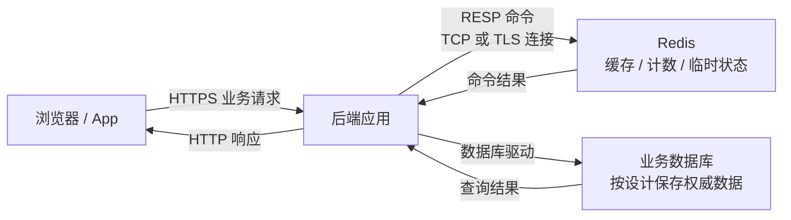
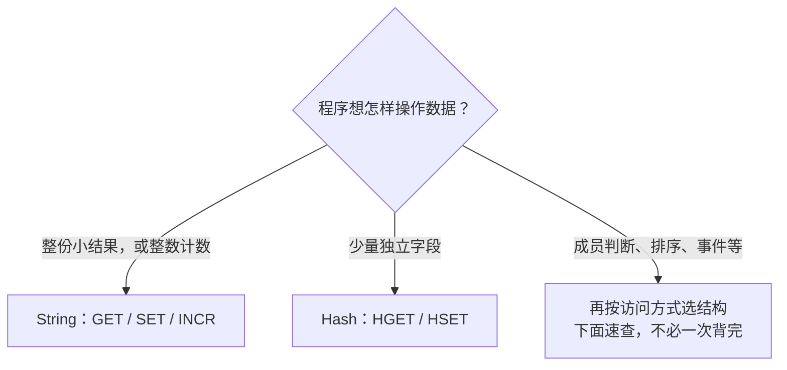
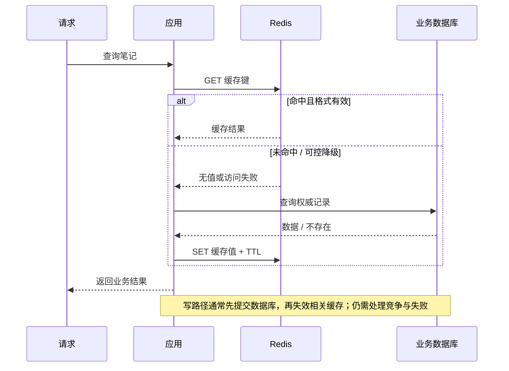
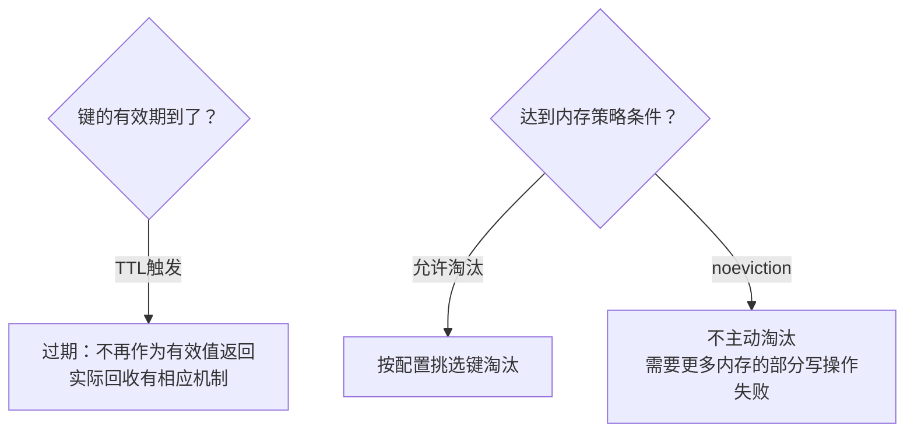
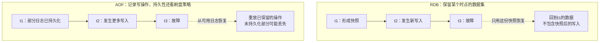
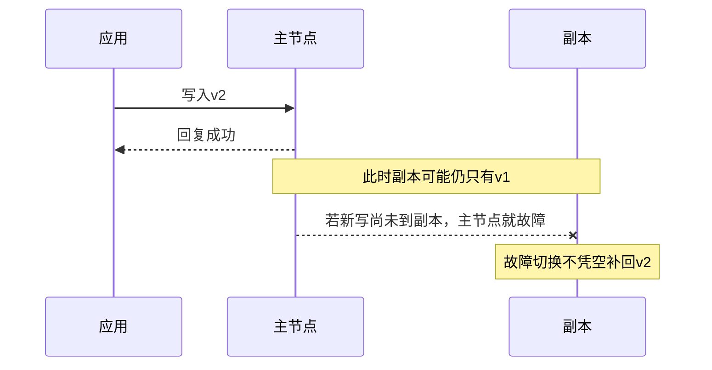

# Redis：通信系统中的高速数据层

第一次打开热门笔记，应用去数据库读取；第二次能不能直接拿一份现成结果？**Redis 可以保存这份快速副本，但副本何时失效、读到旧值怎么办，需要应用决定。**

Redis 是独立的数据结构服务，不只是某个应用里的 `Map`，也不自动替代关系数据库。

## 1. 它放在哪里，谁来连接它 {#position}



- 浏览器或 App 通常请求后端，**不直接拿 Redis 的数据库凭据连接生产实例**。
- Redis 和应用跨进程通信，即使在同机，也有协议编码、网络/Socket与排队成本。
- 内存访问与合适的数据结构很快，但耗时命令、大值、持久化和网络都可能拉高尾延迟。

Redis 的基本定位是数据结构服务；不同结构适合不同访问方式。[官方数据类型](https://redis.io/docs/latest/develop/data-types/)

## 2. 先会用几种结构，不把所有数据都塞成一个大 JSON {#types}

先用 String 保存一篇文章的 JSON：`SET` 写，`GET` 读，`EX` 给有效期。不是所有内容都要塞进同一份大 JSON：需要按字段、成员或分数操作时，再选对应结构。



`INCR` 的单次原子性不等于整段业务原子。数据类型只是操作工具，不会自动补齐可靠队列、分布式锁或一致性协议。

<details>
<summary>六种常见结构：按操作方式找命令与边界</summary>

| 结构 | 怎么理解 | 核心操作 | 常见用途与边界 |
| --- | --- | --- | --- |
| String | 字节串，也可按整数操作 | GET / SET / INCR | 缓存 JSON、计数；INCR 原子不等于整段业务原子 |
| Hash | 一组字段和值 | HSET / HGET / HGETALL | 用户的少量属性；避免一次读出超大对象 |
| List | 有序序列，可从两端操作 | LPUSH / RPOP | 简单队列；裸弹出不自动具有可靠消息确认 |
| Set | 去重成员集合 | SADD / SISMEMBER | 标签、成员判断；集合运算也有成本 |
| Sorted Set | 成员附带分数 | ZADD / ZRANGE | 排行榜、按分数范围查询 |
| Stream | 带ID的追加记录 | XADD / XREAD | 事件消费；保留、确认与重投仍需设计 |

</details>

这些是常用基础结构，不代表所有版本和产品只支持这几种。新数据类型与扩展能力应按实际版本检查，不把“最新文档有”当作旧实例必定有。

### 本机命令练习

前提：已有**自有、隔离的本机 Redis**，并安装 `redis-cli`。下方连接默认端口只适用于该本机实例；改过监听地址、端口或认证时，按实际配置连接，不开放公网免认证实例。

```bash
redis-cli -h 127.0.0.1 -p 6379
```

进入交互提示符后执行，键统一使用独立的 `study:` 前缀，避免碰现有业务数据：

```text
PING
SET study:note:7 "network" EX 60
GET study:note:7
TTL study:note:7
INCR study:views:7
HSET study:user:7 name Alice role reader
HGET study:user:7 name
SADD study:tags networking android
SISMEMBER study:tags networking
ZADD study:rank 10 note:7 20 note:8
ZRANGE study:rank 0 -1 WITHSCORES
```

应观察到 `PONG`、保存值和剩余秒数；`TTL` 为 `-1` 表示没有过期时间，为 `-2` 表示键不存在。普通 `SET` 覆盖值会清除原 TTL，除非按支持的选项明确保留或重设。[SET](https://redis.io/docs/latest/commands/set/)、[TTL](https://redis.io/docs/latest/commands/ttl/)

## 3. 命令在线路上不是一串随意的空格 {#resp}

RESP 是 Redis 的序列化协议。客户端把命令与参数编码为带类型、长度的信息，服务端返回对应类型；可以安全传输包含空格或二进制的数据。

```text
SET study:key value 的 RESP2 示意：

*3\r\n                # 数组，3个元素
$3\r\nSET\r\n        # 字节串长度3：SET
$9\r\nstudy:key\r\n  # 字节串长度9：study:key
$5\r\nvalue\r\n      # 字节串长度5：value

响应：+OK\r\n
```

RESP2/RESP3 的可用类型和连接模式不同，由服务与客户端能力协商。应用优先使用成熟客户端处理连接池、超时、重连和完整报文解析，不能假设一次 `recv()` 就取得完整结果。[RESP 规范](https://redis.io/docs/latest/develop/reference/protocol-spec/)

**Pipeline** 是批量发送后收结果，减少来回等待；不保证整批成为一个原子业务。`MULTI/EXEC`、Lua 脚本与跨系统事务也不是同一层保障，Redis 事务不是执行报错后自动回滚已执行命令。[Pipeline](https://redis.io/docs/latest/develop/using-commands/pipelining/)、[事务边界](https://redis.io/docs/latest/develop/using-commands/transactions/)

## 4. Cache-aside：应用负责在缓存与数据库之间取舍 {#cache-aside}

Cache-aside（旁路缓存）先读缓存，未命中再查数据库并回填。**缓存通常是可重建的副本，数据库仍按业务设计保存权威记录。**



### Python 核心调用

这是数据访问函数：调用方传入 `load_from_db`，负责真实数据库查询，不是完整 Web 服务。

另安装 `redis-py`：`python -m pip install redis`。它与课程标准库实验是两套环境。[官方用法](https://redis.io/docs/latest/develop/clients/redis-py/)

```python
import json
import secrets
import redis

# 仅供已隔离的本机实例；生产凭据从秘密配置注入，按部署开启TLS与验证。
r = redis.Redis(host="127.0.0.1", port=6379, decode_responses=True,
                socket_connect_timeout=1, socket_timeout=1)

def read_note(note_id, load_from_db):
    key = f"study:note:v1:{note_id}"
    try:
        cached = r.get(key)
        if cached is not None:
            return json.loads(cached)  # null可表示短期缓存的“不存在”。
    except (redis.RedisError, ValueError):
        pass  # 缓存失败/格式无效，进入受控回源路径；不要吞掉数据库异常。

    value = load_from_db(note_id)  # 数据库异常由上层处理，不伪装成“没数据”。
    ttl = 60 + secrets.randbelow(15) if value is not None else 5
    try:
        r.set(key, json.dumps(value, ensure_ascii=False), ex=ttl)
    except redis.RedisError:
        pass  # 本例允许查询结果在缓存写失败时仍返回。
    return value

# 业务完成数据库写入并成功提交后，尝试 r.delete(对应缓存键)。
# delete失败应记录并安排重试/失效修复，不能只依靠这行注释保证一致性。
```

这段代码展示最小读流程，**不具备回源限流、并发合并或强一致保证**。生产要限制缓存值大小、校验数据结构、观测异常，并确保缓存故障时数据库不会被无限量回源压垮。[官方 cache-aside 模式](https://redis.io/docs/latest/develop/use-cases/cache-aside/)

### 为什么提交数据库后删缓存仍不等于强一致

看这个交错过程：写请求确实删了缓存，旧值仍可能被另一个读请求放回去。数字只表示本例先后，不是固定线程调度。

```mermaid
sequenceDiagram
    participant R as 读请求
    participant D as 数据库
    participant W as 写请求
    participant C as Redis
    R->>C: ① 查缓存，未命中
    R->>D: ② 查询文章
    D-->>R: 取得旧值v1
    Note over R: 暂停在回填之前
    W->>D: ③ 写入新值v2并提交
    D-->>W: 提交完成
    W->>C: ④ 删除旧缓存，成功
    R->>C: ⑤ 恢复执行，把v1回填
    Note over C: 缓存又是旧值，数据库已经是v2
```



**TTL 只限制这份旧副本的留存，不阻止上述竞争。** 另有“数据库成功、删缓存失败”的窗口；重要数据需版本/可靠失效/回填约束或查权威源，余额与库存扣减不能仅凭缓存。[Cache-aside 路径](https://redis.io/docs/latest/develop/use-cases/cache-aside/)

## 5. 过期、淘汰、持久化分别解决什么 {#durability}



- **TTL** 是键有效期；**淘汰**是内存压力下的容量策略，二者不是同一个触发条件。
- `allkeys-*` 可从所有键中选择；`volatile-*` 仅考虑设置过期的键；`noeviction` 不主动淘汰，会拒绝需要更多内存的部分写操作。
- `maxmemory` 与策略需主动设计，LRU/LFU等也有实现细节；不能写成“Redis满了就自动删最久没用的键”。

选择策略前区分可重建缓存和不可随意删除的状态，最好隔离其容量与策略需求。[内存淘汰](https://redis.io/docs/latest/develop/reference/eviction/)

### RDB、AOF 与备份

它们回答的是“重启后拿什么恢复”，不是“多久过期”。以下两条线是各自的示意时间线，不表示保存机制互斥。



RDB、AOF、磁盘刷写与重写有各自成本；`everysec` 等 AOF 策略仍有故障丢失窗口，不能把命令成功回复等同所有保存点都完成。[持久化策略](https://redis.io/docs/latest/operate/oss_and_stack/management/persistence/)

持久化不是异地备份：应用误删的数据也可能继续写入日志和复制。需要独立的备份保留、可恢复性检查和实际恢复演练。

## 6. 复制、高可用和一致性，不是一个开关 {#replication}

默认复制是异步的，副本可能落后；主节点响应成功后立即故障，最近写入仍有丢失可能。`WAIT` 能等待一定数量副本确认，但不会因此保证强一致，也不保证故障切换后所有已确认写入都保留。[复制官方边界](https://redis.io/docs/latest/operate/oss_and_stack/management/replication/)



这是可能的时间窗口，不是说每次回复都早于复制。**复制保持另一份在线副本，备份保留可恢复的历史；误删也可能被复制。**

**Sentinel** 负责监控与主从故障切换等高可用协作；**Cluster** 将键分片到多个节点并提供相应故障处理。复制、分片、持久化和备份要分别规划，不是“开集群就永不丢数据”。

客户端还需处理连接变化、路由重定向和失败。超时不证明命令未执行，例如计数递增不能随意无界重试；多键操作也要检查集群键槽约束。

## 7. 缓存为何会反而拖垮数据库 {#failures}

| 现象 | 实际发生了什么 | 常见处理方向 |
| --- | --- | --- |
| 穿透 | 不存在的数据反复未命中并回源 | 输入校验、短期负缓存、按场景使用过滤器；新增数据时处理负缓存失效 |
| 击穿 | 一个热点键过期，大量并发同时查库 | 并发合并、受控刷新、限流；过期旧数据是否可用须由业务允许 |
| 雪崩 | 大量键同时失效，或整个缓存层故障 | 分散TTL、容量冗余、分级降级与数据库保护 |
| 热点 / 大 key | 工作或数据集中，网络、执行和内存被占用 | 拆分/分页、限制大小、定位热点；扩容不保证自动解决单键热点 |

生产排查可用受控的慢日志、延迟与内存指标；遍历键用适当的增量方法，避免在大实例随手执行全量阻塞操作。缓存命中率还要结合回源量、延迟和失败率看，不能只追求一个百分比。

分布式锁过期后，旧持有者仍可能继续写；单独 `SET NX` 加 `DEL` 不足以保证正确性。还需校验锁的所有权，并在业务层防止过期写入。

## 8. 安全边界与自测 {#check}

- Redis 放在回环/受控私网与受限网络入口后，不为方便调试开放公网免认证实例。
- 使用最小权限账号，限制命令与键范围；ACL 从 Redis6 引入，具体能力按版本检查。
- `AUTH` 不是加密；跨不可信链路使用 TLS 并校验证书，服务、客户端和构建都要具备相应能力。Redis6起可选 TLS，启用方式依部署而定。
- 密码、URL中的凭据和数据内容不写进源码/日志；保护模式不是防火墙、ACL或TLS的替代品。

依据：[Redis 安全模型](https://redis.io/docs/latest/operate/oss_and_stack/management/security/)、[ACL](https://redis.io/docs/latest/operate/oss_and_stack/management/security/acl/)、[TLS 前提](https://redis.io/docs/latest/operate/oss_and_stack/management/security/encryption/)。

练习前先核对自己的 Redis 环境；本页命令不代表本站静态页面运行了 Redis。能解释以下问题，再结合[QPS与容量观测](./capacity-observability.html)评估真实收益：

1. 数据在 Redis 中为什么仍然涉及网络协议和连接池？
2. TTL、内存淘汰、持久化和副本分别能防什么、不能防什么？
3. 缓存不可用时直接全部回源数据库，会出现什么风险？
4. 为什么单条 `INCR` 原子，不能证明“数据库更新 + Redis更新”整体原子？
5. 副本同步、AOF都启用后，为什么还要备份与恢复演练？
