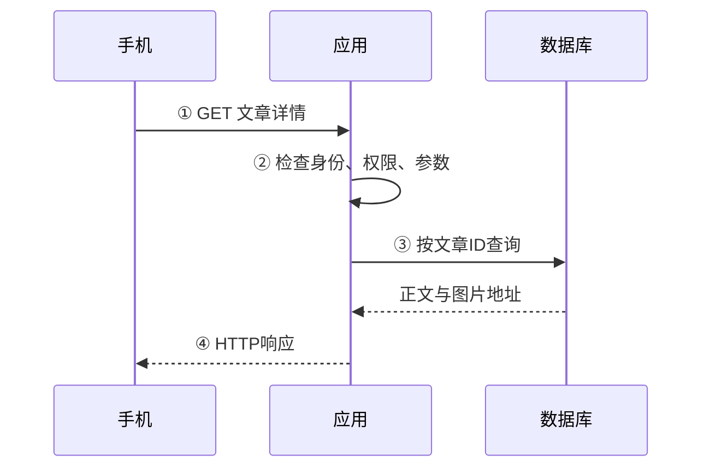
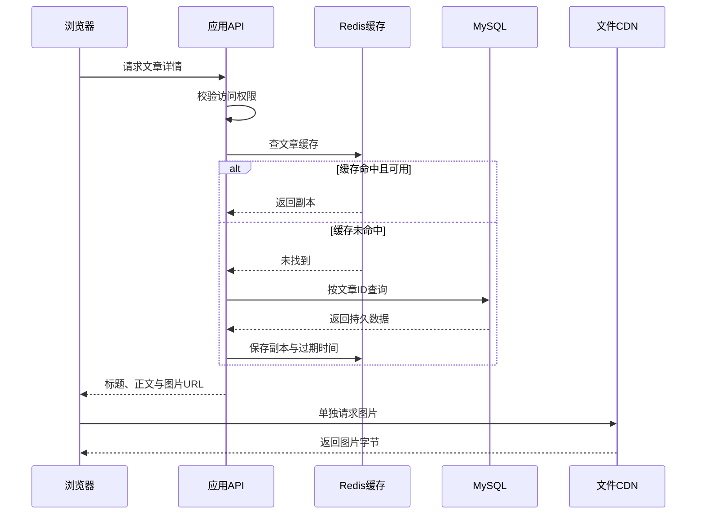
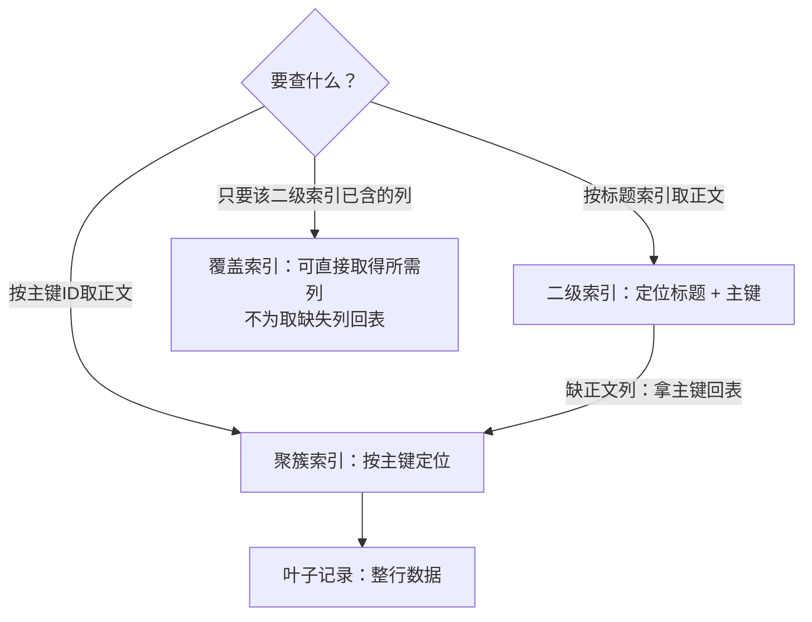
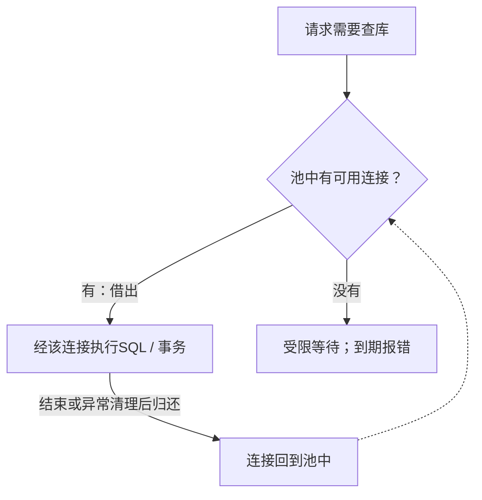
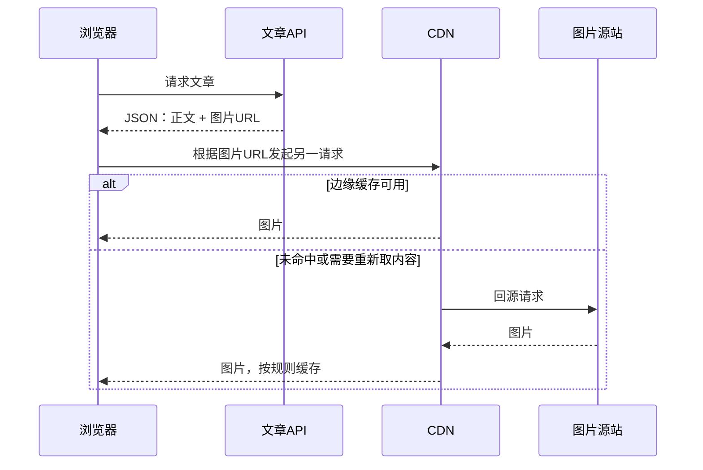
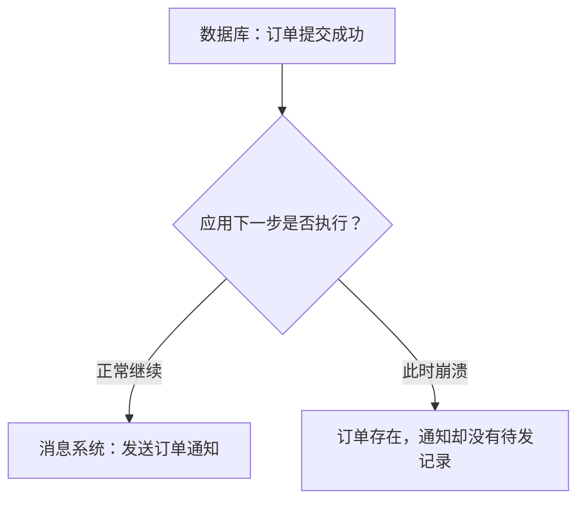
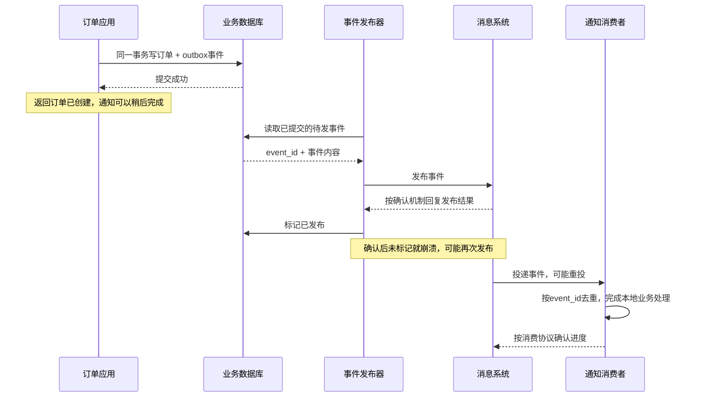

# 服务端架构：一次请求背后有哪些组件

手机打开一篇笔记，最初只需要应用读出内容并返回。热门笔记反复被查、图片变多、通知变慢以后，才逐步加入其他组件。**先记住一次请求，再记组件名。**

## 1. 先看全景，再拆分工

先从最小系统开始：网页发请求，应用决定能否查看，数据库保存正文。图中的箭头标请求与返回，不表示每个框必须占一台机器。



- **应用**组织业务；数据库保存记录。API 服务器是职责名，不是额外一种机器。
- **Web 服务器**接收 HTTP；应用可以自己接，也可以由 Nginx 先接收再转发。Nginx 不替业务判断“这个订单能否创建”。
- 后面依次解决三个问题：重复查询用缓存；图片用对象存储/CDN；耗时通知用消息队列。DNS 查询不在这些内容路径中转发网页。

一个进程可能承担多个角色；多台机器也可能共同承担一个角色。先看请求如何走，不先按产品名字划机器。[Nginx 入门](https://nginx.org/en/docs/beginners_guide.html)

## 2. 读一篇文章：数据库与缓存各管什么

**MySQL 保存业务真相，Redis 作为缓存保存可丢弃、可重建的副本。** 这是本图的配置选择，不是 Redis 永远只能做缓存。



缓存查询不是把 HTTP 转交给 Redis，Redis 也不会自动代替应用去查 MySQL。应用决定命中/回源/填充/失效策略；这种方式叫 **Cache-Aside，旁路缓存**。[Redis Cache-Aside](https://redis.io/docs/latest/develop/use-cases/cache-aside/)

### 数据库：表、SQL、索引先连起来看

**关系数据库**用表组织记录，SQL（Structured Query Language）用于查询和更新。以 MySQL 的 InnoDB 表为例，文章 ID 可以作为主键，让程序按一个稳定标识查询文章。

```sql
-- 在自己的MySQL练习数据库执行；不是本机HTTP实验脚本的接口。
CREATE TABLE articles (
    id BIGINT PRIMARY KEY,
    slug VARCHAR(120) NOT NULL UNIQUE,
    title VARCHAR(200) NOT NULL,
    body MEDIUMTEXT NOT NULL
) ENGINE = InnoDB;

INSERT INTO articles (id, slug, title, body)
VALUES (1, 'network-start', 'Network notes', 'Hello network');

SELECT title, body FROM articles WHERE id = 1;
EXPLAIN SELECT title, body FROM articles WHERE id = 1;
```

**索引像目录：先定位，再取需要的内容。** 下图限定 MySQL InnoDB；二级索引假定包含标题列，实际是否采用它要看执行计划。



聚簇索引叶子保存行，二级索引记录包含主键；**二级索引查询不一定回表**，覆盖查询可能直接满足所需列。[InnoDB 索引组织](https://dev.mysql.com/doc/refman/8.4/en/innodb-index-types.html)

索引还占空间、增加写入维护成本。是否使用索引、扫描多少记录，要看查询条件与执行计划；客户端应使用参数化查询传入用户数据，**不要用拼接 SQL 代替参数绑定**。

### 事务：一次提交内的一组数据库操作

事务把一组数据库改动组织成提交或回滚的单元；隔离级别、锁与多版本并发控制影响并发观察。MySQL 的自动提交模式与显式事务不同，多个 SQL 语句不会因为写在同一个函数里就自然成为一个事务。

```sql
START TRANSACTION;
UPDATE articles SET title = 'Updated network notes' WHERE id = 1;
-- 同一事务还可以更新相关业务表。
COMMIT;
-- 需要放弃且尚未提交时使用ROLLBACK；不是在COMMIT后“撤回”。
```

InnoDB 用锁、多版本和日志等机制支持事务；持久化、复制与恢复保障还受实际配置影响。**数据库事务不是“一键把 Redis、消息队列和外部支付一起提交”。**[事务模型](https://dev.mysql.com/doc/refman/8.4/en/innodb-transaction-model.html)、[自动提交与回滚](https://dev.mysql.com/doc/refman/8.4/en/innodb-autocommit-commit-rollback.html)

### 连接池：有限复用，不是无限并发

每次查库都重新建连接很浪费。连接池像一组可借用的通道：借到才能访问，用完归还，没借到则按期限等待或失败。



虚线表示连接重新可用，不是这个请求反复执行 SQL。**池越大不一定越快**：数据库处理不过来时，只会有更多操作一起等待。

- 事务结束、异常清理与连接归还必须配套，防止连接泄漏、未结束事务与锁长期占用。
- 每个应用实例都有自己的池，总连接量应把**实例数**也算进去。
- 空闲连接、活跃查询、每秒 SQL 数不是一个指标；容量口径见[容量与可观测性](./capacity-observability.html)。

## 3. 图片存哪里：对象存储与 CDN

文章接口不必把每张图片都塞进 JSON。数据库返回图片地址，浏览器再单独取图；**对象存储**按对象键保存文件，**CDN**在靠近用户的边缘缓存可缓存内容。



图片不是先穿过数据库再送到 CDN。对象上传与数据库更新也不会自动成为一个事务。[对象存储](https://docs.aws.amazon.com/AmazonS3/latest/userguide/Welcome.html)

改了源图不代表所有边缘立即更新；版本化 URL、缓存期限和刷新机制解决不同的更新需求。[CDN 命中与回源](https://docs.aws.amazon.com/AmazonCloudFront/latest/DeveloperGuide/Introduction.html)

图片能否公开、缓存键是否包含必要区分、访问授权如何实施，都需要单独配置；不要把私人内容误缓存为所有用户可见。更完整的接入路径见[网关与负载均衡](./gateway-load-balancing.html)。

## 4. 下订单以后再发通知：为什么要消息队列

如果“保存订单、发邮件、推送消息、更新分析系统”都同步做，任一步变慢都会拖住用户响应。队列把可异步的工作交给消费者处理，但同时引入积压、重复、顺序和失败恢复问题。

### 先识别一个危险的时间缝隙



反过来先发消息、再写订单也会失败：消息可能已被消费，订单却回滚了。**两个独立系统的写入，不会因为紧挨着调用就自动原子。**

一种常见思路是 **Transactional Outbox，事务发件箱**：订单与待发事件写入同一业务数据库事务，另有发布器把已提交的事件送出去。下图是架构思路，不是完整的支付系统实现。



数据库侧关键边界可以这样记，下面是**业务伪代码**：

```text
开始同一数据库事务
  用request_id唯一约束识别重复下单
  保存订单
  保存outbox(event_id, 订单引用, 事件类型)
提交事务

独立发布器：取待发事件 → 发布并检查结果 → 更新进度
消费者：处理已知event_id时，不重复产生业务副作用
```

Outbox 让“订单提交却没记通知”变成可追踪的待办，**没有消灭重复**。消费者去重与本地业务变更仍需安排事务边界；邮件/支付等外部副作用还需下游幂等、查询或补偿。[Outbox 模式与限制](https://docs.aws.amazon.com/prescriptive-guidance/latest/cloud-design-patterns/transactional-outbox.html)

## 5. Kafka 与 RabbitMQ：都能传事件，模型不同

先按问题选模型：需要多组消费者各自重读事件，了解 Kafka 分区日志；需要按规则路由任务和消费确认，了解 RabbitMQ 队列。具体能力取决于模式和配置。

<details>
<summary>两种常见模型的组织、进度与保留方式</summary>

| 维度 | Kafka 的常见模型 | RabbitMQ 队列的常见模型 |
| --- | --- | --- |
| 数据怎样组织 | Topic 分区中的追加日志 | Exchange 按规则路由到 Queue |
| 消费位置怎样记 | Consumer Group 跟踪分区 offset | 交付后由消费确认决定已完成/重投 |
| 消费后是否还保留 | 与日志保留/压缩策略有关，消费不等于删除 | 已确认的消息通常可从队列移除 |
| 适合从哪个问题入手 | 多组独立消费、事件流与重放 | 任务分发、路由与明确确认流程 |

</details>

Kafka 的分区 offset 不是全系统通用业务序号；顺序保证要放在分区范围内理解。[Kafka 概念](https://kafka.apache.org/41/getting-started/introduction/)

RabbitMQ 还有 **Streams**，不能用“永远不能重放日志”概括整个产品。[Queues](https://www.rabbitmq.com/docs/queues)、[Streams](https://www.rabbitmq.com/docs/streams)

**发布确认、消费确认、业务数据库提交，是三个不同的成功边界。** 业务效果与消费进度之间崩溃，仍可能重复或遗漏处理。

持久队列、消息持久性、副本和确认需分别配置；只安装中间件不能承诺“绝不丢、不重复”。[发布确认与消费确认](https://www.rabbitmq.com/docs/confirms)

## 6. 这些进程怎么运行：容器与编排

**镜像**打包应用与运行依赖，**容器**是按镜像启动的隔离进程环境。常见 Linux 容器共享宿主内核，不是每个容器都自带一套独立虚拟机内核；重建容器也不自动恢复未备份的数据。[Docker 容器概念](https://docs.docker.com/get-started/docker-concepts/the-basics/what-is-a-container/)

容器解决“怎样运行”，编排解决“怎样维护一组运行实例”；都不替应用保存业务真相。

<details>
<summary>Kubernetes 的 Pod、Deployment 与 Service 各负责什么</summary>

- **Pod**：调度与运行的基本单元，可包含共享网络等资源的容器。
- **Deployment**：维护期望副本与更新过程；不是默认自动按 QPS 扩容，也不代替数据库备份。
- **Service**：为一组变化中的后端提供稳定访问抽象；服务发现让应用通过名称找到它，而不是把临时 Pod IP 写死。

</details>

服务发现回答“现在往哪里连接”，不回答“订单事务是否正确”。容器、编排、负载均衡分别解决运行、管理、流量选择问题，不能替代应用一致性设计。[Kubernetes Deployment](https://kubernetes.io/docs/concepts/workloads/controllers/deployment/)、[Service 与服务发现](https://kubernetes.io/docs/concepts/services-networking/service/)

## 7. 什么时候才需要加组件

先提出可观察的问题：重复查询拖慢数据库，才评估缓存；可异步操作拖住响应，才评估队列；一个实例不够或需要故障隔离，才评估多实例、入口与共享状态。**每加一个组件，也增加连接、权限、监控、恢复和成本的责任。**

本页 SQL 需自有 MySQL 练习库，消息图是架构说明。`network_lab.py` 只演示 HTTP/Socket，不提供数据库、Redis、队列或 K8s；HTTP 成功不证明这些组件已部署。

自测：图片为何不必都经过数据库？缓存删除失败为什么可能读旧数据？发布器已发消息却没标记进度时为什么仍需去重？应用部署三个实例，连接池为什么不能只计算其中一个？

[部署入门](./deployment.html) · [网关与负载均衡](./gateway-load-balancing.html) · [Redis 原理](./redis.html) · [术语速查](./glossary.html)
