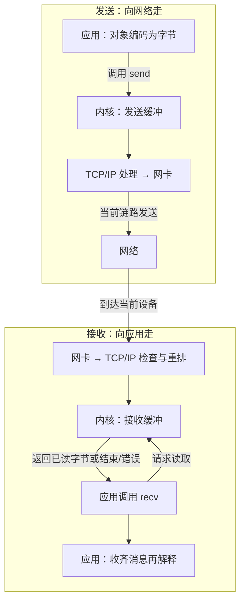
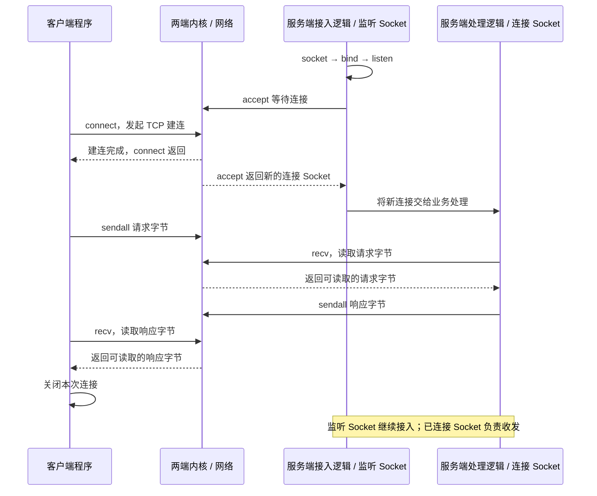
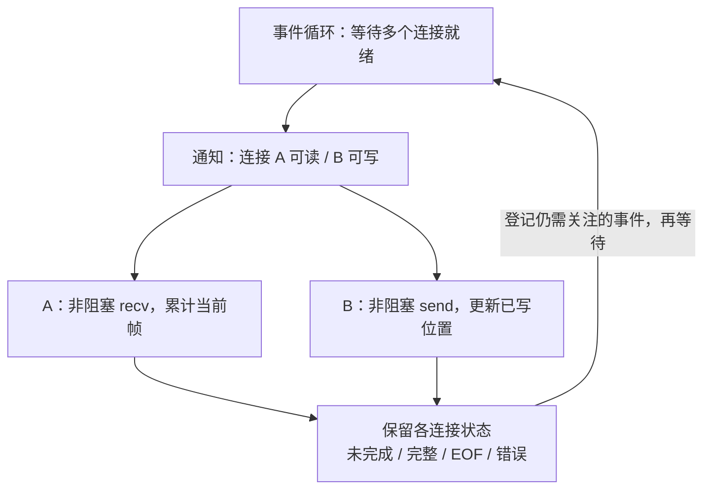

# Socket：程序怎样把消息交给网络

把“你好”交给网络，程序要做三步：**编码成字节 → 交给 Socket → 收齐回信后解码。** Socket 是操作通信端点的接口，不替业务定义“一条消息”。

前置：[TCP、UDP 与 QUIC](./transport.html)。这一篇先做一件事：客户端发一句话，服务器完整收齐后回一句话。

## 1. 一个 Socket 背后有什么

同一台设备有两条相反的走线：发送把字节交给内核，接收从内核取字节。内核处理连接、重传和缓冲；应用处理消息含义。



- **Socket 不是另一种 HTTP。** HTTP 是消息规则，可以通过 TCP Socket 收发；也可以在其上增加 TLS。
- **一个端口可以承载多个连接。** 已建立的 TCP 连接还由两端地址、端口等信息区分。
- **缓冲区有大小限制。** 接收方处理变慢，积压会反向影响发送方，不能只靠无限排队解决。

[Python Socket 官方接口](https://docs.python.org/3/library/socket.html)对应操作系统的 Socket 能力；不同平台的选项与行为可能有差异。

## 2. 服务端为什么先 listen，再 accept

服务端先准备“接入入口”，收到连接后，再为这条连接提供独立的收发端点。



`bind` 指定本地地址与端口；`listen` 开启监听。`accept` 返回的是**新的已连接 Socket**，不是把监听 Socket 改成业务连接。

图中 `connect` 返回与服务端应用执行 `accept` 的先后由调度决定；TCP 握手由内核完成，不要求服务端业务先调用到某一行代码。

### 写出去了，不代表对方已处理

`send()` 可能只接受部分字节；`sendall()` 会继续发送，直到全部交给传输处理或发生异常。成功返回仍然不代表远端数据库已提交。

**业务完成需要业务响应。** 如果请求发出后超时，服务器可能尚未处理，也可能已经处理而响应丢失；不能简单换个连接就重复扣款。

## 3. TCP 没有“一条消息”的边界

客户端两次发送 `hello` 和 `world`，服务端可能一次收到 `helloworld`，也可能分多次收到。TCP 分段方式与应用消息边界没有一一对应关系。

本例规定：**先发 4 字节无符号大端长度，再发指定数量的 UTF-8 字节。** 长度描述字节数，不是汉字个数。


不要对每次 `recv()` 的片段立即解码；一个 UTF-8 字符可能跨两次读取。先收齐消息，再解释它。[Socket Programming HOWTO](https://docs.python.org/3/howto/sockets.html)

### 核心代码：先收满，再解码

下载 [network_lab.py](/assets/network/network_lab.py){download="network_lab.py"}，将它与自己的练习文件放在同一目录。下面展示客户端核心，服务端采用同一套帧规则。

```python
import socket
import struct
from network_lab import HOST, TCP_PORT, MAX_FRAME

HEADER = struct.Struct("!I")  # !：网络字节序；I：4 字节无符号整数

def recv_exact(sock, size):
    result = bytearray()
    while len(result) < size:
        chunk = sock.recv(size - len(result))
        if not chunk:
            # 此时请求的 size > 0：对方已结束发送，帧却尚未收齐。
            raise EOFError("connection closed before the frame was complete")
        result.extend(chunk)
    return bytes(result)

def request_text(message, timeout_seconds):
    payload = message.encode("utf-8")
    if len(payload) > MAX_FRAME:
        raise ValueError("message exceeds MAX_FRAME")

    with socket.create_connection((HOST, TCP_PORT), timeout_seconds) as sock:
        # sendall 处理本端短写；它不提供远端业务完成确认。
        sock.sendall(HEADER.pack(len(payload)) + payload)
        size = HEADER.unpack(recv_exact(sock, HEADER.size))[0]
        if size > MAX_FRAME:
            raise ValueError("response exceeds MAX_FRAME")
        return recv_exact(sock, size).decode("utf-8")
```

`timeout_seconds` 由调用方按业务传入。这里是 Socket 操作的超时设置，不是跨所有步骤、所有重试的完整业务截止时间；长任务还需要累计时间预算。

### EOF、超时、异常分别表示什么

- `recv(n)` 在 **n > 0** 时返回 `b""`：对端发送方向结束，已经没有更多字节可读；不是“暂时没收到”。
- 正文没收齐就 EOF：本次消息不完整，不能交给业务层。
- 超时：规定等待时间内操作没完成；不能据此判断服务器是否执行过业务。
- `shutdown(SHUT_WR)`：只结束自己的发送方向，仍可接收；`close()` 释放这个 Socket 的资源。

长度帧已经给出消息边界，正常收响应不需要等连接断开。HTTP 长连接、WebSocket 也都依赖各自的边界规则，而不是每次消息都断开连接。

## 4. 阻塞、非阻塞、epoll 在解决什么

不是一条连接收到完整消息才看下一条，而是**哪条连接就绪，就推进它自己的读取/写入进度**。



就绪只表示可以尝试 I/O，**不表示一条消息已经收齐**。图是状态推进模型，不是完整事件循环代码。

- **阻塞 I/O**：读不到数据时，调用线程等待。逻辑直观，但不能在界面线程里等网络。
- **非阻塞 I/O**：暂时不能完成就返回相应状态；应用保留当前读取进度，稍后继续，不能忙循环空转。
- **I/O 多路复用**：一次等待很多连接的就绪通知，只处理可读/可写的连接；Python 可用 `selectors.DefaultSelector` 选择平台实现。
- **Linux epoll**：报告描述符就绪，不替应用读取或拼帧；解析进度仍属于每条连接。

完整事件循环还需要连接超时、写入队列上限和背压。若下游来不及消费，应限制生产速度或拒绝负载，而不是无限缓存。[selectors 官方说明](https://docs.python.org/3/library/selectors.html)

## 5. 在自己电脑上跑一次

先下载 [实验说明](/assets/network/README.txt){download="network-README.txt"}和脚本；地址、端口、帧上限以脚本中的常量和启动输出为准。实验默认只监听回环地址。

终端 A 启动服务端：

```sh
python network_lab.py tcp-server
```

终端 B 发请求：

```sh
python network_lab.py tcp-client
python network_lab.py tcp-client --split
```

应观察：连接建立，服务端按长度收齐请求，客户端拿到完整响应。`--split` 把一次帧写入拆成多次发送，接收端仍应还原同一条消息。

UDP 对照实验使用 `udp-server` 与 `udp-client` 子命令。UDP 保留数据报边界，但接收缓冲太小可能导致截断，且应用仍要处理丢失、重复与顺序问题。

**手机的 localhost 指手机自己，不是电脑。** 若要手机访问电脑，需另行配置局域网监听、地址与入站规则；不要为了实验直接把服务开放到公网。

## 6. 最容易写错的地方

- 只调用一次 `recv()` 就把它当完整请求：在分段读取时截断消息。
- 无上限地信任帧头长度：一个错误值就可能导致过量分配或长时间等待。
- 把 TCP ACK、sendall 返回值当成业务提交凭证：重试时可能重复执行。
- 连接断开后只换 Socket、不恢复业务状态：流位置、鉴权和未确认请求都需要重新处理。

自测：`accept` 返回什么？一个汉字的长度应怎么算？半个帧后 EOF 怎么处理？如果响应超时，为什么不能证明服务器没执行？

下一篇：[HTTP：请求、响应与接口规则](./http.html)。
