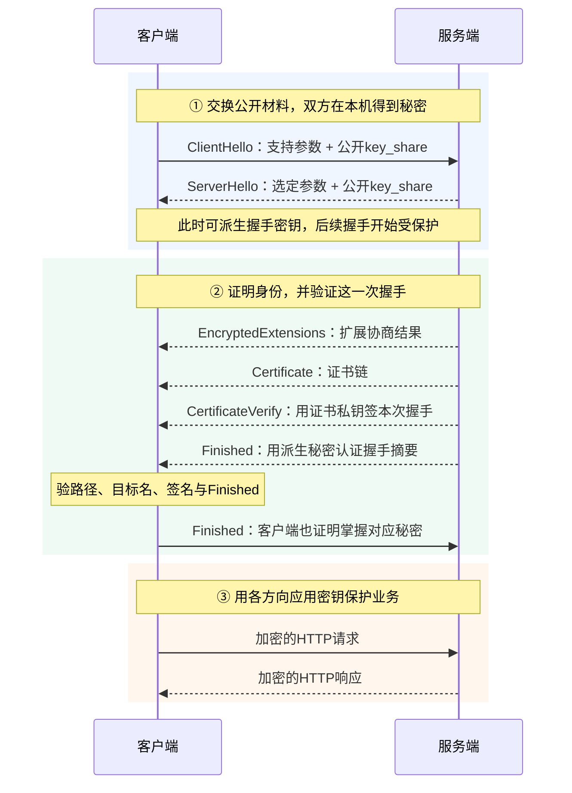
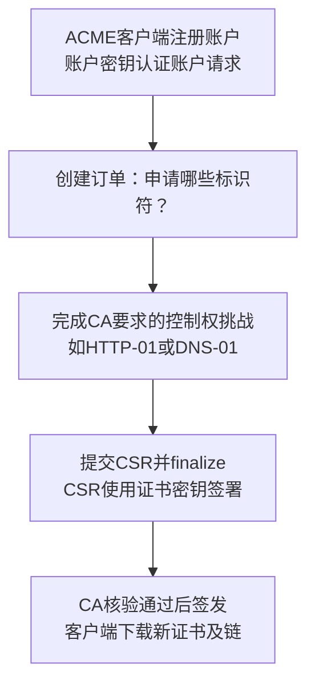
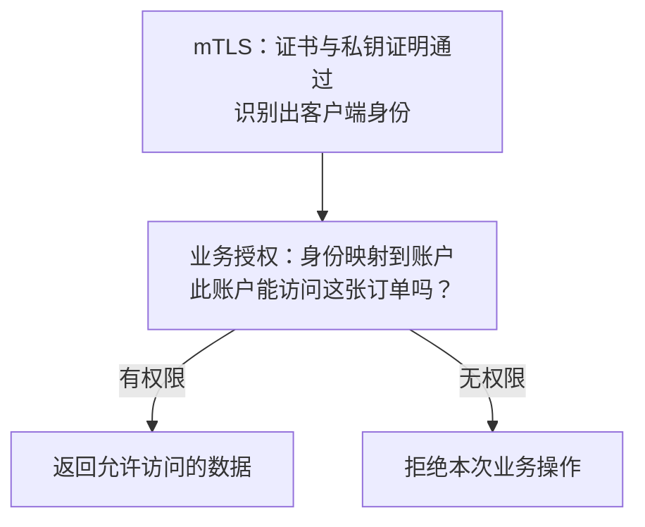

# HTTPS、TLS 与证书：锁头背后发生了什么

点开 `https://notes.example.com`，客户端要先解决两件事：**连到的真是这个站点吗？路上的设备能否偷看或改内容？**

前置：[密码学与密钥](./cryptography.html)。阅读顺序：保护范围 → 身份验证 → 工作密钥。

## 1. 锁头保护哪一段 {#boundary}


- **路径、头部与Body受保护；** 浏览器、TLS终止入口和业务处理端仍能读明文。
- **TLS在代理终止，保护就在这里结束；** 到源站是否再加密，取决于第二条连接。
- **服务身份不等于用户权限；** 有合法证书的网站也可能有错误业务逻辑。

HTTPS不是匿名通信。IP、时间与大小等仍可能被观察；SNI的可见性还受ECH等扩展与实际部署影响。[TLS目标与边界](https://www.rfc-editor.org/rfc/rfc8446.html#section-1)

## 2. 握手前先认三个对象 {#objects}

**证书负责“认身份”，临时交换负责“得秘密”，流量密钥负责“保护数据”。**

- **证书：** 公开的身份与公钥绑定；对应长期私钥留在服务端。
- **临时交换值：** 公开值可以发送，临时私钥不发；双方各自算出共享秘密。
- **流量材料：** 从秘密派生，按阶段、方向分开使用key和IV。

TLS1.3这条主线里，**没有“客户端生成AES密钥，再用证书RSA公钥加密发过去”这一步**；秘密与私钥都不直接发送。

## 3. TLS1.3 的典型完整握手 {#handshake}

场景：**证书认证 + 临时(EC)DHE，无客户端证书、无0-RTT、无需HelloRetryRequest。** 背景色区分阶段，箭头是消息方向。



- **Hello公开，后续不全是明文；** 不能等看完证书才开始派生握手密钥。
- **CertificateVerify证明私钥持有；Finished认证握手摘要。** 复制证书不能替代私钥证明。
- **应用密钥不是双方同时“最后才算”；** 图简化了本机计算时点，服务端可在自己的Finished之后开始发送应用数据。

[完整握手：RFC 8446 §2](https://www.rfc-editor.org/rfc/rfc8446.html#section-2)、[认证消息 §4.4](https://www.rfc-editor.org/rfc/rfc8446.html#section-4.4)

### ClientHello 中哪些字段分别决定什么

**版本、交换组、签名算法、记录加密套件、应用协议是分开选择的。** `TLS_AES_128_GCM_SHA256`没有同时指定证书签名算法和交换曲线。

<details>
<summary>ClientHello字段速查</summary>

```text
supported_versions：支持的TLS版本
supported_groups / key_share：交换组和本次公开交换值
signature_algorithms：能验证的签名算法
cipher_suites：TLS1.3的AEAD与HKDF哈希组合
ALPN：h2、http/1.1等应用协议
SNI：请求的服务名；ECH可改变相关可见性
```

[RFC 8446 §4.1.2](https://www.rfc-editor.org/rfc/rfc8446.html#section-4.1.2)

</details>

## 4. 为什么一张证书能让客户端相信公钥 {#certificates}

你第一次访问 `notes.example.com`，对方递来一个公钥。**怎么知道它属于这个站点，而不是冒充者？**

数字证书把**身份、公钥和使用限制**放在一起，由签发者签名。客户端还要确认签发路径可信、名字匹配，并在 TLS 中检查对方对本次握手的私钥证明。

### 先看签发：自己的公钥怎样变成证书 {#certificate-issuance}


- **CSR 是申请书，不是证书。** Certificate Signing Request 包含公钥、请求的身份等，并由对应私钥签署。
- **CSR 签名只校验请求本身。** 它不等于域名控制权已核验，也不证明远程服务此刻持有私钥。
- **CA 签的是证书内容。** TBSCertificate 就是“待签名的证书内容”；CA 按策略决定最终字段，不会无条件照抄 CSR 扩展。

站点私钥留在站点；CA 私钥留在 CA。签发是 **CA 私钥签名 → 客户端用 CA 公钥验签**，不是“CA 把站点公钥加密”。[证书结构：RFC5280 §4.1](https://www.rfc-editor.org/rfc/rfc5280.html#section-4.1)、[CSR 与签发：Let's Encrypt](https://letsencrypt.org/how-it-works/)

### ACME：把申请、挑战和签发自动化 {#certificate-acme}

手工申请容易漏续期。ACME 是客户端与 CA 之间的自动化协议；Let's Encrypt 是使用它提供证书服务的 CA。



- **HTTP-01：** CA 给挑战，客户端在指定 HTTP 路径放响应；这种挑战使用 **80 端口**，不能用来申请通配符证书。
- **DNS-01：** 在 `_acme-challenge.域名` 放指定 TXT 响应；可用于通配符。自动化应限制 DNS API 凭据权限。
- **账户密钥与证书密钥是两种角色。** 账户签 ACME 请求；证书密钥签 CSR，公钥进入证书。控制权挑战通过也不能跳过其余 CA 策略。

[ACME流程：RFC8555 §7.1/7.4](https://www.rfc-editor.org/rfc/rfc8555.html#section-7.1)、[两类密钥：§11.1](https://www.rfc-editor.org/rfc/rfc8555.html#section-11.1)、[挑战限制：Let's Encrypt](https://letsencrypt.org/docs/challenge-types/)

### 再看验证：根、中间、叶子怎样串起来 {#certificate-chain}

**叶子证书**属于站点；**中间 CA**签发下级证书；**根/信任锚**是客户端通过本地配置已经信任的起点。服务器发来的“根证书”不会自动增加你的信任。


- **蓝线找路径，绿线验签名。** 根信任来自系统、浏览器或明确管理的配置；不是因为根“自己签自己”。
- **服务器通常发送叶子与所需中间证书。** 少发中间证书可能导致部分客户端无法建链；不要假定所有客户端都会自动下载补全。
- **签名通过还不够。** 客户端继续核对时间、用途、CA/路径约束、算法与本地策略；交叉签名还可能产生其他候选路径。

名字按 **URL 原目标**核对：CNAME 指向托管商，也不会把 `notes.example.com` 改成托管商名字。DNS 名看 SAN 的 `dNSName`；IP 字面量看 SAN 的 `iPAddress`，不能拿解析出的 IP 替代原域名检查。

[路径验证：RFC5280 §6](https://www.rfc-editor.org/rfc/rfc5280.html#section-6)、[目标身份与SAN：RFC9525 §6](https://www.rfc-editor.org/rfc/rfc9525.html#section-6)

### 三种“签名/认证”不要混为一谈

**CA签证书内容；CertificateVerify用站点私钥签本次握手；Finished用派生秘密认证握手摘要。** CA不会替每个HTTP请求签字。

单个X.509证书对象是公开材料，复制它不等于持有站点私钥。离线证书验证也不能替代 [TLS握手中的私钥证明](#handshake)。

### 读字段：名字、用途和有效期分别回答什么 {#certificate-fields}


**SAN 解决“是不是我要访问的名字”，KU/EKU 解决“这个公钥允许怎么用”。** 二者不是互相替代的开关；KU 与 EKU 都存在时，必须同时满足。

`BasicConstraints: CA:TRUE` 表示 CA 属性；还须满足相应 KU 和其他验证约束。`pathLen:0` 不表示“只能签零张证书”，而是限制其后的非自颁发中间 CA 层数；仍可签叶子。

<details>
<summary>字段速查：看到openssl输出时对照</summary>

- **Subject：** 证书主体；现代 TLS 服务身份不能只依赖其中的 CN。
- **Issuer + Serial Number：** 签发者与其分配的序列号；定位证书，不证明信任。
- **SubjectPublicKeyInfo：** 主体公钥与公钥算法；与 CA 的证书签名算法是不同字段。
- **SAN：** 可包含 DNS、IP 等不同类型的身份；文本像 IP 的 DNS 条目不等于 IP 类型条目。
- **KeyUsage / ExtendedKeyUsage：** 密钥操作限制 / 具体用途，如 `digitalSignature`、`serverAuth`、`clientAuth`。
- **BasicConstraints：** CA 属性与可选的路径长度约束；`keyCertSign` 也不是普通站点的业务权限。
- **notBefore / notAfter：** 有效时间窗口；看时间仍不能替代路径、名字、用途和撤销策略。
- **SKI / AKI：** 主体/签发者密钥标识，帮助关联；不能代替数字签名校验。
- **critical：** 遇到不认识或无法处理的关键扩展，验证方必须拒绝，不能直接忽略。

</details>

[证书扩展：RFC5280 §4.2](https://www.rfc-editor.org/rfc/rfc5280.html#section-4.2)、[OpenSSL扩展配置](https://docs.openssl.org/3.0/man5/x509v3_config/)

### 证书有哪些用途，“认证”之后谁决定权限 {#certificate-purpose}

- **服务器证书 `serverAuth`：** 浏览器等客户端认证 HTTPS 对端；普通 HTTPS 默认不会因此认证访问者。
- **客户端证书 `clientAuth`：** mTLS 中服务端也认证客户端；应用还需把身份映射到账户与权限。
- **代码签名证书 `codeSigning`：** 验证发布者签名及代码完整性，按平台的代码签名信任与策略处理；不能直接套用浏览器 HTTPS 的全部规则。



**CA 核验申请者、证书限制公钥用途、业务决定资源权限，是三件事。** 邮件保护、时间戳等也有相应用途，不能把任一证书当成万能通行证。[EKU定义：RFC5280 §4.2.1.12](https://www.rfc-editor.org/rfc/rfc5280.html#section-4.2.1.12)、[代码签名要求范围](https://cabforum.org/working-groups/code-signing/requirements/)

**DV / OV / EV 比较的是签发时核验的身份信息与流程，不是 TLS 加密强弱：**

- **DV，域名验证：** 核验申请者对相应域名的控制等签发条件，不因此确认真实世界的组织身份。
- **OV，组织验证：** 除相关标识符控制外，核验组织身份等申请信息。
- **EV，扩展验证：** 按更严格的组织身份、签发授权等要求核验；不承诺某种固定的浏览器绿色地址栏展示。

合法证书不能保证网站没有诈骗内容或业务漏洞。[CA/B TLS BR §3.2/7.1.2.7](https://cabforum.org/working-groups/server/baseline-requirements/requirements/)、[EV Guidelines §1/11](https://cabforum.org/working-groups/server/extended-validation/guidelines/)

### 到期、撤销、续期和换密钥不是一回事 {#certificate-lifecycle}


- **到期：** 超出证书有效时间；续期是取得新证书，不能编辑旧证书的日期继续用。
- **撤销：** 到期前也可能被签发者标为不可接受；删除本地文件并不撤销外部证书副本。
- **轮换：** 换证书不必然换密钥；私钥泄露时需要新密钥及相应证书，不能仅重签同一公钥。

CRL 是撤销列表，OCSP 是证书状态查询机制；具体客户端是否、怎样检查，以及查询失败如何处理，取决于实现与策略。OCSP `good` 不替代名字、时间与路径检查；CT 透明度记录也不等于撤销状态。[RFC5280 §5](https://www.rfc-editor.org/rfc/rfc5280.html#section-5)、[RFC6960 §2.2](https://www.rfc-editor.org/rfc/rfc6960.html#section-2.2)

<details>
<summary>公开CA的有效期规则（2026-10-04版）</summary>

**公开 CA 的期限上限不等于所有证书都用同一天数。** 按 CA/B TLS BR 2.3.1（2026-10-04），2026-03-15 至 2027-03-15 前签发的公开 TLS 订户证书，MUST 不超过 200 天，SHOULD 不超过 199 天；后续分阶段缩短。

这个规则不能套到所有内部 PKI、根证书、客户端或代码签名证书；也不同于域名验证资料的可复用期。实际 CA 可以提供更短期限，应自动续期并验证切换结果。[当前BR §6.3.2](https://cabforum.org/working-groups/server/baseline-requirements/requirements/)

</details>

### PEM、DER、P12：文件后缀不说明里面只有证书 {#certificate-formats}

- **X.509 证书对象：** 包含身份、公钥、约束与签名，不含私钥；CSR 则是申请对象。
- **DER / PEM：** 编码表达方式；PEM 用文本头尾包裹内容，一个文件还可能拼接多张证书或其他对象。
- **PKCS#12（P12/PFX）：** 容器可以同时装私钥、证书与链；不能把它当作可随意公开的证书文件。

部署时核对“文件内是什么对象”，不要只看 `.pem` 后缀。[PEM混合对象边界：RFC8555 §11.4](https://www.rfc-editor.org/rfc/rfc8555.html#section-11.4)、[OpenSSL PKCS#12](https://docs.openssl.org/3.0/man1/openssl-pkcs12/)

### 本地实验：自己签一条链，再故意让验证失败 {#certificate-lab}

**只做离线私有 CA 实验，不导入系统信任，不联系真实 CA。** 需要 OpenSSL 3.x；先运行 `openssl version`。以下按 PowerShell 中每行一条完整命令执行，`openssl` 未在 PATH 时用本机实际可执行文件路径调用。

新建一个空的 `cert-lab` 目录并进入；所有文件只留在本地，不放进站点仓库。实验私钥未加密，RSA 位数与天数是教学参数；`x509 -req` 不具备完整生产 CA 的审核、审计与撤销管理能力。

**第一步：用编辑器先保存两份纯文本扩展文件。** 它们决定 CA 实际签进证书的约束，不依赖“自动复制 CSR”。

`intermediate.ext`：

```ini
[v3_intermediate]
basicConstraints=critical,CA:TRUE,pathlen:0
keyUsage=critical,keyCertSign,cRLSign
subjectKeyIdentifier=hash
authorityKeyIdentifier=keyid,issuer
```

`leaf.ext`：

```ini
[v3_leaf]
basicConstraints=critical,CA:FALSE
keyUsage=critical,digitalSignature
extendedKeyUsage=serverAuth
subjectAltName=DNS:localhost,IP:127.0.0.1
subjectKeyIdentifier=hash
authorityKeyIdentifier=keyid,issuer
```

**第二步：根签中间，中间签叶子。** 三个私钥文件分别属于三个角色，不互相替代。

```text
openssl genpkey -algorithm RSA -pkeyopt rsa_keygen_bits:2048 -out root.key
openssl req -new -x509 -key root.key -out root.crt -sha256 -days 365 -subj "/CN=Study Root" -addext "basicConstraints=critical,CA:TRUE,pathlen:1" -addext "keyUsage=critical,keyCertSign,cRLSign" -addext "subjectKeyIdentifier=hash"
openssl genpkey -algorithm RSA -pkeyopt rsa_keygen_bits:2048 -out intermediate.key
openssl req -new -key intermediate.key -out intermediate.csr -subj "/CN=Study Intermediate"
openssl x509 -req -in intermediate.csr -CA root.crt -CAkey root.key -CAcreateserial -days 180 -sha256 -extfile intermediate.ext -extensions v3_intermediate -out intermediate.crt
openssl genpkey -algorithm RSA -pkeyopt rsa_keygen_bits:2048 -out leaf.key
openssl req -new -key leaf.key -out leaf.csr -subj "/CN=localhost" -addext "subjectAltName=DNS:localhost,IP:127.0.0.1"
openssl req -in leaf.csr -verify -noout
openssl x509 -req -in leaf.csr -CA intermediate.crt -CAkey intermediate.key -CAcreateserial -days 30 -sha256 -extfile leaf.ext -extensions v3_leaf -out leaf.crt
```

`req -verify` 只检查 CSR 自身签名；这里没有公网域名控制权挑战。`localhost`/回环 IP 仅用于本地实验，不是在申请公开可信证书。

**第三步：查看实际字段，并明确提供信任根与建链材料。**

```text
openssl x509 -in leaf.crt -noout -text
openssl verify -CAfile root.crt -untrusted intermediate.crt -purpose sslserver -verify_hostname localhost leaf.crt
openssl verify -CAfile root.crt -untrusted intermediate.crt -purpose sslserver -verify_ip 127.0.0.1 leaf.crt
```

`-CAfile` 指定本次信任依据；`-untrusted` 提供尚须验证的中间材料。两条正例应成功；但这既不安装系统根，也不证明公众浏览器信任或在线站点持有私钥。

**第四步：保持证书不变，改变检查条件。** 以下三条分别应失败：错域名、缺中间、错误用途。

```text
openssl verify -CAfile root.crt -untrusted intermediate.crt -purpose sslserver -verify_hostname wrong.localhost leaf.crt
openssl verify -CAfile root.crt -purpose sslserver -verify_hostname localhost leaf.crt
openssl verify -CAfile root.crt -untrusted intermediate.crt -purpose sslclient leaf.crt
```

再生成一个毫不相关的根，用它作为唯一信任依据，链也应失败：

```text
openssl genpkey -algorithm RSA -pkeyopt rsa_keygen_bits:2048 -out other-root.key
openssl req -new -x509 -key other-root.key -out other-root.crt -sha256 -days 365 -subj "/CN=Study other-root" -addext "basicConstraints=critical,CA:TRUE,pathlen:1" -addext "keyUsage=critical,keyCertSign,cRLSign" -addext "subjectKeyIdentifier=hash"
openssl verify -CAfile other-root.crt -untrusted intermediate.crt -purpose sslserver -verify_hostname localhost leaf.crt
```

本轮在 OpenSSL 3.5.5 实测上述私有链的签发与正反例符合预期。实验始终写明 SAN；OpenSSL 工具的历史 CN 回退兼容行为不代表现代 TLS 应以 CN 替代 SAN。工具参数见 [genpkey](https://docs.openssl.org/3.0/man1/openssl-genpkey/)、[req](https://docs.openssl.org/3.0/man1/openssl-req/)、[x509](https://docs.openssl.org/3.0/man1/openssl-x509/)、[verify](https://docs.openssl.org/3.0/man1/openssl-verify/)。

## 5. 为什么有两套方向密钥，还要不断更新 {#traffic}

**客户端发送与服务端发送分开，握手与业务再分开。** “一个会话密钥保护所有东西”会掩盖真正的边界。


- **主干秘密不直接加密：** traffic secret再派生记录用key和IV；IV与记录序号构造nonce。
- **握手key/IV不派生应用key/IV：** 两者来自主干的不同分支，KeyUpdate更新对应应用方向。
- **HTTP请求、TLS记录、TCP段没有固定一一对应；** 每层都可按自己的规则拆分或合并数据。

图选择临时交换主线，省略恢复、导出器等分支。[密钥调度 §7.1](https://www.rfc-editor.org/rfc/rfc8446.html#section-7.1)、[key与IV §7.3](https://www.rfc-editor.org/rfc/rfc8446.html#section-7.3)、[记录保护 §5](https://www.rfc-editor.org/rfc/rfc8446.html#section-5)、[KeyUpdate §4.6.3](https://www.rfc-editor.org/rfc/rfc8446.html#section-4.6.3)

### 前向保密、恢复与 0-RTT

- **临时(EC)DHE：** 正确处理临时秘密后，未来仅泄露证书私钥，不应直接解密过去会话。
- **PSK恢复：** 可结合新的临时交换；PSK-only不具同样的前向保密边界。
- **0-RTT早期数据：** 不具前向保密，并有重放风险；后续交换不会追溯保护它。不要随意用来转账、下单。

[RFC 8446 §2.2–2.3](https://www.rfc-editor.org/rfc/rfc8446.html#section-2.2)、[重放边界 §8](https://www.rfc-editor.org/rfc/rfc8446.html#section-8)

## 6. 动手：使用系统信任，观察实际协商结果 {#practice}

保存为 `tls_inspect.py`，Python3.11+执行 `python tls_inspect.py 你的域名`。对自己或获准访问的HTTPS服务，只握手和读公开证书，**不发业务请求**。

```python
import socket
import ssl
import sys

hostname = sys.argv[1]
context = ssl.create_default_context()  # 加载默认信任，开启证书与主机名验证。
context.hostname_checks_common_name = False  # 只按 SAN 匹配，不回退到旧证书 CN。
context.set_alpn_protocols(["h2", "http/1.1"])
# 仅观察 TLS1.3 时可设置下面一行；不支持的端点会握手失败。
# context.minimum_version = ssl.TLSVersion.TLSv1_3

with socket.create_connection((hostname, 443), timeout=5) as raw:
    # server_hostname 用于服务名选择与主机名匹配，不能省略后改成“信任所有”。
    with context.wrap_socket(raw, server_hostname=hostname) as tls:
        cert = tls.getpeercert()  # 返回对端叶子证书的信息，不是完整信任库。
        print("TLS:", tls.version())
        print("Cipher:", tls.cipher())
        print("ALPN:", tls.selected_alpn_protocol())
        print("SAN:", cert.get("subjectAltName"))
        print("Expires:", cert.get("notAfter"))
```

输出取决于本机OpenSSL、信任库与对端；ALPN可以为空，不能预写“一定TLS1.3/h2”。[Python ssl](https://docs.python.org/3.11/library/ssl.html#socket-creation)

遇到 `SSLCertVerificationError`，查目标名、证书链、本机时间与信任配置。自建CA可受控地用 `context.load_verify_locations(cafile="lab-ca.pem")` 添加信任，**不要关闭验证**。

## 7. 易错点 {#pitfalls}

- `-k`、`CERT_NONE`、“信任全部”会丢掉身份校验，不是证书错误的修复办法。
- 换证书不一定换了私钥；日志泄露明文、Token或会话秘密，TLS也无法补救。
- HTTPS不替代登录、授权或输入校验。
- HTTP/3由QUIC集成TLS1.3握手并保护包，**不是再套同样的TLS记录层**。

## 8. 自测 {#check}

1. 对方已有真实证书，为何还需CertificateVerify？
2. 证书私钥、临时私钥、流量密钥分别在哪一步使用？
3. 哪些节点能读HTTP明文？代理到应用是否自动加密？
4. 为什么0-RTT不应直接用于所有操作？

下一篇：[服务器部署与反向代理](./deployment.html)。
