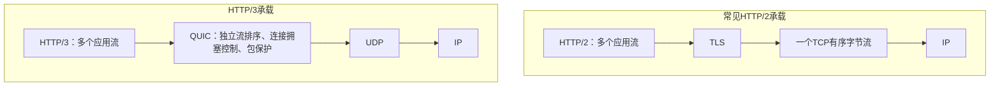

# TCP、UDP 与 QUIC：数据怎样交给另一端程序

发一句 `HELLO`，对方究竟收到“一句话”，还是几段字节？先看交付单位，再看丢失、乱序和限速。**TCP 交付有序字节流，UDP 交付数据报；消息含义仍由应用约定。**

## 1. 先看最关键的区别：字节流与数据报


TCP 保持 `HELLO` 后面接 `WORLD` 的顺序，**不保存两次 send 的调用边界**。要识别一句话，用长度、分隔符等分帧；连接出错仍须按失败处理。

UDP 保留报文边界，**不保证到达或顺序**；接收缓冲过小时还可能截断报文，须按 API 处理。[TCP 字节流](https://www.rfc-editor.org/rfc/rfc9293.html#section-2.2)、[UDP](https://www.rfc-editor.org/rfc/rfc768.html)

### 连接靠什么区分

常用五元组表示一条传输会话的网络端点：**协议、源 IP、源端口、目标 IP、目标端口**。TCP 服务端的同一个监听端口，可以接受来自许多客户端的不同连接。

端口是 16 位编号；客户端一般由系统选择临时端口。QUIC 另外使用连接 ID，支持在满足验证条件时迁移网络路径，不完全依赖五元组不变来维持连接身份。

## 2. TCP 的一生：三次握手、传数据、四次挥手 {#tcp-lifecycle}

**建连先对齐编号；断连分别说“我不再发了”。** 时间从上往下走，看同一条连接怎样开始、传数据、结束。


图中客户端先连接、先关闭；初始序号和数据长度仅是例子。省略丢包、重传与握手数据。

### 读图只需要四个词

- **SYN：我要建连**；**FIN：我不再发送**。
- **seq：这段从哪个字节编号开始**；双方各自编号。
- **ack：下次想收到哪个编号**；`ack=111` 表示已连续收到前面的字节。
- **SYN、FIN 各占一个编号，纯 ACK 不占**。图中客户端：`100 → 101 → 111 → 112`。

### 为什么握手通常三次，挥手通常四次

**三次：我报编号 → 你确认并报编号 → 我再确认。** 服务端等第三步，才确认客户端认可自己的起始序号；旧的重复 SYN 不应单独建成一条连接。[RFC 9293 §3.5](https://www.rfc-editor.org/rfc/rfc9293.html#section-3.5)

**四次：我发完 → 你确认 → 你也发完 → 我确认。** 你收到我的 FIN 时，可能还有数据要发，所以不能立刻结束自己的发送方向；ACK 与 FIN 也可能合并，实际未必四个包。[RFC 9293 §3.6](https://www.rfc-editor.org/rfc/rfc9293.html#section-3.6)

### 关闭时最容易混淆的两个状态

- **CLOSE_WAIT：等本端应用关。** 对方不发了，我还没结束发送；长期堆积时查资源释放。
- **TIME_WAIT：留一会儿善后。** 最后 ACK 丢了，还能回应重传的 FIN；也给旧报文消退留时间。

等待按 **2×MSL** 描述，MSL 是报文最大生存时间，具体秒数看实现；TIME_WAIT 也可能出现在服务端。[RFC 9293 §3.6.1](https://www.rfc-editor.org/rfc/rfc9293.html#section-3.6.1)

<details>
<summary>再深一步：ACK、半关闭与特殊情况</summary>

- `ACK` 是标志，`ack` 是确认号字段；标志置位时字段才有效。
- 第三次握手可带数据；TCP Fast Open 等扩展不在此图范围。
- 两端可同时关闭，并都进入 TIME_WAIT；谁是客户端不决定谁必须等待。
- **半关闭**允许“停止发送，继续接收”，见[Socket](./socket.html)。`RST` 是复位，不能当作正常 FIN 收尾。
- TCP 握手不验证网站身份，也不加密数据，这些由 TLS 等机制处理。

图解讲法参考[小林 coding 的握手与挥手篇](https://xiaolincoding.com/network/3_tcp/tcp_interview.html)，本站图重新绘制，报文与状态按 RFC 9293 图 6、图 12 核对。

</details>

### 头部里真正起作用的字段

```text
Source Port / Destination Port    交付到哪一对端点
Sequence Number                  当前段的序号
Acknowledgment Number            下一期望序号，ACK标志置位时有效
SYN / ACK / FIN / RST             建连、确认、关闭、复位等控制
Window                           对方还可向我发送多少窗口内数据
Checksum                         检测传输错误，不是密码学身份验证
Options                          例如MSS、窗口扩大、SACK等能力
```

序号按 32 位空间循环，正文的加法只为说明连续关系；TCP 实现还要做环绕比较、窗口检查和状态处理。**PSH 也不是应用消息结束标记。**

## 3. 可靠从哪里来：编号、确认、重排、重传

假设 `2001–3000` 丢了，后面的 `3001–4000` 先到。接收端不会把后段当作连续数据直接交给应用：


- **编号按字节**：`ACK=2001` 表示下一期待字节是 2001，不是“第 2001 个包”。
- **后到可暂存，但不能越过缺口交付。** SACK 可另说明哪些后段已收到。
- **发送端判断丢失后补缺段。** 不应把图中的一个重复 ACK 当作快速重传的充分条件。

SACK 是 Selective Acknowledgment（选择确认）。如何结合确认信息与定时器判断丢失，取决于实现；不能从这一张图推导固定重传阈值。

重传定时器会考虑估计往返时延 RTT 与波动，并在超时时退避；不是每隔一个固定常量盲目重发。[重传定时器](https://www.rfc-editor.org/rfc/rfc6298.html#section-2)、[拥塞恢复基线](https://www.rfc-editor.org/rfc/rfc5681.html#section-3.2)

**可靠有序是服务语义，不是“网络永远不会失败”。** 到达重试/超时等边界时连接仍会报错；TCP ACK 通常由接收端协议栈生成，不能证明应用已经处理、持久化或完成支付。

### 两种窗口，不要混为一谈

看起来都是“发送变慢”，原因可能完全不同：**对方缓冲满了，或路径已经拥挤。**


- **rwnd：别压垮对面。** 接收端通告剩余接收能力；应用不读，缓冲会积压。
- **cwnd：别压垮路径。** 发送端根据拥塞控制调整在途预算，不是接收端给的容量。

简化理解：在途数据不能无视 `min(rwnd, cwnd)`；实际发送还受节奏控制、发送缓冲和实现策略影响。慢启动、拥塞避免等负责调整流量，**慢启动不等于始终“每秒多发一个包”**。[TCP 拥塞控制](https://www.rfc-editor.org/rfc/rfc5681.html#section-3)

应用不读接收缓冲，最终会让窗口缩小；服务端发送很快而客户端处理很慢时，真正问题可能是应用消费速度，而不是应该无限增大网络并发。

## 4. UDP 与 QUIC：选择的是能力，不是“快慢标签”

**QUIC 在 UDP 上构建受保护的多流连接。** 它自己补齐握手、可靠流、流控和拥塞控制；不是因为用了 UDP 就不重传。

<details>
<summary>选型速查：TCP、UDP、QUIC 可靠流的能力</summary>

| 维度 | TCP | UDP | QUIC 的可靠流 |
| --- | --- | --- | --- |
| 交付单位 | 有序字节流 | 单个数据报 | 每条流内有序字节 |
| 丢失与重排 | 协议重传、重排 | 基础协议不保证 | 协议按流恢复数据 |
| 拥塞与流控 | 协议栈负责 | 应用/上层需负责适当机制 | 连接拥塞控制、连接/流级流控 |
| 通道安全 | 本身不加密 | 本身不加密 | 集成 TLS 握手与包保护 |
| 典型用途 | HTTP/1.1、HTTP/2 等 | 传统 DNS、媒体承载等 | HTTP/3 等 |

</details>

**QUIC DATAGRAM 是另一个扩展能力**，提供不可靠数据报；不能把全部 QUIC 数据都当成可靠流。[QUIC 流](https://www.rfc-editor.org/rfc/rfc9000.html#section-2)、[DATAGRAM 扩展](https://www.rfc-editor.org/rfc/rfc9221.html#section-1)

UDP 保留报文边界，不承担 TCP 式重传、有序交付和流控。实时语音可能宁愿丢掉过期音频，也不愿为旧帧重传一直等待；但应用仍要考虑拥塞、公平性与丢失恢复策略。

**QUIC 没有因为使用 UDP 就放弃可靠性。** 它在用户态传输实现中管理连接、可靠流、确认、丢失检测和拥塞，结合 TLS1.3 进行握手与包保护。



TCP 某一处字节丢失会阻止其后字节按序交付，可能影响承载在上面的多个 HTTP/2 流；QUIC 按流管理交付，某一流的缺口不必挡住其他流已具备的数据。

但 QUIC 并不是“任何时候都不阻塞”：同一流仍需等缺失数据，多个流共享路径拥塞约束，应用依赖也会造成等待。网络封禁 UDP、服务器能力或应用库限制，也会影响是否能使用它。[QUIC 连接与流](https://www.rfc-editor.org/rfc/rfc9000.html#section-2)、[QUIC 丢失检测与拥塞](https://www.rfc-editor.org/rfc/rfc9002.html#section-1)

## 5. 在本机比较 TCP 与 UDP

下载[统一实验脚本](/assets/network/network_lab.py){download="network_lab.py"}后，在两个终端分别执行：

```sh
# TCP：先启动服务端，再运行客户端。
python network_lab.py tcp-server
python network_lab.py tcp-client --split
```

`--split` 把一个应用帧拆为多次 `send`；服务端仍应按长度收齐再解析。**它不保证制造几个 TCP 段**，因为应用调用次数与线上分段不是同一层的边界。

```sh
# UDP：同样先启动服务端，再运行客户端。
python network_lab.py udp-server
python network_lab.py udp-client
```

端口、超时和帧上限以脚本中的 `TCP_PORT`、`UDP_PORT`、`IO_TIMEOUT`、`MAX_FRAME` 为准。本机回环收发能验证 API 与分帧，不能据此断言公网没有丢包、UDP 天生更快或 QUIC 已经过实测。

## 6. 最需要记住的边界

- **TCP 收到 ACK，不等于业务完成。** 要由应用响应、持久化语义与请求标识决定。
- **超时后重连，不等于可以重新执行所有操作。** 对方可能已提交，重试要有幂等设计。
- **心跳、重连和断点恢复不是同一功能。** TCP keepalive 也不能代替应用级健康检查。
- **长连接不是永生连接。** NAT、代理、进程重启和网络切换都可能让它失效。
- **换 QUIC 不会消除所有慢。** 应用处理、限流、拥塞与内容大小仍然存在。

自测：为什么两次 send 只读出一次不算错误？为什么 ACK 不代表订单落库？为什么服务端出现 CLOSE_WAIT，先看应用关闭流程而不是盲目缩短 TIME_WAIT？

[上一篇：域名与 DNS](./dns.html) · 下一篇：[Socket 编程](./socket.html)
