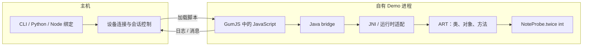

# Frida：原理、Java API 与运行时诊断

Frida 把脚本运行时放入被观察进程，通过运行时桥访问 Java 对象，或通过 Gum 观察原生代码。**主机负责控制会话，脚本在目标进程执行，Java 方法仍由 ART 执行**；把三者分开，才能判断错误发生在哪里。[运行模式](https://frida.re/docs/modes/)

## 四篇笔记怎么读

| 笔记 | 解决的问题 | 关键知识 |
| --- | --- | --- |
| [安装与版本](./installation.html) | 装哪个包，为什么连接或加载失败 | CLI / 绑定 / server 的区别、ABI、Frida 17 bridge |
| [Java API 与 Demo](./java-api.html) | 找到类、方法与实例后怎样观察 | ClassLoader、枚举契约、重载、原方法调用及恢复 |
| [SELinux 与权限拒绝](./selinux-diagnostics.html) | 怎样确认拒绝来自哪一层 | DAC / MAC、AVC 字段、进程域、错误归因 |
| [Smali trace 与 ART](./smali-trace.html) | 怎样理解指令轨迹及其局限 | DEX PC、解释执行、JIT / AOT、上游适配范围 |

## 从命令到 Java 方法

`Java.perform()` 解决当前线程接入 Java VM 与应用 ClassLoader 就绪的问题，不等于把工作切到 Android 主线程。需要操作 UI 时才选择主线程调度；单纯枚举或打印不能顺手放入耗时业务。[Java bridge API](https://frida.re/docs/javascript-api/#java)

Frida 17 开始，Java bridge 从 GumJS 核心拆出。CLI 中能直接使用 `Java`，不代表 Python `create_script()` 加载的任意文本也自带 `Java`；两条加载路径的差别见[安装与版本](./installation.html#java-未定义时先查加载方式)。

## 自有实验 App

实验包名固定为 `com.example.fridalab`，只包含按钮、一个实现接口的对象和纯函数 `twice(int)`。它没有账号、网络或敏感数据，可用同一份源码比较“未观察”和“已观察”的运行结果。

<AttachmentDownload
  href="/attachments/frida/frida-java-lab.zip"
  name="frida-java-lab.zip"
  description="Java Demo 源码、Manifest、只读枚举脚本和单方法观察脚本；需放入自己的 Android debug 工程。"
/>

解压后按 README 放置源码，先确认点击按钮显示 `Result: 14`，再运行脚本。完整示例直接引用下载包中的源文件，代码与附件保持一致。类枚举、实例查找和方法观察分别说明在 [Java API](./java-api.html) 中。

## 常见误判

- **能连接不等于 Java 可用**：连接、脚本运行时、bridge、应用类加载是不同阶段。
- **类存在不等于实例存在**：加载记录、堆对象和已经执行过的方法不是同一种证据。
- **没有日志不等于没有执行**：进程、时机、ClassLoader、编译优化和过滤条件都可能影响观察。
- **一次能用不等于跨版本通用**：ART 内部结构和执行路径会随构建变化，尤其影响指令级工具。

## 原笔记

[版本安装](https://alidocs.dingtalk.com/i/nodes/ZQYprEoWonam2M04uAwYzdPL81waOeDk)、[SELinux](https://alidocs.dingtalk.com/i/nodes/9bN7RYPWdMnmGpkaFbgOwR3eVZd1wyK0)、[高级 API](https://alidocs.dingtalk.com/i/nodes/vNG4YZ7JnPamLrRKiBpN3REaW2LD0oRE)、[Frida-Smali-trace](https://alidocs.dingtalk.com/i/nodes/y20BglGWO2PdknARuqX2X05b8A7depqY)。API 行为以各节链接的上游文档与源码为依据，运行条件见具体示例。
