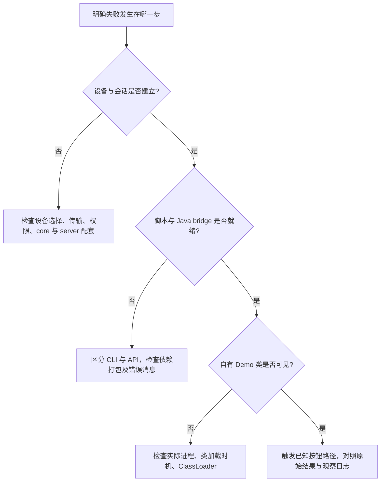

# Frida 安装、版本与连接排障

## 先分清安装对象

| 名称 | 放在哪里 | 负责什么 |
| --- | --- | --- |
| `frida-tools` | 主机 Python 环境 | `frida`、`frida-ps`、`frida-trace` 等命令行工具 |
| PyPI `frida` | 主机 Python 环境 | Python 绑定，CLI 使用的 Frida core 能力 |
| npm `frida` | Node.js 项目 | Node.js 绑定，用于开发自己的主机控制程序 |
| `frida-server` | 专用测试设备 / 模拟器 | 提供设备侧进程控制与会话服务 |
| `frida-gadget` | 自有测试 App 内 | 以嵌入库的方式接入，配置及 App 构建由开发者控制 |

原文用 npm 安装 `frida` 后再检查 CLI 版本，混淆了 **Node 绑定和 Python 工具链**。只想使用命令行时，从 `frida-tools` 开始；只有编写 Node 控制端时才在对应 Node 项目安装 npm 包。[官方安装](https://frida.re/docs/installation/)、[Node 绑定](https://github.com/frida/frida-node)

## 安装与核对

Windows PowerShell 示例使用独立虚拟环境，后续所有命令都显式指向该环境：

```powershell
python -m venv .venv
.\.venv\Scripts\python.exe -m pip install frida-tools
.\.venv\Scripts\python.exe -m pip show frida frida-tools
.\.venv\Scripts\frida.exe --version
.\.venv\Scripts\frida.exe --help
```

Linux / macOS 对应可执行文件位于 `.venv/bin/`。`frida --version` 显示 core 版本，**不是 `frida-tools` 包版本**。两者有独立发布节奏；工具是否兼容某个 core，要核对安装依赖约束，不要求它们版本号相等。[工具依赖定义](https://github.com/frida/frida-tools/blob/main/setup.py)

设备侧二进制从 [Frida 官方 Releases](https://github.com/frida/frida/releases) 选择，按同一 core 发布版本配套 server / Gadget，再核对 ABI 和目标进程位数。固定版本实验应记录实际安装结果与 Python 环境，不把一次安装时自动解析的结果当成永久兼容承诺。

## ABI 与运行环境

在测试设备上读取事实，不根据工程目录名或设备外观猜测：

```sh
adb devices
adb shell getprop ro.build.version.sdk
adb shell getprop ro.build.fingerprint
adb shell getprop ro.product.cpu.abilist
adb shell getenforce
```

设备支持的 ABI 列表不直接等于 App 实际进程位数。64 位系统可以运行 32 位 App，模拟器还可能存在 Native Bridge；分析 ART 内部结构前必须确认实际进程、所加载运行库及其构建。[Android 接入说明](https://frida.re/docs/android/)

server 模式需要测试镜像提供相应调试权限；应用内 Gadget 则需要开发者控制自己的 App 构建。`android:debuggable="true"` 只描述应用调试属性，不能自动赋予某个外部进程任意注入权限。

## `Java` 未定义时先查加载方式

Frida 17 拆出了 Java / Objective-C / Swift bridge；frida-tools 14 起，REPL 与 frida-trace 为兼容脚本预置这些 bridge。[17.0 发布说明](https://frida.re/news/2025/05/17/frida-17-0-0-released/)

### CLI 加载普通脚本

先完成自有 Demo 的构建、安装及测试镜像的官方连接配置。在附件解压目录运行：

```powershell
.\.venv\Scripts\frida-ps.exe -U
.\.venv\Scripts\frida.exe -U -f com.example.fridalab -l .\lab-inspect.js
```

虚拟环境若不在解压目录，替换为真实的工具路径。`-U` 选择 USB 设备，`-f` 启动指定 Demo，`-l` 加载脚本；用本机 `--help` 核对当前版本参数。附加到已运行 Demo 时，需要明确区分进程名、应用标识和 PID，不能把三者混用。[CLI 参数实现](https://github.com/frida/frida-tools/blob/main/frida_tools/application.py)

### Python / Node API 加载自定义 agent

通过 API 的 `create_script()` 加载文本时，Java bridge 不会因主机已安装 Python `frida` 就自动出现在 agent 中。自定义 agent 的源码需显式引入 bridge，再通过受支持的编译 / 打包流程生成可加载脚本：

```javascript
// 自定义 agent 源码的入口，不能把这一行直接当作裸脚本文本加载。
import Java from 'frida-java-bridge';
```

打包步骤、依赖与锁文件放在 agent 工程中，不能把主机 Node 绑定与进程内 Java bridge 当成一个包。附件的普通 `.js` 示例按 CLI 路径编写；API 加载时应先按 [Bridges 官方示例](https://frida.re/docs/bridges/) 集成，而不是删除报错检查。

## 连接、加载、业务命中分开排查



“Unable to perform state transition” 只能说明发生运行时转换错误，不能单独证明某次 ART 更新是根因。应同时记录完整异常栈、core / bridge 版本、系统 fingerprint、ART 模块版本及最小 Demo 的复现结果，再与上游问题和修复记录对照。

ART 是承担应用执行的系统模块，不能把卸载它作为通用 Frida 修复步骤。需要验证版本兼容性时，使用可恢复的专用测试镜像做对照，而不是在日常设备上破坏运行时。[ART 模块](https://source.android.com/docs/core/ota/modular-system/art)

权限拒绝继续查 [SELinux 与权限拒绝](./selinux-diagnostics.html)，类与方法可见性继续查 [Java API](./java-api.html)。
