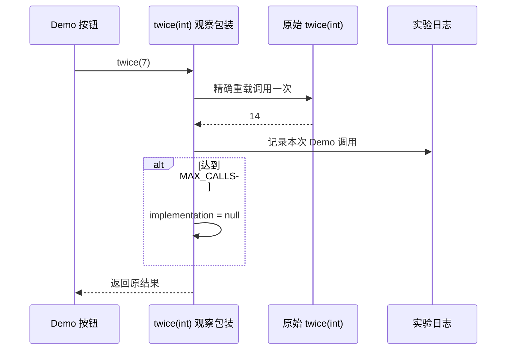

# Frida Java API：类、实例与方法观察

## 先区分类、方法和对象

`Java.use()` 获得类的 JavaScript 包装器；`Java.choose()` 查找堆中的存活实例；`Java.enumerateMethods()` 返回匹配方法的元数据。**获得包装器不等于构造对象，找到方法不等于方法已经执行，堆里有实例也不说明它仍属于当前页面。**

底层由 Java bridge 管理 JNI 调用、引用与运行时适配。脚本的 JavaScript 堆和 ART 的 Java 堆各自独立；对象包装器负责跨越这层边界。默认 ClassFactory 对应应用主 ClassLoader，同名类在不同 loader 中也可能是不同类型。[bridge 入口](https://github.com/frida/frida-java-bridge/blob/main/index.js)、[ClassFactory 实现](https://github.com/frida/frida-java-bridge/blob/main/lib/class-factory.js)

## 实验类与按钮入口

以下文件位于[源码附件](./#自有实验-app)的 `java-lab` 目录中；放入自己的 `com.example.fridalab` debug 工程，保持类名与方法名，不开启会改名的发布混淆。

<<< @/public/attachments/frida/java-lab/Probe.java

<<< @/public/attachments/frida/java-lab/NoteProbe.java

Activity 用字段保留 `NoteProbe`，避免对象在实验前被回收。按钮只调用 `twice(7)`，结果应为 `14`：

<<< @/public/attachments/frida/java-lab/DemoActivity.java

这是源码练习材料，Manifest 合并和 debug APK 构建按附件 README 完成；不依赖其他 App。

## `Java.perform()`：接入 VM，不是切换主线程

```javascript
Java.perform(() => {
  const Probe = Java.use('com.example.fridalab.NoteProbe');
  console.log(Probe.$className);
});
```

`perform()` 确保执行线程接入 Java VM；应用 ClassLoader 尚未可用时会延后执行。它不保证 Activity 已创建，更不保证所有插件类已加载。`Java.available` 表达当前进程存在受支持的 Java VM；Frida 17 自定义 agent 还需先解决 [bridge 的引入与打包](./installation.html#java-未定义时先查加载方式)。[API 契约](https://frida.re/docs/javascript-api/#java)

## 三种枚举 API

| API | 查询对象 | 参数与结果 |
| --- | --- | --- |
| `Java.choose(className, callbacks)` | 指定类的堆实例 | 回调 `onMatch(instance)` / `onComplete()`；`onMatch` 可返回 `"stop"` |
| `Java.enumerateLoadedClasses(callbacks)` | 当前已加载的类 | 回调 `onMatch(name, handle)`；同步版本 `enumerateLoadedClassesSync()` 返回类名数组 |
| `Java.enumerateMethods(query)` | 已加载类中的匹配方法 | 字符串查询，返回按 ClassLoader 分组的数组，不是回调对象 |

### `choose`：实例从哪里来

```javascript
Java.perform(() => {
  Java.choose('com.example.fridalab.NoteProbe', {
    onMatch(instance) {
      console.log(String(instance.getTag())); // 只读取 Demo 的固定标签。
      return 'stop';
    },
    onComplete() {
      console.log('instance lookup complete');
    },
  });
});
```

先打开 Demo 页面，让 Activity 创建并持有对象，再运行查找。`onComplete()` 发生不代表找到实例；零匹配可能来自生命周期、错误进程、错误 loader 或对象已回收。返回 `"stop"` 只会提前结束当前枚举，不意味着扫描一定没有暂停或运行时开销。

在回调之外保存对象要理解 `Java.retain()` 与 `$dispose()` 的引用生命周期；长期保留 Activity 会改变 GC 行为。本实验只在回调内读取，不保存实例。主动调用实例方法会新增一次执行，和“观察已有调用”是两种操作；只有确认方法无副作用时才能用于这种练习。

### 已加载类与接口

原文使用 `Java.use(className)` 再读取 `class.getInterfaces()`，默认 loader 未必能解析枚举得到的那个类。拿到 `onMatch` 的 Class 句柄后，可用 `Java.cast(handle, Java.use('java.lang.Class'))` 读取实际类型；完整写法见下方脚本。

`Class.getInterfaces()` 返回当前类直接声明的接口，不能据此列全继承链上的所有接口。需要判断某个父接口关系时，应沿父类 / 父接口递归，或使用反射的 `isAssignableFrom()` 判断类型兼容性，而不是只比较第一层接口名称。[Class 反射 API](https://developer.android.com/reference/java/lang/Class#getInterfaces())

### `enumerateMethods` 的正确写法

```javascript
Java.perform(() => {
  const groups = Java.enumerateMethods('com.example.fridalab.*!twice/su');
  for (const group of groups) {
    for (const type of group.classes) {
      console.log(type.name, JSON.stringify(type.methods));
    }
  }
});
```

查询格式为 `类名模式!方法名模式/修饰符`：`s` 包含方法签名，`u` 限定用户类，`i` 忽略大小写。结果中的 `loader` 是后续解析同一批类的重要上下文。原文 `enumerateMethods({ onMatch, onComplete })` 混用了其他枚举 API 的形式；它不会按预期返回带 `argumentTypes` 的逐方法回调。

## 可直接加载的只读脚本

脚本只输出 Demo 命名空间内的类、方法和固定实例标签；输出限额集中在 `MAX_ROWS`。类枚举仍会遍历 VM 的已加载类，堆实例查询仍有运行时成本，**限制打印条数并不等于限制扫描开销**。

<<< @/public/attachments/frida/java-lab/lab-inspect.js

启动早期对象还不存在时，先让 Demo 页面建立，再把同一脚本加载到该 Demo 的已运行进程。不要用固定 sleep 猜测对象生命周期。类枚举也没有文档化的 `onMatch` 返回 `"stop"` 契约，不能照搬 `choose` 的取消方式。

## 一个方法怎样观察和恢复

仅观察 Demo 的 `NoteProbe.twice(int)`，保存精确重载包装器，调用原方法一次并返回原结果。观察次数由 `MAX_CALLS` 控制，到达上限后把 `implementation` 设回 `null`：

<<< @/public/attachments/frida/java-lab/lab-observe.js

在同一个 Demo 会话中，单独加载该脚本，然后点击按钮。示例不修改参数、不伪造返回值、不吞掉原方法异常；但插桩会影响时序，日志或运行时自身的故障也可能影响程序。少于观察上限时，应卸载脚本或结束会话，不能把“暂时没有输出”当作已经恢复。



Java 方法观察与源码级调用不保证一一对应：重载、桥接方法、类加载副本、JIT / AOT 优化等都可能改变可观察路径。先用已知 Demo 验证脚本，再依据实际栈和目标执行模式判断；不要靠全局关闭优化来掩盖没有定位清楚的问题。

## ClassLoader 不匹配时

对 `enumerateMethods()` 返回的某个 group，使用它自己的 loader 创建 factory，不要全局修改 `Java.classFactory.loader` 后继续运行其他示例：

```javascript
Java.perform(() => {
  const groups = Java.enumerateMethods('com.example.fridalab.NoteProbe!twice/su');
  for (const group of groups) {
    if (group.loader === null) continue; // 本实验只处理应用 loader。
    const factory = Java.ClassFactory.get(group.loader);
    const Probe = factory.use('com.example.fridalab.NoteProbe');
    console.log(Probe.$className);
  }
});
```

这段代码只解析类，不替换方法。相同名称命中多个 loader 时，需要先确认每个实例属于哪个类型；不能因某个 `.use()` 成功，就认定已找到实际业务使用的那份类。

原始内容：[Frida 高级 API 用法](https://alidocs.dingtalk.com/i/nodes/vNG4YZ7JnPamLrRKiBpN3REaW2LD0oRE)。
