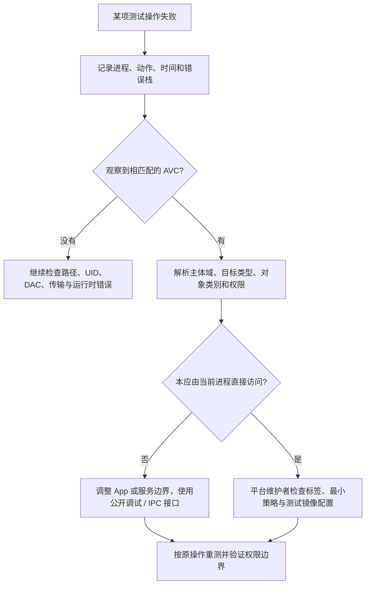

# Frida 与 SELinux：权限拒绝怎样定位

## root 为什么也可能被拒绝

Linux 文件权限、UID 和 capabilities 属于访问控制的一部分；Android 还使用 SELinux 强制访问控制。SELinux 根据主体域、目标类型、对象类别和请求权限决定是否允许操作，root 进程也受它约束。[AOSP SELinux](https://source.android.com/docs/security/features/selinux)

对一次文件访问而言，路径存在、DAC 允许和 SELinux 允许都需要分别检查。进程能够启动，也不代表它有权读取其他域的数据或访问对应进程资源。`EACCES` 只是一种失败结果，不能仅凭它认定是哪一层拒绝。

## 读取状态与复现日志

以下只读命令用于自己的测试镜像：

```sh
adb shell getenforce
adb shell id
adb shell ps -AZ
adb shell getprop ro.build.fingerprint
adb logcat -b all -d
```

`getenforce` 显示全局模式；具体域是否存在例外需结合设备策略，不能只看一个字符串。`ps -AZ` 用于关联进程与 SELinux 上下文。日志的可见范围受镜像和调试权限限制：查不到日志时，应先记录“当前来源未观察到”，不能断言没有拒绝。[模式与拒绝验证](https://source.android.com/docs/security/features/selinux/validate)

复现前记下时间、实际进程、动作及预期结果，复现后只提取相邻时间窗口的 AVC 和异常栈。日志可能含其他应用信息，保存或分享时应缩小范围并去除无关内容。

## 一条 AVC 日志在说什么

下面是用于解释格式的合成示例，不是当前设备的采样结果：

```text
avc: denied { read } for pid=1234 comm="lab-worker"
scontext=u:r:untrusted_app:s0:c100,c200
tcontext=u:object_r:lab_private_file:s0
tclass=file permissive=0
```

| 字段 | 要回答的问题 | 不能据此直接推出什么 |
| --- | --- | --- |
| `{ read }`、`tclass=file` | 访问哪类对象，申请什么权限 | 只开放 read 就一定解决整个业务 |
| `scontext` | 谁在发起访问，处于哪个域 | UID 为 root 就可以忽略该域 |
| `tcontext` | 被访问对象被标成什么类型 | 目标标签必然正确，应该立即新增 allow |
| `pid`、`comm` | 与哪个进程和复现时间关联 | 名称相同就一定是同一进程实例 |
| `permissive=0` | 这条拒绝记录处于怎样的执行状态 | 所有域和所有时间的模式都相同 |

`scontext` / `tcontext` 中的类型分别描述主体与对象安全类型；应用上下文中的类别还可能参与隔离判断，不能把上下文简化成一个 UID。判断因果时要把日志对应到**同一次操作**，再看操作失败和拒绝记录是否吻合。[AVC 字段说明](https://source.android.com/docs/security/features/selinux/validate)

## 从拒绝回到访问设计



App 开发者优先修正访问路径和组件边界，例如通过自己的 Service、受控文件入口或 debug 构建暴露实验能力。维护系统镜像时，先确认域和标签是否正确，再审查最小策略变更及回归；自动生成的 allow 规则不是正确性证明。正常 App 不应自行加载内核策略。[策略开发原则](https://source.android.com/docs/security/features/selinux/implement)

## 原文路径改写为什么不能证明“绕过内核策略”

原文修改可执行文件中的策略访问路径，再用字符串输出确认修改结果。它最多证明程序中的字符串发生变化，以及某条程序分支可能走了不同路径；不能据此证明内核已加载新策略、Enforcing 已改变或目标访问被授权。

路径不存在可能触发程序自身的错误处理或降级逻辑。**程序不再执行检查，不等于内核允许原本禁止的访问。** 应结合 AVC 和实际访问结果判断。

## 与 ART 兼容性分开

Java bridge 初始化异常、找不到类、ABI 不匹配和 ART 内部结构变化并不自动构成 SELinux 问题。出现权限拒绝时追拒绝证据；出现运行时异常时按[安装与版本](./installation.html)检查版本、bridge 及最小 Demo。两类问题同时出现，也需要各自建立因果证据。

原始内容：[SELinux 笔记](https://alidocs.dingtalk.com/i/nodes/9bN7RYPWdMnmGpkaFbgOwR3eVZd1wyK0)。
