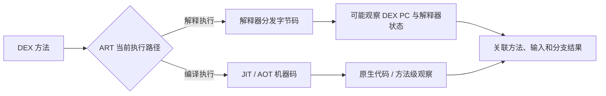
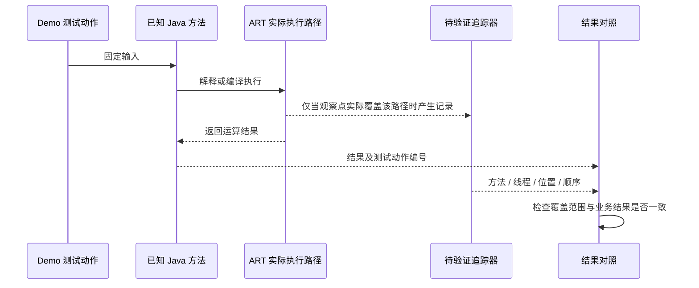

# Frida-Smali-trace：怎样理解 ART 指令轨迹

## 先分清观察层级

| 观察层级 | 一条记录通常表示什么 | 适合回答什么问题 |
| --- | --- | --- |
| Java 方法观察 | 某个类、loader 和重载的入口 / 返回 | 方法是否被调用，参数与结果怎样关联 |
| DEX / Smali 指令轨迹 | 某方法在特定 DEX PC 的字节码执行 | 解释执行时走了哪个分支，寄存器怎样参与运算 |
| Native 机器码轨迹 | 某线程执行的机器指令或基本块 | 原生函数及编译后代码的控制流 |

Smali 是 DEX 字节码的汇编表示；它的寄存器不是 CPU 的 `x0`、`x1` 等物理寄存器。DEX PC 表达方法字节码位置，也不能直接作为模块中的原生代码地址使用。追踪数据必须先说明自己记录的是哪一层。

## ART 为什么让映射变复杂

ART 可以解释执行，也可以使用 JIT / AOT 编译代码。方法运行在哪条路径上，取决于运行时、编译状态及实际调用；不能把源代码里的每次调用，都等同于解释器逐条分发字节码。[ART JIT](https://source.android.com/docs/core/runtime/jit-compiler)、[ART 概览](https://source.android.com/docs/core/runtime)

Frida 的 Stalker 追踪线程的**原生机器码执行**，不会自动把轨迹还原成完整 Smali 语义。解释器自身也是 Native 程序，观察它的机器指令后，仍需正确关联 ART 内部状态才能解释成 DEX 操作。[Stalker 原理](https://frida.re/docs/stalker/)

## 上游工具实际承诺的范围

原始笔记只有 [SeeFlowerX/frida-smali-trace](https://github.com/SeeFlowerX/frida-smali-trace) 链接。上游 README 声明其测试环境为 **Pixel 4、Android 11、64 位 App、构建 `RQ3A.210805.001.A1`**，并说明内部结构偏移可能随版本和设备变化。这是作者报告的环境，不是本仓库当前设备的实测环境。

它依赖对 ART 解释器内部路径的观察与适配。README 中出现的函数位置、结构偏移和寄存器用途属于对应构建的实现细节，不能从 Android 大版本相同就推出可复用，更不能据此宣称适配当前所有 Frida、ART 或 OEM 构建。

官方 Java bridge 与这类社区工具有不同适配边界：前者提供类、实例和方法抽象；后者可能直接依赖 ART 私有实现。遇到普通 Java API 已能回答的问题，先用[方法级 Demo](./java-api.html#一个方法怎样观察和恢复)，不必直接增加指令级追踪成本。

## 用已知 Demo 验证轨迹是否可信

以附件中的 `NoteProbe.twice(int)` 为对照对象：先确认源代码及实际 DEX 一致，再分别记录未观察的结果、方法级观察和待验证工具的输出。固定输入 `7` 对应结果 `14`；输入 `0` 对应结果 `0`。这只是实验预期，不是已经采集到的设备轨迹。

一次有意义的轨迹验证至少应能关联：方法所属 DEX、类与签名、ClassLoader、线程、执行区间、DEX PC 的语义，以及输入 / 输出结果。方法名相同但加载来源不同，或只记录了某个 Native 地址，都不足以证明观察到目标方法的全部字节码。

## 如何读缺失、重复和错位

- **缺失**：先检查进程、线程、方法实际执行路径和采集时间。解释器观察点没有覆盖编译代码时，空轨迹不证明方法没执行。
- **重复**：区分递归、循环、多线程、方法重入与重复安装观察器；同一日志出现多次不自动代表多次用户操作。
- **错位**：核对 APK / DEX / ART 构建，分清字节偏移与指令编码单位，再检查反汇编输出与轨迹的地址含义。
- **崩溃**：保留首次异常和 tombstone。优先回退实验变更及隔离问题，不用吞异常或改返回值制造“成功”。

## 记录哪些版本与产物

记录 APK 与 DEX 哈希、系统 fingerprint、进程位数、ART 模块及实际运行库标识、Frida core / bridge / 工具源码版本，再保留最小输入、原始轨迹与结果。此处要求记录 ART 细节，是因为工具依赖内部实现，而不是为所有知识点重复添加版本声明。

上游的支持范围只能作为起点；没有完成对应构建的验证时，应写“适配待验证”。本仓库没有对该社区工具做设备运行验证，也没有把其脚本或历史偏移打包成通用附件。

原始内容：[Frida-Smali-trace](https://alidocs.dingtalk.com/i/nodes/y20BglGWO2PdknARuqX2X05b8A7depqY)。
