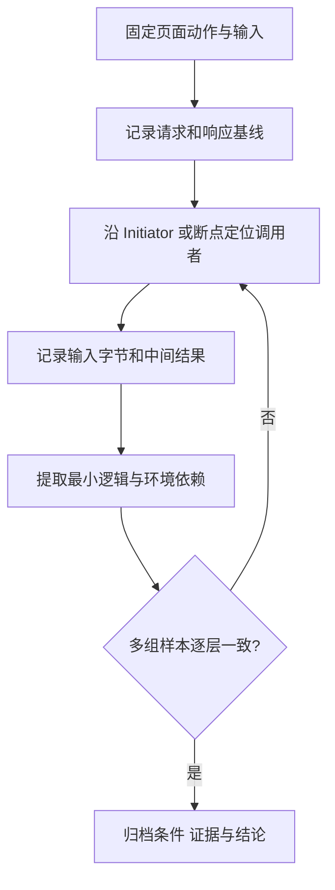
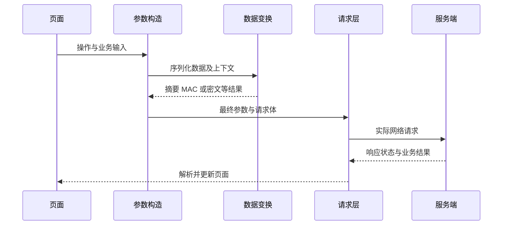
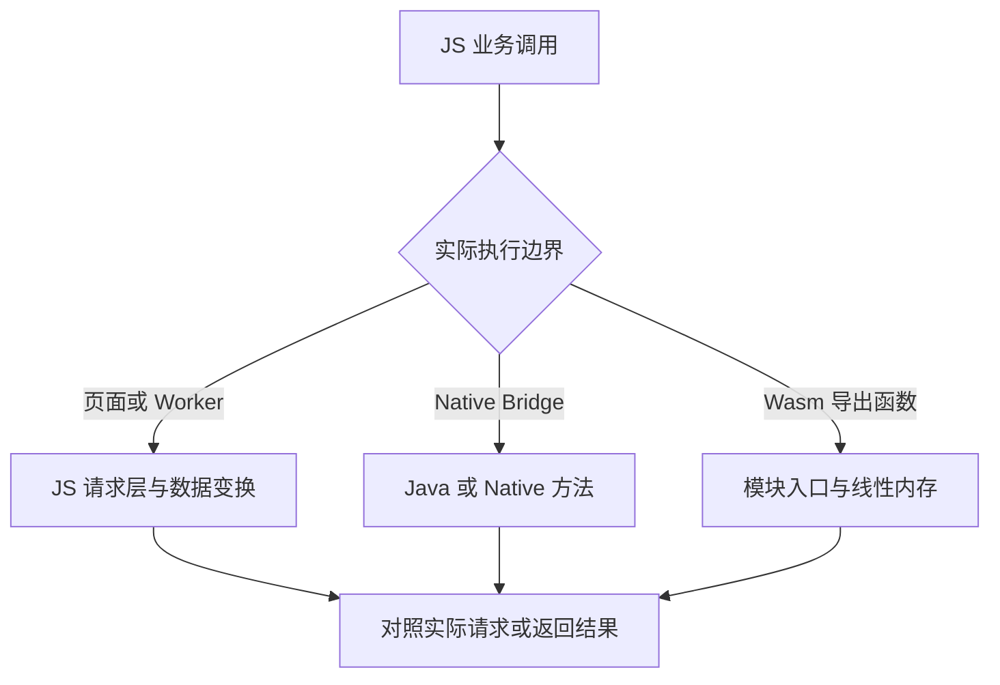

# Web JS 逆向：从 WebView 调试到请求链路还原

Web JS 逆向的核心是解释一条数据链：**输入从哪里来，经过哪些变换，由谁发送，怎样验证结果**。找到一个名字像 `encrypt` 的函数，或让某个请求成功一次，都只是分析过程中的证据。

以下使用自有测试页面说明 WebView 调试、断点和数据变换。

## 1. 先建立分析闭环

先选定一个可重复的页面动作，例如查询列表。记录页面地址、操作步骤、脚本资源标识及时间，再沿着这次动作的请求向上追踪。一次只改变一个业务字段，观察变换前后的差异，比同时修改多个参数更容易定位依赖。



每个结论都应能回到具体证据：脚本文件与位置、断点命中的调用栈、输入输出样本，以及复现时的环境。分析动作是否经过同一个入口，也要作为变量记录。

## 2. Android WebView：先连对进程和页面

### 2.1 开启调试与调试权限是两件事

Android 平台 WebView 从 **API 19** 提供静态方法 `WebView.setWebContentsDebuggingEnabled(boolean)`。它控制 Web 内容的调试能力，与 `setJavaScriptEnabled()` 的页面脚本执行开关不同。[WebView API](https://developer.android.com/reference/android/webkit/WebView#setWebContentsDebuggingEnabled(boolean))

对可修改源码的测试应用，可在初始化路径明确设置；下面是 Java 调用片段，`getApplicationInfo()` 来自 Activity 或其他 Context：

```java
if (android.os.Build.VERSION.SDK_INT >= 19) {
    boolean debug = (getApplicationInfo().flags
            & android.content.pm.ApplicationInfo.FLAG_DEBUGGABLE) != 0;
    android.webkit.WebView.setWebContentsDebuggingEnabled(debug);
}
```

当前 API 文档还说明：**WebView 113.0.5656.0 及以后**，当应用声明 `android:debuggable="true"` 时默认开启，否则默认关闭。

这里的版本是 WebView 实现版本，不是 Android API 等级。旧的 [DevTools WebView 指南](https://developer.chrome.com/docs/devtools/remote-debugging/webviews)仍保留早期描述，判断默认行为时应优先核对当前 API 文档与实际提供者。

### 2.2 VM 接入与主线程调度 {#_2-2-原文-frida-思路的最小化表达}

对自有调试 App，下面在 Java 桥已可用的会话中调用开关：

```javascript
Java.perform(() => {
  const WebView = Java.use('android.webkit.WebView');
  Java.scheduleOnMainThread(() => {
    WebView.setWebContentsDebuggingEnabled(true);
    console.log('WebView debugging requested');
  });
});
```

`Java.perform()` 负责附着 Java VM，并在需要时等待应用类加载器；调度到主线程由 `Java.scheduleOnMainThread()` 完成。二者不能混为一谈。[Frida Java API](https://frida.re/docs/javascript-api/#java)

开关应设置在**实际承载 WebView 的应用进程**。多进程应用中，WebView 宿主进程与内容渲染进程有不同职责；仅在另一个业务进程调用不会替宿主完成配置。核对 Chrome inspect 列表中的页面 URL，并确认断点能命中预期页面。

### 2.3 从设备发现到页面确认

1. 连接已开启 USB 调试的设备并完成授权，用 `adb devices -l` 检查连接状态。
2. 打开包含目标 WebView 的页面，在桌面 Chrome 地址栏输入 `chrome://inspect/#devices`。
3. 在对应页面下点击 **inspect**，核对页面 URL、标题与实际操作是否一致。
4. 触发一次业务动作，确认页面请求或断点随之变化，再开始记录证据。[设备远程调试](https://developer.chrome.com/docs/devtools/remote-debugging/)

记录系统与 WebView 环境时，可查询 `adb shell getprop ro.build.version.release`、`adb shell getprop ro.build.version.sdk`、`adb shell dumpsys webviewupdate`；记录这些命令的实际输出，不能从工程目录名或模块名称推断版本。第三方内核还需另行确认实现。

## 3. DevTools：从现象选择入口

**Network** 查看请求；**Sources** 查找生成请求的代码；**Console** 验证当前作用域；**Application** 查看缓存、Service Worker 和页面状态。截图为历史界面，面板位置随 Chrome 版本变化。

没有现成断点时，先看现象再选择工具：

- 已知接口路径：在 Sources 的 **XHR/fetch Breakpoints** 中添加 URL 片段，触发动作后沿调用栈回溯。
- 已知点击操作：在 **Event Listener Breakpoints** 中选择对应事件，随后收窄到具体业务调用。
- 已知 DOM 被改动：使用 DOM 变更断点，追踪修改者。
- 已知函数引用：Console 中用 `debug(fn)` 设置函数断点，完成后用 `undebug(fn)` 移除。

这些断点解决的问题不同；XHR/fetch 断点也不能替代 WebSocket 消息或 Native 网络调用的观察入口。[断点类型](https://developer.chrome.com/docs/devtools/javascript/breakpoints)、[Console 调试工具](https://developer.chrome.com/docs/devtools/console/utilities#debugfunction)


## 4. 从一条请求回溯参数生成

先在 Network 中记录一次完整基线：请求方法与路径、查询串、Content-Type、请求体原始表示、相关响应，以及请求的 **Initiator**。需要观察导航前后的链路时开启 Preserve log；缓存会影响结论时再对照测试缓存条件。WebSocket 应查看消息记录，不能只分析握手请求。[Network 参考](https://developer.chrome.com/docs/devtools/network/reference)

通常可从请求发送位置向上找“最后一次写入参数”的地方，再找该值的来源。不要从整个压缩包顶部开始逐行阅读。



这是阅读请求链的示意，不代表所有站点都会签名或加密。观察点应覆盖变换函数的输入、输出和最终发出的字节；存在拦截器、请求适配器或 Service Worker 时，参数构造完成后仍可能发生变化。

导出 HAR 时优先使用 DevTools 的 sanitized 选项，但其默认隐藏部分敏感请求头，**不代表 URL、请求体和响应都已脱敏**。分享前仍需检查业务数据，站点中只保存适合公开的样本。

## 5. 断点命中后怎样读调用栈

先看当前帧的参数、局部变量与 `this`，再向上找是谁提供了这些值。**Step over** 跨过当前调用，**Step into** 进入调用，**Step out** 回到调用者；应围绕目标字段跟进，避免陷入框架调度的每一层。


原文截图中的混淆名只对应当时脚本，不能作为其他页面的固定 Hook 点。可先用“事件分发”“请求适配器”“序列化”等职责做注释，并同时保留原名称与位置，便于回查。

Promise、定时器、事件队列会切断同步调用链；异步父栈是否完整取决于运行时与框架支持。Ignore List 可以减少第三方代码噪声，但也会隐藏关键帧；链路出现缺口时，应显示被忽略帧，并确认 Console 当前选中的是目标 frame / worker 与暂停帧。[调用栈与异步帧](https://developer.chrome.com/docs/devtools/javascript/reference#call-stack)

同步函数调用会压入新的执行上下文，返回后出栈。`await` 后续执行与 Promise reaction 则通过 job 调度，在浏览器中进入微任务；定时器回调属于任务调度。

它们恢复时，原来的同步调用栈通常已经退出，因此 DevTools 的异步父栈是调试器补充的因果关联，不是一直挂在栈上的调用帧。判断先后顺序时要同时看入队时机和实际执行时机，不能只按源码上下位置推断。[执行上下文](https://developer.mozilla.org/en-US/docs/Web/JavaScript/Reference/Execution_model#stack_and_execution_contexts)、[HTML 事件循环与微任务](https://html.spec.whatwg.org/multipage/webappapis.html#event-loops)

## 6. JS Hook：先观察，再讨论改写

原文通过覆写 `a.trigger` 阻止某个事件。它适合表达“某条分支会改变现象”，但 `return;` 也把返回值改为 `undefined`，可能破坏调用者对布尔值、对象或 Promise 的期待。现象消失并不能独立证明最上游原因。

### 6.1 一个可恢复的普通方法观察器

下面只处理**自有、可写的数据属性方法**，不适用于访问器、构造器、私有方法或被冻结的对象。它转交原 `this` 与所有实参，并原样返回结果；观察回调只用于本地诊断。

```javascript
function observeMethod(owner, key, onCall) {
  const descriptor = Object.getOwnPropertyDescriptor(owner, key);
  if (!descriptor || !descriptor.writable
      || typeof descriptor.value !== 'function') {
    throw new TypeError('需要自有、可写的普通方法');
  }
  const original = descriptor.value;
  function wrapped(...args) {
    try { onCall(args); } catch { /* 观察回调失败不阻止原调用 */ }
    return Reflect.apply(original, this, args);
  }
  Object.defineProperty(owner, key, { ...descriptor, value: wrapped });
  return function restore() {
    if (owner[key] !== wrapped) {
      throw new Error('方法已被其他代码替换，请先核对当前状态');
    }
    Object.defineProperty(owner, key, descriptor);
  };
}
```

`Reflect.apply()` 指定原函数调用的 `this` 与参数列表。[ECMAScript 调用语义](https://tc39.es/ecma262/2022/multipage/reflection.html#sec-reflect.apply) 这里不把 wrapper 声明为 `async`，也不额外挂 `.then()`，以避免包装 Promise 或改变未处理拒绝的观察方式；原方法抛出的异常仍向外传播。

用自造对象验证，不依赖第三方页面里恰好存在名为 `a` 的变量：

```javascript
const pending = Promise.resolve('demo');
const demo = {
  prefix: 'local',
  trigger(name) { return `${this.prefix}:${name}`; },
  load() { return pending; }
};
const restore = observeMethod(demo, 'trigger', ([name]) => {
  console.log('event:', name); // 只记录当前实验所需字段
});
console.assert(demo.trigger('click') === 'local:click');
restore();
const restoreLoad = observeMethod(demo, 'load', () => {});
console.assert(demo.load() === pending); // Promise 对象身份不变
restoreLoad();
```

::: warning 观察仍会影响运行
wrapper 会改变函数身份、调用栈和耗时；观察回调若修改实参对象，也会改变业务行为。日志中的对象还可能在展开时显示后续状态，应只复制必要的基本类型或明确的字节样本。需要看异步结果时，优先在原代码完成分支设断点，而非随意改造 Promise 链。
:::

### 6.2 Hook 不生效时检查什么

闭包变量、ES Module 局部绑定不会自动出现在 `window` 上；已缓存的原函数引用、已 `bind()` 的函数，以及另一个 iframe / worker 的对象，也不会因为覆写某个属性而全部更新。刷新、导航和应用重新初始化可能让 Hook 失效。

Snippets 适合保存手动诊断脚本，但不会自动保证在业务初始化之前执行。`debug()` 等 Console Utilities 也不是页面或 Node.js 的标准全局 API。先确认引用、上下文与安装时机，再扩大 Hook 范围。

## 7. 参数还原：先区分编码、摘要与密码运算

字符串长得像随机值，不足以判断算法。先定位运算调用与输入字节，再讨论输出表示；同一种算法也可以输出不同格式。

| 变换 | 主要目的 | 是否依赖密钥 | 还原时要确认 |
| --- | --- | --- | --- |
| URL 编码 / Base64 | 表示或传输数据 | 否 | 字符集、转义规则、Base64URL 与填充 |
| SHA-256 等摘要 | 计算固定长度摘要 | 否 | 原始字节、算法、十六进制大小写等 |
| HMAC | 带密钥的消息认证码 | 是，共享密钥 | 消息、密钥字节、摘要算法 |
| AES 等加密 | 保护明文内容 | 是 | 模式、IV / nonce、标签或填充、密钥 |
| 非对称签名 | 用私钥签名、用公钥验证 | 是，密钥对 | 算法参数、待签字节、签名编码 |

HMAC 在部分业务里被叫作“签名”，但它与非对称数字签名的密钥关系不同；Base64 也不是加密。Web Crypto 的 `digest()` 用于摘要，`sign()` 则覆盖 HMAC 和若干签名算法。[摘要 API](https://developer.mozilla.org/en-US/docs/Web/API/SubtleCrypto/digest)、[签名与 HMAC](https://developer.mozilla.org/en-US/docs/Web/API/SubtleCrypto/sign)

### 7.1 “对象一样”不代表字节一样

核对字段顺序、空值处理、数字格式、重复查询参数、百分号编码、空格、换行与时间单位。`JSON.stringify()` 有规定的属性遍历顺序，但它不会自动执行某个服务所要求的通用规范化；把所有字段排序同样不是通用解法。[ECMAScript JSON 序列化](https://tc39.es/ecma262/2022/multipage/structured-data.html#sec-serializejsonobject)

```javascript
const left = JSON.stringify({ a: 1, b: 2 });
const right = JSON.stringify({ b: 2, a: 1 });
console.assert(left !== right);

const query = new URLSearchParams();
query.append('q', 'a b');
console.assert(query.toString() === 'q=a+b');
console.assert(encodeURIComponent('a b') === 'a%20b');
```

`URLSearchParams` 以表单规则序列化，空格写成 `+`；不要不经核对就拿它替换原站的编码方式，重复编码也会造成差异。[WHATWG 查询参数编码](https://url.spec.whatwg.org/#urlsearchparams-stringification-behavior)

### 7.2 用公开向量检查字节处理

下面仅验证 UTF-8 → SHA-256 → 小写 hex 这条局部链，不是任何站点的签名算法。可在支持 Web Crypto 的 HTTPS 页面或 localhost 环境运行：

```javascript
async function sha256Hex(text) {
  const bytes = new TextEncoder().encode(text);
  const digest = await crypto.subtle.digest('SHA-256', bytes);
  return Array.from(new Uint8Array(digest),
    b => b.toString(16).padStart(2, '0')).join('');
}
const expected = 'ba7816bf8f01cfea414140de5dae2223b0'
  + '0361a396177a9cb410ff61f20015ad';
console.assert(await sha256Hex('abc') === expected);
```

实际样本应保存每一步的字节或确定性表示：业务输入 → 序列化文本 → 输入 bytes → 运算结果 bytes → 输出编码。时间戳、随机数和会话材料应显式记录为依赖，再分别验证稳定部分与动态部分。

## 8. 压缩与混淆：恢复结构，保留语义

**格式化**改善缩进，不恢复原变量名；**Source Map** 把发布代码映射回可用的源位置，浏览器执行的仍是发布代码；**反混淆**则需要结合数据流证明某个转换保持行为。先确认映射对应当前脚本，再决定在哪一份代码上设断点。[Source Map 工作方式](https://developer.chrome.com/docs/devtools/javascript/source-maps)

对字符串表、常量表达式、包装函数、控制流平坦化等结构，可先做静态切片，只追踪目标参数依赖的部分。不要为了一个接口先还原整个 bundle。

需要批量处理时，可按“解析 AST → 小范围转换 → 生成代码 → 对照样本”推进。Babel 的 [parser](https://babeljs.io/docs/babel-parser)、[traverse](https://babeljs.io/docs/babel-traverse) 和 [generator](https://babeljs.io/docs/babel-generator) 分别负责解析、遍历与输出；解析成功或生成代码成功都不证明语义等价。

重命名应尊重作用域，不能全文替换同名标识符；常量折叠不能执行来源未知的函数；删除分支前要确认副作用与异常路径。每个转换单独保存依据和差异，保留原始脚本及其哈希，避免覆盖唯一证据。

## 9. 跨出页面：Native Bridge、Worker 与 Wasm

页面里找不到网络发送或密码运算时，应先判断它是否已跨越边界。下面是一种 Hybrid App 的可能路径，必须通过实际样本确认，不能把图当作目标实现结论。



**Native Bridge**：`addJavascriptInterface()` 是 Android 向 WebView 注入对象的一种机制，此外还可能有消息通道或自定义路由。确认桥对象、方法名、参数序列化、回调标识和返回路径，再去宿主追踪实现；JS 中看到结果不代表运算发生在 JS 内。[WebView Bridge API](https://developer.android.com/reference/android/webkit/WebView#addJavascriptInterface(java.lang.Object,%20java.lang.String))

**Worker / Service Worker**：它们有独立执行上下文；在页面 `window` 上覆写 `fetch` 不能自动覆盖 Worker 内调用。Service Worker 还可能拦截请求并返回缓存，出现“页面拿到数据但没有相应远端请求”时应核对这条路径。[Service Worker 原理](https://developer.mozilla.org/en-US/docs/Web/API/Service_Worker_API)

**WebAssembly**：先检查 JS 与 Wasm 的 imports / exports、输入长度、指针指向的内存区间及返回约定，再缩小到相关函数。WAT 是 WebAssembly 模块抽象语法的文本表示，与二进制格式表达同一层次的模块结构，不能等同于恢复原 C / C++ 源码。[Wasm 官方文本格式规范](https://webassembly.github.io/spec/core/text/conventions.html)

**迁移到 Node.js**：先列出 DOM、Web API、存储、时间、随机数、原生桥等依赖，区分纯函数与环境初始化。不要用一串空对象“补环境”后就认定语义一致；`node:vm` 也不是运行不可信代码的安全边界。[Node VM 文档](https://nodejs.org/api/vm.html)

## 10. 怎样证明还原有效

先做离线逐层比较，再在授权测试环境核对协议行为。测试至少覆盖正常输入、中文和空格、空值、特殊字符、字段顺序与时间变化；涉及 nonce、IV 或会话状态时还要明确哪些量固定、哪些量重新生成。

- **输入一致**：原始字节、编码和环境依赖都有记录。
- **中间结果一致**：比较每一层的实际输出，定位首次分歧。
- **协议行为一致**：同时检查状态码、业务响应和必要的服务端测试日志。
- **结论可复查**：保存脚本标识、样本、失败样本与适用条件。

HTTP 200 可能包含业务错误；一次成功也不能排除缓存、会话状态或服务器降级路径。失败则应区分算法差异、过期时间、重复 nonce、权限与网络条件。CORS 属于浏览器跨源访问约束，不能与服务端身份认证或签名校验混为一谈。[CORS 机制](https://developer.mozilla.org/en-US/docs/Web/HTTP/Guides/CORS)

## 11. 留下一份能接着分析的记录

建议按“问题与边界 → 环境与资源标识 → 复现动作 → 调用链 → 逐层样本 → 验证结果 → 未解决项”组织案例。函数先保留原名，再附上职责解释；对外分享时去除不适合公开的请求与账户数据。

结论明确分为：**已验证**，有可重复样本支持；**高置信推断**，证据较完整但仍缺关键观察；**仅静态映射**，只说明代码可能承担某职责，尚未证明本次动作经过它。

## 12. 继续查阅

完整抓包工具链见 [App 网络请求抓包](/tools/app-network-capture.html)，Java 方法观察见 [Frida Java API](./frida/java-api.html)，原始操作记录见[钉钉笔记](https://alidocs.dingtalk.com/i/nodes/7QG4Yx2JpLRmejbvS1GLMaNxJ9dEq3XD)。
