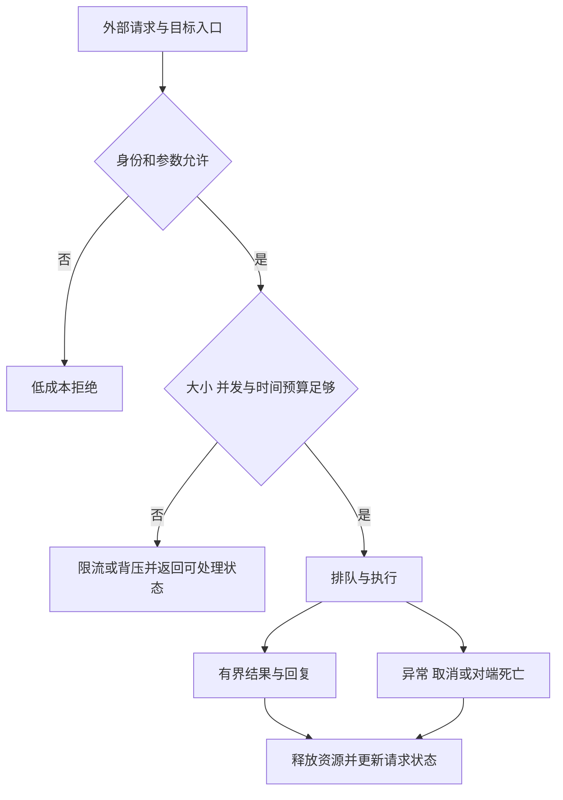

# 可用性与 Binder 数据预算

::: info 相关分类
- [getPackageInfo 安全](/security/android/dos-attacks.html#s234)
- [Binder 事务预算、flags 与异常处理](/security/android/dos-attacks.html#s237)
:::

`TransactionTooLargeException` 可能涉及共享缓冲区占用、请求大小或回复大小；它不能直接证明客户端发送了超过 1 MiB 的请求。可用性风险还需结合入口可达性、重复触发成本和受影响范围判断。

通信入口见 [Service 与 IPC](../foundation/service-ipc.html)，事务路由见 [Binder 机制](../../../android/framework/binder-mechanism.html)。

## 1. 从崩溃到 DoS 还缺哪些证据 {#dos-model}

可用性审计要先说明攻击者能否进入入口、能否反复触发、消耗了什么资源，以及影响持续多久。相同异常可能是普通输入错误、已授权用户操作失败，也可能是外部可控输入造成的服务不可用；错误类型本身不决定安全影响。

常见资源包括内存、CPU、Binder 缓冲区、工作队列、文件描述符和锁等待。多次小请求也可能耗尽共享资源；限制单条字符串长度不足以控制并发、深度嵌套或长期积压。对于客户端 API，还应检查是否在主线程同步等待，导致用户无法继续操作。[Android ANR 诊断原则](https://developer.android.com/topic/performance/vitals/anr)

判断风险至少保留四条证据：入口访问控制、可控数据到危险操作的数据流、重复触发所需成本、对其他用户或请求的影响。只提供一张崩溃截图，不能证明远程攻击可达，也不能证明服务恢复之后仍会持续失效。



图中的预算应覆盖请求和回复。已拒绝请求不应先完成昂贵解析，也不能靠无限重试把背压转换成新的排队风暴。

## 2. 共享事务缓冲区不是单笔配额 {#binder-budget}

官方异常文档将当前 Binder 事务缓冲区描述为约 1 MB，并明确它由进程中进行的事务共享。这个数量不能当作每笔调用都独享的有效载荷预算，更不能保证“略小于 1 MiB 就必定成功”。[TransactionTooLargeException 契约](https://developer.android.com/reference/android/os/TransactionTooLargeException)

固定源码中的 libbinder 还有 `1 MiB - 2 × page size` 的映射实现细节。Parcel 元数据、Binder 对象、并发占用和生命周期都会影响可用空间；API 文档近似值、实现映射大小和业务可用负载不是同一数字。[ProcessState 的映射定义](https://android.googlesource.com/platform/frameworks/native/+/refs/tags/android-16.0.0_r1/libs/binder/ProcessState.cpp)

同步调用要发送请求并接收回复。异常可能意味着请求没有送出，也可能意味着服务处理后无法发回回复。客户端仅凭异常不能判定业务未执行；对扣款、提交等有副作用操作，需要请求标识、幂等处理或状态查询，不能无条件重发。

缓冲区应按接收方向定位：请求进入服务进程的事务接收区，回复进入客户端的事务接收区。检查客户端请求大小，无法排除服务端生成大回复或客户端同时接收其他事务的占用；应分别限制双向数据量与在途请求数量。[驱动的目标进程分配路径](https://android.googlesource.com/kernel/common/+/refs/tags/android16-6.12-2025-06_r1/drivers/android/binder.c#3189)

`oneway` 不会消除缓冲区与服务端处理成本，也不提供无限异步队列。它改变远端等待语义，不能代替配额、背压或业务完成确认。具体线程与队列边界见 [Binder 的异步事务分析](../../../android/framework/binder-mechanism.html)。

### 限制的对象是协议，不只是数组

优先让接口只传所需字段；集合分页，并给每页条数、单项大小、嵌套层数和并发请求数设业务预算。图片、文件等大对象可考虑文件描述符或其他适合的通道，但仍须管理读写权限、总量、关闭和取消，而不是把内存风险转成文件描述符泄漏。

仅调用 `Parcel.dataSize()` 得到的局部序列化长度，也不是对端必然接收成功的证明。系统此刻的共享占用、其他事务与远端业务资源都不在该值里。[Parcel.dataSize](https://developer.android.com/reference/android/os/Parcel#dataSize())

## 3. getPackageInfo 的 flags 到底控制什么 {#package-flags}

`getPackageInfo()` 的 `flags` 指定需要附带的包信息和匹配条件，不是风险等级；非零不代表必然产生大响应或抛异常，零也不代表只有版本号。

在 `android-16.0.0_r1` 的 `PackageInfoUtils` 中，基础结果直接填充包名、版本、ApplicationInfo、安装和更新时间等数据；随后根据 flags 决定是否展开 Activity 等组件信息。

因此，应按实际字段需要选择 flags，而不是对所有非零 flags 机械套上 `catch RuntimeException`。[基础字段生成](https://android.googlesource.com/platform/frameworks/base/+/refs/tags/android-16.0.0_r1/services/core/java/com/android/server/pm/parsing/PackageInfoUtils.java#131)、[组件附加分支](https://android.googlesource.com/platform/frameworks/base/+/refs/tags/android-16.0.0_r1/services/core/java/com/android/server/pm/parsing/PackageInfoUtils.java#268)

组件、权限、签名等附加信息可能增加结果体积，但实际大小取决于包内容和返回路径。审计不能从一个 flags 值推导通用崩溃阈值，也不能因为只查询包名就跳过调用环境、包可见性与异常契约。[PackageManager 查询 API](https://developer.android.com/reference/android/content/pm/PackageManager#getPackageInfo(java.lang.String,int))

### 只查询自己确实需要的信息

下面读取本应用基础包信息。`PackageInfoFlags` 需要 compile SDK 33+；低版本分支使用 int 重载，包不存在时由调用方处理 `NameNotFoundException`。

```java
static String ownVersionName(Context context)
        throws PackageManager.NameNotFoundException {
    PackageManager pm = context.getPackageManager();
    String packageName = context.getPackageName();
    PackageInfo info;
    if (Build.VERSION.SDK_INT >= 33) {
        info = pm.getPackageInfo(packageName,
                PackageManager.PackageInfoFlags.of(0L));
    } else {
        info = pm.getPackageInfo(packageName, 0);
    }
    return info.versionName == null ? "" : info.versionName;
}
```

`PackageInfoFlags` 从 API 33 提供，包装 long 位集合；它不会自动限流或缩减响应。跨应用查询还涉及包可见性，不应为了这个示例申请查看全部已安装应用的能力。[PackageInfoFlags](https://developer.android.com/reference/android/content/pm/PackageManager.PackageInfoFlags)、[包可见性](https://developer.android.com/training/package-visibility)

错误处理应让调用方区分不存在、无权访问、对端/系统异常与业务取消等情况。吞掉所有异常并返回“安全”或“未安装”，会把不可用状态伪装成确定结果，干扰后续授权或风控判断。

## 4. 让昂贵工作保持有界 {#resource-policy}

假设业务需要处理用户提交的列表：先鉴权并检查集合长度，再逐项检查字符串、层数和总字节预算，才进入查询、解码或落盘。多个请求共享的任务池也要有上限；排队满时给出明确可恢复结果，而不是继续创建线程。

建议把资源策略与业务结果分开：

- **入口配额**：单次大小、每个已验证身份的速率，以及全局并发预算。
- **执行配额**：最大展开量、工作队列、取消/超时如何传播，避免后台任务失去所有者。
- **结果配额**：分页、裁剪规则和总量限制，避免“请求小、回复巨大”。
- **失败协议**：副作用请求可查询状态，重试有退避和总次数上限；不自动重试永久性输入错误。

这些预算需结合负载实测，不存在适合所有设备与业务的固定阈值。输入大小检查应在实际分配和解析前实施；事后捕获 OOM 不能替代内存预算和受控恢复设计。

## 5. 验证路线与观察证据 {#verification}

在自有测试服务分别改变单次数据量、并发数和返回结果量，记录请求 ID、入口线程、开始/完成状态及异常。一次只改变一个因素，并设置停止条件，不用无限循环或不断加压系统服务来寻找所谓“设备极限”。

对包查询先保存 OS、target SDK、目标包和 flags，比较实际返回的基础字段及附加字段；不要根据异常截图倒推返回对象内容。若发生事务失败，结合客户端与服务端记录确认是否已执行，保留结果不确定这一状态。

记录设备环境时可使用以下只读查询：

```sh
adb shell getprop ro.build.version.release
adb shell getprop ro.build.version.sdk
adb shell getprop ro.build.fingerprint
```

最终报告应注明可达入口、资源瓶颈、受影响范围和恢复条件；“本次没有复现”不能证明所有并发与设备状态下都安全。进一步阅读[不可信文件与图片](../engineering/untrusted-files.html)，把 Binder 体积与业务展开后的资源消耗一并审计。
