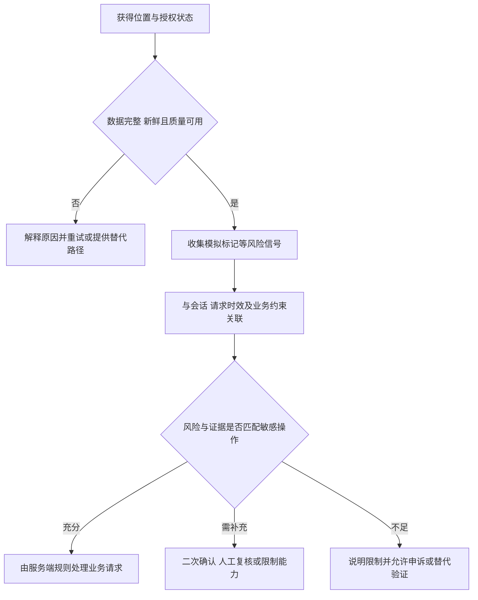

# 模拟位置与位置业务风控

::: info 相关分类
- [模拟位置检查](/security/android/configuration-security.html#s153)
- [开发者选项与模拟位置应用检测](/security/android/configuration-security.html#s156)
:::

开发者选项描述设备设置状态，不能直接证明某次位置是否真实。位置业务需要分别评估采样质量、模拟标记、会话关联与操作风险，再决定重试、复核或授权。

客户端信任边界见[安全模型](../foundation/security-model.html)，账号关联和恢复策略见[数据生命周期](../engineering/data-lifecycle.html)。

## 1. 模拟标记说明什么 {#mock-signals}

`Location.isMock()` 从 API 31 提供，用于查询位置是否被标记为模拟位置。旧的 `isFromMockProvider()` 从 API 18 提供并在 API 31 弃用；对 Framework 提供的位置，该标记与测试位置提供者有关。[Location 标记契约](https://developer.android.com/reference/android/location/Location#isMock())

标记为 true 是具体的异常/测试信号，不等于已经证实欺诈；标记为 false 也不是不可伪造的位置真实性证明。如果进程、上报链或数据源已不可信，读取本地字段无法独立证明用户在某个物理地点。

还要区分两个问题：**这次采样是否足够新且准确**，以及**这次位置能否作为敏感操作的可信证据**。没有 mock 标记的旧缓存、低精度或错误采样，也可能不满足业务要求；误差不是恶意的同义词。



图中“充分”是业务策略判断，不是客户端保证地理坐标绝对真实。风险措施应尽量作用于敏感操作，避免把整台开发设备或所有用户直接封禁。

## 2. 开发者选项不能代替位置证据 {#developer-settings}

`Settings.Global.DEVELOPMENT_SETTINGS_ENABLED` 描述开发设置开关，而不是某次定位的来源。即使能读到开启状态，也不能说明用户选择了模拟应用，更不能说明这次请求使用了模拟位置。

还需注意接口可见性的演进：当前官方滚动 API 文档注明第三方应用读取该项总返回 0；`android-16.0.0_r1` 的字段定义只列出可读声明。不能据此猜测具体变更切点，也不能把一次读取为 0 解释成确定未开启。运行平台和可用性要实际核对。[当前 API 契约](https://developer.android.com/reference/android/provider/Settings.Global#DEVELOPMENT_SETTINGS_ENABLED)、[固定标签字段定义](https://android.googlesource.com/platform/frameworks/base/+/refs/tags/android-16.0.0_r1/core/java/android/provider/Settings.java#14067)

旧的 `Settings.Secure.ALLOW_MOCK_LOCATION` 自 API 23 弃用，官方说明该设置已不再使用。继续读取旧键、反射隐藏接口或依赖设置界面文字，不能构成通用可靠检测方案。[旧设置的弃用说明](https://developer.android.com/reference/android/provider/Settings.Secure#ALLOW_MOCK_LOCATION)

普通应用不能凭一个旧开关就可靠还原所有平台上的模拟位置应用选择状态。采集信号应限于业务必要范围；应用安装情况本身不证明这次定位来源。

## 3. 教学示例：只做候选位置分级 {#candidate-validation}

下面片段根据采样年龄、精度与模拟标记输出候选位置状态，要求 API 18+、compile SDK 31+。参数由业务定义；失败状态保留原因，不直接决定账号处罚或交易授权。

```java
enum FixDecision { RETRY_QUALITY, REVIEW_SIGNAL, CANDIDATE_ONLY }

static FixDecision classifyFix(Location fix, long maxAgeMillis,
        float maxAccuracyMeters) {
    if (maxAgeMillis < 0 || Float.isNaN(maxAccuracyMeters)
            || Float.isInfinite(maxAccuracyMeters)
            || maxAccuracyMeters <= 0) {
        throw new IllegalArgumentException("invalid policy budget");
    }
    if (fix == null || !fix.hasAccuracy()) {
        return FixDecision.RETRY_QUALITY;
    }
    double latitude = fix.getLatitude();
    double longitude = fix.getLongitude();
    if (Double.isNaN(latitude) || latitude < -90 || latitude > 90
            || Double.isNaN(longitude) || longitude < -180 || longitude > 180) {
        return FixDecision.RETRY_QUALITY;
    }
    long now = SystemClock.elapsedRealtimeNanos();
    long sampled = fix.getElapsedRealtimeNanos();
    if (sampled < 0 || sampled > now) {
        return FixDecision.RETRY_QUALITY;
    }
    long ageMillis = java.util.concurrent.TimeUnit.NANOSECONDS
            .toMillis(now - sampled);
    float accuracy = fix.getAccuracy();
    if (ageMillis > maxAgeMillis || Float.isNaN(accuracy)
            || Float.isInfinite(accuracy) || accuracy < 0
            || accuracy > maxAccuracyMeters) {
        return FixDecision.RETRY_QUALITY;
    }
    boolean mock = Build.VERSION.SDK_INT >= 31
            ? fix.isMock() : fix.isFromMockProvider();
    return mock ? FixDecision.REVIEW_SIGNAL : FixDecision.CANDIDATE_ONLY;
}
```

本例要求位置来自当前启动周期内的可信获取路径。`getElapsedRealtimeNanos()` 可与本机单调时钟比较，不能拿另一设备或重启前的值计算年龄；墙上时间会被用户或网络校时改变，不适合替代这个年龄比较。[Location 时钟约定](https://developer.android.com/reference/android/location/Location#getElapsedRealtimeNanos())

`getAccuracy()` 是以米为单位、约 68% 置信水平的水平误差半径，不是误差绝不会超过的上界。处于签到区域边缘时，单个坐标落在线内不足以确定真实位置也在线内；可要求更新采样、结合误差范围复核或提供替代流程。[水平精度契约](https://developer.android.com/reference/android/location/Location#getAccuracy())

坐标范围检查不替代业务范围判断。调用方仍需实现定位订阅、权限申请和服务端防重放，并明确 Location 对象的修改所有权，避免分级过程中被其他线程改变。

同一误差阈值不适合所有用途。系统允许用户仅授予近似位置；地下空间、弱信号和节电环境也可能降低质量。应解释为何需要更精确或更新的位置，允许重试及合理替代，而不是把授权较少或定位较差判为攻击。[位置权限与精度选择](https://developer.android.com/develop/sensors-and-location/location/permissions)

## 4. 敏感业务需要独立关联 {#server-policy}

位置上报需要与已授权的会话、具体操作及有限有效期关联。服务端对业务请求作最终授权，并限制重放与频率；仅在客户端比较距离或时间，不能阻止不可信客户端直接构造请求。这是从客户端信任边界导出的设计要求，不是某个位置 API 自带的能力。

可以组合账户行为、请求时序、位置质量和必要的环境信号，但每类信号都应有可解释用途。诸如“不可能的移动速度”也受采样误差、旧位置和多设备会话影响，应核对数据关联，而不是直接从两个坐标作永久处罚。

若引入 Play Integrity 等额外服务，先确认分发环境、接入契约和服务端验证流程。完整性判定面向应用/设备风险，并不自动证明 GPS 坐标或签到地点；不能把它与位置真实性画等号。[Play Integrity 的能力范围](https://developer.android.com/google/play/integrity/overview)

策略应分别处理拒绝授权、无可用采样、质量不足、发现模拟信号和高风险业务请求。对开发设备、辅助场景和合法测试提供明确流程，限制必要能力并给出申诉或替代验证，不以 root、开发者选项或单一标记一概定罪。

## 5. 验证误报、漏报与恢复路径 {#verification}

在授权的自有测试环境构造：无权限、近似授权、旧缓存、精度差、标记为模拟和正常候选位置。检查每个输入得到的状态与用户提示，特别确认失败不会静默变成“可信位置”，也不会导致崩溃或永久锁定。

对服务端请求另测过期会话、重复请求和操作不匹配：即使位置字段看似正常，也应遵守业务授权。需要真实位置实验时先取得参与者同意并最小化保存；日志优先记录状态原因与时间区间，避免无必要持久化完整轨迹。

至少记录实际 OS/API、target SDK、定位来源、授权精度、采样年龄及预期结果。无模拟标记只能作为当前观测，不能外推为位置真实性证明。
