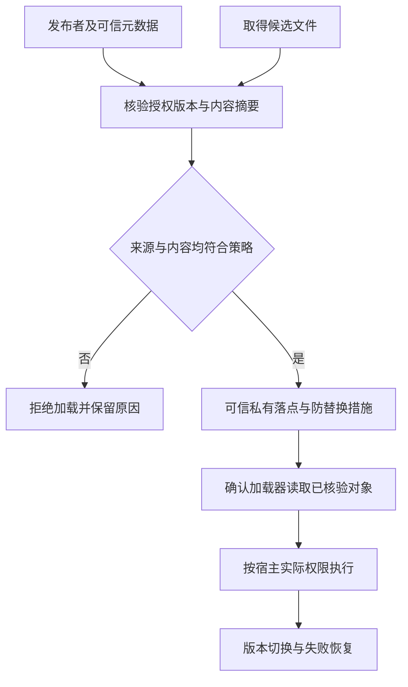

# 动态代码与可信执行文件

::: info 相关分类
- [插件动态加载](/security/android/configuration-security.html#s159)
- [TA 文件安全](/security/android/special-functions.html#s195)
:::

动态代码的信任链从字节来源延伸到实际执行对象。私有目录减少其他应用直接替换文件的机会，但发布者授权、版本回滚、下载解压和加载时的防替换仍需要分别处理。

权限边界见[安全模型](../foundation/security-model.html)，存储与共享路径见[文件边界](../engineering/file-sharing.html)。

## 1. 插件加载链的信任主体 {#plugin-chain}

动态代码包括运行时装入的 DEX、JAR/APK 中的代码和原生库等不同形态。不同加载器、存储位置和系统版本的限制不同，不能用一种文件校验代替所有执行路径检查。确无动态更新需要时，把功能随受信任的应用版本交付，可减少额外加载链。

需要动态加载时，至少确认以下主体：谁发布代码，谁签发允许加载的版本，谁能修改落地文件，加载器最终读取哪个对象。网络加密保护传输，不等于发布者授权；文件可读也不等于适合执行。[官方动态加载风险与建议](https://developer.android.com/privacy-and-security/risks/dynamic-code-loading)

插件与宿主同进程执行时，不会因为类加载器不同就自动获得独立 UID 沙箱。插件可能调用宿主可达的接口、读取同进程状态；加载器命名空间隔离与业务权限隔离是不同问题。若插件本身不可信，应重新评估是否应执行，而不是仅增加一次哈希比较。[Android 应用沙箱](https://source.android.com/docs/security/app-sandbox)



图中最后的“按宿主实际权限执行”是关键：真实性核验成功，只说明它是获准发布的代码，不说明代码没有漏洞，也不会自动缩小宿主已有权限。

## 2. 摘要校验不是来源认证 {#integrity}

攻击者若能同时替换文件与旁边的 `.sha256`，两个值仍能匹配。可信预期摘要必须来自独立的信任根，例如随受信任应用发布的固定值，或由预置可信公钥验证过的版本元数据。不要从同一个未认证响应中同时取文件与“正确摘要”。

下面只演示**有界内容与可信摘要的比较**。`maxBytes` 是业务自定预算，不是 Android 固定限制；`trustedSha256` 的来源已通过另外的发布授权流程验证，不能直接使用用户输入。

```java
static boolean matchesTrustedContent(byte[] content,
        byte[] trustedSha256, int maxBytes)
        throws java.security.NoSuchAlgorithmException {
    if (content == null || trustedSha256 == null
            || maxBytes <= 0 || content.length > maxBytes
            || trustedSha256.length != 32) {
        return false;
    }
    byte[] actual = java.security.MessageDigest
            .getInstance("SHA-256").digest(content);
    return java.security.MessageDigest.isEqual(actual, trustedSha256);
}
```

该片段不能防止调用前已经分配超大数组，实际下载/读取必须先限制字节流大小；也没有实现签名验证、版本授权和文件落地。32 是 SHA-256 摘要的字节数，不能推广为其他算法的输出长度。[MessageDigest 契约](https://docs.oracle.com/en/java/javase/17/docs/api/java.base/java/security/MessageDigest.html)

版本元数据应把摘要与插件标识、适用宿主版本和允许的版本序列绑定。否则，旧版真实插件仍可能被重放；“签名正确”与“当前允许安装该版本”是两个判定。回滚和应急恢复需按业务策略设计，不能无条件允许任意历史版本。

## 3. 文件只读与校验后替换 {#read-only}

在 Android 14 的相应兼容性要求下，运行于该平台且 target SDK 为 34 或更高的应用，其动态加载文件需要标为只读。官方给出的流程是在新文件打开后、写内容前设置只读，再通过已打开的输出流写入；不能把这个顺序改成“先任意写完再随时修权限”。[Android 14 动态加载行为变化](https://developer.android.com/about/versions/14/behavior-changes-14#safer-dynamic-code-loading)

这项要求不提供发布者认证，也不是进程已被控制时的隔离保证。审计时还要检查：

- 目录是否由应用控制，路径是否可能经解压、符号链接或外部 URI 指向其他对象。
- 校验期间与加载期间是否读取同一份内容，失败后是否仍继续调用加载器。
- 已存在文件如何升级，崩溃后半成品是否可能被当成成功版本。
- 老文件是否有可信摘要；不能只给来源不明的旧文件改只读属性就继续使用。

这是典型的校验与使用之间的竞争窗口。即使路径字符串没有变化，它指向的内容也可能被替换。优先采用不允许不可信写入者参与的私有发布目录和清晰的版本切换流程；具体加载器如何打开文件，仍须按实现核对。

版本切换还涉及**内存中的旧代码**：替换磁盘文件不会替换已加载的 Class 或现存实例。类卸载取决于定义加载器是否可被回收，不能靠删除文件或置空一个局部变量保证立即卸载。更新时应停止分发新工作，处理在途任务和回调，释放插件线程及对象引用；新加载器产生的同名类型也不能自动替换旧类型。[类卸载条件 §12.7](https://docs.oracle.com/javase/specs/jls/se17/html/jls-12.html#jls-12.7)、[Android 类加载机制](../../../android/basics/class-loading.html)

应用发布渠道也有自己的动态代码政策。满足平台加载要求不代表自动满足商店政策；是否允许远程交付可执行代码，应对照所用渠道的最新规则。[官方风险页中的政策提示](https://developer.android.com/privacy-and-security/risks/dynamic-code-loading)

## 4. 若 TA 指 Trusted Application {#ta-scope}

**TA 若指 Trusted Application**，其加载属于 TEE 与设备平台信任链，与普通插件的 `ClassLoader` 模型不同；需要先确认所用 TEE 实现及其文件、签名和部署协议。

以 AOSP Trusty 为例，它是与 Android 隔离运行的安全操作系统，通过驱动和用户态通信库连接 Android 与可信应用。Trusty 是一种 TEE 实现，不代表所有 Android 设备的安全世界都使用同一内核、文件格式或部署协议。[Trusty 架构](https://source.android.com/docs/security/features/trusty)

平台/OEM 审计应分别确认：

1. TA 镜像由谁签名、验证密钥由谁管理，加载链何时校验真实性和版本。
2. 安全启动、更新和回滚策略覆盖到哪一层，恢复流程是否允许旧的易受攻击组件。
3. 普通世界到可信应用的通信端点如何授权，消息长度、句柄、共享内存和状态机如何验证。
4. 调试接口、日志和错误码是否暴露密钥或受保护数据，资源耗尽是否影响其他可信服务。

这些是待查问题，不是对任一厂商实现的既定描述。签名加载不替代每条消息的输入验证；安全世界隔离也不意味着 TA 内部不会出现解析错误。普通 APK 通信能力不能被写成“可任意部署或加载 TA”。[Trusty IPC 的对象与端口模型](https://source.android.com/docs/security/features/trusty/trusty-ref)

## 5. 如何验证而不制造假结论 {#verification}

应用插件先在自有测试工程中准备合法版本、内容被修改版本、来源不可信但摘要自洽版本、过期真实版本和截断文件。预期分别验证授权、完整性、回滚与失败关闭路径，不能只测成功加载。

再检查下载和解压阶段是否在读取前限制资源；在授权的隔离目录模拟更新中断和文件替换，确认未核验对象无法进入加载路径。记录宿主版本、OS、target SDK、加载器类型及实际异常，不能把某次设备结果推广到全部 Android。

TA 部分必须先取得明确的平台资料与授权测试环境。没有可确认的 TA 格式、签名工具和部署协议时，只能开展架构与代码审查，不能编造签名命令、刷写步骤或“验证通过”的日志。

## 6. 审计结论应包含什么 {#findings}

有效结论需要给出：可控输入在哪里进入、被信任的元数据来自哪里、哪一步缺少验证、最终执行权限是什么，以及修复后仍保留哪些假设。只发现一个 `.dex`、`.so` 或 `.ta` 文件，不足以断言存在任意代码执行漏洞。

继续阅读[命令与序列化边界](../engineering/injection-serialization.html)，将“允许数据”与“授予执行能力”的判断分开。
