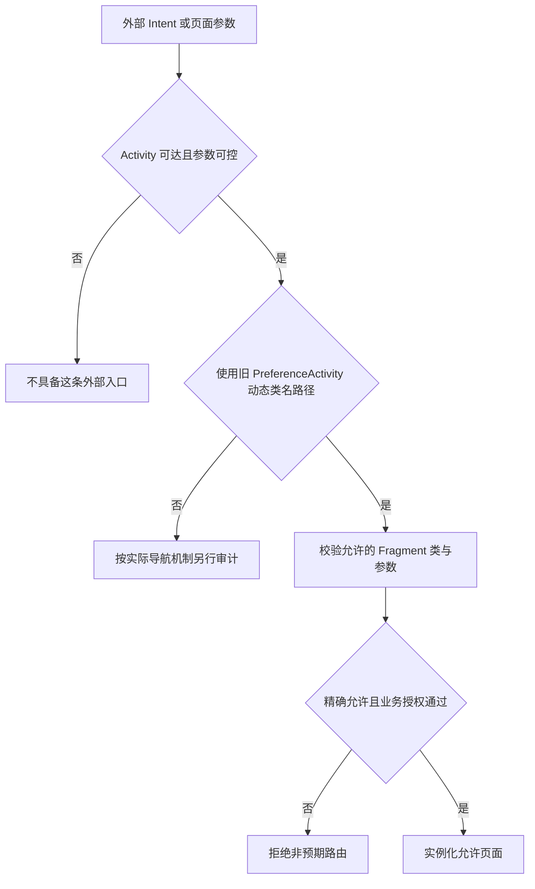

# 输入界面与历史框架风险

::: info 相关分类
- [安全键盘配置漏洞](/security/android/component-security.html#s21)
- [Fragment 框架注入（PreferenceActivity）](/security/android/dos-attacks.html#s207)
- [EditText.setSelection() 光标定位](/security/android/dos-attacks.html#s228)
- [外部文本与 maxLength 条件](/security/android/dos-attacks.html#s231)
:::

密码框显示成圆点，并不意味着当前输入法无法接触输入内容。一个设置页面包含 Fragment，也不意味着它存在历史 Fragment 注入漏洞。界面审计要分开处理输入参与者、可控导航参数，以及实际文本处理的边界。

组件入口见 [Activity 与 Intent](../foundation/activity-intent.html)，剪贴板和退出后残留见[数据生命周期](../engineering/data-lifecycle.html)。

## 1. 安全键盘配置控制了什么 {#ime-boundary}

输入法参与用户的文本编辑交互，通过输入连接与编辑器交换文本、选择和组合输入状态。password 类型、建议词和学习相关配置，影响界面行为与协作约定，不是给输入法重新划一条进程内权限边界。[输入法与应用交互](https://developer.android.com/develop/ui/views/touch-and-input/creating-input-method)

因此，审计“安全键盘”前先定义目标：避免屏幕直接显示密码、请求不记录个性化学习、降低无意复制和日志泄露，还是抵御恶意输入参与者？这些目标需要不同措施，不能用设置一个 inputType 宣称全部完成。

`IME_FLAG_NO_PERSONALIZED_LEARNING` 自 API 26 提供，其语义是**请求**输入法不基于该编辑框更新学习数据。该标志不证明某个 IME 会遵守，也不禁止一个已恶意实现的输入法观察其参与处理的输入。[EditorInfo 契约](https://developer.android.com/reference/android/view/inputmethod/EditorInfo#IME_FLAG_NO_PERSONALIZED_LEARNING)

```java
// 教学片段：在 UI 线程中配置真实的密码输入框。
password.setInputType(InputType.TYPE_CLASS_TEXT
        | InputType.TYPE_TEXT_VARIATION_PASSWORD);
if (Build.VERSION.SDK_INT >= 26) {
    password.setImeOptions(password.getImeOptions()
            | EditorInfo.IME_FLAG_NO_PERSONALIZED_LEARNING);
}
```

本例保留既有 imeOptions 位设置；它没有实现可信键盘认证，也没有阻断截图、日志或粘贴板路径。密码输入类型定义见 [InputType](https://developer.android.com/reference/android/text/InputType#TYPE_TEXT_VARIATION_PASSWORD)。

更有效的配套检查是：密码是否进入调试日志/埋点，错误提示是否回显原文，离开页面后是否仍被业务缓存持有，复制和辅助功能策略是否符合实际产品要求。自绘键盘也要承担可访问性和输入兼容成本，不能因为“不调用系统键盘”就自动被判安全。

## 2. PreferenceActivity 的历史入口 {#legacy-fragment}

`PreferenceActivity` 支持从 Intent 的 `EXTRA_SHOW_FRAGMENT` 选择设置 Fragment；当 Activity 可由不可信调用方启动，且外部类名未经足够约束进入实例化路径时，需要分析非预期页面与行为是否可达。

不应据此说“所有 Fragment 都能被注入”。现代 AndroidX 导航、应用自定义路由与旧框架额外参数是不同路径；即使同样接受一个字符串，也要实际追到类选择和实例化位置。



### API 与 target SDK 必须分别看

`isValidFragment()` 从 API 19 提供。官方契约及固定源码表明：默认实现对 target SDK 小于 19 的应用返回 true，对 target SDK 大于等于 19 的未覆盖实现抛异常；类名校验通过后才调用 `Fragment.instantiate()`。

仅升级运行系统或提高 target，并不能证明应用自定义覆盖也正确。[API 契约](https://developer.android.com/reference/android/preference/PreferenceActivity#isValidFragment(java.lang.String))、[固定源码校验](https://android.googlesource.com/platform/frameworks/base/+/refs/tags/android-16.0.0_r1/core/java/android/preference/PreferenceActivity.java#998)、[实例化入口](https://android.googlesource.com/platform/frameworks/base/+/refs/tags/android-16.0.0_r1/core/java/android/preference/PreferenceActivity.java#1278)

`PreferenceActivity` 在 API 29 弃用。维护旧代码时既要看运行平台是否有该校验，也要看 target 和子类覆盖；不能把 API 19 才存在的回调当成更旧平台的完整防护。新代码优先采用维护中的设置组件，并重新设计输入与授权。[PreferenceActivity 版本说明](https://developer.android.com/reference/android/preference/PreferenceActivity)

### 精确允许列表而非包名前缀

下面是旧代码迁移前的校验示意，两个类名为示例，必须替换为真实允许页面。它只约束选择范围，不替代页面参数和账号权限检查。

```java
@Override
protected boolean isValidFragment(String fragmentName) {
    return "com.example.settings.DisplayPrefsFragment".equals(fragmentName)
            || "com.example.settings.NotificationsPrefsFragment"
                    .equals(fragmentName);
}
```

不要使用 `return true`，也不要把同包类名前缀当允许所有页面的理由。允许的 Fragment 还可能依参数读取文件、切换账号或执行敏感操作，应在对应业务入口独立授权，不能因为“已经显示在设置页”就信任所有参数。

## 3. setSelection 需要实际文本长度 {#selection-bounds}

`EditText.setSelection(index)` 最终对文本设置选择 span；索引必须适合当前文本。负值、超过长度的值或文字已变化后的旧索引，可能导致异常。这里首先是索引与状态一致性问题，是否构成可被第三方触发的可用性风险还取决于输入来源和页面可达性。[EditText](https://developer.android.com/reference/android/widget/EditText#setSelection(int))、[Selection 固定源码](https://android.googlesource.com/platform/frameworks/base/+/refs/tags/android-16.0.0_r1/core/java/android/text/Selection.java#79)

XML 属性 `android:maxLength` 对应长度过滤。过滤可以使最终文本短于外部原始字符串；格式化、替换、异步更新和其他 InputFilter 也可能改变长度。[LengthFilter](https://developer.android.com/reference/android/text/InputFilter.LengthFilter)

`LengthFilter.filter()` 先扣除当前保留文本占用的长度，再决定本次插入能保留多少内容；截断点遇到高位代理项时还会后退，避免切开 UTF-16 代理对。这个限制针对 UTF-16 文本长度，仍不是用户可见字符数量或字节长度。光标位置应在全部过滤和替换完成后，基于最终 Editable 计算。[LengthFilter 实现](https://github.com/aosp-mirror/platform_frameworks_base/blob/android-16.0.0_r1/core/java/android/text/InputFilter.java#L168)

下面示例在 UI 线程设置文字，然后针对**过滤后的实际文本**计算光标位置。数值需先从外部输入安全解析为 int；不把原始字符串长度直接传入。

```java
static void showTextAt(EditText view, CharSequence incoming,
        int requestedIndex) {
    view.setText(incoming == null ? "" : incoming);
    int actualLength = view.getText().length();
    int bounded = Math.max(0, Math.min(requestedIndex, actualLength));
    view.setSelection(bounded);
}
```

这只是防止数值越界的教学片段：输入本身仍需大小限制；若业务要求严格索引，可以选择拒绝非法值而非截断。字符位置是 Java 文本索引，处理 emoji、组合字符等用户可见字符时，还需单独定义光标与文本语义，不能把字节数当文本索引。

异步更新必须在最终修改文字的同一 UI 执行阶段重新检查长度。先取长度、之后又替换文本再使用旧结果，仍然可能失效；捕获异常并无限重试只会掩盖状态问题。

## 4. 如何验证三个不同边界 {#verification}

- **输入法配置**：检查合并后的 inputType/imeOptions；在授权测试输入法中观察编辑交互，不记录真实密码。某个 IME 不学习的结果不能证明所有 IME 均遵守提示。
- **历史设置页**：列出可达入口、运行 OS、target SDK、子类覆盖和允许页面；在自有测试工程中分别验证合法类名、未允许类名和危险业务参数。新导航框架另追实际调用链。
- **光标定位**：用空文本、负值、超长索引、长度过滤、多字节字符和更新后的旧索引构造边界；预期可处理地拒绝或调整，不因输入导致持续崩溃。

泄露、非预期导航和崩溃应分别说明入口、可控参数和影响范围，不能合成一个“配置不安全”的笼统结论。
