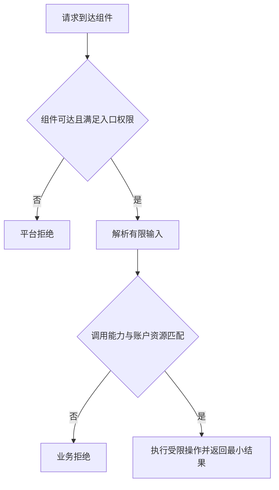
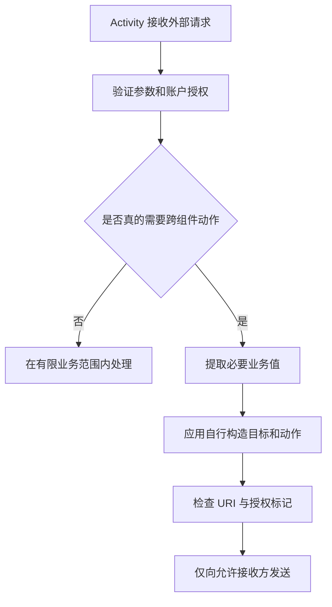
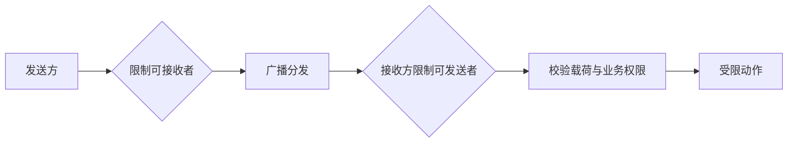
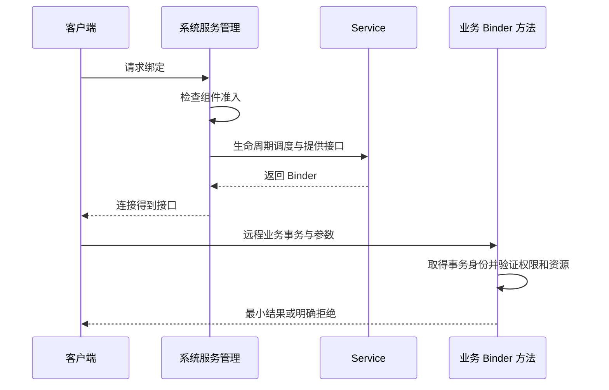
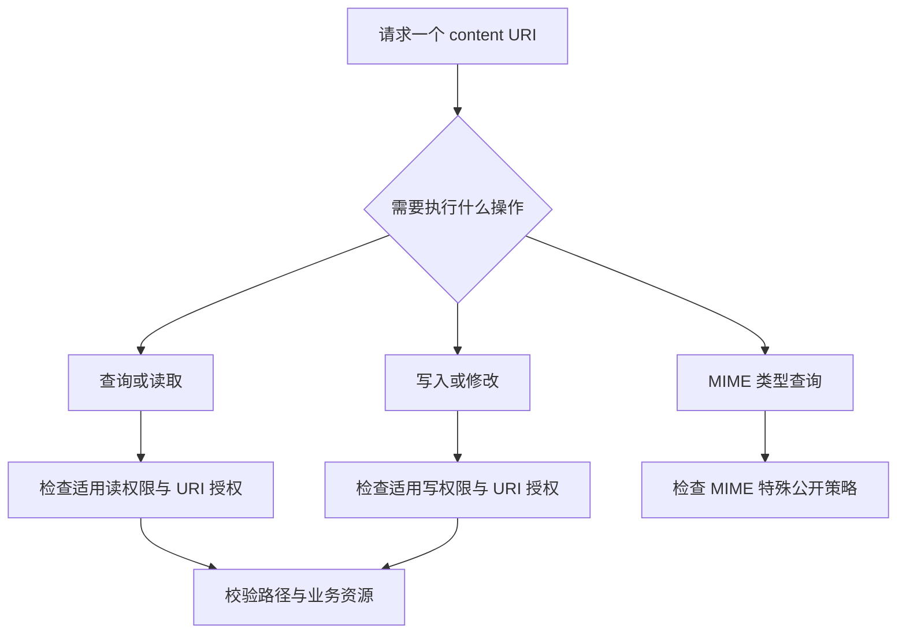

# 通用组件安全

Android 应用沙箱以 Linux UID 为基础，结合文件权限及其他平台机制隔离应用。应用启动多个进程，并不会因此自动获得几组相互独立的应用权限。反过来，相同包名字符串也不能作为调用者身份证明，身份应来自对应通信机制提供的可信信息。[AOSP 应用沙箱](https://source.android.com/docs/security/app-sandbox)

需要区分几个问题：UID 说明执行主体是谁；应用权限说明平台允许它做什么；业务授权说明当前账户能访问哪条记录。持有某项平台权限，不能证明有权读取另一个账户的数据。审查一个“查询笔记”入口时，既要限制调用能力，也要校验该笔记是否属于已授权账户。

## Activity {#s6}

Activity 可从外部链接、其他应用或应用内部流程进入。入口需要验证必需字段、类型、长度、允许值与资源归属；对已经复用的实例，新的 Intent 也应走同一套验证逻辑。不能只在首次创建时校验，后续直接相信新参数。[Activity 定义与生命周期](https://developer.android.com/reference/android/app/Activity)

**检查发生在两层**：系统处理启动请求时检查目标组件的导出状态和所需权限；应用在 `onCreate()` 与 `onNewIntent()` 中解析业务参数并授权资源。`intent-filter` 负责路由匹配，不是调用者身份认证；Android 13 起，接收方 target 33+ 的相应外部 Intent 还受声明过滤器匹配要求约束。匹配成功仍不代表当前账户有权操作资源。[Intent 匹配与安全](https://developer.android.com/guide/components/intents-filters)

### 权限与属性设置 {#s9}

`<permission>` 定义能力，`<uses-permission>` 申请能力，组件上的 permission 属性要求调用者拥有能力。这三者的名字必须一致；申请写进 Manifest 不等于系统已授予，更不等于应用应主动使用它。权限最小化应从实际业务及访问数据出发，而不是从库默认带来的权限列表出发。[Android 权限概览](https://developer.android.com/guide/topics/permissions/overview)

审查权限时，把每项申请对应到具体功能和调用点。能通过用户选择器、临时 URI 授权等较窄能力完成的场景，优先避免申请长期、广范围访问；同时为拒绝授权设计可理解的失败路径。

### 组件暴露 {#s12}

`android:exported` 表达组件是否允许应用外部访问，但它不负责解释一笔业务请求是否合理。一个公开的分享入口和一个内部支付确认入口，暴露策略显然不同；公开入口也不能因为“本来就是公开的”而跳过账户与参数验证。[android:exported 风险说明](https://developer.android.com/privacy-and-security/risks/android-exported)



图中的后两步是应用需要设计的策略，不能假定平台替它完成。典型风险是应用持有敏感能力，对外入口却接受任意资源标识，最后用自身权限代调用者执行操作。

**默认值与安装要求不能混写**

组件类型和历史平台的默认导出规则不同。Android 12 上，面向 API 31 及以上、带 intent-filter 的 Activity、Service 和 Receiver 需要显式声明 exported；缺少声明会影响安装。

这不等于“所有组件从 API 31 起默认 false”，Provider 还应按其独立规则判断。[Android 12 的组件导出要求](https://developer.android.com/about/versions/12/behavior-changes-12#exported)

工程上显式声明每个组件的预期边界，并检查最终合并结果。无需外部访问的入口设为不导出；需要外部访问的敏感入口，根据合作方与能力选择权限及业务校验。不能把“所有导出组件都加同一个签名权限”套到公开网页入口，否则会破坏预期功能。

**验证路线**：准备应用自己的受信客户端与不同签名客户端，对内部、合作方、公开入口分别发起请求。确认不可信请求被拒绝时，敏感操作确实没有发生；仅检查界面没弹出不足以证明后台未执行。

### Intent 接收/发送安全 {#s15}

Intent 接收和发送是两个检查点。接收者需要判断输入是否有效；发送者需要确定目标、动作、携带数据及额外授予的能力。若把外部提供的嵌套 Intent 原样执行，应用可能在自己的上下文中代外部请求者操作内部组件。[Intent 重定向风险](https://developer.android.com/privacy-and-security/risks/intent-redirection)



更容易审阅的设计是提取有限业务参数，再由应用构造明确动作；不需要的 component、selector、ClipData 或授予标记不要从不可信对象继承。若确有动态转发需求，应依据业务允许列表和所用 API 的完整语义净化，不能仅删除一个 extra。

下面是与 Android API 无关的伪代码，展示校验顺序；`allowedAction` 等均是待实现策略，不是可直接复制的工具函数。

```text
request = parseBoundedInput(incoming)
reject if request is malformed
reject if currentAccount cannot access request.resource
action = buildOwnedAction(request.resource)
reject if action is outside allowedAction
send only the minimum required data
```

**版本边界**：Android 16 引入默认 Intent 重定向加固，但不能用当前平台的保护替代业务校验，也不要为了让未审阅转发继续运行而直接关闭保护。[官方默认保护说明](https://developer.android.com/privacy-and-security/risks/intent-redirection#default-protection)

### Scheme URL / intent-based URI 启动组件 {#s18}

自定义 Scheme 是路由名称，不具备域名所有权证明。Android App Links 通过域名关联改善网页链接分发，但完成域名验证并不代表 URL 里的对象 ID、回调地址或业务操作已经授权。入口仍需对 scheme、host、路径和参数建立明确规则。[深链风险与防护](https://developer.android.com/privacy-and-security/risks/unsafe-use-of-deeplinks)

解析 host 后应与完整允许值比较，不能通过包含某段字符串判断。处理回调 URL 时，校验最终要打开的完整目标；解码和规范化之后不得再把未经验证的内容重新解释成高权限动作。

`intent:` 字符串可以表达 Intent 的多个属性，解析成功不等于安全。`Intent.parseUri` 的 flags 与启动 Intent 的 flags 是不同参数领域；不要混用。尤其 `URI_ALLOW_UNSAFE` 会保留原本出于安全原因不保留的标记，不能为了兼容不明输入而随意启用。[Intent 的 URI 解析定义](https://developer.android.com/reference/android/content/Intent#URI_ALLOW_UNSAFE)

**验证路线**：在自有链接中改变 host、大小写、编码、路径段、重复参数与回调目标，确认拒绝策略与真正解析结果一致。另行核对设备上的域名验证状态，不能用浏览器可访问网页证明 App Links 验证成功。

### 安全键盘配置漏洞 {#s21}

输入法参与用户的文本编辑交互，通过输入连接与编辑器交换文本、选择和组合输入状态。password 类型、建议词和学习相关配置，影响界面行为与协作约定，不是给输入法重新划一条进程内权限边界。[输入法与应用交互](https://developer.android.com/develop/ui/views/touch-and-input/creating-input-method)

因此，审计“安全键盘”前先定义目标：避免屏幕直接显示密码、请求不记录个性化学习、降低无意复制和日志泄露，还是抵御恶意输入参与者？这些目标需要不同措施，不能用设置一个 inputType 宣称全部完成。

`IME_FLAG_NO_PERSONALIZED_LEARNING` 自 API 26 提供，其语义是**请求**输入法不基于该编辑框更新学习数据。该标志不证明某个 IME 会遵守，也不禁止一个已恶意实现的输入法观察其参与处理的输入。[EditorInfo 契约](https://developer.android.com/reference/android/view/inputmethod/EditorInfo#IME_FLAG_NO_PERSONALIZED_LEARNING)

```java
// 教学片段：在 UI 线程中配置真实的密码输入框。
password.setInputType(InputType.TYPE_CLASS_TEXT
        | InputType.TYPE_TEXT_VARIATION_PASSWORD);
if (Build.VERSION.SDK_INT >= 26) {
    password.setImeOptions(password.getImeOptions()
            | EditorInfo.IME_FLAG_NO_PERSONALIZED_LEARNING);
}
```

本例保留既有 imeOptions 位设置；它没有实现可信键盘认证，也没有阻断截图、日志或粘贴板路径。密码输入类型定义见 [InputType](https://developer.android.com/reference/android/text/InputType#TYPE_TEXT_VARIATION_PASSWORD)。

更有效的配套检查是：密码是否进入调试日志/埋点，错误提示是否回显原文，离开页面后是否仍被业务缓存持有，复制和辅助功能策略是否符合实际产品要求。自绘键盘也要承担可访问性和输入兼容成本，不能因为“不调用系统键盘”就自动被判安全。

## BroadcastReceiver {#s24}

广播通过过滤与分发连接发送方和接收方。接收器即使只处理某个自定义 action，也不能假设只有应用自己会发送它；发送方即使只想通知合作方，也不能假设其他应用不会注册相同过滤器。[广播总览](https://developer.android.com/develop/background-work/background-tasks/broadcasts)



这里的“限制”取决于具体 API 的目标、权限和导出设置，不是对 action 做字符串比较。回调触发后仍要检查事件值和操作条件，不能让一个广播直接转成任意文件操作或账户动作。

**验证路线**：用自有发送器和接收器分成两个测试应用，先确认合法消息可用，再用非受信发送器尝试同 action；另加非受信接收器观察是否获得本应私有的数据。分别记录两条方向，不能把一次拒绝当作所有方向通过。

### 动态广播组件暴露 {#s27}

动态注册的边界由运行时调用决定，不能只搜 Manifest。Android 13 提供明确的导出标记；在 Android 14 上，面向 API 34 及以上的应用注册非纯系统广播接收器时，需要说明导出行为。仅接收系统广播的注册存在官方说明的例外。[Android 14 行为变化](https://developer.android.com/about/versions/14/behavior-changes-14#runtime-receivers-exported)

若只接收本应用消息，选择与目标平台或所用兼容库对应的不导出方案。若确实接收其他应用消息，则导出并配套身份/权限策略；不要为了消除异常，统一切换成 EXPORTED。使用 AndroidX 时，还要核对实际 Core 版本和合并权限，不能把平台 API 条件直接套给库包装层。

部分系统相关广播来自高权限但不同 UID 的应用，NOT_EXPORTED 的接收范围也有具体限制。按实际广播种类检查官方建议，必要时拆分接收器，避免为一条外部消息放大其他消息的入口。[动态接收器导出选择](https://developer.android.com/develop/background-work/background-tasks/broadcasts#context-registered-receivers)

**验证路线**：记录注册代码实际执行时间、导出参数和接收范围；分别测试本应用、合作应用、非受信应用及目标系统事件。页面退出或对象销毁后检查是否撤销注册，避免遗留入口与重复回调。

**限制发送者与限制接收者不是同一个参数**

接收器声明或注册时要求权限，用于限制谁能向它发送消息；发送广播时要求接收者持有权限，用于限制谁能收到消息。两者应以自己的调用方向理解，不能看到代码里出现一个权限字符串就认定双向都已保护。[广播权限机制](https://developer.android.com/develop/background-work/background-tasks/broadcasts#restrict-broadcasts-with-permissions)

同签名应用之间的敏感消息可考虑自定义 signature 权限，定义、申请和使用位置须相互对应。普通 action 加上“公司域名风格”前缀只降低命名冲突，不限制其他应用发送。

回调中的业务参数仍可能无效。不要在 Receiver 的 onReceive 中用 `Binder.getCallingUid()` 直接认证原始广播发送者；它描述当前 Binder 事务，并不是所有异步分发路径中的最初主体。具体发送者 API 的可用性应按目标平台单独核对。[Binder 身份 API](https://developer.android.com/reference/android/os/Binder#getCallingUid())

**验证路线**：自有样例分别使用同签名且申请权限、同签名未申请权限、不同签名的参与方，验证发送与接收两个方向的准入。签名相同不代表所有业务动作都应该允许，载荷仍需测试越界和缺字段。

### 静态广播组件暴露 {#s30}

Manifest 声明使接收器成为发布物的一部分。检查是否真的需要外部消息、exported 是否明确、所要求权限是否正确，以及回调是否承担敏感操作。不要因为入口没有界面就忽略它。[receiver 元素定义](https://developer.android.com/guide/topics/manifest/receiver-element)

Android 12 上，面向 API 31 及以上、带 intent-filter 的 Receiver 需要显式 exported。这是安装要求，不能被改写为所有历史系统统一采用同一默认值。即使配置可安装，仍需检查业务暴露是否合理。[Android 12 导出要求](https://developer.android.com/about/versions/12/behavior-changes-12#exported)

```xml
<!-- 仅示意 application 下的内部接收器，未提供完整工程。 -->
<receiver
    android:name=".InternalRefreshReceiver"
    android:exported="false" />
```

这个配置限制非预期外部入口，但不代替正常输入处理。若业务根本不需要跨应用广播，可优先采用应用内部的调用、状态或回调，减少公开通信面。

**验证路线**：检查发布变体的合并 Manifest，包括依赖引入的 Receiver；在自有不同签名应用中尝试发消息，确认内部入口没有执行。再检查合法业务是否仍能触发，防止只验证“拒绝成功”。

### Receiver 嗅探 {#s33}

“Receiver 嗅探”的实质是非预期接收者拿到广播载荷。它需要广播本身可被分发给对方以及内容确实敏感；不能只因为存在 sendBroadcast 就认定泄露。查询接收范围、发送权限、包限制与实际数据，才能判断风险。

防护通常从减少载荷开始：广播只通知“状态改变”，通过有授权的接口查询具体内容；确需跨应用传递时，限制接收方并避免长效凭据。显式目标或包限制可以收窄普通广播目标，但不认证消息内容或对方后续行为。[广播安全考虑](https://developer.android.com/develop/background-work/background-tasks/broadcasts#security-considerations)

**验证路线**：在隔离样例里发送无敏感测试标记，观察非受信接收器是否收到。检查载荷与日志都不含真实账户数据；若外部能接收，再验证是否能造成实际越权，区分可达性与影响。

### 粘性广播与敏感数据 {#s36}

粘性广播把消息保留在系统缓存中，新注册的接收器可能随后得到旧消息。该机制具有接收限制、来源与重放等安全问题，自 API 21 起弃用，不适合传递敏感信息。不要把缓存中的旧事件当作当前可信状态。[官方粘性广播风险说明](https://developer.android.com/privacy-and-security/risks/sticky-broadcast)

新增业务应使用非粘性的变化通知，再通过可信渠道读取状态。迁移历史流程时，列清旧缓存如何影响新注册对象，保证消费者不因为遗漏一次通知就永久失去同步，也不因为重复通知重复执行副作用。

**验证路线**：在自有样例中依次发送、销毁并重新注册接收器，观察旧消息是否重新到达；对缓存后的数据变化与重复事件测试状态一致性。不要发送真实口令或令牌作为测试数据。

广播不会自动解决后台执行限制。若回调需要长期任务，需设计符合平台约束的后台方案，并保持原有身份与授权边界，不能用“收到广播”作为无限执行的依据。

## Service {#s39}

启动服务把一个工作请求交给组件，绑定服务则取得可交互的接口。一个 Service 也可以同时具备两种用法，所以应分别检查处理入口，不能只审查 onBind。[绑定服务概览](https://developer.android.com/develop/background-work/services/bound-services)

### Service 组件暴露安全 {#s42}

`startService()` / `bindService()` 先进入系统的服务管理路径，系统检查目标服务的导出和入口权限，再调度 `onStartCommand()` / `onBind()`。这些生命周期回调由系统交付，不能在里面随手读取 Binder UID 就认定找到了最初请求者；远程接口的身份检查应放在每次 AIDL 事务中。[绑定服务概览](https://developer.android.com/develop/background-work/services/bound-services)

无需其他应用使用的服务，显式限制导出。需要外部访问时，在 Manifest 中声明适合业务的准入权限，并检查最终合并配置；公开可达不意味着可以替外部调用者操作任何账户或文件。[service 元素定义](https://developer.android.com/guide/topics/manifest/service-element)

**验证路线**：使用自有不同签名客户端分别尝试启动与绑定，覆盖无权限、有权限、缺字段和无效动作。记录是否到达回调、是否拿到接口以及业务是否实际执行，避免把这三种结果混为一谈。

### Service 劫持 {#s45}

如果发送方让系统解析不受限制的目标，可能把请求或数据送给非预期接收者。风险成立还取决于平台是否允许该调用方式、匹配规则和接收方能力；不能把历史隐式服务行为直接套到所有现代平台。[Intent 类型与服务调用](https://developer.android.com/guide/components/intents-filters)

应用内部固定服务使用明确组件；跨应用协作需限定允许的服务身份，检查实际连接对象与接口契约，并控制发给它的数据。一个远端返回了预期 descriptor，只能说明协议看起来匹配，不是密码学身份认证。

**验证路线**：在自有测试客户端中替换目标为非允许服务、使允许服务不可用、模拟连接断开，核对应用是否拒绝继续业务。正常路径也要验证恢复与解绑，不能无限重试已经可能执行过的有副作用请求。

### AIDL 接口安全 {#s48}

Service 的生命周期由系统调度。onBind 负责提供接口，不应把它内部随手读取的 Binder 身份当成每个后续业务调用者。跨进程客户端通过远程 AIDL 调用进入 Stub 时，需要按该入站事务核验身份；接口还可能被传递，不能把首次绑定者等同于永久持有者。



这是跨进程机制示意，省略了调度细节。依据来自 [绑定接口契约](https://developer.android.com/develop/background-work/services/bound-services)及 [Binder 当前事务身份定义](https://developer.android.com/reference/android/os/Binder#getCallingUid())；这里关于分层鉴权的要求是由两者结合得到的设计结论。

本地 AIDL 接口可能直接返回实现对象，方法在当前调用线程执行，不产生新的 Binder 事务；本地调用的 `oneway` 也仍是同步执行。此时 `getCallingUid()` 的意义取决于线程是否已经处于其他入站事务中，不能把它当成独立本地调用者认证。

内部调用需要明确的可信入口和业务授权上下文，不能不加区分地套用远程事务检查。[AIDL 的本地与远程调用语义](https://developer.android.com/develop/background-work/services/aidl)

**AIDL 只生成通信协议，不生成业务授权**

AIDL 定义双方如何传递调用，不判断输入资源属于哪个账户。每个敏感方法需要在修改状态之前检查调用能力和业务资源，不能只保护“获取接口”方法。远程请求也可能并发，因此授权状态与实际操作之间应避免出现可利用的不一致窗口。[AIDL 官方说明](https://developer.android.com/develop/background-work/services/aidl)

方法级检查顺序如下，名称表示业务策略：

```text
on incoming remote business transaction:
    caller = captureTrustedTransactionIdentity()
    reject unless caller has required capability
    request = validateBoundedArguments()
    reject unless caller may access request.resource
    execute operation under explicit state rules
```

防护同时需要拒绝路径：无效字段、未知请求、超大集合、未授权资源都应在副作用发生前拒绝。不要只在成功分支末尾检查，更不要从客户端自己传来的 uid 字段取身份。

**验证路线**：自有样例中让有权限客户端连接后传入不属于其账户的测试资源，验证方法级授权是否独立拒绝；再覆盖并发调用与无效输入。接口引用是否能被转交也应纳入威胁模型，不能只验证首次绑定。

**Binder 身份不能直接跨异步边界读取**

`Binder.getCallingUid()` 返回正在处理的事务的调用 UID；不在入站事务中时返回本进程 UID。切到 Handler、线程池或其他异步任务后重新读取，不能推断仍是原来的远端客户端。清除调用身份同样改变后续权限判断的上下文。[Binder API 定义](https://developer.android.com/reference/android/os/Binder#getCallingUid())

因此应在可信事务上下文中获取并验证必要身份，构造受限工作请求后再调度；异步执行时还要考虑账户退出、资源归属改变和权限撤回等状态变化。保存一个 uid 数字并不自动解决所有业务授权时效问题。

**验证路线**：在自有服务中分别记录事务内与异步任务中的身份来源，使用不同 UID 客户端发请求并对照结果。不要在生产日志输出敏感请求；若只做文档审阅，应把跨线程身份验证标为未执行。

### Messenger 服务安全 {#s51}

Messenger 把请求交给 Handler 处理，有助于串行化消息，但消息编号、Bundle、replyTo 都不能自动充当业务身份。`Message.sendingUid` 由通过 Messenger 发送的路径提供；其他构造方式可能没有有效值，需按其契约检查，不能盲信自定义 Bundle 里的包名或 uid。[Message.sendingUid](https://developer.android.com/reference/android/os/Message#sendingUid)

**身份如何跨过消息队列**：AOSP 的 `Handler.MessengerImpl.send()` 在 Binder 接收线程先执行 `msg.sendingUid = Binder.getCallingUid()`，再调用 `Handler.this.sendMessage(msg)` 入队。Handler 稍后处理消息时应读取这个已记录的字段；此时重新调用 `Binder.getCallingUid()` 已经脱离原事务。发送者自行填写 `sendingUid` 不会代替接收端这一步赋值。指定合作 App 的校验和回复示例见 [Messenger](/android/basics/messenger.html)。[AOSP Handler](https://github.com/aosp-mirror/platform_frameworks_base/blob/android-16.0.0_r1/core/java/android/os/Handler.java#L974)

防护应先确认消息来源和准入策略，再解释允许的 what 与数据格式，拒绝未知命令；响应只发给业务确实允许的回调对象。敏感服务仍应有入口限制和资源授权，不能把 Handler 串行执行误认为安全隔离。

**验证路线**：用正常 Messenger 客户端、无效消息编号、缺数据与非受信客户端测试；检查身份缺失时是否拒绝敏感动作。对回复路径也观察信息是否交给非预期接收方。

### 前台服务安全 {#s54}

前台服务以用户可见方式执行符合条件的工作，受到启动来源、服务类型、权限和平台版本等约束。通知可见不证明请求可信，也不保证进程永久存活。[前台服务概览](https://developer.android.com/develop/background-work/services/fgs)

在 Android 14 上，面向 API 34 及以上的应用需按工作声明相应前台服务类型，并满足相关权限/条件；其他版本和特定服务类型有不同规则。安全检查要在启动前处理请求来源与业务授权，不能通过升级为前台服务绕过入口设计。[Android 14 前台服务要求](https://developer.android.com/about/versions/14/behavior-changes-14#fgs-types)

**验证路线**：自有样例分别测试允许与不允许的启动状态，核对声明、权限、通知和停止流程；同时重跑未经授权的业务请求，确认它不会因为前台状态而被放行。设备限制与业务拒绝应分开记录。

进一步理解通信机制可读 [Binder 机制](/android/framework/binder-mechanism.html)；需要共享数据时继续读 [Provider 访问模型](/security/android/foundation/provider.html)。

## ContentProvider {#s57}

`content://authority/path` 中，authority 用于识别 Provider，path 再由 Provider 解释。Manifest 的 authorities 声明是路由配置；它不是加密凭据，也不证明外部返回的内容可信。[provider 元素定义](https://developer.android.com/guide/topics/manifest/provider-element)

访问外部 URI 时，应先确认业务为什么允许这个来源和资源范围，再校验返回内容、大小和用途。不要接收任意 content URI，随后用自身能力无条件复制、解析或转发；这些后续风险见[文件边界](/security/android/engineering/file-sharing.html)。

### 组件暴露安全 {#s60}

Provider 可通过 permission 或分开的 readPermission、writePermission 控制访问。导出控制常规外部可达性，URI grant 可为特定资源提供临时访问能力；因此正常共享场景中“不导出”与“授予某 URI”并不矛盾。[Provider 权限定义](https://developer.android.com/guide/topics/manifest/provider-element#prmsn)

**权限由哪层检查**：跨进程访问先进入 Provider 的 Binder `Transport`，它校验输入 URI，并根据读、写或文件模式进入权限检查，再调用应用实现的 `query()` / `openFile()` 等方法。框架检查涉及调用 UID、导出与用户边界、组件/路径权限及 URI grant；应用方法仍须检查具体记录或文件是否属于获准资源。[AOSP Transport 与读权限检查](https://github.com/aosp-mirror/platform_frameworks_base/blob/android-16.0.0_r1/core/java/android/content/ContentProvider.java#L948)



图中是检查模型，不声称精确复刻所有平台方法的调用顺序。MIME 查询单独列出，因为它有下面要讨论的特殊契约。

**Provider 默认导出规则有历史条件**

旧平台、targetSdk 与组件类型的差异会影响默认 exported。Provider 的官方定义专门说明 API 16 及以下与后续平台的区别，不能套用 Activity 的 intent-filter 安装规则。新配置应明确表达导出意图，并验证最终合并结果。[Provider 的 exported 属性](https://developer.android.com/guide/topics/manifest/provider-element#exported)

防护不是把所有方法统一加相同权限字符串。读与写可能暴露不同信息，写操作的成功/失败及返回数量也可能泄露数据是否存在；需要按真实接口语义划分授权，避免“不能直接读，所以写接口没有泄露风险”的推断。

**验证路线**：自有 Provider 使用无敏感测试数据，对不同客户端分别测试 query、insert/update/delete 和文件打开；覆盖无权限、只读、只写及特定 URI grant。检查真实副作用，不能只看是否返回异常。

### Provider 文件目录遍历漏洞 {#s63}

自定义 Provider 或接收端拼接路径时，先把业务对象映射到受控文件，再检查最终规范化路径是否位于可信根目录内。字符串 `startsWith(root)` 可能把 `root-other` 错当子目录，检查要包含目录边界；更不能先检查一份路径，却随后打开另一份重新拼接的路径。

canonical 路径能处理一类 `..` 和符号链接问题，却不能自动消除“检查后、打开前”目标被替换的竞态。安全前提应包含根目录及其父目录不由攻击者控制；避免在可被其他应用写入的共享目录中执行敏感更新。[Android 路径遍历说明](https://developer.android.com/privacy-and-security/risks/path-traversal)

文件打开的实际过程是：`ContentResolver` 请求 Provider → `Transport.openFile()` 检查模式与授权 → 自定义 `openFile()` 将业务 ID 映射为文件 → 用确定的读写模式打开并返回 `ParcelFileDescriptor`。

路径校验必须针对最后打开的同一个对象；只在 `query()` 隐藏路径，不能保护独立的文件打开入口。只读导出应拒绝其他模式，而非原样接受外部 `mode`。[AOSP 文件入口](https://github.com/aosp-mirror/platform_frameworks_base/blob/android-16.0.0_r1/core/java/android/content/ContentProvider.java#L588)、[文件描述符打开契约](https://developer.android.com/reference/android/os/ParcelFileDescriptor#open(java.io.File,int))

写入重要状态还需要失败恢复与并发策略。可使用临时文件完成校验后提交，或按实际 SDK 核对 `AtomicFile`；原子写入帮助避免半写状态，不等于跨线程锁或授权机制。线程、进程之间的并发访问仍需单独协调。[AtomicFile API](https://developer.android.com/reference/android/util/AtomicFile)

### Provider uriPath 权限控制 {#s66}

path-permission 对 URI 路径设置访问要求；它与 Provider 内部如何把 URI 转成记录或文件是不同层。即使 URI 的权限匹配符合预期，内部错误拼接文件路径仍可能访问非预期位置；反过来，安全的文件路径也不能替代业务记录授权。[path-permission 定义](https://developer.android.com/guide/topics/manifest/path-permission-element)

实现应把允许的 URI 形状、解码规则、资源范围与最终文件边界连起来。使用 URI API 解析后，不要不加判断地把输入片段当任意 SQL、文件路径或另一个 URI 再解释。

**验证路线**：用合法路径、未定义路径、编码差异、额外路径段和越界资源标识测试路径授权与实际操作。若映射文件，比较最终落点是否仍在指定共享目录；路径遍历专项继续见[文件共享](/security/android/engineering/file-sharing.html)。

### SQL 注入 {#s69}

SQL 注入的前提是外部数据进入 SQL 语法结构。例如把用户输入拼进 `WHERE` 字符串，会让引号、运算符等参与 SQL 解释。Android 的 [SQL 注入风险说明](https://developer.android.com/privacy-and-security/risks/sql-injection)建议使用绑定参数并限制不可信查询结构。

占位符用于**值**，不能拿来绑定表名、列名、排序方向或整段 `selection`。对这些结构选择，使用应用内部固定映射。Provider 对外接受的 `projection`、`sortOrder`、`selection` 和查询 Bundle 也要按接口协议限制，不能原样转给数据库。

下面假设应用自有 `notes(_id, owner_id, title, created_at)` 表，`trustedOwnerId` 来自已校验的会话，不来自 Intent 或 URI：

```kotlin
// 教学片段：db 为 SQLiteDatabase，route 已通过上一节校验。
val order = if (route.newestFirst) "created_at DESC" else "created_at ASC"
db.query(
    "notes", arrayOf("_id", "title"),
    "owner_id = ? AND _id = ?",
    arrayOf(trustedOwnerId, route.id.toString()),
    null, null, order, "1"
).use { cursor ->
    if (cursor.moveToFirst()) {
        // 只处理当前授权主体的结果；避免将 Cursor 带出此作用域。
    }
}
```

这里的占位符阻止值变成 SQL 结构，`owner_id` 条件实现示意的行级隔离，两者职责不同。真实的共享、管理员权限或跨账户迁移必须有明确授权模型。API 参数语义见 [`SQLiteDatabase.query`](https://developer.android.com/reference/android/database/sqlite/SQLiteDatabase#query(java.lang.String,java.lang.String%5B%5D,java.lang.String,java.lang.String%5B%5D,java.lang.String,java.lang.String,java.lang.String,java.lang.String))。

底层会先编译 SQL 语句，再把 `selectionArgs` 绑定到参数位置；绑定值不会重新被解析为运算符或子查询。使用 `SQLiteQueryBuilder` 的共享接口还可设置列映射，并在 API 30+ 显式启用 `setStrictColumns(true)` / `setStrictGrammar(true)`，缩小列名与查询语法范围；这些选项默认关闭，也不负责账户行级授权。[SQLiteQueryBuilder 契约](https://developer.android.com/reference/android/database/sqlite/SQLiteQueryBuilder)

### 隐式 Intent 的 URI 操作权限 {#s72}

临时 URI 授权是把某项资源访问能力交给接收方。目标如何选择、谁取得授权、可访问哪些资源和授权何时失效，决定了共享范围；使用隐式分享并不自动意味着授权失控。[ContentProvider 临时权限](https://developer.android.com/guide/topics/providers/content-provider-basics#Permissions)

显式限制接收方有助于收窄边界；需要选择器的合法分享也应保证只给业务需要的能力。发送者持有资源不意味着应该把写权限一并交出去，前缀和持久授权也不能默认继承。

**验证路线**：通过自有接收应用验证只读、写入拒绝、非目标接收方及授权结束后的结果。记录 data/ClipData、实际目标与授权选项；不要把“Intent 里写着只读”直接当成访问结果。

**URI 授权只交付必要能力**

只需预览就只给读权限；写权限意味着接收方可能修改或破坏共享内容。使用 FileProvider 为应用确认过的文件生成 URI，再通过所选业务入口授予权限，避免直接接受外部指定的“本地待分享 URI”。

`Intent` 的 data、`EXTRA_STREAM`、ClipData 和 flags 应作为一个整体审查。读写位是 bitmask 的组成部分，不能用 `flags == 某常量` 判断是否存在授权。也不能把所有隐式 Intent 一概判漏洞：系统分享选择器本来就服务于用户选择接收方，关键是交付的内容、目标和授权范围是否符合用户意图。

临时授权的存续与承载方式有关，不能写成“发送后立即失效”。取消授权也不能收回接收方已经复制的内容；若要求长期保密，不应把原始秘密交付给不可信接收者。[FileProvider 授权与生命周期](https://developer.android.com/reference/androidx/core/content/FileProvider)

### getType() 方法安全 {#s75}

`getType(Uri)` 返回对应资源的 MIME 类型或无法识别时的 null。它不等于读取资源内容；但如果返回值依赖私有记录是否存在、类别或内部状态，元数据本身也可能敏感。[ContentProvider.getType 定义](https://developer.android.com/reference/android/content/ContentProvider#getType(android.net.Uri))

官方说明：默认情况下，MIME 查询有不同于普通读写的访问行为，即使 Provider 不导出或设置读写权限，也不能简单假定类型查询被同样阻断。因此类型实现不应进行不必要的文件读取或有副作用的业务动作，更不应靠返回细粒度类型泄露私有状态。

#### MIME 查询原理与权限边界 {#s78}

API 34 增加 `getTypeAnonymous(Uri)`，用于提供不需要权限即可公开的类型信息；按官方契约实现后，可把需要保护的类型信息留在 getType 路径并受相应读权限约束。**默认实现直接委托 `getType(uri)`**，因此保留默认委托不会自动隐藏敏感类型。[getTypeAnonymous 定义](https://developer.android.com/reference/android/content/ContentProvider#getTypeAnonymous(android.net.Uri))

对敏感 URI，匿名分支应返回 null 或不会暴露记录存在性、内部分类的统一公开类型，避免转调敏感查询。还需配置并验证真实的读访问限制与 URI 授权策略；若公开 Provider 没有相应读限制，仅覆写匿名方法不会凭空建立鉴权。[固定标签中的匿名查询与访问分支](https://android.googlesource.com/platform/frameworks/base/+/refs/tags/android-16.0.0_r1/core/java/android/content/ContentProvider.java#315)

为早于 API 34 的运行环境设计实现时，需要单独考虑兼容行为。编译 SDK 允许覆写一个新方法，不代表旧设备会采用新的调用策略；不能把新版防护倒推到所有历史版本。

**防护与验证路线**：先列出任何人可知的粗粒度类型，再列出需要鉴权的信息。在隔离样例中，用无权限与有权限客户端比较已知、未知和私有资源的类型结果，确认不泄露存在性或内部分类；按运行 OS 分别记录结果。

#### 空 URI 与未定义 URI {#s81}

空 URI 需要区分 `null`、不支持的 scheme/authority、空路径和不存在资源。`null` 可能在 API 入口已被拒绝；其余输入仍可能到达 Provider，需要按方法契约处理。输入异常和数据越权是不同结果。

实现可根据具体方法契约对不支持输入返回适当结果或受控异常，关键是行为确定、无敏感副作用、不把异常细节作为内部数据出口。getType 的未知类型可以按契约返回 null，不能为“成功处理”而任意打开输入路径。

**验证路线**：在自有调用端区分 API 入口就拒绝的 null 与真正到达 Provider 的未知 URI，检查错误类型、日志以及是否改变状态。连续重复测试时记录资源消耗，防止把单次异常和可重复拒绝服务混淆。

完成访问模型后，继续检查[文件边界与共享目录](/security/android/engineering/file-sharing.html)、[URI 与 SQL 输入](/security/android/engineering/uri-sql-input.html)。

### authority 劫持 {#s84}

authority 解析安全涉及三个不同问题：目标应用因名称冲突无法安装、目标缺失时客户端信任了其他 Provider、已安装 Provider 是否能被另一包替换。分别检查安装冲突、客户端身份校验与更新授权，不把路由冲突等同于数据接管。

#### authority 唯一性与抢先安装 {#s87}

authority 用于 Provider 路由，不代表提供者通过了合作方认证。应区分安装时的名称冲突与客户端解析到错误提供者：前者影响安装，后者还要求客户端接受并信任该提供者。跨应用协议需要核对解析到的包、签名、用户/配置文件及资源范围；不要用一个 authority 字符串代替这些身份检查。

**验证路线**：仅在隔离设备使用自有双样例，依次测试不同安装顺序、目标缺失和正常更新；记录安装返回与客户端解析到的包，确认失败发生在哪一阶段。防护上避免用一个路由字符串充当合作方认证；可信合作还需核对身份与业务协议。

### FileProvider 共享目录范围 {#s90}

FileProvider 把配置根目录内的文件映射为 content URI，并结合临时授权共享。配置一个目录不等于所有应用立即都能读取它，但根目录越宽，业务代码错误生成 URI 或错误授权后的影响越大。

#### 共享范围过大的风险 {#s93}

风险成立需要实际可达的路径：例如外部输入控制要导出的文件，应用能够生成相应 URI，又把读取或写入能力交给了对方。不能仅凭配置文件存在就宣称已经任意文件读取。

#### 共享路径最小化防护 {#s96}

**不要使用过宽的 `<root-path>`、`path="."` 或整个私有目录。`<files-path>` 和 `<cache-path>` 本身合法，应该选择专用子目录。** 官方安全示例也使用这两种元素。[目录最小化建议](https://developer.android.com/privacy-and-security/risks/file-providers)

教学配置：只为已经脱敏的导出副本提供 URI，不把数据库、会话文件放入这些目录。

```xml
<!-- res/xml/share_paths.xml -->
<paths xmlns:android="http://schemas.android.com/apk/res/android">
    <files-path name="reports" path="share/reports/" />
    <cache-path name="previews" path="share/previews/" />
</paths>
```

对应 Provider 应使用匹配的 authority、`android:exported="false"`、`android:grantUriPermissions="true"`，并用 `android.support.FILE_PROVIDER_PATHS` 元数据引用该资源。

按官方文档建立自己的 FileProvider 子类及 Manifest 声明；不要因为看到私有 Provider 就误以为 URI grant 无法访问它。[FileProvider API 与配置](https://developer.android.com/reference/androidx/core/content/FileProvider)

