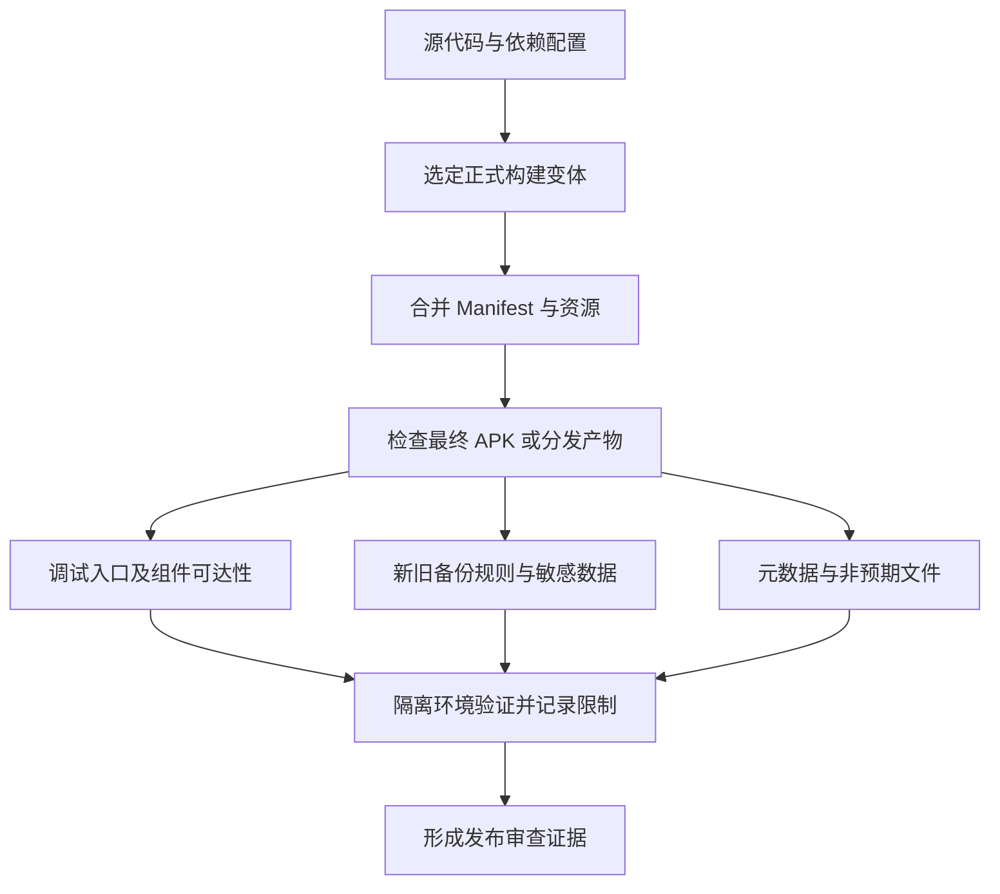
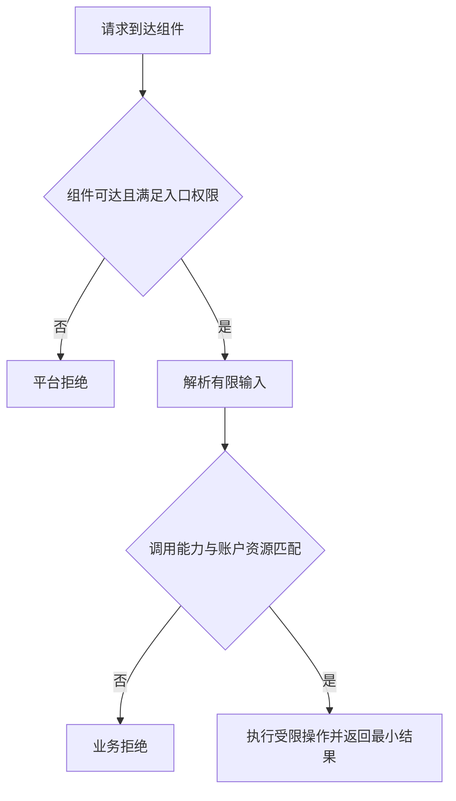
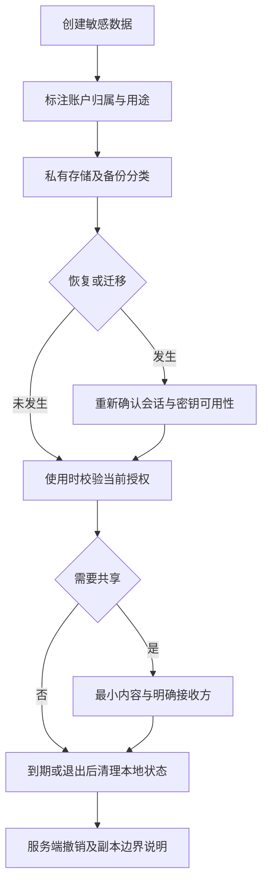
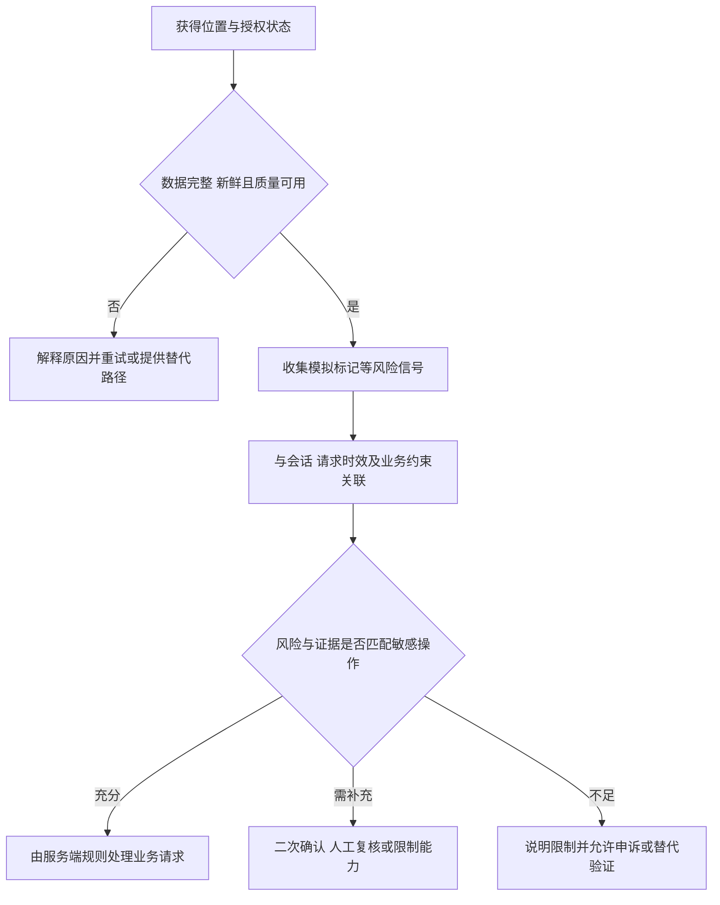
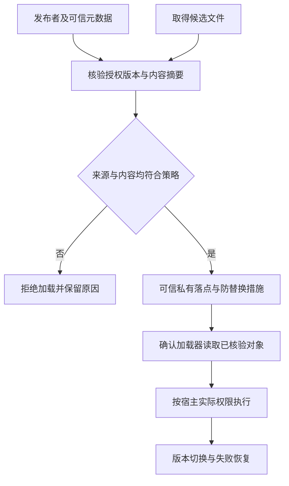

# 配置安全

配置安全不是 Manifest 单文件检查。发布变体可能合并依赖组件，运行时还可能注册 Receiver、生成 URI 授权或暴露 Binder 对象。因此应从最终发布物出发，追踪每个入口到敏感操作和返回数据。

建议为每个组件写下：预期调用者、平台准入、业务授权、输入上限和失败结果。遇到动态入口，说明它何时注册、何时撤销；遇到配置修复，重跑正常业务与拒绝路径，防止安全调整同时破坏合法用户。

可按以下顺序在自有样例工程中执行，示例命令仅查询设备环境：

```sh
adb shell getprop ro.build.version.sdk
adb shell getprop ro.build.fingerprint
```

运行系统决定平台实现，`targetSdk` 决定部分兼容行为；同时记录发布变体的 target、签名与最终 Manifest，才能解释同一份源码在不同安装包上的差异。

继续阅读：[Activity 与 Intent](/security/android/foundation/activity-intent.html)、[Service 与 IPC](/security/android/foundation/service-ipc.html)、[ContentProvider](/security/android/foundation/provider.html)。

## 应用程序只申请必要的权限 {#s102}

`<permission>` 定义能力，`<uses-permission>` 申请能力，组件上的 permission 属性要求调用者拥有能力。这三者的名字必须一致；申请写进 Manifest 不等于系统已授予，更不等于应用应主动使用它。权限最小化应从实际业务及访问数据出发，而不是从库默认带来的权限列表出发。[Android 权限概览](https://developer.android.com/guide/topics/permissions/overview)

审查权限时，把每项申请对应到具体功能和调用点。能通过用户选择器、临时 URI 授权等较窄能力完成的场景，优先避免申请长期、广范围访问；同时为拒绝授权设计可理解的失败路径。

## 应用的 UID 权限 {#s105}

Android 应用沙箱以 Linux UID 为基础，结合文件权限及其他平台机制隔离应用。应用启动多个进程，并不会因此自动获得几组相互独立的应用权限。反过来，相同包名字符串也不能作为调用者身份证明，身份应来自对应通信机制提供的可信信息。[AOSP 应用沙箱](https://source.android.com/docs/security/app-sandbox)

需要区分几个问题：UID 说明执行主体是谁；应用权限说明平台允许它做什么；业务授权说明当前账户能访问哪条记录。持有某项平台权限，不能证明有权读取另一个账户的数据。审查一个“查询笔记”入口时，既要限制调用能力，也要校验该笔记是否属于已授权账户。

## sharedUserId 与 UID 共享 {#s108}

历史应用可以在符合签名等条件时共享 UID，代价是合并原本隔离的信任边界：文件访问和权限检查看到的是共享身份，而非各自包名。`sharedUserId` 自 API 29 起弃用；已有应用不能简单删除该属性当作安全迁移，新安装与已有安装需分别设计。[Manifest 的 sharedUserId 说明](https://developer.android.com/guide/topics/manifest/manifest-element#uid)

新设计优先通过权限明确的 Service 或 Provider 通信。维护历史包时，先清点共享 UID 的所有成员、签名和可访问数据，再制定兼容迁移；不要只改一个 Manifest 就声称完成隔离。

**验证路线**：在隔离测试设备上查询已安装包的 UID，比较同一应用的不同进程及历史共享身份包；随后分别执行文件访问和组件请求。记录实际返回与拒绝原因，不能从进程名推断隔离已经成立。

## reboot 权限 {#s111}

`android.permission.REBOOT` 官方明确不供第三方应用使用。普通应用声明它不代表获得重启能力；系统/OEM 集成需按其授权与产品场景单独审查，而不是以“特殊应用”一句话豁免全部要求。[REBOOT 定义](https://developer.android.com/reference/android/Manifest.permission#REBOOT)

## release 配置：debuggable 与 allowBackup {#s114}

`android:debuggable` 表示应用是否可被调试，默认值为 false。发布构建应明确检查最终值；不要把“系统是 user build”或“没有连接调试器”当成关闭该能力的证据。[application 属性定义](https://developer.android.com/guide/topics/manifest/application-element#debug)

威胁前提是攻击者获得适用的本机访问或调试条件，借此扩大观察或控制应用的能力。`debuggable=true` 不是“互联网可直接执行代码”的充分证明，但也不应作为普通正式包的便利开关保留。

实际 Manifest 来自应用、构建变体和依赖的合并。审查合并报告，确认主清单的值没有被变体覆盖，并检查最终 APK 的 Manifest。无需为了“统一配置”盲目重写库声明。[Manifest 合并规则](https://developer.android.com/build/manage-manifests)



**allowBackup 不是一刀切的漏洞开关**

备份风险来自秘密或业务授权状态被不适当地复制、恢复或迁移，不来自备份功能这个名称。用户偏好、离线文档可能需要恢复，刷新凭据和设备绑定状态则需要独立策略。`allowBackup=true` 不能单独判漏洞；把它设为 false 也不能证明所有迁移途径都被禁止。

官方说明：对 Android 12 及以上的相关应用场景，部分设备厂商仍可能在 `allowBackup=false` 时执行设备到设备迁移。云备份和 D2D 应分别配置、分别验证。[allowBackup 与厂商差异](https://developer.android.com/guide/topics/manifest/application-element#allowbackup)

对于 Auto Backup，规则选择取决于系统与 target SDK：

- Android 11 及以下使用 `fullBackupContent` 对应的旧规则。
- 应用 target SDK 为 31 或更高且运行于 Android 12 或更高时，使用 `dataExtractionRules` 区分 cloud-backup 与 device-transfer；仍支持旧系统时还要保留旧规则。
- 不满足上述新规则条件的组合，应核对对应平台文档及实际行为，不把只验证过的一种组合推广到全部设备。[规则选择与 XML 语法](https://developer.android.com/identity/data/autobackup)

当前官方滚动文档还列出 Android 16 QPR2 起的 `cross-platform-transfer`。下文只演示云备份与 Android 设备间迁移；项目支持跨平台迁移时，须按实际系统与 SDK 条件另行核对、配置和验证对应规则，不能把这两个分区理解为覆盖所有后续迁移方式。[跨平台迁移规则](https://developer.android.com/identity/data/autobackup)

**以数据分类驱动新旧规则**

先列清数据位置和恢复需求，再写规则。例如只允许恢复界面偏好 `ui.xml`，会话凭据放在独立的 `session.xml` 并禁止随这组备份导出。下面示例假设应用需要备份偏好，编译 SDK 支持 API 31 属性；不是所有应用通用的最终策略。

```xml
<!-- application 内的属性片段 -->
<application
    android:debuggable="false"
    android:allowBackup="true"
    android:fullBackupContent="@xml/backup_legacy"
    android:dataExtractionRules="@xml/backup_rules" />
```

```xml
<!-- res/xml/backup_legacy.xml -->
<full-backup-content>
    <include domain="sharedpref" path="ui.xml" />
    <exclude domain="sharedpref" path="session.xml" />
</full-backup-content>
```

```xml
<!-- res/xml/backup_rules.xml -->
<data-extraction-rules>
    <cloud-backup>
        <include domain="sharedpref" path="ui.xml" />
        <exclude domain="sharedpref" path="session.xml" />
    </cloud-backup>
    <device-transfer>
        <include domain="sharedpref" path="ui.xml" />
        <exclude domain="sharedpref" path="session.xml" />
    </device-transfer>
</data-extraction-rules>
```

显式 include 表达允许恢复的集合，exclude 记录敏感项，便于审查；随后新增数据库、文件和设备保护存储时，仍需重新评估整个数据清单。缓存与 no-backup 目录等有自身备份规则，不能用一个文件名覆盖所有存储域。[Auto Backup 的范围与排除规则](https://developer.android.com/identity/data/autobackup)

恢复后的偏好和文件也不能直接当作当前登录或付费权限，关联机制见 [敏感数据生命周期](/security/android/configuration-security.html#s135)。

## 自定义权限保护等级 {#s117}

自定义权限的 `protectionLevel` 决定授予策略，原文 `protectLevel` 不是正确属性。若接口只供同签名家族应用使用，可考虑 signature 权限；若业务确实面向其他应用，需另行设计受信关系。normal、dangerous、signature 各有用途，不能统一替换成一个等级。[permission 元素定义](https://developer.android.com/guide/topics/manifest/permission-element)

**从声明到检查**：权限定义方声明保护等级，调用方通过 `<uses-permission>` 请求该名称，系统按等级决定是否授予；组件启动或业务 API 再检查调用 UID 是否持有它。`normal` 通常在安装时授予，`dangerous` 按适用系统与 target 进入运行时授权，`signature` 依赖签名关系而非用户点击批准。因此权限名相同、包名前缀相同或请求了权限，都不等于已经获准访问。[权限授予机制](https://developer.android.com/guide/topics/permissions/overview)

```xml
<!-- 教学片段：声明位于 manifest 下，service 位于 application 下。 -->
<permission
    android:name="example.notes.permission.READ_SUMMARY"
    android:protectionLevel="signature" />

<service
    android:name=".SummaryService"
    android:exported="true"
    android:permission="example.notes.permission.READ_SUMMARY" />
```

这是入口准入示意，不是完整服务实现。它也不代表服务方法可以省略输入及账户授权检查。API 23 起弃用的 `signatureOrSystem` 不应作为新的普遍推荐；改造既有系统集成时还要分析现有调用者。[保护等级定义](https://developer.android.com/guide/topics/manifest/permission-element#plevel)

## 私有组件的 taskAffinity 与 launchMode {#s120}

taskAffinity 参与任务归属，launchMode 影响实例创建与复用，它们不是“私有组件一律禁止设置”的开关。风险需要结合跨应用启动、任务复用、界面身份、平台版本与修复状态分析。[activity 属性定义](https://developer.android.com/guide/topics/manifest/activity-element)

合理防护包括选择符合业务的任务模型、不向外部开放无必要入口、在敏感动作前重新确认账户与授权、避免把返回栈中的某个画面当作可信认证信号。不能仅通过删除一个属性就声称消除了所有界面欺骗。

**验证路线**：在隔离样例中覆盖冷启动、已有任务、最近任务恢复、返回操作与新 Intent，记录实际栈和实例行为。更换 OS 与 targetSdk 时分别执行；历史漏洞名称不能替代对当前样例条件的判断。

## 自定义权限的系统命名空间 {#s123}

自定义权限使用应用拥有的包名前缀，避免碰撞和归属混淆，不要冒用 `android.permission.*` 等系统命名空间。权限字符串本身不是密钥，正确声明、保护等级及实际检查才形成边界。[权限命名指导](https://developer.android.com/guide/topics/manifest/permission-element#name)

**验证路线**：核对合并 Manifest 中定义、申请、组件要求的名称，检查安装后实际授予状态；使用不同签名的自有客户端验证准入结果。分别记录“未授予”“入口被拒绝”“业务拒绝”，避免把某一步失败误认成全部策略有效。

## 对外导出组件的访问权限 {#s126}

`android:exported` 表达组件是否允许应用外部访问，但它不负责解释一笔业务请求是否合理。一个公开的分享入口和一个内部支付确认入口，暴露策略显然不同；公开入口也不能因为“本来就是公开的”而跳过账户与参数验证。[android:exported 风险说明](https://developer.android.com/privacy-and-security/risks/android-exported)



图中的后两步是应用需要设计的策略，不能假定平台替它完成。典型风险是应用持有敏感能力，对外入口却接受任意资源标识，最后用自身权限代调用者执行操作。

**默认值与安装要求不能混写**

组件类型和历史平台的默认导出规则不同。Android 12 上，面向 API 31 及以上、带 intent-filter 的 Activity、Service 和 Receiver 需要显式声明 exported；缺少声明会影响安装。这不等于“所有组件从 API 31 起默认 false”，Provider 还应按其独立规则判断。[Android 12 的组件导出要求](https://developer.android.com/about/versions/12/behavior-changes-12#exported)

工程上显式声明每个组件的预期边界，并检查最终合并结果。无需外部访问的入口设为不导出；需要外部访问的敏感入口，根据合作方与能力选择权限及业务校验。不能把“所有导出组件都加同一个签名权限”套到公开网页入口，否则会破坏预期功能。

**验证路线**：准备应用自己的受信客户端与不同签名客户端，对内部、合作方、公开入口分别发起请求。确认不可信请求被拒绝时，敏感操作确实没有发生；仅检查界面没弹出不足以证明后台未执行。

## APK 暗码与隐藏入口 {#s129}

“暗码”通常指隐藏功能的触发入口，例如调试 Activity、测试深链、特殊广播 action、WebView 调试页面、远程诊断指令或隐藏菜单。真正需要保护的是触发后可调用的能力，而不是触发字符串是否容易猜到。

风险成立需要入口可达并能触发未授权能力。例如外部 App 能启动测试 Activity，后者信任 extras 就导出私有日志。防护应优先在正式变体移除不需要的入口；确需保留诊断功能时，再限制调用主体、业务授权、数据范围与有效期，而不是只隐藏按钮或把 action 改得复杂。

审查最终组件清单、Intent filter 和实际分发逻辑，对照预期功能逐一说明存在理由。公开深链本身并不要求全部改成私有组件；业务授权的判断仍须在真正的操作入口成立。[组件导出风险](https://developer.android.com/privacy-and-security/risks/android-exported)

## meta-data 中的敏感数据 {#s132}

Manifest `meta-data`、字符串资源、assets 和代码随包分发，不能因为没显示在界面上就视为保密。把长期服务端签名密钥塞进 meta-data，再用混淆隐藏读取路径，仍允许持有包的人取得或恢复该值。

具体措施是把服务端秘密保留在服务端，客户端只持有按用途、权限和有效期受限的凭据。确需客户端加密密钥时，按威胁模型使用 Android Keystore，而不是把同一把静态密钥复制到所有安装包。[硬编码密钥风险](https://developer.android.com/privacy-and-security/risks/hardcoded-cryptographic-secrets)

并非每个 SDK 标识符都是秘密：公开项目标识与私密令牌应区分，配合服务端授权、配额和平台支持的调用限制判断风险，不能仅凭出现 `key` 字符串认定泄露。

## 应用状态与设备或账号关联 {#s135}

本地文件可以保存用户偏好、上次显示的账户名或缓存结果，却不能单独证明当前请求已经授权。攻击前提可能是旧备份恢复、同一设备切换账户、测试环境复制数据，或客户端状态被更改后应用仍无条件信任它。

例如数据库记录带有账户 A 的资料，而恢复后用户登录账户 B。如果读取代码只用本地记录 ID，不同时检查当前账户归属，就可能展示错误主体的数据。防护应让缓存按账户隔离，敏感接口由服务端根据有效会话校验资源所有者与操作范围；客户端切换账户时停止旧任务，避免异步响应把 A 的结果写回 B 的界面。

设备关联是业务策略，不是所有数据必须永久绑定某个硬件标识。先确定换机、重装、共享设备和账户恢复需求，再选择作用域合适的标识；避免把不可重置设备 ID 当作用户身份或唯一授权凭据。[Android 标识符选择原则](https://developer.android.com/identity/user-data-ids)



图中的重新确认不能仅依赖一个客户端布尔值。恢复失败、凭据过期或密钥不可用时，应转入重新登录或重新建立安全状态的流程，不能因为“曾经登录过”而跳过鉴权。

**为不同数据设置不同的恢复规则**

以测试业务为例，界面主题可随账户偏好恢复；刷新凭据需要服务端认可的会话流程；导出附件则要明确接收方与保留期限。不要把三者放进同一个“账户数据包”后统一复制。

实施时为每类数据记录创建者、账户归属、存储域、备份资格、共享对象和到期动作。代码评审把新增存储点与这份清单比对，恢复测试再检查实际结果；清单只是设计证据，不能证明文件已被排除或删除。

**加密、备份与设备迁移分别负责什么**

私有存储减少其他普通应用直接读取数据的机会，加密保护密文，备份规则控制哪些内容进入特定备份/迁移流程。这三层相互补充，不能互相替代。

例如密文被备份到新设备，而解密密钥没有对应迁移能力，恢复文件可能无法使用；反过来，把密钥和密文一起以可提取形式存入同一份备份，也可能削弱加密设计。恢复逻辑必须检查数据版本、账户归属、密钥存在性和完整性，失败时清理或重新获取，而不是降级使用明文。

Android Keystore 可使密钥材料不直接进入应用进程，并限制密钥用途或使用条件；是否位于安全硬件中取决于设备能力、算法配置及实际密钥属性。应用进程被控制时，攻击者仍可能调用该进程可使用的密钥，因此不能承诺“用了 Keystore 就无法泄露”。[Android Keystore 安全能力](https://developer.android.com/privacy-and-security/keystore)

备份排除、新旧 XML 与 D2D 条件见 [备份规则示例](/security/android/configuration-security.html#s114)。验证恢复时同时检查正常数据能否恢复、敏感状态是否被错误延续；只验证“文件没出现”不足以证明账户授权正确。

**退出登录是一次撤销流程**

一个可操作的顺序是：终止或隔离当前账户的后台任务；按服务端协议撤销刷新能力；清除本地会话和账户专属缓存；清理临时导出副本与界面状态；再回到未登录界面。具体顺序要处理网络失败和正在执行的任务，不能只调用一次删除函数。

若离线退出，客户端至少应立即停止把旧会话作为当前登录态，并安排受控的后续处理。服务端令牌的有效期和撤销策略属于业务设计，不能声称客户端删除文件后服务器上的令牌必然失效。

具体测试可以使用两个测试账户：让 A 的请求在切换到 B 后才返回，确认结果不会写入 B 的缓存；让服务端拒绝旧凭据，确认 App 不会回退到旧本地状态继续执行敏感操作。

文件删除也不等同介质层可靠擦除。闪存、系统管理和副本生命周期会影响残留，普通应用不应承诺能对所有存储介质执行可证明的安全覆写。高敏感设计需要减少明文落盘、缩短保留期，并从架构上限制可恢复的副本。

## 软件卸载后的残留信息检查 {#s138}

应用专属内部与外部目录在正常卸载时由系统清理；缓存也可能在卸载前因空间管理被删除，不能依赖它长期保存数据。[应用专属文件生命周期](https://developer.android.com/training/data-storage/app-specific)

共享媒体、用户主动导出的文档、其他 App 保存的附件、服务端记录和系统备份不是同一份应用私有目录。外部共享存储面向用户和其他应用，数据保留策略需要结合存储 API 与用户选择说明，不能直接套用“卸载即清空”。[共享存储说明](https://developer.android.com/training/data-storage/shared)

因此，风险判断要说明数据位置与持有方。例如“卸载后导出的 PDF 仍在下载目录”可能是预期产品行为；如果其中含访问令牌，而产品又承诺退出即不可使用，则暴露了设计问题。防护优先减少导出内容、提示接收方及保留行为，并避免把长期凭据打包到导出文件。

不要依赖卸载回调完成服务端注销或删除共享文件。需要远端保留期限、用户删数和失效机制时，应在账户系统中明确实现，不能要求已经卸载的客户端继续执行清理。

## 头像本地缓存的大小和有效性 {#s141}

缓存仍在数据流中。若缓存键仅采用可碰撞文件名或 URL 尾段，不同账户、不同尺寸或不同版本可能误用同一内容。按可信资源标识、账户范围和变换版本设计缓存键，敏感内容退出后按政策清理，并避免把鉴权令牌写入文件名或日志。

读取缓存前也要检查大小、有效格式和资源归属。缓存损坏可回源重建，但不能无限重试或无限留存坏文件。应用外部目录中的可修改内容不应成为无需校验的可信源；目录选择见 [Android 数据与文件存储](https://developer.android.com/training/data-storage)。

大小约束作用于压缩文件、解码像素、并发任务与缓存总量四个阶段。下载体积受限的头像仍可能解码为很大的位图；按账户隔离缓存则解决数据串用，两者需要分别实现。[图片解码预算](/security/android/file-operations.html#s174)

## META-INF 中的 APK、ODEX、SO {#s144}

`META-INF` 也不是按扩展名判定风险的特殊禁区。发现 APK、ODEX 或 SO，应追踪它来自哪个依赖、是否预期分发、是否会被动态加载、是否携带真实私密内容。签名相关文件与合法库资源不能因为目录名称而删除；不使用的二次包、调试资产或测试凭据则应从构建源头排除。[APK Analyzer 的包内容与最终 Manifest 检查](https://developer.android.com/studio/debug/apk-analyzer)

## 剪贴板安全使用 {#s147}

复制身份证号、付款信息或一次性验证码之后，数据离开了原页面的展示边界。攻击者可能通过允许读取剪贴板的环境、恶意输入法、屏幕观察或用户再次粘贴取得内容；具体可达性取决于系统版本与应用身份。

Android 10 起限制普通后台应用读取剪贴板，但这不等于只有来源 App 能读取。输入法、前台使用场景以及用户主动粘贴仍需考虑；不要用“新系统禁止后台读取”推出可以长期保存密码。[剪贴板安全风险与版本背景](https://developer.android.com/privacy-and-security/risks/secure-clipboard-handling)

Android 13 起系统提供复制后的可视反馈。敏感标记可隐藏内容预览，但不加密剪贴板，也不撤销符合平台条件的读取能力。[系统复制反馈与敏感内容](https://developer.android.com/develop/ui/views/touch-and-input/copy-paste)

教学片段：使用编译 SDK 33 或更高的常量，按业务判断只在用户主动操作时复制，不把真实秘密放入日志。

```kotlin
import android.content.ClipData
import android.content.ClipDescription
import android.content.ClipboardManager
import android.os.PersistableBundle

fun copySensitive(clipboard: ClipboardManager, text: String) {
    val clip = ClipData.newPlainText("Sensitive content", text)
    clip.description.extras = PersistableBundle().apply {
        putBoolean(ClipDescription.EXTRA_IS_SENSITIVE, true)
    }
    clipboard.setPrimaryClip(clip)
}
```

该片段还要求运行系统支持 `ClipDescription.setExtras`，即 API 24 或更高。[API 引入条件](https://developer.android.com/reference/android/content/ClipDescription#setExtras(android.os.PersistableBundle)) 较低编译 SDK 的官方兼容写法使用键字符串 `android.content.extra.IS_SENSITIVE`；不能因换成字符串就假定所有旧系统都支持相同界面行为。[敏感标记与 SDK 条件](https://developer.android.com/privacy-and-security/risks/secure-clipboard-handling)

**剪贴板清理也有并发与产品边界**

不应把定时清空描述为“保证内容不被读取”：对方可能已经读取或复制，定时任务也可能因为进程、调度和前台限制无法执行。Android 13 起的系统自动清理减少保留窗口，但仍不能替代避免复制高敏感秘密的设计。[官方自动清理说明](https://developer.android.com/privacy-and-security/risks/secure-clipboard-handling)

如果产品实现主动清理，需要识别仍是本次写入的剪贴项，并考虑用户已经复制新内容的情况。读取、比较、再清空不是跨进程原子操作，不能无条件清空用户后来复制的数据。应优先缩短秘密有效期、让复制成为明确用户操作，并谨慎说明清理的最佳努力性质。

验证码即使标记敏感并随后清空，服务端仍需限制用途、有效期和重放；剪贴板 UI 不改变凭据可被复制、转交的性质。

## 应用混淆规则增强 {#s150}

R8 可执行代码缩减、优化及重命名，增加理解内部实现的成本，也可能暴露反射、序列化或 JNI 配置错误。配置要匹配实际工具版本与依赖，保留必要入口，不直接复制一组“最强混淆”规则。[R8 优化配置](https://developer.android.com/topic/performance/app-optimization/enable-app-optimization)

即使方法名已不可读，应用仍需在本地执行既定逻辑，攻击者也可能观察其输入输出。混淆不能把硬编码秘密变成安全存储，不能替代服务端鉴权或可靠的更新签名校验。

审查时比较优化前后的功能与包内容，验证反射调用、SDK 初始化、序列化和 native 入口；同时保护正式构建的 mapping 文件，保证崩溃能够还原，不把“无法定位异常”当成加固效果。

## 模拟位置检查 {#s153}

`Location.isMock()` 从 API 31 提供，用于查询位置是否被标记为模拟位置。旧的 `isFromMockProvider()` 从 API 18 提供并在 API 31 弃用；对 Framework 提供的位置，该标记与测试位置提供者有关。[Location 标记契约](https://developer.android.com/reference/android/location/Location#isMock())

标记为 true 是具体的异常/测试信号，不等于已经证实欺诈；标记为 false 也不是不可伪造的位置真实性证明。如果进程、上报链或数据源已不可信，读取本地字段无法独立证明用户在某个物理地点。

还要区分两个问题：**这次采样是否足够新且准确**，以及**这次位置能否作为敏感操作的可信证据**。没有 mock 标记的旧缓存、低精度或错误采样，也可能不满足业务要求；误差不是恶意的同义词。



图中“充分”是业务策略判断，不是客户端保证地理坐标绝对真实。风险措施应尽量作用于敏感操作，避免把整台开发设备或所有用户直接封禁。


**教学示例：只做候选位置分级**

下面片段根据采样年龄、精度与模拟标记输出下一步建议，不直接决定账号处罚或交易授权。要求最低运行 API 18，编译 SDK 支持 API 31；否则低版本分支中的 `isFromMockProvider()` 或编译期的 `isMock()` 不满足接口条件。参数由业务定义，不代表 Android 推荐统一阈值；失败状态保留原因，不能把“未知”写成“正常”。[Location 版本契约](https://developer.android.com/reference/android/location/Location#isFromMockProvider())

```java
enum FixDecision { RETRY_QUALITY, REVIEW_SIGNAL, CANDIDATE_ONLY }

static FixDecision classifyFix(Location fix, long maxAgeMillis,
        float maxAccuracyMeters) {
    if (maxAgeMillis < 0 || Float.isNaN(maxAccuracyMeters)
            || Float.isInfinite(maxAccuracyMeters)
            || maxAccuracyMeters <= 0) {
        throw new IllegalArgumentException("invalid policy budget");
    }
    if (fix == null || !fix.hasAccuracy()) {
        return FixDecision.RETRY_QUALITY;
    }
    long now = SystemClock.elapsedRealtimeNanos();
    long sampled = fix.getElapsedRealtimeNanos();
    if (sampled < 0 || sampled > now) {
        return FixDecision.RETRY_QUALITY;
    }
    long ageMillis = java.util.concurrent.TimeUnit.NANOSECONDS
            .toMillis(now - sampled);
    float accuracy = fix.getAccuracy();
    if (ageMillis > maxAgeMillis || Float.isNaN(accuracy)
            || Float.isInfinite(accuracy) || accuracy < 0
            || accuracy > maxAccuracyMeters) {
        return FixDecision.RETRY_QUALITY;
    }
    boolean mock = Build.VERSION.SDK_INT >= 31
            ? fix.isMock() : fix.isFromMockProvider();
    return mock ? FixDecision.REVIEW_SIGNAL : FixDecision.CANDIDATE_ONLY;
}
```

本例要求位置来自当前启动周期内的可信获取路径。`getElapsedRealtimeNanos()` 可与本机单调时钟比较，不能拿另一设备或重启前的值计算年龄；墙上时间会被用户或网络校时改变，不适合替代这个年龄比较。[Location 时钟约定](https://developer.android.com/reference/android/location/Location#getElapsedRealtimeNanos())

片段没有验证全部业务字段，没有实现定位订阅、权限申请或服务端防重放；调用方还要判断坐标数值与业务范围，严格限制请求规模。它也没有证明对象未被应用内其他代码修改，不能当完整反作弊 SDK。

同一误差阈值不适合所有用途。系统允许用户仅授予近似位置；地下空间、弱信号和节电环境也可能降低质量。应解释为何需要更精确或更新的位置，允许重试及合理替代，而不是把授权较少或定位较差判为攻击。[位置权限与精度选择](https://developer.android.com/develop/sensors-and-location/location/permissions)

**敏感业务需要独立关联**

位置上报需要与已授权的会话、具体操作及有限有效期关联。服务端对业务请求作最终授权，并限制重放与频率；仅在客户端比较距离或时间，不能阻止不可信客户端直接构造请求。这是从客户端信任边界导出的设计要求，不是某个位置 API 自带的能力。

可以组合账户行为、请求时序、位置质量和必要的环境信号，但每类信号都应有可解释用途。诸如“不可能的移动速度”也受采样误差、旧位置和多设备会话影响，应核对数据关联，而不是直接从两个坐标作永久处罚。

若引入 Play Integrity 等额外服务，先确认分发环境、接入契约和服务端验证流程。完整性判定面向应用/设备风险，并不自动证明 GPS 坐标或签到地点；不能把它与位置真实性画等号。[Play Integrity 的能力范围](https://developer.android.com/google/play/integrity/overview)

策略应分别处理拒绝授权、无可用采样、质量不足、发现模拟信号和高风险业务请求。对开发设备、辅助场景和合法测试提供明确流程，限制必要能力并给出申诉或替代验证，不以 root、开发者选项或单一标记一概定罪。

## 开发者选项与模拟位置应用检测 {#s156}

`Settings.Global.DEVELOPMENT_SETTINGS_ENABLED` 描述开发设置开关，而不是某次定位的来源。即使能读到开启状态，也不能说明用户选择了模拟应用，更不能说明这次请求使用了模拟位置。

还需注意接口可见性的演进：当前官方滚动 API 文档注明第三方应用读取该项总返回 0；`android-16.0.0_r1` 的字段定义只列出可读声明。不能据此猜测具体变更切点，也不能把一次读取为 0 解释成确定未开启。运行平台和可用性要实际核对。[当前 API 契约](https://developer.android.com/reference/android/provider/Settings.Global#DEVELOPMENT_SETTINGS_ENABLED)、[固定标签字段定义](https://android.googlesource.com/platform/frameworks/base/+/refs/tags/android-16.0.0_r1/core/java/android/provider/Settings.java#14067)

旧的 `Settings.Secure.ALLOW_MOCK_LOCATION` 自 API 23 弃用，官方说明该设置已不再使用。继续读取旧键、反射隐藏接口或依赖设置界面文字，不能构成通用可靠检测方案。[旧设置的弃用说明](https://developer.android.com/reference/android/provider/Settings.Secure#ALLOW_MOCK_LOCATION)

“选择模拟位置信息应用”与开发者选项总开关、某条 `Location` 的模拟标记是三个不同状态。实际业务优先检查本次位置、采样时间和质量；旧设置键不能可靠代替本次位置判断，也不应以扫描用户完整应用列表来替代。

## 插件动态加载 {#s159}

动态代码包括运行时装入的 DEX、JAR/APK 中的代码和原生库等不同形态。不同加载器、存储位置和系统版本的限制不同，不能用一种文件校验代替所有执行路径检查。确无动态更新需要时，把功能随受信任的应用版本交付，可减少额外加载链。

需要动态加载时，至少确认以下主体：谁发布代码，谁签发允许加载的版本，谁能修改落地文件，加载器最终读取哪个对象。网络加密保护传输，不等于发布者授权；文件可读也不等于适合执行。[官方动态加载风险与建议](https://developer.android.com/privacy-and-security/risks/dynamic-code-loading)

插件与宿主同进程执行时，不会因为类加载器不同就自动获得独立 UID 沙箱。插件可能调用宿主可达的接口、读取同进程状态；加载器命名空间隔离与业务权限隔离是不同问题。若插件本身不可信，应重新评估是否应执行，而不是仅增加一次哈希比较。[Android 应用沙箱](https://source.android.com/docs/security/app-sandbox)



图中最后的“按宿主实际权限执行”是关键：真实性核验成功，只说明它是获准发布的代码，不说明代码没有漏洞，也不会自动缩小宿主已有权限。


**摘要校验不是来源认证**

攻击者若能同时替换文件与旁边的 `.sha256`，两个值仍能匹配。可信预期摘要必须来自独立的信任根，例如随受信任应用发布的固定值，或由预置可信公钥验证过的版本元数据。不要从同一个未认证响应中同时取文件与“正确摘要”。

下面只演示**有界内容与可信摘要的比较**。`maxBytes` 是业务自定预算，不是 Android 固定限制；`trustedSha256` 的来源已通过另外的发布授权流程验证，不能直接使用用户输入。

```java
static boolean matchesTrustedContent(byte[] content,
        byte[] trustedSha256, int maxBytes)
        throws java.security.NoSuchAlgorithmException {
    if (content == null || trustedSha256 == null
            || maxBytes <= 0 || content.length > maxBytes
            || trustedSha256.length != 32) {
        return false;
    }
    byte[] actual = java.security.MessageDigest
            .getInstance("SHA-256").digest(content);
    return java.security.MessageDigest.isEqual(actual, trustedSha256);
}
```

该片段不能防止调用前已经分配超大数组，实际下载/读取必须先限制字节流大小；也没有实现签名验证、版本授权和文件落地。32 是 SHA-256 摘要的字节数，不能推广为其他算法的输出长度。[MessageDigest 契约](https://docs.oracle.com/en/java/javase/17/docs/api/java.base/java/security/MessageDigest.html)

版本元数据应把摘要与插件标识、适用宿主版本和允许的版本序列绑定。否则，旧版真实插件仍可能被重放；“签名正确”与“当前允许安装该版本”是两个判定。回滚和应急恢复需按业务策略设计，不能无条件允许任意历史版本。

**文件只读与校验后替换**

在 Android 14 的相应兼容性要求下，运行于该平台且 target SDK 为 34 或更高的应用，其动态加载文件需要标为只读。官方给出的流程是在新文件打开后、写内容前设置只读，再通过已打开的输出流写入；不能把这个顺序改成“先任意写完再随时修权限”。[Android 14 动态加载行为变化](https://developer.android.com/about/versions/14/behavior-changes-14#safer-dynamic-code-loading)

这项要求不提供发布者认证，也不是进程已被控制时的隔离保证。审计时还要检查：

- 目录是否由应用控制，路径是否可能经解压、符号链接或外部 URI 指向其他对象。
- 校验期间与加载期间是否读取同一份内容，失败后是否仍继续调用加载器。
- 已存在文件如何升级，崩溃后半成品是否可能被当成成功版本。
- 老文件是否有可信摘要；不能只给来源不明的旧文件改只读属性就继续使用。

这是典型的校验与使用之间的竞争窗口。即使路径字符串没有变化，它指向的内容也可能被替换。优先采用不允许不可信写入者参与的私有发布目录和清晰的版本切换流程；具体加载器如何打开文件，仍须按实现核对。

应用发布渠道也有自己的动态代码政策。满足平台加载要求不代表自动满足商店政策；是否允许远程交付可执行代码，应对照所用渠道的最新规则。[官方风险页中的政策提示](https://developer.android.com/privacy-and-security/risks/dynamic-code-loading)

