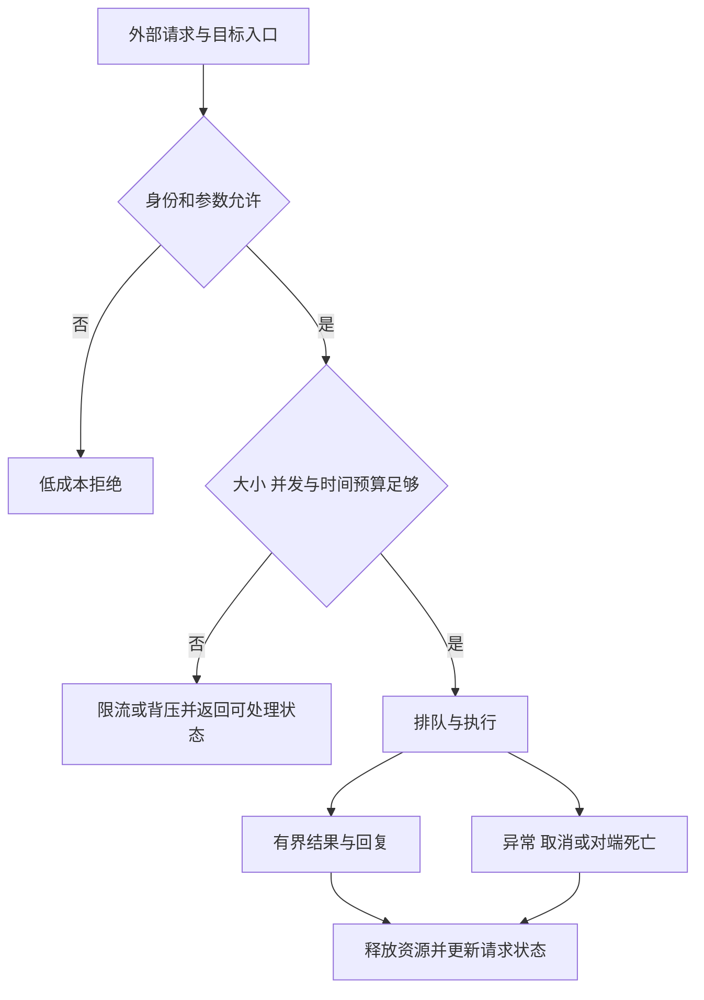
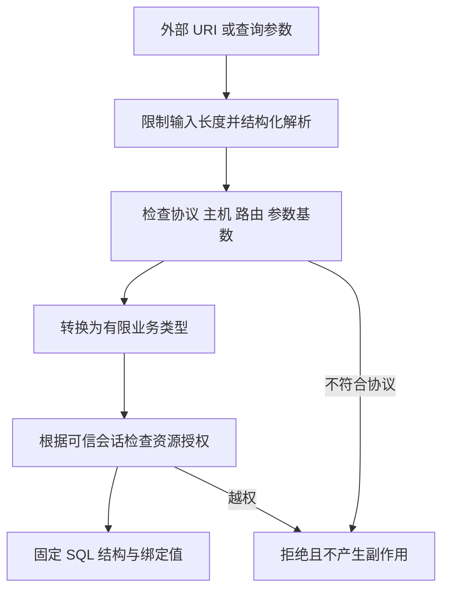
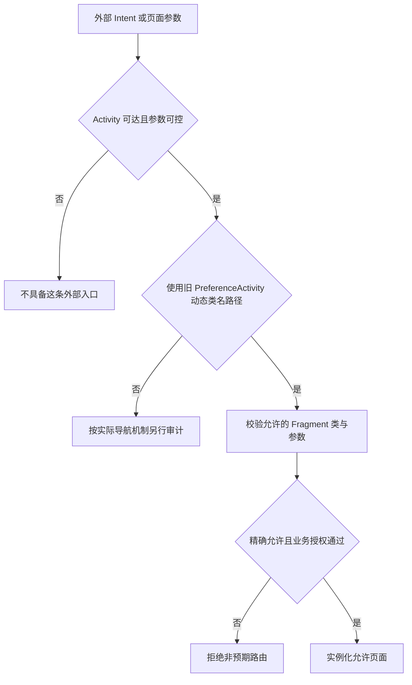

# Dos攻击

可用性审计要先说明攻击者能否进入入口、能否反复触发、消耗了什么资源，以及影响持续多久。相同异常可能是普通输入错误、已授权用户操作失败，也可能是外部可控输入造成的服务不可用；错误类型本身不决定安全影响。

常见资源包括内存、CPU、Binder 缓冲区、工作队列、文件描述符和锁等待。多次小请求也可能耗尽共享资源；限制单条字符串长度不足以控制并发、深度嵌套或长期积压。对于客户端 API，还应检查是否在主线程同步等待，导致用户无法继续操作。[Android ANR 诊断原则](https://developer.android.com/topic/performance/vitals/anr)

判断风险至少保留四条证据：入口访问控制、可控数据到危险操作的数据流、重复触发所需成本、对其他用户或请求的影响。只提供一张崩溃截图，不能证明远程攻击可达，也不能证明服务恢复之后仍会持续失效。



图中的预算应覆盖请求和回复。已拒绝请求不应先完成昂贵解析，也不能靠无限重试把背压转换成新的排队风暴。


**让昂贵工作保持有界**

假设业务需要处理用户提交的列表：先鉴权并检查集合长度，再逐项检查字符串、层数和总字节预算，才进入查询、解码或落盘。多个请求共享的任务池也要有上限；排队满时给出明确可恢复结果，而不是继续创建线程。

建议把资源策略与业务结果分开：

- **入口配额**：单次大小、每个已验证身份的速率，以及全局并发预算。
- **执行配额**：最大展开量、工作队列、取消/超时如何传播，避免后台任务失去所有者。
- **结果配额**：分页、裁剪规则和总量限制，避免“请求小、回复巨大”。
- **失败协议**：副作用请求可查询状态，重试有退避和总次数上限；不自动重试永久性输入错误。

这些预算需结合负载实测，不存在适合所有设备与业务的固定阈值。输入大小检查应在实际分配和解析前实施；事后捕获 OOM 不能替代内存预算和受控恢复设计。

## Intent.setPackage 安全 {#s201}

在没有显式 component 的匹配路径中，`setPackage()` 限制候选应用包；固定组件应由应用自行设置允许的 `ComponentName`。它们都不证明来自目标的后续数据可信，也不能授予调用者本来不具备的业务权限。[Intent.setPackage 定义](https://developer.android.com/reference/android/content/Intent#setPackage(java.lang.String))

不能给不可信 Intent 补一个 `setPackage()` 就宣称目标已被锁定：它只修改 package 字段，不清除原有 component；显式 component 仍进入组件查询分支。`Intent.resolveActivity()` 对已有 component 也会直接返回该值，并不验证组件存在、可启动或符合业务允许列表。应提取必要业务值并新建应用控制的 Intent；存在 selector 时，还要处理它与非空 package 不可并用的契约。[固定源码 setPackage](https://android.googlesource.com/platform/frameworks/base/+/refs/tags/android-16.0.0_r1/core/java/android/content/Intent.java#11408)、[resolveActivity](https://android.googlesource.com/platform/frameworks/base/+/refs/tags/android-16.0.0_r1/core/java/android/content/Intent.java#10113)、[组件解析分支](https://android.googlesource.com/platform/frameworks/base/+/refs/tags/android-16.0.0_r1/services/core/java/com/android/server/pm/ComputerEngine.java#542)

防护需要匹配实际目标：内部固定跳转可直接构造应用自己的显式 Intent；跨应用协作还需验证接收方和响应关系。不应接受外部任意包名，再以“已经 setPackage”为由跳过判断。

**验证路线**：准备正常合作方及非预期包作为自有样例，测试未指定、允许、非允许目标和同包不同入口。记录实际解析结果及操作，检查选择器、回调或结果处理是否重新引入不可信输入。

## uri.getQueryParameter {#s204}

解析解决“字符串有哪些部分”，校验解决“这些部分是否符合业务协议”，授权解决“当前主体能否操作目标资源”。`Uri.parse()` 成功、MIME 正确或 SQL 使用占位符，都不能替代第三步。



检查对象应当是最终将被消费的同一份解析结果。若入口检查原始字符串，后续组件又解码、重写或重新解析，两个阶段可能对“相同输入”产生不同理解。

**getQueryParameter：缺失、多值与不透明 URI**

[`getQueryParameter(key)`](https://developer.android.com/reference/android/net/Uri#getQueryParameter(java.lang.String)) 返回首个同名参数的解码值；缺失为 `null`，对非层次型 URI 可抛 `UnsupportedOperationException`。因此，方法调用成功不代表参数完整，也不代表其他解析器会采用相同值。

例如 `?role=reader&role=admin`：若网关读取首值、业务读取末值，授权就可能建立在不同数据上。对身份、签名、回调地址等单值字段，应明确拒绝重复键；允许多值的字段则定义次序、数量和合并语义。未知字段、空串、超长值及片段 `#fragment` 也要有明确策略。

下面将一个受限 HTTPS 路由转换为业务类型，只处理路由校验，不完成资源授权。示例只接受一个固定枚举参数，因此直接限定原始编码查询的规范形式；它主动拒绝重复参数、编码键别名和空查询，不尝试兼容任意查询语法。

```kotlin
// 教学片段：需 import android.net.Uri；调用方负责失败响应与授权。
data class NoteRoute(val id: Long, val newestFirst: Boolean)

fun parseNoteRoute(raw: String): NoteRoute {
    require(raw.length <= 2048) // 本示例的业务输入预算，并非平台上限
    val uri = Uri.parse(raw)
    require(uri.isHierarchical)
    require(uri.scheme == "https" && uri.host == "notes.example.org")
    require(uri.userInfo == null && (uri.port == -1 || uri.port == 443))
    require(uri.fragment == null)
    val parts = uri.pathSegments
    require(parts.size == 2 && parts[0] == "notes")
    require(parts[1].matches(Regex("[1-9][0-9]{0,17}")))
    val id = requireNotNull(parts[1].toLongOrNull())
    val newestFirst = when (uri.encodedQuery) {
        null, "sort=newest" -> true
        "sort=oldest" -> false
        else -> throw IllegalArgumentException("Non-canonical query")
    }
    return NoteRoute(id, newestFirst)
}
```

不要把“解码后的键名集合”与按另一种编码匹配的取值接口混用来实现重复键检查。固定标签 [Android 16 Uri.java](https://android.googlesource.com/platform/frameworks/base/+/refs/tags/android-16.0.0_r1/core/java/android/net/Uri.java#1638) 中，两条路径的键处理存在差异；例如 `sort` 与 `s%6Frt` 不应被一条链路合并、另一条链路忽略。若协议允许编码键，需一次解析所有键值对，在同一规范化规则下统计重复并生成业务值。

调用方仅在这一输入边界捕获预期的解析/校验异常并返回失败；不要捕获异常后继续使用默认账户、默认路径或已部分解析的数据。本例按规范只接受小写协议与主机，是主动缩小协议，不声称覆盖所有合法 URL。用于 WebView、HTTP 客户端或回调跳转时，还须核对实际消费者的解析和重定向规则。

## Fragment 框架注入（PreferenceActivity） {#s207}



**PreferenceActivity 的历史入口**

`PreferenceActivity` 支持从 Intent 的 `EXTRA_SHOW_FRAGMENT` 选择设置 Fragment。Activity 读取类名、调用 `isValidFragment()`，通过后才进入 `Fragment.instantiate()`；导出的设置入口应精确约束类名，再由具体页面检查参数与操作权限。

不应据此说“所有 Fragment 都能被注入”。现代 AndroidX 导航、应用自定义路由与旧框架额外参数是不同路径；即使同样接受一个字符串，也要实际追到类选择和实例化位置。


**API 与 target SDK 必须分别看**

`isValidFragment()` 从 API 19 提供。官方契约及固定源码表明：默认实现对 target SDK 小于 19 的应用返回 true，对 target SDK 大于等于 19 的未覆盖实现抛异常；类名校验通过后才调用 `Fragment.instantiate()`。仅升级运行系统或提高 target，并不能证明应用自定义覆盖也正确。[API 契约](https://developer.android.com/reference/android/preference/PreferenceActivity#isValidFragment(java.lang.String))、[固定源码校验](https://android.googlesource.com/platform/frameworks/base/+/refs/tags/android-16.0.0_r1/core/java/android/preference/PreferenceActivity.java#998)、[实例化入口](https://android.googlesource.com/platform/frameworks/base/+/refs/tags/android-16.0.0_r1/core/java/android/preference/PreferenceActivity.java#1278)

`PreferenceActivity` 在 API 29 弃用。维护旧代码时既要看运行平台是否有该校验，也要看 target 和子类覆盖；不能把 API 19 才存在的回调当成更旧平台的完整防护。新代码优先采用维护中的设置组件，并重新设计输入与授权。[PreferenceActivity 版本说明](https://developer.android.com/reference/android/preference/PreferenceActivity)

**精确允许列表而非包名前缀**

下面是旧代码迁移前的校验示意，两个类名为示例，必须替换为真实允许页面。它只约束选择范围，不替代页面参数和账号权限检查。

```java
@Override
protected boolean isValidFragment(String fragmentName) {
    return "com.example.settings.DisplayPrefsFragment".equals(fragmentName)
            || "com.example.settings.NotificationsPrefsFragment"
                    .equals(fragmentName);
}
```

不要使用 `return true`，也不要把同包类名前缀当允许所有页面的理由。允许的 Fragment 还可能依参数读取文件、切换账号或执行敏感操作，应在对应业务入口独立授权，不能因为“已经显示在设置页”就信任所有参数。

## Base64.decode 解码安全 {#s210}

Base64 将字节转换为文本表示；能解码只说明符合某些编码规则，不能证明内容可信。不能把“参数经过 Base64”作为防篡改、密码存储或安全传输方案。

Android [`Base64.decode`](https://developer.android.com/reference/android/util/Base64) 的 flags 控制变体，填充不合法可抛 `IllegalArgumentException`。输入大小与输出大小均需约束，避免解码、解压、反序列化串联后扩大资源占用。

```kotlin
// 教学片段：业务选择标准 Base64；不把成功解码当成认证。
fun decodeBounded(raw: String): ByteArray {
    require(raw.length <= 8192) // 示例协议预算，并非 Android 限制
    val bytes = android.util.Base64.decode(raw, android.util.Base64.DEFAULT)
    require(bytes.size <= 4096)
    return bytes
}
```

调用方在入口将格式异常转成明确失败，不继续执行后续动作。本例输出检查发生在分配后，因此输入预算也必不可少。需要严格、唯一编码的签名协议，还应定义允许字符、是否接受填充及规范形式；不要假设解码器必然拒绝所有非规范表达。

若内容需要真实性，使用经设计的 MAC 或数字签名并保护密钥；需要保密时使用合适的认证加密方案。签名覆盖的是精确定义的字节，Base64 的不同文本表示不应被无意混入验证逻辑。

## 带 Flags 的 Intent 启动组件 {#s213}

`FLAG_GRANT_READ_URI_PERMISSION` 与 `FLAG_GRANT_WRITE_URI_PERMISSION` 允许接收方获得相应 URI 访问能力。`addFlags` 组合标记，`setFlags` 设置整组标记；检查时应理解 bitmask，不能只比较 flags 是否恰好等于某个常量。[Intent 授权标记](https://developer.android.com/reference/android/content/Intent#FLAG_GRANT_READ_URI_PERMISSION)

可控 URI 加授权标记构成需要审查的条件，但不是脱离上下文的充分漏洞证据。还要判断谁原本拥有访问能力、URI 指向哪里、接收方是谁、读写范围及授权生命周期。data 与 ClipData 都需要纳入；持久或前缀等其他授予标记也不能遗漏。[URI 权限基础](https://developer.android.com/guide/topics/providers/content-provider-basics#Permissions)

防护应把文件选择、目标选择和授予范围放在同一条数据流里：只交给实际需要的接收方，能只读就不写，能单个资源就不扩大范围，不把外部对象中的授权标记机械带到新的跳转。

**验证路线**：使用自有 Provider 提供无敏感数据的测试 URI，分别测试不授予、只读、读写和拒绝目标。检查接收方实际能否查询、打开、修改资源，以及界面关闭后授权是否仍符合设计；不要仅检查 Intent 打印结果。

### URI 读写授权与 addFlags / setFlags {#s216}

`FLAG_GRANT_READ_URI_PERMISSION` 与 `FLAG_GRANT_WRITE_URI_PERMISSION` 分别交付读取和写入能力。`addFlags()` 叠加标记，`setFlags()` 替换现有标记；应按业务需要明确构造最终授权，不能把带有授权位的外部 Intent 原样转发。单独发现标记不构成漏洞，还要检查 URI、接收方和可访问资源。[Intent URI 授权](https://developer.android.com/reference/android/content/Intent#FLAG_GRANT_READ_URI_PERMISSION)

### URI 外部可控条件 {#s219}

URI 外部可控只提供输入条件；还需要分析应用是否接受该 URI、是否能访问目标资源、是否把授权交给非预期接收方，以及是否实际触发敏感动作。验证拒绝未知 authority、异常路径和无业务必要的授权组合，不把任意一个前提当成已完成利用。[Intent 重定向风险](https://developer.android.com/privacy-and-security/risks/intent-redirection)

## getContentResolver() 安全 {#s222}

`OpenableColumns.DISPLAY_NAME`、大小列、MIME 类型和 URI 最后一段都是提供者声明，不是可信的文件路径或内容证明。攻击者可以提供带目录穿越含义的文件名，诱导接收方覆盖自己的配置；也可以声明很小的文件却持续返回大量字节。

具体防护是自己生成存储名，把显示名称仅作为展示数据，并为展示同样设置长度与字符规则。以实际读取字节计量，限制解码、解压、上传等后续步骤；`getType()` 返回图片 MIME 不代表内容一定可安全解码。[官方文件名信任风险](https://developer.android.com/privacy-and-security/risks/untrustworthy-contentprovider-provided-filename)

下面仅演示有界导入，不承诺文件类型安全或执行时限。`maxBytes` 必须来自业务预算；调用者还需要选择后台执行方式、取消机制及允许的 URI 策略。

```kotlin
import android.content.Context
import android.net.Uri
import java.io.File
import java.io.IOException

fun importBounded(context: Context, uri: Uri, maxBytes: Long): File {
    require(uri.scheme == "content")
    require(maxBytes > 0)
    val target = File.createTempFile("import-", ".bin", context.cacheDir)
    try {
        val source = context.contentResolver.openInputStream(uri)
            ?: throw IOException("Provider returned no stream")
        source.use { input ->
            target.outputStream().use { output ->
                val buffer = ByteArray(8192)
                var total = 0L
                while (true) {
                    val count = input.read(buffer)
                    if (count < 0) break
                    if (count.toLong() > maxBytes - total) {
                        throw IOException("Import exceeds budget")
                    }
                    output.write(buffer, 0, count)
                    total += count
                }
            }
        }
        return target
    } catch (failure: Exception) {
        target.delete() // 最佳努力清理；应用仍需清理过期临时文件。
        throw failure
    }
}
```

不要在主线程执行这段复制。恶意远端可以阻塞、报错或返回不完整内容，单靠字节上限不能防止所有耗时攻击。缓存还可能被系统回收，重要数据须在校验通过后提交到适合的私有持久目录。[应用专属存储](https://developer.android.com/training/data-storage/app-specific)

### 不可信 URI 的访问边界 {#s225}

调用 `getContentResolver()` 取得的是访问接口，不是来源认证结果。安全边界位于后续 URI 解析、Provider 选择、权限与业务授权、读取预算和私有落盘位置。不要将外部 Provider 返回的文件名直接拼接成本地路径，也不要把它声明的大小或 MIME 类型当作可信验证。[不可信 Provider 文件名](https://developer.android.com/privacy-and-security/risks/untrustworthy-contentprovider-provided-filename)

## EditText.setSelection() 光标定位 {#s228}

`EditText.setSelection(index)` 最终对文本设置选择 span；索引必须适合当前文本。负值、超过长度的值或文字已变化后的旧索引，可能导致异常。这里首先是索引与状态一致性问题，是否构成可被第三方触发的可用性风险还取决于输入来源和页面可达性。[EditText](https://developer.android.com/reference/android/widget/EditText#setSelection(int))、[Selection 固定源码](https://android.googlesource.com/platform/frameworks/base/+/refs/tags/android-16.0.0_r1/core/java/android/text/Selection.java#79)

`android:maxLength` 通过长度过滤约束最终文本；格式化、替换、异步更新和其他 `InputFilter` 也会改变文本。因此光标必须依据最终的 `Editable` 计算，而非输入字符串的长度。[LengthFilter](https://developer.android.com/reference/android/text/InputFilter.LengthFilter)

下面示例在 UI 线程设置文字，然后针对**过滤后的实际文本**计算光标位置。数值需先从外部输入安全解析为 int；不把原始字符串长度直接传入。

```java
static void showTextAt(EditText view, CharSequence incoming,
        int requestedIndex) {
    view.setText(incoming == null ? "" : incoming);
    int actualLength = view.getText().length();
    int bounded = Math.max(0, Math.min(requestedIndex, actualLength));
    view.setSelection(bounded);
}
```

这只是防止数值越界的教学片段：输入本身仍需大小限制；若业务要求严格索引，可以选择拒绝非法值而非截断。字符位置是 Java 文本索引，处理 emoji、组合字符等用户可见字符时，还需单独定义光标与文本语义，不能把字节数当文本索引。

异步更新必须在最终修改文字的同一 UI 执行阶段重新检查长度。先取长度、之后又替换文本再使用旧结果，仍然可能失效；捕获异常并无限重试只会掩盖状态问题。

### 外部文本与 maxLength 条件 {#s231}

`maxLength` 只限制过滤后的文本，不自动调整业务保存的旧光标索引。应在最后一次设置文本的同一 UI 阶段，按 `getText().length()` 拒绝或截断非法索引。外部原始输入仍应提前限制长度，避免先分配、格式化超大字符串再交给过滤器。[LengthFilter](https://developer.android.com/reference/android/text/InputFilter.LengthFilter)

## getPackageInfo 安全 {#s234}

`getPackageInfo()` 请求包管理服务生成 `PackageInfo`。`flags` 指定附加的包信息和匹配条件；非零不代表必然产生大响应或抛异常，零也不代表只有版本号。

在 `android-16.0.0_r1` 的 `PackageInfoUtils` 中，基础结果直接填充包名、版本、ApplicationInfo、安装和更新时间等数据；随后根据 flags 决定是否展开 Activity 等组件信息。因此，应按实际字段需要选择 flags，而不是对所有非零 flags 机械套上 `catch RuntimeException`。[基础字段生成](https://android.googlesource.com/platform/frameworks/base/+/refs/tags/android-16.0.0_r1/services/core/java/com/android/server/pm/parsing/PackageInfoUtils.java#131)、[组件附加分支](https://android.googlesource.com/platform/frameworks/base/+/refs/tags/android-16.0.0_r1/services/core/java/com/android/server/pm/parsing/PackageInfoUtils.java#268)

组件、权限、签名等附加信息可能增加结果体积，但实际大小取决于包内容和返回路径。审计不能从一个 flags 值推导通用崩溃阈值，也不能因为只查询包名就跳过调用环境、包可见性与异常契约。[PackageManager 查询 API](https://developer.android.com/reference/android/content/pm/PackageManager#getPackageInfo(java.lang.String,int))

**只查询自己确实需要的信息**

下面展示读取本应用基础包信息的分支。编译 SDK 需支持 API 33 类型；低版本分支保留旧重载。示例只处理 API 声明的包不存在情形，不伪装成覆盖所有系统失败的完整封装。

```java
static String ownVersionName(Context context)
        throws PackageManager.NameNotFoundException {
    PackageManager pm = context.getPackageManager();
    String packageName = context.getPackageName();
    PackageInfo info;
    if (Build.VERSION.SDK_INT >= 33) {
        info = pm.getPackageInfo(packageName,
                PackageManager.PackageInfoFlags.of(0L));
    } else {
        info = pm.getPackageInfo(packageName, 0);
    }
    return info.versionName == null ? "" : info.versionName;
}
```

`PackageInfoFlags` 从 API 33 提供，包装 long 位集合；它不会自动限流或缩减响应。跨应用查询还涉及包可见性，不应为了这个示例申请查看全部已安装应用的能力。[PackageInfoFlags](https://developer.android.com/reference/android/content/pm/PackageManager.PackageInfoFlags)、[包可见性](https://developer.android.com/training/package-visibility)

错误处理应让调用方区分不存在、无权访问、对端/系统异常与业务取消等情况。吞掉所有异常并返回“安全”或“未安装”，会把不可用状态伪装成确定结果，干扰后续授权或风控判断。

### Binder 事务预算、flags 与异常处理 {#s237}

官方异常文档将当前 Binder 事务缓冲区描述为约 1 MB，并明确它由进程中进行的事务共享。这个数量不能当作每笔调用都独享的有效载荷预算，更不能保证“略小于 1 MiB 就必定成功”。[TransactionTooLargeException 契约](https://developer.android.com/reference/android/os/TransactionTooLargeException)

固定源码中的 libbinder 还有 `1 MiB - 2 × page size` 的映射实现细节。Parcel 元数据、Binder 对象、并发占用和生命周期都会影响可用空间；API 文档近似值、实现映射大小和业务可用负载不是同一数字。[ProcessState 的映射定义](https://android.googlesource.com/platform/frameworks/native/+/refs/tags/android-16.0.0_r1/libs/binder/ProcessState.cpp)

同步调用要发送请求并接收回复。异常可能意味着请求没有送出，也可能意味着服务处理后无法发回回复。客户端仅凭异常不能判定业务未执行；对扣款、提交等有副作用操作，需要请求标识、幂等处理或状态查询，不能无条件重发。

`oneway` 不会消除缓冲区与服务端处理成本，也不提供无限异步队列。它改变远端等待语义，不能代替配额、背压或业务完成确认。具体线程与队列边界见 [Binder 的异步事务分析](/android/framework/binder-mechanism.html)。

**限制的对象是协议，不只是数组**

优先让接口只传所需字段；集合分页，并给每页条数、单项大小、嵌套层数和并发请求数设业务预算。图片、文件等大对象可考虑文件描述符或其他适合的通道，但仍须管理读写权限、总量、关闭和取消，而不是把内存风险转成文件描述符泄漏。

仅调用 `Parcel.dataSize()` 得到的局部序列化长度，也不是对端必然接收成功的证明。系统此刻的共享占用、其他事务与远端业务资源都不在该值里。[Parcel.dataSize](https://developer.android.com/reference/android/os/Parcel#dataSize())

## URLDecoder.decode 解码安全 {#s240}

[`URLDecoder`](https://docs.oracle.com/en/java/javase/17/docs/api/java.base/java/net/URLDecoder.html) 面向 `application/x-www-form-urlencoded`：`+` 会变成空格，百分号转义按字符集解码。它不适合直接对整条 URL 使用，也不应该再处理已经由 `Uri` 解码的参数。

若业务输入明确是原始表单字段，可在限定长度后使用 `URLDecoder.decode(rawField, "UTF-8")`，并在入口处理非法转义导致的 `IllegalArgumentException`。Android 的字符串字符集重载自 API 1 可用，而 `Charset` 重载自 API 33 引入；不能把 Java SE 中的所有重载默认视为所有 Android 版本可用。[Android URLDecoder API](https://developer.android.com/reference/java/net/URLDecoder)

“多解码几遍直到没有 `%`”会引入新的语义：校验时的 `%2F` 与再次解码后的 `/` 不是同一数据。设计协议时固定编码方式与解码次数，后续消费者不得偷偷增加另一轮解码。签名验证还需定义精确字节和规范化规则，不能先随意重排参数再验证签名。

