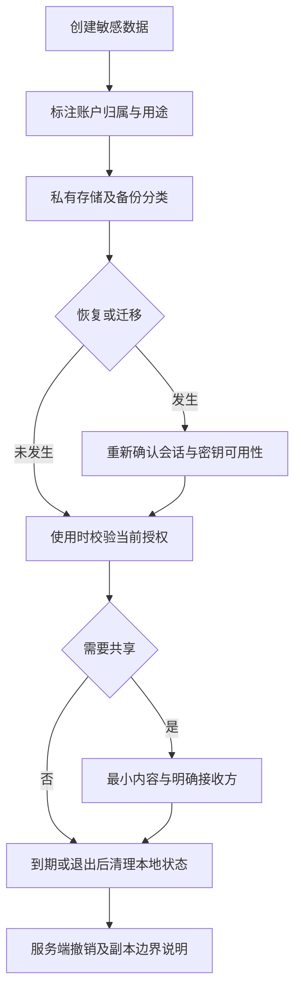

# 敏感数据生命周期：退出、迁移和卸载之后还剩什么

现行分类：

- [应用状态与设备或账号关联](/security/android/configuration-security.html#s135)
- [软件卸载后的残留信息检查](/security/android/configuration-security.html#s138)
- [剪贴板安全使用](/security/android/configuration-security.html#s147)
应用退出登录时清空界面，却仍把刷新凭据留在磁盘；重装后从备份恢复 `loggedIn=true`，又直接开放敏感页面。问题不只在“有没有加密”，而在于同一份数据何时还能代表有效身份，以及它还有多少副本。

## 1. 数据状态不等于当前授权 {#account-binding}

本地文件可以保存用户偏好、上次显示的账户名或缓存结果，却不能单独证明当前请求已经授权。攻击前提可能是旧备份恢复、同一设备切换账户、测试环境复制数据，或客户端状态被更改后应用仍无条件信任它。

例如数据库记录带有账户 A 的资料，而恢复后用户登录账户 B。如果读取代码只用本地记录 ID，不同时检查当前账户归属，就可能展示错误主体的数据。防护应让缓存按账户隔离，敏感接口由服务端根据有效会话校验资源所有者与操作范围；客户端切换账户时停止旧任务，避免异步响应把 A 的结果写回 B 的界面。

设备关联是业务策略，不是所有数据必须永久绑定某个硬件标识。先确定换机、重装、共享设备和账户恢复需求，再选择作用域合适的标识；避免把不可重置设备 ID 当作用户身份或唯一授权凭据。[Android 标识符选择原则](https://developer.android.com/identity/user-data-ids)



图中的重新确认不能仅依赖一个客户端布尔值。恢复失败、凭据过期或密钥不可用时，应转入重新登录或重新建立安全状态的流程，不能因为“曾经登录过”而跳过鉴权。

### 为不同数据设置不同的恢复规则

以测试业务为例，界面主题可随账户偏好恢复；刷新凭据需要服务端认可的会话流程；导出附件则要明确接收方与保留期限。不要把三者放进同一个“账户数据包”后统一复制。

实施时为每类数据记录创建者、账户归属、存储域、备份资格、共享对象和到期动作。代码评审把新增存储点与这份清单比对，恢复测试再检查实际结果；清单只是设计证据，不能证明文件已被排除或删除。

## 2. 加密、备份与设备迁移分别负责什么 {#storage-and-restore}

私有存储减少其他普通应用直接读取数据的机会，加密保护密文，备份规则控制哪些内容进入特定备份/迁移流程。这三层相互补充，不能互相替代。

例如密文被备份到新设备，而解密密钥没有对应迁移能力，恢复文件可能无法使用；反过来，把密钥和密文一起以可提取形式存入同一份备份，也可能削弱加密设计。恢复逻辑必须检查数据版本、账户归属、密钥存在性和完整性，失败时清理或重新获取，而不是降级使用明文。

Android Keystore 可使密钥材料不直接进入应用进程，并限制密钥用途或使用条件；是否位于安全硬件中取决于设备能力、算法配置及实际密钥属性。应用进程被控制时，攻击者仍可能调用该进程可使用的密钥，因此不能承诺“用了 Keystore 就无法泄露”。[Android Keystore 安全能力](https://developer.android.com/privacy-and-security/keystore)

备份排除、新旧 XML 与 D2D 条件见 [备份规则示例](./release-hardening.html#backup-rules)。验证恢复时同时检查正常数据能否恢复、敏感状态是否被错误延续；只验证“文件没出现”不足以证明账户授权正确。

## 3. 退出登录是一次撤销流程 {#logout-cleanup}

一个可操作的顺序是：终止或隔离当前账户的后台任务；按服务端协议撤销刷新能力；清除本地会话和账户专属缓存；清理临时导出副本与界面状态；再回到未登录界面。具体顺序要处理网络失败和正在执行的任务，不能只调用一次删除函数。

若离线退出，客户端至少应立即停止把旧会话作为当前登录态，并安排受控的后续处理。服务端令牌的有效期和撤销策略属于业务设计，不能声称客户端删除文件后服务器上的令牌必然失效。

具体测试可以使用两个测试账户：让 A 的请求在切换到 B 后才返回，确认结果不会写入 B 的缓存；让服务端拒绝旧凭据，确认 App 不会回退到旧本地状态继续执行敏感操作。

文件删除也不等同介质层可靠擦除。闪存、系统管理和副本生命周期会影响残留，普通应用不应承诺能对所有存储介质执行可证明的安全覆写。高敏感设计需要减少明文落盘、缩短保留期，并从架构上限制可恢复的副本。

## 4. 卸载不会收回所有副本 {#uninstall-residue}

应用专属内部与外部目录在正常卸载时由系统清理；缓存也可能在卸载前因空间管理被删除，不能依赖它长期保存数据。[应用专属文件生命周期](https://developer.android.com/training/data-storage/app-specific)

共享媒体、用户主动导出的文档、其他 App 保存的附件、服务端记录和系统备份不是同一份应用私有目录。外部共享存储面向用户和其他应用，数据保留策略需要结合存储 API 与用户选择说明，不能直接套用“卸载即清空”。[共享存储说明](https://developer.android.com/training/data-storage/shared)

因此，风险判断要说明数据位置与持有方。例如“卸载后导出的 PDF 仍在下载目录”可能是预期产品行为；如果其中含访问令牌，而产品又承诺退出即不可使用，则暴露了设计问题。防护优先减少导出内容、提示接收方及保留行为，并避免把长期凭据打包到导出文件。

不要依赖卸载回调完成服务端注销或删除共享文件。需要远端保留期限、用户删数和失效机制时，应在账户系统中明确实现，不能要求已经卸载的客户端继续执行清理。

## 5. 剪贴板是跨应用交付渠道 {#clipboard}

复制身份证号、付款信息或一次性验证码之后，数据离开了原页面的展示边界。攻击者可能通过允许读取剪贴板的环境、恶意输入法、屏幕观察或用户再次粘贴取得内容；具体可达性取决于系统版本与应用身份。

Android 10 起限制普通后台应用读取剪贴板，但这不等于只有来源 App 能读取。输入法、前台使用场景以及用户主动粘贴仍需考虑；不要用“新系统禁止后台读取”推出可以长期保存密码。[剪贴板安全风险与版本背景](https://developer.android.com/privacy-and-security/risks/secure-clipboard-handling)

Android 13 起系统提供复制后的可视反馈。敏感标记可隐藏内容预览，但不加密剪贴板，也不撤销符合平台条件的读取能力。[系统复制反馈与敏感内容](https://developer.android.com/develop/ui/views/touch-and-input/copy-paste)

教学片段：使用编译 SDK 33 或更高的常量，按业务判断只在用户主动操作时复制，不把真实秘密放入日志。

```kotlin
import android.content.ClipData
import android.content.ClipDescription
import android.content.ClipboardManager
import android.os.PersistableBundle

fun copySensitive(clipboard: ClipboardManager, text: String) {
    val clip = ClipData.newPlainText("Sensitive content", text)
    clip.description.extras = PersistableBundle().apply {
        putBoolean(ClipDescription.EXTRA_IS_SENSITIVE, true)
    }
    clipboard.setPrimaryClip(clip)
}
```

该片段还要求运行系统支持 `ClipDescription.setExtras`，即 API 24 或更高。[API 引入条件](https://developer.android.com/reference/android/content/ClipDescription#setExtras(android.os.PersistableBundle)) 较低编译 SDK 的官方兼容写法使用键字符串 `android.content.extra.IS_SENSITIVE`；不能因换成字符串就假定所有旧系统都支持相同界面行为。[敏感标记与 SDK 条件](https://developer.android.com/privacy-and-security/risks/secure-clipboard-handling)

## 6. 剪贴板清理也有并发与产品边界 {#clipboard-cleanup}

不应把定时清空描述为“保证内容不被读取”：对方可能已经读取或复制，定时任务也可能因为进程、调度和前台限制无法执行。Android 13 起的系统自动清理减少保留窗口，但仍不能替代避免复制高敏感秘密的设计。[官方自动清理说明](https://developer.android.com/privacy-and-security/risks/secure-clipboard-handling)

如果产品实现主动清理，需要识别仍是本次写入的剪贴项，并考虑用户已经复制新内容的情况。读取、比较、再清空不是跨进程原子操作，不能无条件清空用户后来复制的数据。应优先缩短秘密有效期、让复制成为明确用户操作，并谨慎说明清理的最佳努力性质。

例如验证码即使显示为敏感且随后清空，仍应由服务端限制用途、有效期和重放；UI 措施不能把可复制数据变成不可转交凭据。

## 7. 清理与恢复检查 {#verification}

先用实际设备查询结果记录系统版本、target SDK、账户状态、存储位置和备份/迁移实现。只使用测试账户与合成秘密。

1. 账户切换：准备 A、B 两个账户，覆盖旧请求延迟返回、离线退出、重新登录及恢复旧缓存，确认数据按当前主体隔离。
2. 恢复检查：分别执行支持范围内的备份恢复与 D2D，确认偏好可恢复，旧会话不直接复活，密钥缺失走受控恢复流程。[官方备份测试路线](https://developer.android.com/identity/data/testingbackup)
3. 删除检查：枚举应用私有、共享、接收方、服务端与备份副本；在授权的隔离测试中观察退出和卸载后的实际状态，不凭目录名推断结果。
4. 剪贴板检查：在支持的系统版本上观察敏感预览、前后台读取条件、手动粘贴和清理；确认用户复制第二项内容后不会被旧任务误清除。
5. 失败检查：覆盖网络不可用、密钥不可用、清理失败与任务中断，确认不回退到不安全的本地授权状态。
