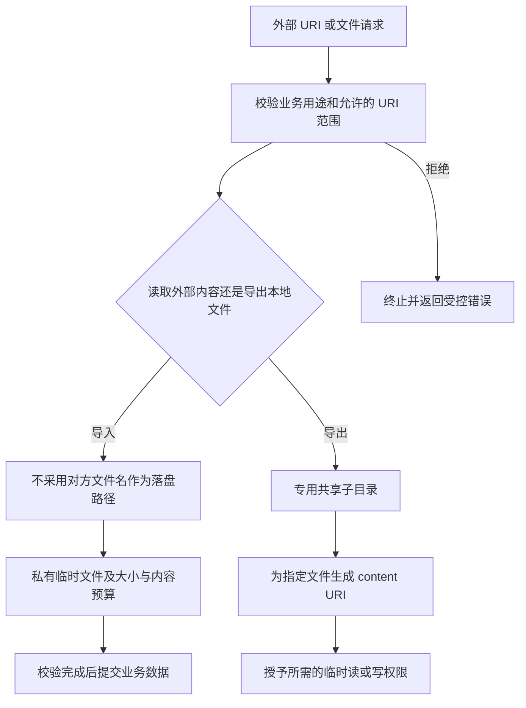

# 文件边界与 FileProvider：共享的是哪一份能力

现行分类：[Provider 文件目录遍历漏洞](/security/android/component-security.html#s63)、[FileProvider 共享目录范围](/security/android/component-security.html#s90)、[共享范围过大的风险](/security/android/component-security.html#s93)、[共享路径最小化防护](/security/android/component-security.html#s96)、[文件读写](/security/android/file-operations.html#s171)、[getContentResolver() 安全](/security/android/dos-attacks.html#s222)、[不可信 URI 的访问边界](/security/android/dos-attacks.html#s225)。

导入头像时沿用外部 Provider 返回的文件名，可能覆盖应用自己的文件；导出附件时共享整个 files 目录，又可能把凭据一起暴露。两者都使用 `content://`，风险却分别发生在接收端落盘和发送端授权。

## 1. 文件操作先回答三个边界问题 {#file-boundaries}

第一，谁决定要访问的对象：应用内部 ID、用户选择结果，还是外部传入的 URI、文件名与相对路径？第二，操作使用谁的权限：调用者持有的临时授权，还是应用作为代理拥有的私有数据访问能力？第三，结果会流向哪里：内部解析器、应用私有目录、另一个 App，还是上传接口？

`getContentResolver()` 只是取得内容访问入口，不替你判断业务对象、提供者可信度或文件用途。拥有读取权限，也不代表应该把内容转交给其他主体。尤其要防止把外部 URI 转发给拥有更高权限的组件后，形成代读私有数据的路径。



这里的“允许范围”由业务决定。只接受指定合作方时可以校验 authority 对应的包及签名；用户主动选择文档的场景则不能随意只允许某个厂商 Provider。两者都不能把 URI 字符串当成调用者身份。[FileProvider 风险说明](https://developer.android.com/privacy-and-security/risks/file-providers)

如果入口只应导入外部文档，应拒绝业务不允许的本应用 Provider URI，避免攻击者把它变成读取本地私有数据的代理。不要把外部传入的 `file://` 转换为本地路径直接打开，也不要把“scheme 是 content”当成全部校验。

## 2. 共享目录是暴露面的上界 {#fileprovider-roots}

FileProvider 将文件规范化后匹配已配置根目录，把根名和相对路径编码成 URI；接收方打开 URI 时再映射回实际文件。路径规则决定可生成 URI 的上界，临时 grant 决定谁取得其中某个资源的能力，两者共同约束访问。AndroidX 独立发布，具体实现应对应项目依赖版本。[FileProvider 的生成与打开契约](https://developer.android.com/reference/androidx/core/content/FileProvider)

FileProvider 把配置根目录内的文件映射为 content URI，并结合临时授权共享。配置一个目录不等于所有应用立即都能读取它，但根目录越宽，业务代码错误生成 URI 或错误授权后的影响越大。

风险成立需要实际可达的路径：例如外部输入控制要导出的文件，应用能够生成相应 URI，又把读取或写入能力交给了对方。不能仅凭配置文件存在就宣称已经任意文件读取。

**不要使用过宽的 `<root-path>`、`path="."` 或整个私有目录。`<files-path>` 和 `<cache-path>` 本身合法，应该选择专用子目录。** 官方安全示例也使用这两种元素。[目录最小化建议](https://developer.android.com/privacy-and-security/risks/file-providers)

教学配置：只为已经脱敏的导出副本提供 URI，不把数据库、会话文件放入这些目录。

```xml
<!-- res/xml/share_paths.xml -->
<paths xmlns:android="http://schemas.android.com/apk/res/android">
    <files-path name="reports" path="share/reports/" />
    <cache-path name="previews" path="share/previews/" />
</paths>
```

对应 Provider 应使用匹配的 authority、`android:exported="false"`、`android:grantUriPermissions="true"`，并用 `android.support.FILE_PROVIDER_PATHS` 元数据引用该资源。按官方文档建立自己的 FileProvider 子类及 Manifest 声明；不要因为看到私有 Provider 就误以为 URI grant 无法访问它。[FileProvider API 与配置](https://developer.android.com/reference/androidx/core/content/FileProvider)

## 3. URI 授权只交付必要能力 {#uri-grants}

只需预览就只给读权限；写权限意味着接收方可能修改或破坏共享内容。使用 FileProvider 为应用确认过的文件生成 URI，再通过所选业务入口授予权限，避免直接接受外部指定的“本地待分享 URI”。

`Intent` 的 data、`EXTRA_STREAM`、ClipData 和 flags 应作为一个整体审查。读写位是 bitmask 的组成部分，不能用 `flags == 某常量` 判断是否存在授权。也不能把所有隐式 Intent 一概判漏洞：系统分享选择器本来就服务于用户选择接收方，关键是交付的内容、目标和授权范围是否符合用户意图。

临时授权的存续与承载方式有关，不能写成“发送后立即失效”。取消授权也不能收回接收方已经复制的内容；若要求长期保密，不应把原始秘密交付给不可信接收者。[FileProvider 授权与生命周期](https://developer.android.com/reference/androidx/core/content/FileProvider)

## 4. 不可信 Provider 可以对元信息撒谎 {#untrusted-provider}

`OpenableColumns.DISPLAY_NAME`、大小列、MIME 类型和 URI 最后一段都是提供者声明，不是可信的文件路径或内容证明。攻击者可以提供带目录穿越含义的文件名，诱导接收方覆盖自己的配置；也可以声明很小的文件却持续返回大量字节。

具体防护是自己生成存储名，把显示名称仅作为展示数据，并为展示同样设置长度与字符规则。以实际读取字节计量，限制解码、解压、上传等后续步骤；`getType()` 返回图片 MIME 不代表内容一定可安全解码。[官方文件名信任风险](https://developer.android.com/privacy-and-security/risks/untrustworthy-contentprovider-provided-filename)

下面仅演示有界导入，不承诺文件类型安全或执行时限。`maxBytes` 必须来自业务预算；调用者还需要选择后台执行方式、取消机制及允许的 URI 策略。

```kotlin
import android.content.Context
import android.net.Uri
import java.io.File
import java.io.IOException

fun importBounded(context: Context, uri: Uri, maxBytes: Long): File {
    require(uri.scheme == "content")
    require(maxBytes > 0)
    val target = File.createTempFile("import-", ".bin", context.cacheDir)
    try {
        val source = context.contentResolver.openInputStream(uri)
            ?: throw IOException("Provider returned no stream")
        source.use { input ->
            target.outputStream().use { output ->
                val buffer = ByteArray(8192)
                var total = 0L
                while (true) {
                    val count = input.read(buffer)
                    if (count < 0) break
                    if (count.toLong() > maxBytes - total) {
                        throw IOException("Import exceeds budget")
                    }
                    output.write(buffer, 0, count)
                    total += count
                }
            }
        }
        return target
    } catch (failure: Exception) {
        target.delete() // 最佳努力清理；应用仍需清理过期临时文件。
        throw failure
    }
}
```

不要在主线程执行这段复制。恶意远端可以阻塞、报错或返回不完整内容，单靠字节上限不能防止所有耗时攻击。缓存还可能被系统回收，重要数据须在校验通过后提交到适合的私有持久目录。[应用专属存储](https://developer.android.com/training/data-storage/app-specific)

## 5. 路径校验必须连接到真实访问 {#path-and-races}

真正读写针对已打开的文件描述符。校验路径后再次按路径打开，会重新解析目录项，产生检查与使用的时间差；应让共享根和父目录不由不可信主体修改，并明确只读、追加或截断模式。返回的描述符也可能来自管道，不能假定总能定位或具有固定长度。[ParcelFileDescriptor](https://developer.android.com/reference/android/os/ParcelFileDescriptor)

自定义 Provider 或接收端拼接路径时，先把业务对象映射到受控文件，再检查最终规范化路径是否位于可信根目录内。字符串 `startsWith(root)` 可能把 `root-other` 错当子目录，检查要包含目录边界；更不能先检查一份路径，却随后打开另一份重新拼接的路径。

canonical 路径能处理一类 `..` 和符号链接问题，却不能自动消除“检查后、打开前”目标被替换的竞态。安全前提应包含根目录及其父目录不由攻击者控制；避免在可被其他应用写入的共享目录中执行敏感更新。[Android 路径遍历说明](https://developer.android.com/privacy-and-security/risks/path-traversal)

写入重要状态还需要失败恢复与并发策略。可使用临时文件完成校验后提交，或按实际 SDK 核对 `AtomicFile`；原子写入帮助避免半写状态，不等于跨线程锁或授权机制。线程、进程之间的并发访问仍需单独协调。[AtomicFile API](https://developer.android.com/reference/android/util/AtomicFile)

## 6. 文件共享检查要点 {#verification}

只在自有测试 App、合成文件和隔离目录中验证，并先记录实际 OS、target SDK、AndroidX 版本与授权方式。

1. 配置检查：确认共享根只包含专用导出目录；测试普通附件能够分享，数据库、会话文件和相邻目录无法生成可用共享 URI。
2. 权限检查：自有接收 App 在未获授权、获读授权、获写授权三种状态分别尝试实际操作；记录成功或异常，而非只看 Manifest。
3. 输入检查：测试 Provider 返回 `../` 风格名称、重复名称、未知大小、错误 MIME、超预算内容及读到一半失败；确认不覆盖既有文件、不提交半成品。
4. 路径检查：覆盖同名前缀目录、规范化路径以及测试目录内的替换竞态；明确哪些竞态由私有目录前提排除，哪些仍需修复。
5. 生命周期检查：测试接收端复制后撤销授权的结果、进程重启后的残留临时文件和缓存被回收的恢复行为。

## 7. 关联阅读 {#related}

URI 解析与 SQL 输入分别见 [URI、查询参数与 SQL](./uri-sql-input.html)；文件内容、图片和压缩包预算见 [不可信文件处理](./untrusted-files.html)。Provider 权限与 MIME 行为回到 [访问模型](../foundation/provider.html)，不要用文件路径检查代替组件鉴权。
