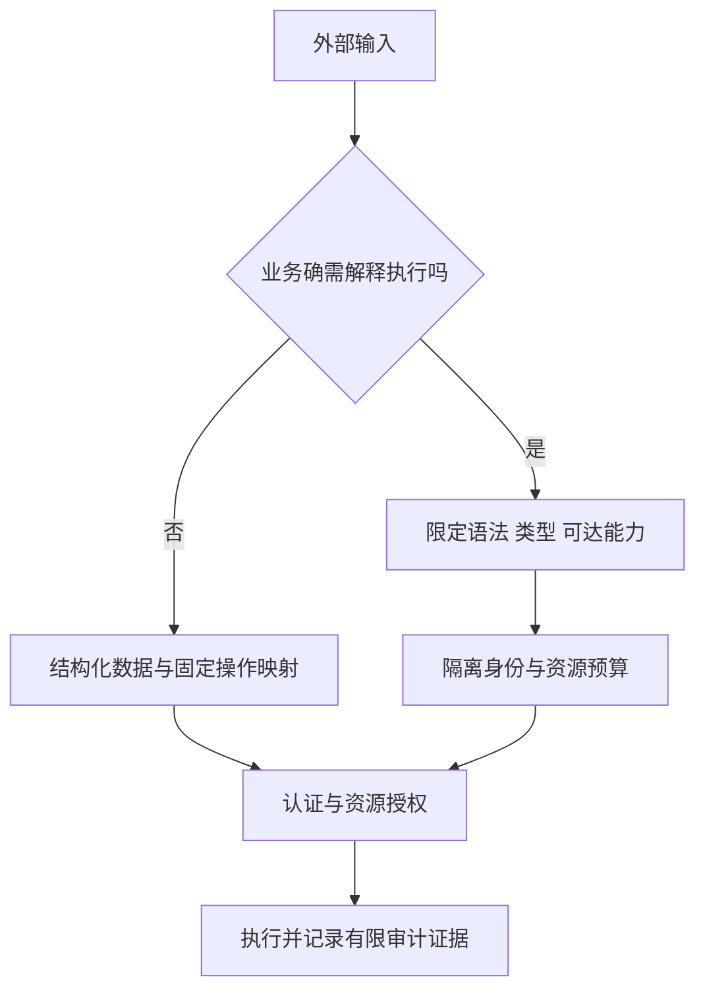

# 命令、表达式与序列化边界

::: info 旧专题链接
本站已将正文按原提纲五类重新组织。本页保留供历史链接查阅，不再出现在全文搜索中；请从以下同名章节继续阅读。

- [命令执行安全](/security/android/special-functions.html#s180)
- [序列化安全](/security/android/special-functions.html#s189)
- [JEXL 表达式注入](/security/android/special-functions.html#s192)
- [Base64.decode 解码安全](/security/android/dos-attacks.html#s210)
:::

“特殊函数”并不天然构成漏洞。需要追问：谁能控制输入，这段输入会被当成数据还是指令，执行时获得哪些权限，失败会影响什么资产。

> **工程层 · 前置知识**：[安全模型](../foundation/security-model.html)、[URI 与 SQL 输入](./uri-sql-input.html)。下列为教学片段和设计示意，未在 Android 工程中编译或真机执行；本站不依赖 JEXL。

## 1. 先识别解释器与危险能力 {#capability-model}

同一个字符串进入不同消费者，风险不同。文件路径交给文件 API，表达式交给脚本引擎，序列化对象交给对象恢复器，都可能使外部数据获得超出预期的能力。防护应在敏感操作之前完成，而不是在发生异常后统一忽略。



通用审计模型是“输入源 → 转换 → 可达能力 → 执行身份 → 结果”。仅看到 `exec`、`Serializable` 或 `Base64.decode` 不能判定可利用漏洞；反过来，输入来自本地缓存也不代表可信，缓存可能由外部响应或共享目录写入。

## 2. 命令执行：分离参数仍要限制命令语义 {#command-execution}

优先使用 Android/Java 的文件、网络或压缩 API，避免为普通业务启动 shell。若确需外部工具，固定可执行文件与操作集合，限制参数的语义、长度和文件落点，并使用最小权限运行。

危险模式是把外部值拼接后传入 shell 的 `-c` 参数。shell 会进一步解释引号、替换、管道等语法。`Runtime.exec(String)` 本身也不能一概等同于 shell，它与显式执行 shell 的解释路径必须区分；其字符串拆分契约见 [Android Runtime.exec](https://developer.android.com/reference/java/lang/Runtime#exec(java.lang.String,java.lang.String%5B%5D,java.io.File))。

[`ProcessBuilder`](https://docs.oracle.com/en/java/javase/11/docs/api/java.base/java/lang/ProcessBuilder.html) 支持用参数列表表达程序及参数；下面只说明参数分离，不指定任何未核实工具或参数名：

```kotlin
// 教学片段：这些变量由应用内部固定策略提供，不直接采纳外部字符串。
val process = ProcessBuilder(
    trustedExecutablePath,
    reviewedOperationArgument,
    validatedResourceId
).start()
```

这不能自动消除**参数注入**：若目标程序把资源名解释成选项、响应文件或脚本，参数列表仍然危险。是否支持选项终止符及其含义，要查目标工具的实际文档，不能套用统一参数。可执行文件本身也必须位于可信、不可被其他主体替换的位置。

执行还要限制并发、输出总量和耗时，处理标准输出与错误输出，避免管道写满造成等待。终止父进程也不必然终止全部后代；不能把线程超时当作完整进程隔离。Android 应用启动的本地程序通常仍受其 UID、SELinux 和系统策略约束，调用命令不自动获得系统权限。

**验证路线**：在隔离工程使用固定测试程序记录收到的参数，测试空格、换行、选项样式值和超长输入，确认它们没有改变操作集合；再测试工具阻塞、异常退出和大量输出。不要在真实用户数据目录中验证破坏性副作用。

## 3. JEXL：表达式引擎是能力暴露面 {#jexl}

JEXL 可用于表达式和脚本求值。如果把不可信表达式与带文件、网络、反射或服务能力的对象绑定，引擎可能成为业务权限的代理。仅允许“算式外观”的输入，或简单过滤类名，并不能证明所有可达调用链安全。

Apache 的[配置与安全说明](https://commons.apache.org/proper/commons-jexl/apidocs/org/apache/commons/jexl3/package-summary.html)指出，自 3.7 起默认权限采用 `SECURE`；旧版本和显式恢复旧行为的配置可能不同。这是滚动文档中的版本说明，不是本文对某个项目依赖版本的测量。

对实际工程，应同时核对引擎版本、`JexlPermissions`、`JexlFeatures`、沙箱、命名空间与上下文对象。`RESTRICTED` 或 `SECURE` 都不是“任意用户脚本安全执行”的保证。能改成预定义规则或结构化条件时，不开放通用表达式。

确需执行时采用以下设计：

1. 只暴露纯数据和业务必需的有限函数，不把 `Context`、数据库连接、类加载器等广泛能力对象交给表达式。
2. 按实际版本配置允许列表，默认拒绝未知类型、方法和属性；限制语法功能，避免误用空列表语义。
3. 限制表达式长度、编译频率、执行资源和结果大小；缓存也设容量边界。
4. 对需要强隔离的不可信脚本使用独立信任域与可终止执行单元；不要只依赖同进程线程中断。

配置项的精确语义见 [`JexlSandbox`](https://commons.apache.org/proper/commons-jexl/apidocs/org/apache/commons/jexl3/introspection/JexlSandbox.html)。本文不提供脱离版本、复制即可保证安全的引擎配置。

**验证路线**：以业务允许的最小表达式集作正例，再逐项验证未授权类型访问、方法调用、循环或高成本计算、超大结果及配置迁移。拒绝测试不能替代对暴露对象完整可达能力的审查。

## 4. 序列化：类型匹配不代表对象无害 {#deserialization}

反序列化不仅是“读取字段”。某些机制会实例化对象、执行恢复逻辑、触发嵌套解析，或形成异常大的对象图。风险成立取决于格式、可达类、库版本、输入来源和后续用途，不能把所有反序列化一律称为代码执行。

Android 的[不安全反序列化说明](https://developer.android.com/privacy-and-security/risks/unsafe-deserialization)覆盖 Java 对象序列化与 Parcel/Parcelable 相关风险。`Parcel` 主要用于 IPC，不适合作为长期持久化格式；`Parcelable` 也不是通用不可信输入沙箱。

对跨信任边界的数据，优先选择字段明确、版本化的协议：限制总字节、字段数量、字符串长度、数组长度、嵌套深度与允许类型；拒绝未知多态类型。即使采用 JSON、CBOR 或 Protobuf，也仍需资源配额与业务校验，不能因为格式不同就宣称没有拒绝服务风险。

Intent/Bundle 中读取到的对象要经过类型与语义双重检查。Android 新版的类型化读取接口可以缩小类型误用，但不能证明字段值、对象行为和调用方权限安全。具体 AndroidX 兼容接口按工程实际依赖核对，不套用未确认版本。

边界处处理已知格式异常并立即失败，避免先产生副作用再补校验。不要为了“兼容”而回退到更宽泛的对象恢复器，也不要把失败后的空对象当成已认证状态。

**验证路线**：围绕实际协议建立截断、缺字段、未知类型、深嵌套、大数组和非法枚举用例，验证失败无副作用且资源消耗受控；为历史版本保存兼容性样本，而不是只验证当前正常数据。

## 5. Base64.decode：编码既不保密也不认证 {#base64}

Base64 将字节转换为文本表示；能解码只说明符合某些编码规则，不能证明内容可信。不能把“参数经过 Base64”作为防篡改、密码存储或安全传输方案。

Android [`Base64.decode`](https://developer.android.com/reference/android/util/Base64) 的 flags 控制变体，填充不合法可抛 `IllegalArgumentException`。输入大小与输出大小均需约束，避免解码、解压、反序列化串联后扩大资源占用。

```kotlin
// 教学片段：业务选择标准 Base64；不把成功解码当成认证。
fun decodeBounded(raw: String): ByteArray {
    require(raw.length <= 8192) // 示例协议预算，并非 Android 限制
    val bytes = android.util.Base64.decode(raw, android.util.Base64.DEFAULT)
    require(bytes.size <= 4096)
    return bytes
}
```

调用方在入口将格式异常转成明确失败，不继续执行后续动作。本例输出检查发生在分配后，因此输入预算也必不可少。需要严格、唯一编码的签名协议，还应定义允许字符、是否接受填充及规范形式；不要假设解码器必然拒绝所有非规范表达。

若内容需要真实性，使用经设计的 MAC 或数字签名并保护密钥；需要保密时使用合适的认证加密方案。签名覆盖的是精确定义的字节，Base64 的不同文本表示不应被无意混入验证逻辑。

## 6. 审计证据与关联阅读 {#verification}

记录危险能力的调用点、输入来源、可信配置、可达对象、执行身份与失败路径；给出正常、越权、畸形和资源超限样本。只有明确的输入到结果链路，才能支持“可利用”结论。

文件落点与解压见 [不可信文件处理](./untrusted-files.html)，解析与数据库见 [URI 与 SQL](./uri-sql-input.html)，插件执行见 [动态代码信任](../audit/runtime-code-trust.html)，崩溃和资源预算见 [可用性与 Binder](../audit/availability-binder.html)。这些验证路线尚未在设备执行，不作为已复现漏洞报告。
