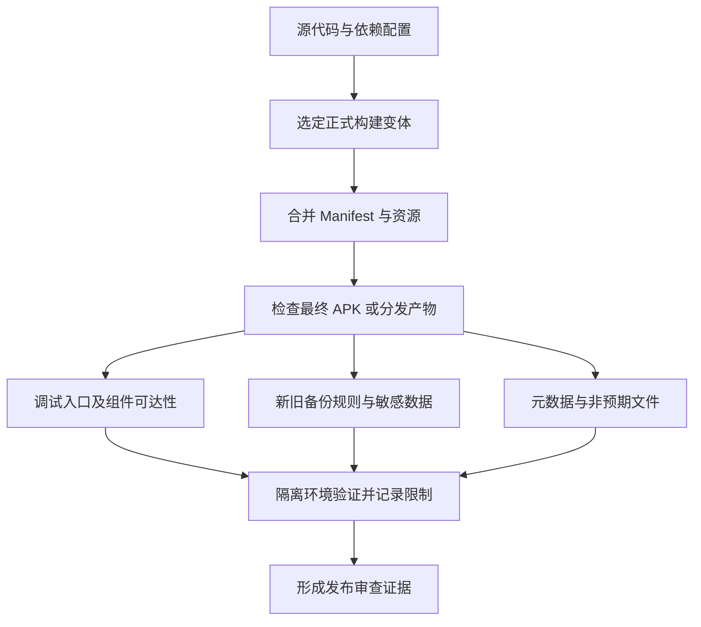

# 发布加固：检查最终包，而不是只看 release 名称

现行分类：

- [release 配置：debuggable 与 allowBackup](/security/android/configuration-security.html#s114)
- [APK 暗码与隐藏入口](/security/android/configuration-security.html#s129)
- [meta-data 中的敏感数据](/security/android/configuration-security.html#s132)
- [META-INF 中的 APK、ODEX、SO](/security/android/configuration-security.html#s144)
- [应用混淆规则增强](/security/android/configuration-security.html#s150)
一个构建变体叫 release，并不能证明它关闭了调试入口、排除了敏感备份，也不能证明依赖库没有合并额外组件。发布加固的对象是实际交付物及其运行行为，配置文件只是证据的一部分。

## 1. 调试能力为何要在最终包检查 {#debuggable}

`android:debuggable` 表示应用是否可被调试，默认值为 false。发布构建应明确检查最终值；不要把“系统是 user build”或“没有连接调试器”当成关闭该能力的证据。[application 属性定义](https://developer.android.com/guide/topics/manifest/application-element#debug)

威胁前提是攻击者获得适用的本机访问或调试条件，借此扩大观察或控制应用的能力。`debuggable=true` 不是“互联网可直接执行代码”的充分证明，但也不应作为普通正式包的便利开关保留。

实际 Manifest 来自应用、构建变体和依赖的合并。审查合并报告，确认主清单的值没有被变体覆盖，并检查最终 APK 的 Manifest。无需为了“统一配置”盲目重写库声明。[Manifest 合并规则](https://developer.android.com/build/manage-manifests)



## 2. allowBackup 不是一刀切的漏洞开关 {#backup-policy}

备份风险来自秘密或业务授权状态被不适当地复制、恢复或迁移，不来自备份功能这个名称。用户偏好、离线文档可能需要恢复，刷新凭据和设备绑定状态则需要独立策略。`allowBackup=true` 不能单独判漏洞；把它设为 false 也不能证明所有迁移途径都被禁止。

官方说明：对 Android 12 及以上的相关应用场景，部分设备厂商仍可能在 `allowBackup=false` 时执行设备到设备迁移。云备份和 D2D 应分别配置、分别验证。[allowBackup 与厂商差异](https://developer.android.com/guide/topics/manifest/application-element#allowbackup)

对于 Auto Backup，规则选择取决于系统与 target SDK：

- Android 11 及以下使用 `fullBackupContent` 对应的旧规则。
- 应用 target SDK 为 31 或更高且运行于 Android 12 或更高时，使用 `dataExtractionRules` 区分 cloud-backup 与 device-transfer；仍支持旧系统时还要保留旧规则。
- 不满足上述新规则条件的组合，应核对对应平台文档及实际行为，不把只验证过的一种组合推广到全部设备。[规则选择与 XML 语法](https://developer.android.com/identity/data/autobackup)

当前官方滚动文档还列出 Android 16 QPR2 起的 `cross-platform-transfer`。下文只演示云备份与 Android 设备间迁移；项目支持跨平台迁移时，须按实际系统与 SDK 条件另行核对、配置和验证对应规则，不能把这两个分区理解为覆盖所有后续迁移方式。[跨平台迁移规则](https://developer.android.com/identity/data/autobackup)

## 3. 以数据分类驱动新旧规则 {#backup-rules}

先列清数据位置和恢复需求，再写规则。例如只允许恢复界面偏好 `ui.xml`，会话凭据放在独立的 `session.xml` 并禁止随这组备份导出。下面示例假设应用需要备份偏好，编译 SDK 支持 API 31 属性；不是所有应用通用的最终策略。

```xml
<!-- application 内的属性片段 -->
<application
    android:debuggable="false"
    android:allowBackup="true"
    android:fullBackupContent="@xml/backup_legacy"
    android:dataExtractionRules="@xml/backup_rules" />
```

```xml
<!-- res/xml/backup_legacy.xml -->
<full-backup-content>
    <include domain="sharedpref" path="ui.xml" />
    <exclude domain="sharedpref" path="session.xml" />
</full-backup-content>
```

```xml
<!-- res/xml/backup_rules.xml -->
<data-extraction-rules>
    <cloud-backup>
        <include domain="sharedpref" path="ui.xml" />
        <exclude domain="sharedpref" path="session.xml" />
    </cloud-backup>
    <device-transfer>
        <include domain="sharedpref" path="ui.xml" />
        <exclude domain="sharedpref" path="session.xml" />
    </device-transfer>
</data-extraction-rules>
```

显式 include 表达允许恢复的集合，exclude 记录敏感项，便于审查；随后新增数据库、文件和设备保护存储时，仍需重新评估整个数据清单。缓存与 no-backup 目录等有自身备份规则，不能用一个文件名覆盖所有存储域。[Auto Backup 的范围与排除规则](https://developer.android.com/identity/data/autobackup)

恢复后的偏好和文件也不能直接当作当前登录或付费权限，关联机制见 [敏感数据生命周期](./data-lifecycle.html#account-binding)。

## 4. 隐藏入口必须落到真实能力 {#hidden-entrypoints}

原笔记中的“暗码”不是一个统一 Android API。应把它具体化：调试 Activity、测试深链、特殊广播 action、WebView 调试页面、远程诊断指令，或者隐藏菜单开启后的特权操作。

风险成立需要入口可达并能触发未授权能力。例如外部 App 能启动测试 Activity，后者信任 extras 就导出私有日志。防护应优先在正式变体移除不需要的入口；确需保留诊断功能时，再限制调用主体、业务授权、数据范围与有效期，而不是只隐藏按钮或把 action 改得复杂。

审查最终组件清单、Intent filter 和实际分发逻辑，对照预期功能逐一说明存在理由。公开深链本身并不要求全部改成私有组件；业务授权的判断仍须在真正的操作入口成立。[组件导出风险](https://developer.android.com/privacy-and-security/risks/android-exported)

## 5. 元数据与包体内容不适合存放长期秘密 {#metadata-and-package}

Manifest `meta-data`、字符串资源、assets 和代码随包分发，不能因为没显示在界面上就视为保密。把长期服务端签名密钥塞进 meta-data，再用混淆隐藏读取路径，仍允许持有包的人取得或恢复该值。

具体措施是把服务端秘密保留在服务端，客户端只持有按用途、权限和有效期受限的凭据。确需客户端加密密钥时，按威胁模型使用 Android Keystore，而不是把同一把静态密钥复制到所有安装包。[硬编码密钥风险](https://developer.android.com/privacy-and-security/risks/hardcoded-cryptographic-secrets)

并非每个 SDK 标识符都是秘密：公开项目标识与私密令牌应区分，配合服务端授权、配额和平台支持的调用限制判断风险，不能仅凭出现 `key` 字符串认定泄露。

`META-INF` 也不是按扩展名判定风险的特殊禁区。发现 APK、ODEX 或 SO，应追踪它来自哪个依赖、是否预期分发、是否会被动态加载、是否携带真实私密内容。签名相关文件与合法库资源不能因为目录名称而删除；不使用的二次包、调试资产或测试凭据则应从构建源头排除。[APK Analyzer 的包内容与最终 Manifest 检查](https://developer.android.com/studio/debug/apk-analyzer)

## 6. 混淆减少可读性，不承担授权 {#obfuscation}

R8 可执行代码缩减、优化及重命名，增加理解内部实现的成本，也可能暴露反射、序列化或 JNI 配置错误。配置要匹配实际工具版本与依赖，保留必要入口，不直接复制一组“最强混淆”规则。[R8 优化配置](https://developer.android.com/topic/performance/app-optimization/enable-app-optimization)

即使方法名已不可读，应用仍需在本地执行既定逻辑，攻击者也可能观察其输入输出。混淆不能把硬编码秘密变成安全存储，不能替代服务端鉴权或可靠的更新签名校验。

审查时比较优化前后的功能与包内容，验证反射调用、SDK 初始化、序列化和 native 入口；同时保护正式构建的 mapping 文件，保证崩溃能够还原，不把“无法定位异常”当成加固效果。

## 7. 发布前检查 {#verification}

对自有应用的正式构建逐项检查：

1. 固定产物：记录构建变体、工具版本和最终 APK 标识，通过 APK Analyzer 查看合并后的调试属性、组件、备份资源与包内文件。
2. 入口审查：用合成数据覆盖正常入口和遗留诊断入口；确认未授权主体不能执行敏感操作，不能只验证页面是否可打开。
3. 备份矩阵：在实际支持的旧系统组合与新系统/target 组合分别验证云备份和 D2D。使用测试账户，只恢复允许的偏好，确认会话不因旧文件复活。[官方备份测试流程](https://developer.android.com/identity/data/testingbackup)
4. 包体审查：对 meta-data、资源、assets 和非预期嵌套包追踪来源及用途，记录秘密是否已撤销或移出分发物，避免只做关键词命中计数。
5. 优化回归：使用正式优化配置验证业务关键路径和崩溃还原；单独记录未覆盖的 OEM、迁移运输方式及设备限制。
