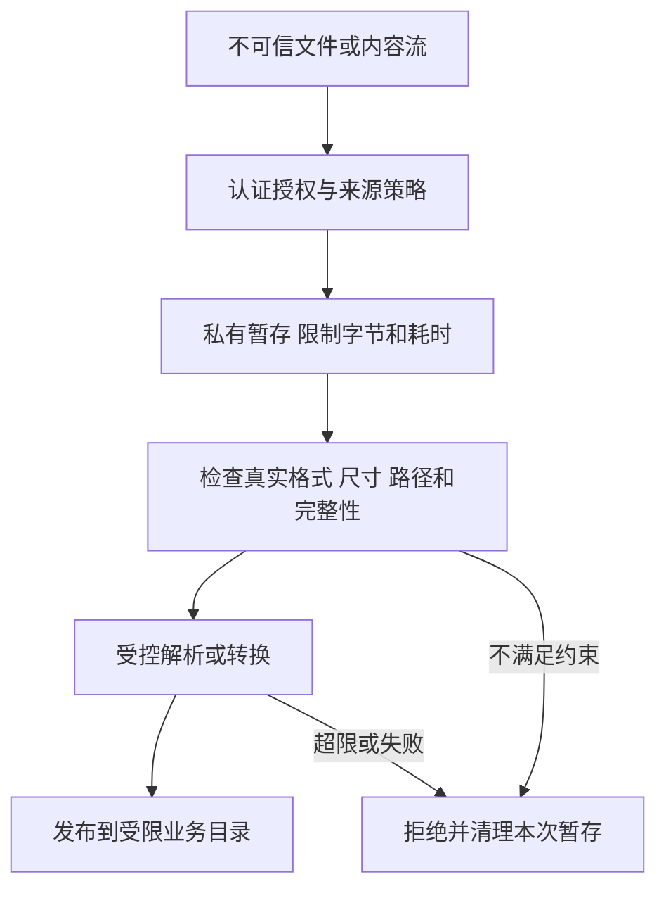

# 不可信文件、图片与压缩包

现行分类：

- [头像本地缓存的大小和有效性](/security/android/configuration-security.html#s141)
- [文件上传](/security/android/file-operations.html#s165)
- [文件下载](/security/android/file-operations.html#s168)
- [BitmapFactory 图片解析与 OOM](/security/android/file-operations.html#s174)
- [解压安全](/security/android/special-functions.html#s183)
文件安全同时涉及内容、路径、身份和资源。扩展名正确、下载使用 HTTPS 或文件位于应用目录，都不足以独立证明“可以安全解析”。

文件共享与 URI 授权见[文件共享](./file-sharing.html)。下面代码中的容量阈值是示例业务策略，按设备与功能预算调整。

## 1. 将接收、验证与使用分成阶段 {#pipeline}

外部文件可能来自上传、下载、相册、其他 Provider 或历史缓存。先将输入保存到应用控制的临时区域，在限制资源的条件下检查，再把已接受内容原子地交给消费者；不要边接收边覆盖正在执行或展示的重要文件。



文件名、`Content-Length`、MIME 与 Provider 返回的元数据都是检查线索，实际读取过程仍要执行限制。上传和下载的服务端、客户端分别承担自己的边界，不能将“客户端已校验”当成服务器放行依据。

## 2. 文件上传：同时检查对象归属和内容 {#upload}

上传入口应认证用户并验证目标对象权限：用户能上传到自己的头像，不意味着能覆盖任意用户资源。服务端生成存储键，限制扩展类型、实际格式、大小、数量和处理成本，不直接采用客户端提供的绝对路径或原文件名作为落点。

客户端使用系统选择器或用户明确授权的内容 URI，按功能范围读取；复制之前核对 URI 来源与权限，读取中执行限额。不要因为 URI 来自选择界面就跳过校验，返回数据仍可能由其他应用提供。相关外部组件输入原则见 [OWASP 输入净化建议](https://mas.owasp.org/MASTG/best-practices/MASTG-BEST-0057/)。

对于头像等展示内容，可在服务端进行受限解码、尺寸重建和元数据处理。文件头嗅探也不是完整解析安全证明；仍需更新解码库并控制处理资源。敏感上传应明确元数据保留政策，例如定位、拍摄信息与原始文件名。

**验证路线**：覆盖无权对象、伪造扩展名/MIME、空文件、超限流、多文件并发与失败重试。验证服务器独立拒绝非法请求，不能只证明客户端按钮无法提交。

## 3. 文件下载：来源与落点都需要约束 {#download}

下载时验证业务授权、HTTPS 和预期来源；如允许重定向，应核对每一跳是否仍符合策略，不能只检查初始 URL。拒绝“信任所有证书/主机”的自定义校验。具体网络配置参见 Android [Network Security Configuration](https://developer.android.com/privacy-and-security/security-config)。

保存路径由应用生成，响应中的文件名只能作为有限展示信息。为下载设置实际字节、时间、重试次数和磁盘配额；不能只相信响应头宣称的长度。断点续传还要确认内容标识和完整性，避免把不同版本拼成同一文件。

有发布签名的资源先验证可信发布方签名和版本策略，再供加载器使用。同一路径下载的文件与哈希若都可被攻击者替换，单纯“哈希一致”不能证明来源真实。可执行插件的额外边界见 [动态代码信任](../audit/runtime-code-trust.html)。

下载完成不代表可以任意打开：交给其他应用时使用受限 `content://` URI、最小临时读权限与明确类型，不附送整个目录的能力。失败时只清理本次操作创建的临时文件，避免根据外部路径做递归删除。

## 4. 头像缓存：缓存键、账户与解码预算 {#avatar-cache}

缓存仍在数据流中。若缓存键仅采用可碰撞文件名或 URL 尾段，不同账户、不同尺寸或不同版本可能误用同一内容。按可信资源标识、账户范围和变换版本设计缓存键，敏感内容退出后按政策清理，并避免把鉴权令牌写入文件名或日志。

读取缓存前也要检查大小、有效格式和资源归属。缓存损坏可回源重建，但不能无限重试或无限留存坏文件。应用外部目录中的可修改内容不应成为无需校验的可信源；目录选择见 [Android 数据与文件存储](https://developer.android.com/training/data-storage)。

原提纲的“本地缓存攻击”不是一个由头像大小直接证明的固定漏洞名称。需进一步确认谁能控制缓存、缓存如何命名和覆盖、解码器如何处理输入，以及能否影响其他账户或造成稳定资源耗尽。

## 5. BitmapFactory：先限制，再采样，再调度 {#bitmap}

压缩体积小不代表像素少。对典型 `ARGB_8888`，仅像素存储估算为宽 × 高 × 4 字节，实际还涉及行对齐、转换缓冲、并发、缓存及显示资源，因此不能把这一公式当精确峰值。

Android 的[大图加载说明](https://developer.android.com/topic/performance/graphics/load-bitmap.html)介绍先以 `inJustDecodeBounds` 获取尺寸，再设置 `inSampleSize` 采样。下面只展示头部准入，不是完整安全解码器：

```kotlin
// 教学片段：file 已处于应用控制的暂存目录，且接收阶段已限制字节数。
fun acceptedImageBounds(file: java.io.File): Pair<Int, Int> {
    val options = android.graphics.BitmapFactory.Options().apply {
        inJustDecodeBounds = true
    }
    android.graphics.BitmapFactory.decodeFile(file.path, options)
    val width = options.outWidth
    val height = options.outHeight
    require(width > 0 && height > 0)
    require(width <= 8192 && height <= 8192)
    require(width.toLong() * height.toLong() <= 16_000_000L)
    return width to height
}
```

真正解码前，依据展示尺寸和可用预算选择采样比例，并限制同时工作的任务数、队列与缓存总量。解码放在适当工作线程；单纯移到后台不减少内存消耗。源文件在两次读取之间应保持应用控制，避免头部检查与正式解码针对不同内容。

`decodeFile` 可能返回空结果，损坏文件和格式异常都要进入明确失败路径。依赖 `catch OutOfMemoryError` 恢复不是可靠预算策略；过大的分配请求还可能影响整个进程状态。动图、多帧及其他解码器需要额外评估帧数与累计资源，不能直接套用单帧检查。

**验证路线**：覆盖超大声明尺寸、小文件大像素、损坏/截断数据、多图并发、缓存累计和滚动取消。记录设备实际内存环境与峰值分配；仅用一张正常头像无法验证防护有效。

## 6. 解压：路径约束与资源约束缺一不可 {#archive}

Zip Slip 的核心是条目名控制最终落点；压缩炸弹则主要利用展开资源。阻止 `../` 不能阻止大量正常路径文件耗尽磁盘，限制压缩文件大小也不能推导展开后大小。

以下片段校验普通 ZIP 条目的目标路径：

```kotlin
// 教学片段：destination 是本次新建、仅本应用可写的私有暂存目录。
fun checkedDestination(destination: java.io.File, name: String): java.io.File {
    require(name.isNotEmpty() && !java.io.File(name).isAbsolute)
    val root = destination.canonicalFile
    val target = java.io.File(root, name).canonicalFile
    require(target.path.startsWith(root.path + java.io.File.separator))
    return target
}
```

末尾路径分隔符用于防止把同名前缀目录误判为子目录。该检查仍假设根目录及其父路径不受攻击者替换；若其他主体能并发修改符号链接，先规范化再写入会有竞态，不能承诺抵御所有路径替换。官方 [ZIP 路径遍历说明](https://developer.android.com/privacy-and-security/risks/zip-path-traversal)也明确了可信目标目录前提。

实现中还应限制条目数、单条目实际展开字节、累计展开字节、目录深度及耗时；不要只依赖 ZIP 元数据中的尺寸。拒绝重复落点、文件/目录冲突和非预期覆盖；按库和格式明确符号链接策略，不把解压出的链接作为后续写入路径。递归解压嵌套包会跨越原配额，默认不自动递归处理。

Android 14 且应用 target API 34+ 时，部分 `ZipFile`、`ZipInputStream` 路径检查会拒绝含 `..` 或以 `/` 开头的条目，见[版本行为变更](https://developer.android.com/about/versions/14/behavior-changes-14#zip-path-traversal)。这不替代其他库/格式、展开资源、覆盖和竞态防护，也不意味着旧设备具有相同行为。

**验证路线**：在独立临时根目录测试跨目录条目、绝对路径、同名前缀目录、重复条目、异常中断及资源超限。验证根目录之外未产生文件、失败后未发布半成品；符号链接和并发用例须按实际库与文件系统另测。

## 7. 审计记录与失败处置 {#verification}

为每条文件链路保留“来源主体 → 授权对象 → 字节预算 → 暂存目录 → 解析器版本 → 最终消费者”的证据。失败日志只记录必要错误类别和资源标识，避免保存敏感原文与凭证。

通用读写与 Provider 共享见 [文件边界与 FileProvider](./file-sharing.html)，反序列化过程见 [注入与序列化](./injection-serialization.html)。
