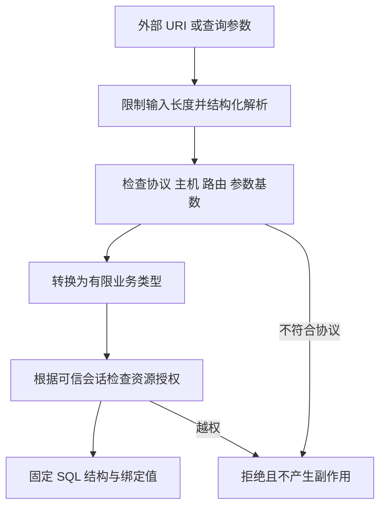

# URI、查询参数与 SQL 输入

现行分类：[SQL 注入](/security/android/component-security.html#s69)、[getPathSegments 函数](/security/android/special-functions.html#s186)、[uri.getQueryParameter](/security/android/dos-attacks.html#s204)、[URLDecoder.decode 解码安全](/security/android/dos-attacks.html#s240)。

外部字符串经过解析后仍然是不可信数据。真正的安全问题是：应用如何将它转成路由、文件名、查询条件或权限决策。

## 1. 解析、校验、授权是三件事 {#boundaries}

解析解决“字符串有哪些部分”，校验解决“这些部分是否符合业务协议”，授权解决“当前主体能否操作目标资源”。`Uri.parse()` 成功、MIME 正确或 SQL 使用占位符，都不能替代第三步。



检查对象应当是最终将被消费的同一份解析结果。若入口检查原始字符串，后续组件又解码、重写或重新解析，两个阶段可能对“相同输入”产生不同理解。

## 2. getPathSegments：已解码不等于安全路径 {#path-segments}

Android [`Uri.getPathSegments()`](https://developer.android.com/reference/android/net/Uri#getPathSegments()) 返回已解码的路径片段。片段数可能不足，片段内容也未必是安全文件名。直接取 `[1]` 可能越界；将片段拼到文件系统路径还会跨入另一种语法。

对 `/notes/123` 这样的业务路由，先检查段数、固定段和 ID 格式，再使用它查询已授权资源。文件访问另按 [文件边界](./file-sharing.html) 检查真实落点，不能把 `UriMatcher` 或“最后一段”当路径净化器。Google 的[路径遍历说明](https://support.google.com/faqs/answer/7496913)特别指出，编码后的分隔符可能在解码后进入文件路径。

不要通过删除 `../`、检查字符串中是否包含 `/` 等局部替换来修补任意路径。更稳妥的模型是外部只传业务 ID，由应用从受控映射中取得文件。

## 3. getQueryParameter：缺失、多值与不透明 URI {#query-parameters}

[`getQueryParameter(key)`](https://developer.android.com/reference/android/net/Uri#getQueryParameter(java.lang.String)) 返回首个同名参数的解码值；缺失为 `null`，对非层次型 URI 可抛 `UnsupportedOperationException`。因此，方法调用成功不代表参数完整，也不代表其他解析器会采用相同值。

例如 `?role=reader&role=admin`：若网关读取首值、业务读取末值，授权就可能建立在不同数据上。对身份、签名、回调地址等单值字段，应明确拒绝重复键；允许多值的字段则定义次序、数量和合并语义。未知字段、空串、超长值及片段 `#fragment` 也要有明确策略。

下面将一个受限 HTTPS 路由转换为业务类型，只处理路由校验，不完成资源授权。示例只接受一个固定枚举参数，因此直接限定原始编码查询的规范形式；它主动拒绝重复参数、编码键别名和空查询，不尝试兼容任意查询语法。

```kotlin
// 教学片段：需 import android.net.Uri；调用方负责失败响应与授权。
data class NoteRoute(val id: Long, val newestFirst: Boolean)

fun parseNoteRoute(raw: String): NoteRoute {
    require(raw.length <= 2048) // 本示例的业务输入预算，并非平台上限
    val uri = Uri.parse(raw)
    require(uri.isHierarchical)
    require(uri.scheme == "https" && uri.host == "notes.example.org")
    require(uri.userInfo == null && (uri.port == -1 || uri.port == 443))
    require(uri.fragment == null)
    val parts = uri.pathSegments
    require(parts.size == 2 && parts[0] == "notes")
    require(parts[1].matches(Regex("[1-9][0-9]{0,17}")))
    val id = requireNotNull(parts[1].toLongOrNull())
    val newestFirst = when (uri.encodedQuery) {
        null, "sort=newest" -> true
        "sort=oldest" -> false
        else -> throw IllegalArgumentException("Non-canonical query")
    }
    return NoteRoute(id, newestFirst)
}
```

不要把“解码后的键名集合”与按另一种编码匹配的取值接口混用来实现重复键检查。固定标签 [Android 16 Uri.java](https://android.googlesource.com/platform/frameworks/base/+/refs/tags/android-16.0.0_r1/core/java/android/net/Uri.java#1638) 中，两条路径的键处理存在差异；例如 `sort` 与 `s%6Frt` 不应被一条链路合并、另一条链路忽略。若协议允许编码键，需一次解析所有键值对，在同一规范化规则下统计重复并生成业务值。

调用方仅在这一输入边界捕获预期的解析/校验异常并返回失败；不要捕获异常后继续使用默认账户、默认路径或已部分解析的数据。本例按规范只接受小写协议与主机，是主动缩小协议，不声称覆盖所有合法 URL。用于 WebView、HTTP 客户端或回调跳转时，还须核对实际消费者的解析和重定向规则。

## 4. URLDecoder：表单解码不能代替 URI 解析 {#url-decoder}

[`URLDecoder`](https://docs.oracle.com/en/java/javase/17/docs/api/java.base/java/net/URLDecoder.html) 面向 `application/x-www-form-urlencoded`：`+` 会变成空格，百分号转义按字符集解码。它不适合直接对整条 URL 使用，也不应该再处理已经由 `Uri` 解码的参数。

若业务输入明确是原始表单字段，可在限定长度后使用 `URLDecoder.decode(rawField, "UTF-8")`，并在入口处理非法转义导致的 `IllegalArgumentException`。

Android 的字符串字符集重载自 API 1 可用，而 `Charset` 重载自 API 33 引入；不能把 Java SE 中的所有重载默认视为所有 Android 版本可用。[Android URLDecoder API](https://developer.android.com/reference/java/net/URLDecoder)

“多解码几遍直到没有 `%`”会引入新的语义：校验时的 `%2F` 与再次解码后的 `/` 不是同一数据。设计协议时固定编码方式与解码次数，后续消费者不得偷偷增加另一轮解码。签名验证还需定义精确字节和规范化规则，不能先随意重排参数再验证签名。

## 5. SQL 注入：值参数化，结构允许列表 {#sql-injection}

SQLite 先编译语句，再把绑定值放入参数位置；值里的引号或运算符不会重新变成 SQL 语法。表、列、排序方向和整段条件属于语法结构，只能由应用固定映射选择；账户资源条件还需独立加入查询。

Provider 使用 `SQLiteQueryBuilder` 时可设置列映射，并在 API 30+ 显式启用严格列与语法检查，不能假定默认开启。[SQLiteQueryBuilder](https://developer.android.com/reference/android/database/sqlite/SQLiteQueryBuilder)

SQL 注入的前提是外部数据进入 SQL 语法结构。例如把用户输入拼进 `WHERE` 字符串，会让引号、运算符等参与 SQL 解释。Android 的 [SQL 注入风险说明](https://developer.android.com/privacy-and-security/risks/sql-injection)建议使用绑定参数并限制不可信查询结构。

占位符用于**值**，不能拿来绑定表名、列名、排序方向或整段 `selection`。对这些结构选择，使用应用内部固定映射。Provider 对外接受的 `projection`、`sortOrder`、`selection` 和查询 Bundle 也要按接口协议限制，不能原样转给数据库。

下面假设应用自有 `notes(_id, owner_id, title, created_at)` 表，`trustedOwnerId` 来自已校验的会话，不来自 Intent 或 URI：

```kotlin
// 教学片段：db 为 SQLiteDatabase，route 已通过上一节校验。
val order = if (route.newestFirst) "created_at DESC" else "created_at ASC"
db.query(
    "notes", arrayOf("_id", "title"),
    "owner_id = ? AND _id = ?",
    arrayOf(trustedOwnerId, route.id.toString()),
    null, null, order, "1"
).use { cursor ->
    if (cursor.moveToFirst()) {
        // 只处理当前授权主体的结果；避免将 Cursor 带出此作用域。
    }
}
```

这里的占位符阻止值变成 SQL 结构，`owner_id` 条件实现示意的行级隔离，两者职责不同。真实的共享、管理员权限或跨账户迁移必须有明确授权模型。API 参数语义见 [`SQLiteDatabase.query`](https://developer.android.com/reference/android/database/sqlite/SQLiteDatabase#query(java.lang.String,java.lang.String%5B%5D,java.lang.String,java.lang.String%5B%5D,java.lang.String,java.lang.String,java.lang.String,java.lang.String))。

## 6. 审计与回归验证 {#verification}

先从导出组件、Provider 查询和网络响应找到输入，再追踪解析、重复解码、SQL 构造及最终授权位置；仅搜索 `rawQuery` 会漏掉把不可信结构传给 `query()` 的情况。

在自有测试工程中覆盖以下场景，并断言拒绝时没有读写副作用：

- 路由缺段、多段、编码分隔符、ID 溢出、非层次 URI、未知主机和非预期端口。
- 参数缺失、空值、重复键、未知键、`+`、非法 `%` 和二次编码输入；特别验证 `?sort=newest&s%6Frt=oldest` 与 `?s%6Frt=oldest` 均被本例拒绝。
- 字符值包含引号和 SQL 元字符时作为普通数据处理；不合法排序字段被拒绝。
- 合法 ID 指向其他账户资源时仍拒绝访问，而非只证明“没有 SQL 语法错误”。

回归用例应同时断言返回值、文件/数据库副作用和资源是否释放；参数拒绝后不能继续使用默认账户或默认路径。
