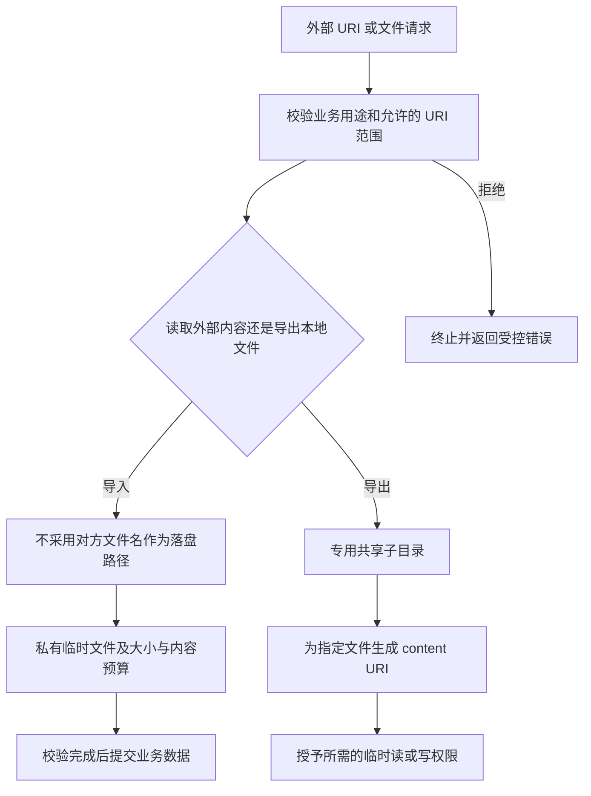
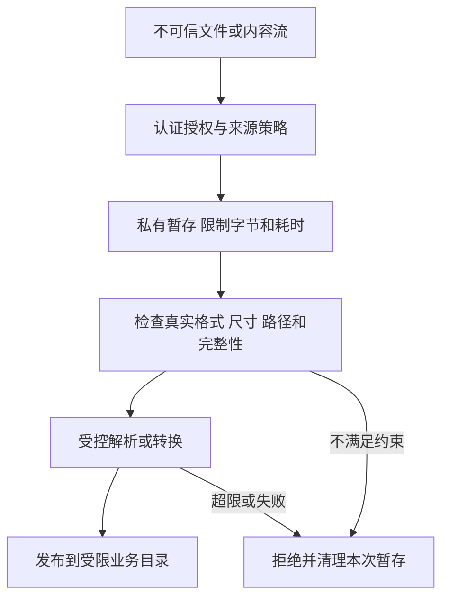

# 文件操作

本章按原提纲的分类和子项顺序组织。左侧条目、正文标题与本文目录使用同一组标题和锚点。

::: info 适用与验证边界
平台行为需分别核对运行 OS、target SDK 和依赖版本；历史检查项已按正文依据限定条件。所有代码均为教学片段，未经过 Android 工程编译或真机执行；域名、容量阈值及业务规则为示例，不能直接作为生产策略。
:::

第一，谁决定要访问的对象：应用内部 ID、用户选择结果，还是外部传入的 URI、文件名与相对路径？第二，操作使用谁的权限：调用者持有的临时授权，还是应用作为代理拥有的私有数据访问能力？第三，结果会流向哪里：内部解析器、应用私有目录、另一个 App，还是上传接口？

`getContentResolver()` 只是取得内容访问入口，不替你判断业务对象、提供者可信度或文件用途。拥有读取权限，也不代表应该把内容转交给其他主体。尤其要防止把外部 URI 转发给拥有更高权限的组件后，形成代读私有数据的路径。



这里的“允许范围”由业务决定。只接受指定合作方时可以校验 authority 对应的包及签名；用户主动选择文档的场景则不能随意只允许某个厂商 Provider。两者都不能把 URI 字符串当成调用者身份。[FileProvider 风险说明](https://developer.android.com/privacy-and-security/risks/file-providers)

如果入口只应导入外部文档，应拒绝业务不允许的本应用 Provider URI，避免攻击者把它变成读取本地私有数据的代理。不要把外部传入的 `file://` 转换为本地路径直接打开，也不要把“scheme 是 content”当成全部校验。

**将接收、验证与使用分成阶段**

外部文件可能来自上传、下载、相册、其他 Provider 或历史缓存。先将输入保存到应用控制的临时区域，在限制资源的条件下检查，再把已接受内容原子地交给消费者；不要边接收边覆盖正在执行或展示的重要文件。



文件名、`Content-Length`、MIME 与 Provider 返回的元数据都是检查线索，实际读取过程仍要执行限制。上传和下载的服务端、客户端分别承担自己的边界，不能将“客户端已校验”当成服务器放行依据。

## 文件上传 {#s165}

上传入口应认证用户并验证目标对象权限：用户能上传到自己的头像，不意味着能覆盖任意用户资源。服务端生成存储键，限制扩展类型、实际格式、大小、数量和处理成本，不直接采用客户端提供的绝对路径或原文件名作为落点。

客户端使用系统选择器或用户明确授权的内容 URI，按功能范围读取；复制之前核对 URI 来源与权限，读取中执行限额。不要因为 URI 来自选择界面就跳过校验，返回数据仍可能由其他应用提供。相关外部组件输入原则见 [OWASP 输入净化建议](https://mas.owasp.org/MASTG/best-practices/MASTG-BEST-0057/)。

对于头像等展示内容，可在服务端进行受限解码、尺寸重建和元数据处理。文件头嗅探也不是完整解析安全证明；仍需更新解码库并控制处理资源。敏感上传应明确元数据保留政策，例如定位、拍摄信息与原始文件名。

**验证路线**：覆盖无权对象、伪造扩展名/MIME、空文件、超限流、多文件并发与失败重试。验证服务器独立拒绝非法请求，不能只证明客户端按钮无法提交。

## 文件下载 {#s168}

下载时验证业务授权、HTTPS 和预期来源；如允许重定向，应核对每一跳是否仍符合策略，不能只检查初始 URL。拒绝“信任所有证书/主机”的自定义校验。具体网络配置参见 Android [Network Security Configuration](https://developer.android.com/privacy-and-security/security-config)。

保存路径由应用生成，响应中的文件名只能作为有限展示信息。为下载设置实际字节、时间、重试次数和磁盘配额；不能只相信响应头宣称的长度。断点续传还要确认内容标识和完整性，避免把不同版本拼成同一文件。

有发布签名的资源先验证可信发布方签名和版本策略，再供加载器使用。同一路径下载的文件与哈希若都可被攻击者替换，单纯“哈希一致”不能证明来源真实。可执行插件的额外边界见 [动态代码信任](/security/android/audit/runtime-code-trust.html)。

下载完成不代表可以任意打开：交给其他应用时使用受限 `content://` URI、最小临时读权限与明确类型，不附送整个目录的能力。失败时只清理本次操作创建的临时文件，避免根据外部路径做递归删除。

## 文件读写 {#s171}

自定义 Provider 或接收端拼接路径时，先把业务对象映射到受控文件，再检查最终规范化路径是否位于可信根目录内。字符串 `startsWith(root)` 可能把 `root-other` 错当子目录，检查要包含目录边界；更不能先检查一份路径，却随后打开另一份重新拼接的路径。

canonical 路径能处理一类 `..` 和符号链接问题，却不能自动消除“检查后、打开前”目标被替换的竞态。安全前提应包含根目录及其父目录不由攻击者控制；避免在可被其他应用写入的共享目录中执行敏感更新。[Android 路径遍历说明](https://developer.android.com/privacy-and-security/risks/path-traversal)

写入重要状态还需要失败恢复与并发策略。可使用临时文件完成校验后提交，或按实际 SDK 核对 `AtomicFile`；原子写入帮助避免半写状态，不等于跨线程锁或授权机制。线程、进程之间的并发访问仍需单独协调。[AtomicFile API](https://developer.android.com/reference/android/util/AtomicFile)

## BitmapFactory 图片解析与 OOM {#s174}

压缩体积小不代表像素少。对典型 `ARGB_8888`，仅像素存储估算为宽 × 高 × 4 字节，实际还涉及行对齐、转换缓冲、并发、缓存及显示资源，因此不能把这一公式当精确峰值。

Android 的[大图加载说明](https://developer.android.com/topic/performance/graphics/load-bitmap.html)介绍先以 `inJustDecodeBounds` 获取尺寸，再设置 `inSampleSize` 采样。下面只展示头部准入，不是完整安全解码器：

```kotlin
// 教学片段：file 已处于应用控制的暂存目录，且接收阶段已限制字节数。
fun acceptedImageBounds(file: java.io.File): Pair<Int, Int> {
    val options = android.graphics.BitmapFactory.Options().apply {
        inJustDecodeBounds = true
    }
    android.graphics.BitmapFactory.decodeFile(file.path, options)
    val width = options.outWidth
    val height = options.outHeight
    require(width > 0 && height > 0)
    require(width <= 8192 && height <= 8192)
    require(width.toLong() * height.toLong() <= 16_000_000L)
    return width to height
}
```

真正解码前，依据展示尺寸和可用预算选择采样比例，并限制同时工作的任务数、队列与缓存总量。解码放在适当工作线程；单纯移到后台不减少内存消耗。源文件在两次读取之间应保持应用控制，避免头部检查与正式解码针对不同内容。

`decodeFile` 可能返回空结果，损坏文件和格式异常都要进入明确失败路径。依赖 `catch OutOfMemoryError` 恢复不是可靠预算策略；过大的分配请求还可能影响整个进程状态。动图、多帧及其他解码器需要额外评估帧数与累计资源，不能直接套用单帧检查。

**验证路线**：覆盖超大声明尺寸、小文件大像素、损坏/截断数据、多图并发、缓存累计和滚动取消。记录设备实际内存环境与峰值分配；仅用一张正常头像无法验证防护有效。

