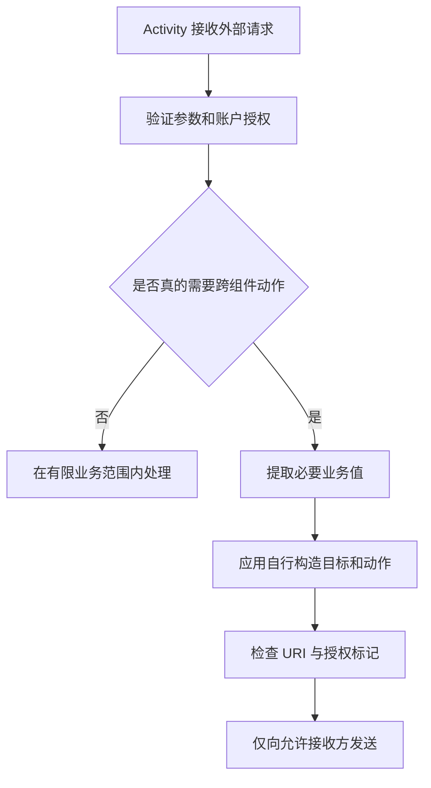

# Activity、Intent 与深链信任边界

::: info 旧专题链接
本站已将正文按原提纲五类重新组织。本页保留供历史链接查阅，不再出现在全文搜索中；请从以下同名章节继续阅读。

- [Activity](/security/android/component-security.html#s6)
- [Intent 接收/发送安全](/security/android/component-security.html#s15)
- [Scheme URL / intent-based URI 启动组件](/security/android/component-security.html#s18)
- [私有组件的 taskAffinity 与 launchMode](/security/android/configuration-security.html#s120)
- [Intent.setPackage 安全](/security/android/dos-attacks.html#s201)
- [带 Flags 的 Intent 启动组件](/security/android/dos-attacks.html#s213)
- [URI 读写授权与 addFlags / setFlags](/security/android/dos-attacks.html#s216)
- [URI 外部可控条件](/security/android/dos-attacks.html#s219)
:::

一个页面可以被打开，只说明路由可达；它不代表打开者有权操作页面里的账户、文件或支付资源。Activity 安全需要沿着“收到什么、如何解析、最后执行什么”检查，而不是只看一个 exported 属性。

本文属于基础层，建议先读[权限边界](./security-model.html)。文中流程与伪代码是教学设计，未编译、未执行设备实验；具体行为需同时记录运行 OS、targetSdk、启动方式和实例复用情况。

## 页面入口收到的都是待验证请求 {#activity-entry}

Activity 可从外部链接、其他应用或应用内部流程进入。入口需要验证必需字段、类型、长度、允许值与资源归属；对已经复用的实例，新的 Intent 也应走同一套验证逻辑。不能只在首次创建时校验，后续直接相信新参数。[Activity 定义与生命周期](https://developer.android.com/reference/android/app/Activity)

Activity 生命周期回调并不等同于客户端直接发来的业务 Binder 事务。不要在这里随手调用 `Binder.getCallingUid()`，就认为得到了最初打开页面的应用身份；Binder 该方法描述的是当前事务身份。来源 extras、referrer 或包名字符串也不能独立作为认证凭据。[Binder 身份契约](https://developer.android.com/reference/android/os/Binder#getCallingUid())

需要识别合作方时，选择适用于具体入口和平台的受信机制；需要执行账户操作时，仍应校验当前登录态和服务端资源权限。缺少可信身份信息时，应限制可执行能力，而不是猜测来源。

**验证路线**：在自有测试应用中分别测试首次打开和已有实例收到新 Intent；使用缺字段、错误类型、过期资源 ID 与正常输入，核对同一授权策略是否执行。保存实例状态及实际副作用，不能仅凭页面出现与否判断安全。

## 入站参数不能原样变成出站动作 {#intent-forwarding}

Intent 接收和发送是两个检查点。接收者需要判断输入是否有效；发送者需要确定目标、动作、携带数据及额外授予的能力。若把外部提供的嵌套 Intent 原样执行，应用可能在自己的上下文中代外部请求者操作内部组件。[Intent 重定向风险](https://developer.android.com/privacy-and-security/risks/intent-redirection)



更容易审阅的设计是提取有限业务参数，再由应用构造明确动作；不需要的 component、selector、ClipData 或授予标记不要从不可信对象继承。若确有动态转发需求，应依据业务允许列表和所用 API 的完整语义净化，不能仅删除一个 extra。

下面是与 Android API 无关的伪代码，展示校验顺序；`allowedAction` 等均是待实现策略，不是可直接复制的工具函数。

```text
request = parseBoundedInput(incoming)
reject if request is malformed
reject if currentAccount cannot access request.resource
action = buildOwnedAction(request.resource)
reject if action is outside allowedAction
send only the minimum required data
```

**版本边界**：Android 16 引入默认 Intent 重定向加固，但不能用当前平台的保护替代业务校验，也不要为了让未审阅转发继续运行而直接关闭保护。[官方默认保护说明](https://developer.android.com/privacy-and-security/risks/intent-redirection#default-protection)

## setPackage 限定解析范围，不认证收到的数据 {#set-package}

在没有显式 component 的匹配路径中，`setPackage()` 限制候选应用包；固定组件应由应用自行设置允许的 `ComponentName`。它们都不证明来自目标的后续数据可信，也不能授予调用者本来不具备的业务权限。[Intent.setPackage 定义](https://developer.android.com/reference/android/content/Intent#setPackage(java.lang.String))

不能给不可信 Intent 补一个 `setPackage()` 就宣称目标已被锁定：它只修改 package 字段，不清除原有 component；显式 component 仍进入组件查询分支。`Intent.resolveActivity()` 对已有 component 也会直接返回该值，并不验证组件存在、可启动或符合业务允许列表。应提取必要业务值并新建应用控制的 Intent；存在 selector 时，还要处理它与非空 package 不可并用的契约。[固定源码 setPackage](https://android.googlesource.com/platform/frameworks/base/+/refs/tags/android-16.0.0_r1/core/java/android/content/Intent.java#11408)、[resolveActivity](https://android.googlesource.com/platform/frameworks/base/+/refs/tags/android-16.0.0_r1/core/java/android/content/Intent.java#10113)、[组件解析分支](https://android.googlesource.com/platform/frameworks/base/+/refs/tags/android-16.0.0_r1/services/core/java/com/android/server/pm/ComputerEngine.java#542)

防护需要匹配实际目标：内部固定跳转可直接构造应用自己的显式 Intent；跨应用协作还需验证接收方和响应关系。不应接受外部任意包名，再以“已经 setPackage”为由跳过判断。

**验证路线**：准备正常合作方及非预期包作为自有样例，测试未指定、允许、非允许目标和同包不同入口。记录实际解析结果及操作，检查选择器、回调或结果处理是否重新引入不可信输入。

## Scheme、App Links 与 intent URI 各自解决什么 {#deep-links}

自定义 Scheme 是路由名称，不具备域名所有权证明。Android App Links 通过域名关联改善网页链接分发，但完成域名验证并不代表 URL 里的对象 ID、回调地址或业务操作已经授权。入口仍需对 scheme、host、路径和参数建立明确规则。[深链风险与防护](https://developer.android.com/privacy-and-security/risks/unsafe-use-of-deeplinks)

解析 host 后应与完整允许值比较，不能通过包含某段字符串判断。处理回调 URL 时，校验最终要打开的完整目标；解码和规范化之后不得再把未经验证的内容重新解释成高权限动作。

`intent:` 字符串可以表达 Intent 的多个属性，解析成功不等于安全。`Intent.parseUri` 的 flags 与启动 Intent 的 flags 是不同参数领域；不要混用。尤其 `URI_ALLOW_UNSAFE` 会保留原本出于安全原因不保留的标记，不能为了兼容不明输入而随意启用。[Intent 的 URI 解析定义](https://developer.android.com/reference/android/content/Intent#URI_ALLOW_UNSAFE)

**验证路线**：在自有链接中改变 host、大小写、编码、路径段、重复参数与回调目标，确认拒绝策略与真正解析结果一致。另行核对设备上的域名验证状态，不能用浏览器可访问网页证明 App Links 验证成功。

## URI grant 是能力转移，不能只比一个 flag {#uri-grants}

`FLAG_GRANT_READ_URI_PERMISSION` 与 `FLAG_GRANT_WRITE_URI_PERMISSION` 允许接收方获得相应 URI 访问能力。`addFlags` 组合标记，`setFlags` 设置整组标记；检查时应理解 bitmask，不能只比较 flags 是否恰好等于某个常量。[Intent 授权标记](https://developer.android.com/reference/android/content/Intent#FLAG_GRANT_READ_URI_PERMISSION)

可控 URI 加授权标记构成需要审查的条件，但不是脱离上下文的充分漏洞证据。还要判断谁原本拥有访问能力、URI 指向哪里、接收方是谁、读写范围及授权生命周期。data 与 ClipData 都需要纳入；持久或前缀等其他授予标记也不能遗漏。[URI 权限基础](https://developer.android.com/guide/topics/providers/content-provider-basics#Permissions)

防护应把文件选择、目标选择和授予范围放在同一条数据流里：只交给实际需要的接收方，能只读就不写，能单个资源就不扩大范围，不把外部对象中的授权标记机械带到新的跳转。

**验证路线**：使用自有 Provider 提供无敏感数据的测试 URI，分别测试不授予、只读、读写和拒绝目标。检查接收方实际能否查询、打开、修改资源，以及界面关闭后授权是否仍符合设计；不要仅检查 Intent 打印结果。

## taskAffinity 与 launchMode 要按任务模型评估 {#task-stack}

taskAffinity 参与任务归属，launchMode 影响实例创建与复用，它们不是“私有组件一律禁止设置”的开关。风险需要结合跨应用启动、任务复用、界面身份、平台版本与修复状态分析。[activity 属性定义](https://developer.android.com/guide/topics/manifest/activity-element)

合理防护包括选择符合业务的任务模型、不向外部开放无必要入口、在敏感动作前重新确认账户与授权、避免把返回栈中的某个画面当作可信认证信号。不能仅通过删除一个属性就声称消除了所有界面欺骗。

**验证路线**：在隔离样例中覆盖冷启动、已有任务、最近任务恢复、返回操作与新 Intent，记录实际栈和实例行为。更换 OS 与 targetSdk 时分别执行；历史漏洞名称不能替代对当前样例条件的判断。

下一篇：[广播的收发边界](./broadcast.html)。Provider 路径与临时授权细节见[访问模型](./provider.html)。
