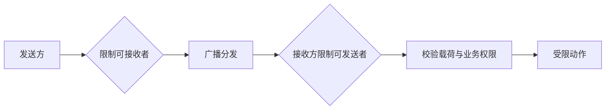

# 广播收发与暴露面

现行分类：[BroadcastReceiver](/security/android/component-security.html#s24)、[动态广播组件暴露](/security/android/component-security.html#s27)、[静态广播组件暴露](/security/android/component-security.html#s30)、[Receiver 嗅探](/security/android/component-security.html#s33)、[粘性广播与敏感数据](/security/android/component-security.html#s36)。

一条广播有两条安全方向：发送时决定谁能接收数据，接收时决定谁能驱动应用执行动作。只保护其中一端，仍可能泄露信息或接受伪造请求。action 字符串承担匹配职责，不是密码，也不是调用者证明。

## 先画出发送和接收的两个方向 {#broadcast-model}

广播通过过滤与分发连接发送方和接收方。接收器即使只处理某个自定义 action，也不能假设只有应用自己会发送它；发送方即使只想通知合作方，也不能假设其他应用不会注册相同过滤器。[广播总览](https://developer.android.com/develop/background-work/background-tasks/broadcasts)



这里的“限制”取决于具体 API 的目标、权限和导出设置，不是对 action 做字符串比较。回调触发后仍要检查事件值和操作条件，不能让一个广播直接转成任意文件操作或账户动作。

**验证路线**：用自有发送器和接收器分成两个测试应用，先确认合法消息可用，再用非受信发送器尝试同 action；另加非受信接收器观察是否获得本应私有的数据。分别记录两条方向，不能把一次拒绝当作所有方向通过。

## 静态 Receiver：检查最终 Manifest {#manifest-receiver}

Manifest 声明使接收器成为发布物的一部分。检查是否真的需要外部消息、exported 是否明确、所要求权限是否正确，以及回调是否承担敏感操作。不要因为入口没有界面就忽略它。[receiver 元素定义](https://developer.android.com/guide/topics/manifest/receiver-element)

Android 12 上，面向 API 31 及以上、带 intent-filter 的 Receiver 需要显式 exported。这是安装要求，不能被改写为所有历史系统统一采用同一默认值。即使配置可安装，仍需检查业务暴露是否合理。[Android 12 导出要求](https://developer.android.com/about/versions/12/behavior-changes-12#exported)

```xml
<!-- 仅示意 application 下的内部接收器，未提供完整工程。 -->
<receiver
    android:name=".InternalRefreshReceiver"
    android:exported="false" />
```

这个配置限制非预期外部入口，但不代替正常输入处理。若业务根本不需要跨应用广播，可优先采用应用内部的调用、状态或回调，减少公开通信面。

**验证路线**：检查发布变体的合并 Manifest，包括依赖引入的 Receiver；在自有不同签名应用中尝试发消息，确认内部入口没有执行。再检查合法业务是否仍能触发，防止只验证“拒绝成功”。

## 动态 Receiver：导出选择有 OS 和 target 条件 {#runtime-receiver}

动态注册的边界由运行时调用决定，不能只搜 Manifest。Android 13 提供明确的导出标记；在 Android 14 上，面向 API 34 及以上的应用注册非纯系统广播接收器时，需要说明导出行为。仅接收系统广播的注册存在官方说明的例外。[Android 14 行为变化](https://developer.android.com/about/versions/14/behavior-changes-14#runtime-receivers-exported)

若只接收本应用消息，选择与目标平台或所用兼容库对应的不导出方案。若确实接收其他应用消息，则导出并配套身份/权限策略；不要为了消除异常，统一切换成 EXPORTED。使用 AndroidX 时，还要核对实际 Core 版本和合并权限，不能把平台 API 条件直接套给库包装层。

部分系统相关广播来自高权限但不同 UID 的应用，NOT_EXPORTED 的接收范围也有具体限制。按实际广播种类检查官方建议，必要时拆分接收器，避免为一条外部消息放大其他消息的入口。[动态接收器导出选择](https://developer.android.com/develop/background-work/background-tasks/broadcasts#context-registered-receivers)

**验证路线**：记录注册代码实际执行时间、导出参数和接收范围；分别测试本应用、合作应用、非受信应用及目标系统事件。页面退出或对象销毁后检查是否撤销注册，避免遗留入口与重复回调。

## 限制发送者与限制接收者不是同一个参数 {#broadcast-permissions}

沿 API 方向记忆：`sendBroadcast(intent, receiverPermission)` 要求接收者持有权限；Receiver 的 Manifest `android:permission` 或注册时的 `broadcastPermission` 要求发送者持有权限。前者防止非预期接收，后者限制谁能触发回调，二者都不替代载荷与资源授权。[广播权限参数](https://developer.android.com/develop/background-work/background-tasks/broadcasts#restrict-broadcasts-with-permissions)

接收器声明或注册时要求权限，用于限制谁能向它发送消息；发送广播时要求接收者持有权限，用于限制谁能收到消息。两者应以自己的调用方向理解，不能看到代码里出现一个权限字符串就认定双向都已保护。[广播权限机制](https://developer.android.com/develop/background-work/background-tasks/broadcasts#restrict-broadcasts-with-permissions)

同签名应用之间的敏感消息可考虑自定义 signature 权限，定义、申请和使用位置须相互对应。普通 action 加上“公司域名风格”前缀只降低命名冲突，不限制其他应用发送。

回调中的业务参数仍可能无效。不要在 Receiver 的 onReceive 中用 `Binder.getCallingUid()` 直接认证原始广播发送者；它描述当前 Binder 事务，并不是所有异步分发路径中的最初主体。具体发送者 API 的可用性应按目标平台单独核对。[Binder 身份 API](https://developer.android.com/reference/android/os/Binder#getCallingUid())

**验证路线**：自有样例分别使用同签名且申请权限、同签名未申请权限、不同签名的参与方，验证发送与接收两个方向的准入。签名相同不代表所有业务动作都应该允许，载荷仍需测试越界和缺字段。

## Receiver 嗅探：把敏感信息移出公开载荷 {#broadcast-eavesdropping}

“Receiver 嗅探”的实质是非预期接收者拿到广播载荷。它需要广播本身可被分发给对方以及内容确实敏感；不能只因为存在 sendBroadcast 就认定泄露。查询接收范围、发送权限、包限制与实际数据，才能判断风险。

防护通常从减少载荷开始：广播只通知“状态改变”，通过有授权的接口查询具体内容；确需跨应用传递时，限制接收方并避免长效凭据。显式目标或包限制可以收窄普通广播目标，但不认证消息内容或对方后续行为。[广播安全考虑](https://developer.android.com/develop/background-work/background-tasks/broadcasts#security-considerations)

**验证路线**：在隔离样例里发送无敏感测试标记，观察非受信接收器是否收到。检查载荷与日志都不含真实账户数据；若外部能接收，再验证是否能造成实际越权，区分可达性与影响。

## 粘性广播：缓存延长了数据与信任的寿命 {#sticky-broadcasts}

粘性广播把消息保留在系统缓存中，新注册的接收器可能随后得到旧消息。该机制具有接收限制、来源与重放等安全问题，自 API 21 起弃用，不适合传递敏感信息。不要把缓存中的旧事件当作当前可信状态。[官方粘性广播风险说明](https://developer.android.com/privacy-and-security/risks/sticky-broadcast)

新增业务应使用非粘性的变化通知，再通过可信渠道读取状态。迁移历史流程时，列清旧缓存如何影响新注册对象，保证消费者不因为遗漏一次通知就永久失去同步，也不因为重复通知重复执行副作用。

**验证路线**：在自有样例中依次发送、销毁并重新注册接收器，观察旧消息是否重新到达；对缓存后的数据变化与重复事件测试状态一致性。不要发送真实口令或令牌作为测试数据。

广播不会自动解决后台执行限制。若回调需要长期任务，需设计符合平台约束的后台方案，并保持原有身份与授权边界，不能用“收到广播”作为无限执行的依据。
