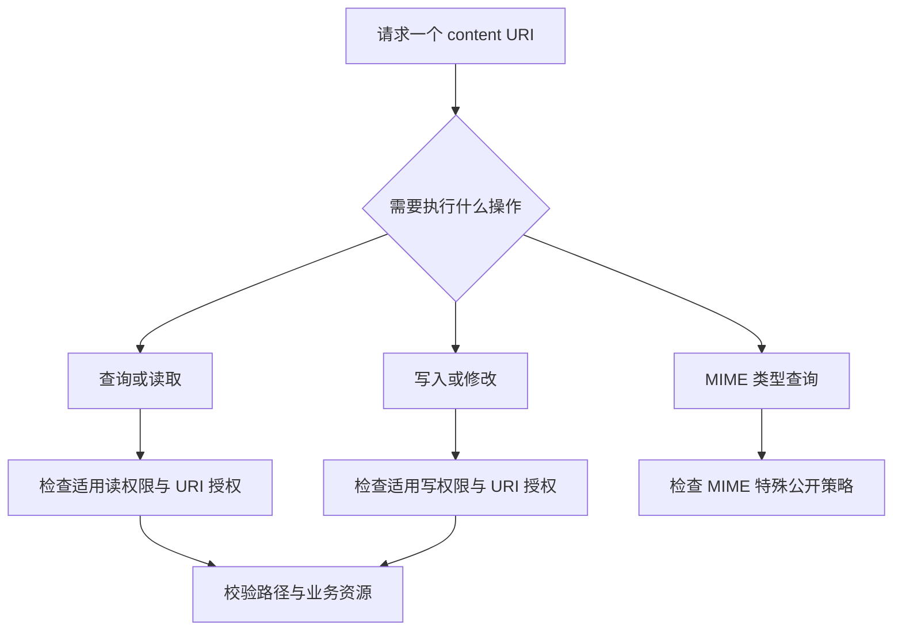

# ContentProvider 访问模型

现行分类：[ContentProvider](/security/android/component-security.html#s57)、[组件暴露安全](/security/android/component-security.html#s60)、[Provider uriPath 权限控制](/security/android/component-security.html#s66)、[隐式 Intent 的 URI 操作权限](/security/android/component-security.html#s72)、[getType() 方法安全](/security/android/component-security.html#s75)、[MIME 查询原理与权限边界](/security/android/component-security.html#s78)、[空 URI 与未定义 URI](/security/android/component-security.html#s81)、[authority 劫持](/security/android/component-security.html#s84)、[authority 唯一性与抢先安装](/security/android/component-security.html#s87)。

同一个 content URI 可以被用于查询、写入、打开文件或询问 MIME 类型。这些操作的权限路径并不完全相同。只看到 `exported="false"`，或只检查一个 query 方法，都不足以判断整套数据接口是否符合预期。

## authority 是路由名，不是资源所有权证明 {#authority-routing}

`content://authority/path` 中，authority 用于识别 Provider，path 再由 Provider 解释。Manifest 的 authorities 声明是路由配置；它不是加密凭据，也不证明外部返回的内容可信。[provider 元素定义](https://developer.android.com/guide/topics/manifest/provider-element)

访问外部 URI 时，应先确认业务为什么允许这个来源和资源范围，再校验返回内容、大小和用途。不要接收任意 content URI，随后用自身能力无条件复制、解析或转发；这些后续风险见[文件边界](../engineering/file-sharing.html)。

### 名称冲突、抢先占用与任意劫持是不同结果 {#authority-conflicts}

authority 冲突导致安装失败，与客户端信任了错误提供者属于不同问题。前者检查安装和更新规则，后者检查实际解析出的包、签名和业务协议；路由名称本身不能证明提供者可信。

跨应用读取前，应确认解析出的提供者符合预期合作身份，并按用户/配置文件限定资源。目标缺失时明确失败，不接受任意同名 authority 提供者作为替代；安装冲突与解析结果应分别记录。

**验证路线**：仅在隔离设备使用自有双样例，依次测试不同安装顺序、目标缺失和正常更新；记录安装返回与客户端解析到的包，确认失败发生在哪一阶段。防护上避免用一个路由字符串充当合作方认证；可信合作还需核对身份与业务协议。

## 导出、读写权限与临时授权共同形成访问面 {#provider-permissions}

跨进程请求先进入 Binder `Transport`：校验 URI，再按操作执行读、写或文件权限检查，之后才调用 Provider 的业务方法。`Transport.openFile()` 先检查模式与授权，应用的 `openFile()` 再映射实际文件并返回描述符；只保护 `query()` 不能保护另一条文件入口。[AOSP Transport](https://github.com/aosp-mirror/platform_frameworks_base/blob/android-16.0.0_r1/core/java/android/content/ContentProvider.java#L588)

Provider 可通过 permission 或分开的 readPermission、writePermission 控制访问。导出控制常规外部可达性，URI grant 可为特定资源提供临时访问能力；因此正常共享场景中“不导出”与“授予某 URI”并不矛盾。[Provider 权限定义](https://developer.android.com/guide/topics/manifest/provider-element#prmsn)

图中是检查模型，不声称精确复刻所有平台方法的调用顺序。MIME 查询单独列出，因为它有下面要讨论的特殊契约。

### Provider 默认导出规则有历史条件 {#provider-exported}

旧平台、targetSdk 与组件类型的差异会影响默认 exported。Provider 的官方定义专门说明 API 16 及以下与后续平台的区别，不能套用 Activity 的 intent-filter 安装规则。新配置应明确表达导出意图，并验证最终合并结果。[Provider 的 exported 属性](https://developer.android.com/guide/topics/manifest/provider-element#exported)

防护不是把所有方法统一加相同权限字符串。读与写可能暴露不同信息，写操作的成功/失败及返回数量也可能泄露数据是否存在；需要按真实接口语义划分授权，避免“不能直接读，所以写接口没有泄露风险”的推断。

**验证路线**：自有 Provider 使用无敏感测试数据，对不同客户端分别测试 query、insert/update/delete 和文件打开；覆盖无权限、只读、只写及特定 URI grant。检查真实副作用，不能只看是否返回异常。

## 路径权限不是文件系统边界 {#path-permissions}

path-permission 对 URI 路径设置访问要求；它与 Provider 内部如何把 URI 转成记录或文件是不同层。即使 URI 的权限匹配符合预期，内部错误拼接文件路径仍可能访问非预期位置；反过来，安全的文件路径也不能替代业务记录授权。[path-permission 定义](https://developer.android.com/guide/topics/manifest/path-permission-element)

实现应把允许的 URI 形状、解码规则、资源范围与最终文件边界连起来。使用 URI API 解析后，不要不加判断地把输入片段当任意 SQL、文件路径或另一个 URI 再解释。

**验证路线**：用合法路径、未定义路径、编码差异、额外路径段和越界资源标识测试路径授权与实际操作。若映射文件，比较最终落点是否仍在指定共享目录；路径遍历专项继续见[文件共享](../engineering/file-sharing.html)。

## URI grant 要和接收方及生命周期一起审查 {#uri-sharing}

临时 URI 授权向接收方交付某项资源的访问能力。检查实际目标、读写范围、前缀/持久标记和失效时机；系统分享选择器可用于用户主动选择接收方，但不应附带超出分享目的的写权限。[ContentProvider 临时权限](https://developer.android.com/guide/topics/providers/content-provider-basics#Permissions)

显式限制接收方有助于收窄边界；需要选择器的合法分享也应保证只给业务需要的能力。发送者持有资源不意味着应该把写权限一并交出去，前缀和持久授权也不能默认继承。

**验证路线**：通过自有接收应用验证只读、写入拒绝、非目标接收方及授权结束后的结果。记录 data/ClipData、实际目标与授权选项；不要把“Intent 里写着只读”直接当成访问结果。

## getType 查询的是元数据，也可能泄露信息 {#mime-type}

`getType(Uri)` 返回对应资源的 MIME 类型或无法识别时的 null。它不等于读取资源内容；但如果返回值依赖私有记录是否存在、类别或内部状态，元数据本身也可能敏感。[ContentProvider.getType 定义](https://developer.android.com/reference/android/content/ContentProvider#getType(android.net.Uri))

官方说明：默认情况下，MIME 查询有不同于普通读写的访问行为，即使 Provider 不导出或设置读写权限，也不能简单假定类型查询被同样阻断。因此类型实现不应进行不必要的文件读取或有副作用的业务动作，更不应靠返回细粒度类型泄露私有状态。

### API 34 的 getTypeAnonymous 边界 {#anonymous-mime}

API 34 增加 `getTypeAnonymous(Uri)`，用于提供不需要权限即可公开的类型信息；按官方契约实现后，可把需要保护的类型信息留在 getType 路径并受相应读权限约束。**默认实现直接委托 `getType(uri)`**，因此保留默认委托不会自动隐藏敏感类型。[getTypeAnonymous 定义](https://developer.android.com/reference/android/content/ContentProvider#getTypeAnonymous(android.net.Uri))

对敏感 URI，匿名分支应返回 null 或不会暴露记录存在性、内部分类的统一公开类型，避免转调敏感查询。还需配置并验证真实的读访问限制与 URI 授权策略；若公开 Provider 没有相应读限制，仅覆写匿名方法不会凭空建立鉴权。[固定标签中的匿名查询与访问分支](https://android.googlesource.com/platform/frameworks/base/+/refs/tags/android-16.0.0_r1/core/java/android/content/ContentProvider.java#315)

为早于 API 34 的运行环境设计实现时，需要单独考虑兼容行为。编译 SDK 允许覆写一个新方法，不代表旧设备会采用新的调用策略；不能把新版防护倒推到所有历史版本。

**防护与验证路线**：先列出任何人可知的粗粒度类型，再列出需要鉴权的信息。在隔离样例中，用无权限与有权限客户端比较已知、未知和私有资源的类型结果，确认不泄露存在性或内部分类；按运行 OS 分别记录结果。

## 空输入与未定义 URI 不应引发副作用 {#invalid-uri}

应区分 `null`、不支持的 scheme/authority、空路径和不存在资源。前者可能在调用入口被拒绝，其余输入仍需由 Provider 按方法契约处理；不能在处理未知类型时转而打开任意路径。

实现可根据具体方法契约对不支持输入返回适当结果或受控异常，关键是行为确定、无敏感副作用、不把异常细节作为内部数据出口。getType 的未知类型可以按契约返回 null，不能为“成功处理”而任意打开输入路径。

**验证路线**：在自有调用端区分 API 入口就拒绝的 null 与真正到达 Provider 的未知 URI，检查错误类型、日志以及是否改变状态。连续重复测试时记录资源消耗，防止把单次异常和可重复拒绝服务混淆。

完成访问模型后，继续检查[文件边界与共享目录](../engineering/file-sharing.html)、[URI 与 SQL 输入](../engineering/uri-sql-input.html)。
