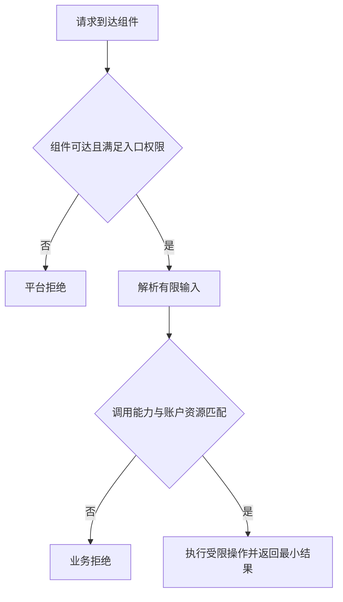

# Android 安全模型与权限边界

现行分类：[权限与属性设置](/security/android/component-security.html#s9)、[组件暴露](/security/android/component-security.html#s12)、[应用程序只申请必要的权限](/security/android/configuration-security.html#s102)、[应用的 UID 权限](/security/android/configuration-security.html#s105)、[sharedUserId 与 UID 共享](/security/android/configuration-security.html#s108)、[reboot 权限](/security/android/configuration-security.html#s111)、[自定义权限保护等级](/security/android/configuration-security.html#s117)、[自定义权限的系统命名空间](/security/android/configuration-security.html#s123)、[对外导出组件的访问权限](/security/android/configuration-security.html#s126)。

一个应用有权限读取联系人，并不意味着它可以替任何调用者读取联系人。真正需要回答的是：谁提出请求，谁持有能力，最后把什么资源交给了谁？这也是检查组件安全时比“是否导出”更完整的问题。

## UID 是身份边界，进程不是权限清单 {#uid-permissions}

Android 应用沙箱以 Linux UID 为基础，结合文件权限及其他平台机制隔离应用。应用启动多个进程，并不会因此自动获得几组相互独立的应用权限。反过来，相同包名字符串也不能作为调用者身份证明，身份应来自对应通信机制提供的可信信息。[AOSP 应用沙箱](https://source.android.com/docs/security/app-sandbox)

需要区分几个问题：UID 说明执行主体是谁；应用权限说明平台允许它做什么；业务授权说明当前账户能访问哪条记录。持有某项平台权限，不能证明有权读取另一个账户的数据。审查一个“查询笔记”入口时，既要限制调用能力，也要校验该笔记是否属于已授权账户。

### sharedUserId 为什么不能当便捷互通方案 {#shared-uid}

历史应用可以在符合签名等条件时共享 UID，文件访问和权限检查因此看到共享身份，而非彼此独立的包名。`sharedUserId` 自 API 29 起弃用；已有包的 UID、存储归属和升级兼容需要整体迁移，不能只删除属性。新设计采用权限明确的 IPC 互通。[Manifest 的 sharedUserId 说明](https://developer.android.com/guide/topics/manifest/manifest-element#uid)

新设计优先通过权限明确的 Service 或 Provider 通信。维护历史包时，先清点共享 UID 的所有成员、签名和可访问数据，再制定兼容迁移；不要只改一个 Manifest 就声称完成隔离。

**验证路线**：在隔离测试设备上查询已安装包的 UID，比较同一应用的不同进程及历史共享身份包；随后分别执行文件访问和组件请求。记录实际返回与拒绝原因，不能从进程名推断隔离已经成立。

## exported、入口权限与业务授权是不同关卡 {#component-exposure}

`android:exported` 表达组件是否允许应用外部访问，但它不负责解释一笔业务请求是否合理。一个公开的分享入口和一个内部支付确认入口，暴露策略显然不同；公开入口也不能因为“本来就是公开的”而跳过账户与参数验证。[android:exported 风险说明](https://developer.android.com/privacy-and-security/risks/android-exported)



图中的后两步是应用需要设计的策略，不能假定平台替它完成。典型风险是应用持有敏感能力，对外入口却接受任意资源标识，最后用自身权限代调用者执行操作。

### 默认值与安装要求不能混写 {#exported-versions}

组件类型和历史平台的默认导出规则不同。Android 12 上，面向 API 31 及以上、带 intent-filter 的 Activity、Service 和 Receiver 需要显式声明 exported；缺少声明会影响安装。这不等于“所有组件从 API 31 起默认 false”，Provider 还应按其独立规则判断。[Android 12 的组件导出要求](https://developer.android.com/about/versions/12/behavior-changes-12#exported)

工程上显式声明每个组件的预期边界，并检查最终合并结果。无需外部访问的入口设为不导出；需要外部访问的敏感入口，根据合作方与能力选择权限及业务校验。不能把“所有导出组件都加同一个签名权限”套到公开网页入口，否则会破坏预期功能。

**验证路线**：准备应用自己的受信客户端与不同签名客户端，对内部、合作方、公开入口分别发起请求。确认不可信请求被拒绝时，敏感操作确实没有发生；仅检查界面没弹出不足以证明后台未执行。

## 权限的声明、申请与实际授予 {#permission-policy}

权限定义方声明等级，调用方请求权限，系统决定授予，入口再按调用 UID 检查。`normal` 通常安装时授予，`dangerous` 按运行系统与 target 进入相应运行时授权，`signature` 按签名关系授予；定义和申请相同字符串不等于已获得能力。[权限机制](https://developer.android.com/guide/topics/permissions/overview)

`<permission>` 定义能力，`<uses-permission>` 申请能力，组件上的 permission 属性要求调用者拥有能力。这三者的名字必须一致；申请写进 Manifest 不等于系统已授予，更不等于应用应主动使用它。权限最小化应从实际业务及访问数据出发，而不是从库默认带来的权限列表出发。[Android 权限概览](https://developer.android.com/guide/topics/permissions/overview)

审查权限时，把每项申请对应到具体功能和调用点。能通过用户选择器、临时 URI 授权等较窄能力完成的场景，优先避免申请长期、广范围访问；同时为拒绝授权设计可理解的失败路径。

### 自定义权限与签名信任 {#custom-permissions}

自定义权限的 `protectionLevel` 决定授予策略，原文 `protectLevel` 不是正确属性。若接口只供同签名家族应用使用，可考虑 signature 权限；若业务确实面向其他应用，需另行设计受信关系。normal、dangerous、signature 各有用途，不能统一替换成一个等级。[permission 元素定义](https://developer.android.com/guide/topics/manifest/permission-element)

```xml
<!-- 教学片段：声明位于 manifest 下，service 位于 application 下。 -->
<permission
    android:name="example.notes.permission.READ_SUMMARY"
    android:protectionLevel="signature" />

<service
    android:name=".SummaryService"
    android:exported="true"
    android:permission="example.notes.permission.READ_SUMMARY" />
```

这是入口准入示意，不是完整服务实现。它也不代表服务方法可以省略输入及账户授权检查。API 23 起弃用的 `signatureOrSystem` 不应作为新的普遍推荐；改造既有系统集成时还要分析现有调用者。[保护等级定义](https://developer.android.com/guide/topics/manifest/permission-element#plevel)

### 命名空间与特权权限 {#namespace-privilege}

自定义权限使用应用拥有的包名前缀，避免碰撞和归属混淆，不要冒用 `android.permission.*` 等系统命名空间。权限字符串本身不是密钥，正确声明、保护等级及实际检查才形成边界。[权限命名指导](https://developer.android.com/guide/topics/manifest/permission-element#name)

`android.permission.REBOOT` 官方明确不供第三方应用使用。普通应用声明它不代表获得重启能力；系统/OEM 集成需按其授权与产品场景单独审查，而不是以“特殊应用”一句话豁免全部要求。[REBOOT 定义](https://developer.android.com/reference/android/Manifest.permission#REBOOT)

**验证路线**：核对合并 Manifest 中定义、申请、组件要求的名称，检查安装后实际授予状态；使用不同签名的自有客户端验证准入结果。分别记录“未授予”“入口被拒绝”“业务拒绝”，避免把某一步失败误认成全部策略有效。

## 把配置检查连接到真实数据流 {#review-workflow}

配置安全不是 Manifest 单文件检查。发布变体可能合并依赖组件，运行时还可能注册 Receiver、生成 URI 授权或暴露 Binder 对象。因此应从最终发布物出发，追踪每个入口到敏感操作和返回数据。

建议为每个组件写下：预期调用者、平台准入、业务授权、输入上限和失败结果。遇到动态入口，说明它何时注册、何时撤销；遇到配置修复，重跑正常业务与拒绝路径，防止安全调整同时破坏合法用户。

可按以下顺序在自有样例工程中执行，示例命令仅查询设备环境：

```sh
adb shell getprop ro.build.version.sdk
adb shell getprop ro.build.fingerprint
```

结合最终 Manifest、实际 targetSdk、安装状态与签名检查组件准入；再跟踪到业务方法，确认授权检查先于敏感读写。

继续阅读：[Activity 与 Intent](./activity-intent.html)、[Service 与 IPC](./service-ipc.html)、[ContentProvider](./provider.html)。
