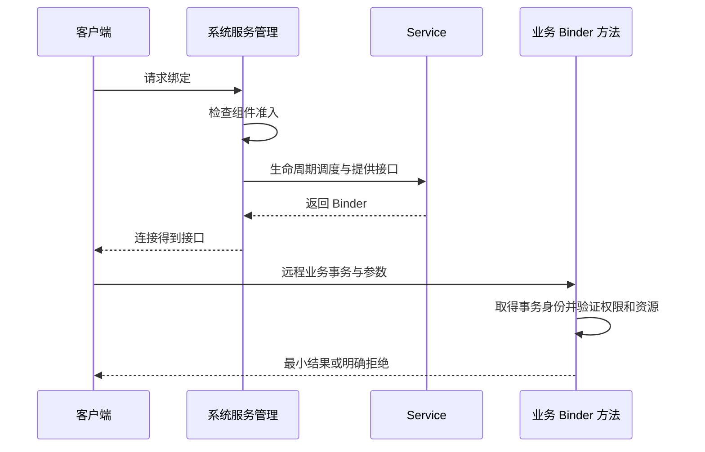

# Service 与 IPC 身份鉴别

现行分类：[Service](/security/android/component-security.html#s39)、[Service 组件暴露安全](/security/android/component-security.html#s42)、[Service 劫持](/security/android/component-security.html#s45)、[AIDL 接口安全](/security/android/component-security.html#s48)、[Messenger 服务安全](/security/android/component-security.html#s51)、[前台服务安全](/security/android/component-security.html#s54)。

服务被允许启动或绑定，不代表拿到接口之后的每个业务请求都已经授权。Service 安全需要同时检查入口、通信对象、方法参数、调用者身份和资源权限。

## 启动服务和绑定服务暴露不同能力 {#service-entry}

启动服务把一个工作请求交给组件，绑定服务则取得可交互的接口。一个 Service 也可以同时具备两种用法，所以应分别检查处理入口，不能只审查 onBind。[绑定服务概览](https://developer.android.com/develop/background-work/services/bound-services)

无需其他应用使用的服务，显式限制导出。需要外部访问时，在 Manifest 中声明适合业务的准入权限，并检查最终合并配置；公开可达不意味着可以替外部调用者操作任何账户或文件。[service 元素定义](https://developer.android.com/guide/topics/manifest/service-element)

**验证路线**：使用自有不同签名客户端分别尝试启动与绑定，覆盖无权限、有权限、缺字段和无效动作。记录是否到达回调、是否拿到接口以及业务是否实际执行，避免把这三种结果混为一谈。

## 服务劫持先问目标是否确定 {#service-hijacking}

如果发送方让系统解析不受限制的目标，可能把请求或数据送给非预期接收者。风险成立还取决于平台是否允许该调用方式、匹配规则和接收方能力；不能把历史隐式服务行为直接套到所有现代平台。[Intent 类型与服务调用](https://developer.android.com/guide/components/intents-filters)

应用内部固定服务使用明确组件；跨应用协作需限定允许的服务身份，检查实际连接对象与接口契约，并控制发给它的数据。一个远端返回了预期 descriptor，只能说明协议看起来匹配，不是密码学身份认证。

**验证路线**：在自有测试客户端中替换目标为非允许服务、使允许服务不可用、模拟连接断开，核对应用是否拒绝继续业务。正常路径也要验证恢复与解绑，不能无限重试已经可能执行过的有副作用请求。

## onBind 准入和 Binder 业务事务必须分开 {#binder-authorization}

Service 的生命周期由系统调度。onBind 负责提供接口，不应把它内部随手读取的 Binder 身份当成每个后续业务调用者。跨进程客户端通过远程 AIDL 调用进入 Stub 时，需要按该入站事务核验身份；接口还可能被传递，不能把首次绑定者等同于永久持有者。



这是跨进程机制示意，省略了调度细节。依据来自 [绑定接口契约](https://developer.android.com/develop/background-work/services/bound-services)及 [Binder 当前事务身份定义](https://developer.android.com/reference/android/os/Binder#getCallingUid())；这里关于分层鉴权的要求是由两者结合得到的设计结论。

本地 AIDL 接口可能直接返回实现对象，方法在当前调用线程执行，不产生新的 Binder 事务；本地调用的 `oneway` 也仍是同步执行。此时 `getCallingUid()` 的意义取决于线程是否已经处于其他入站事务中，不能把它当成独立本地调用者认证。内部调用需要明确的可信入口和业务授权上下文，不能不加区分地套用远程事务检查。[AIDL 的本地与远程调用语义](https://developer.android.com/develop/background-work/services/aidl)

### AIDL 只生成通信协议，不生成业务授权 {#aidl-methods}

AIDL 定义双方如何传递调用，不判断输入资源属于哪个账户。每个敏感方法需要在修改状态之前检查调用能力和业务资源，不能只保护“获取接口”方法。远程请求也可能并发，因此授权状态与实际操作之间应避免出现可利用的不一致窗口。[AIDL 官方说明](https://developer.android.com/develop/background-work/services/aidl)

敏感方法按以下业务策略检查：

```text
on incoming remote business transaction:
    caller = captureTrustedTransactionIdentity()
    reject unless caller has required capability
    request = validateBoundedArguments()
    reject unless caller may access request.resource
    execute operation under explicit state rules
```

防护同时需要拒绝路径：无效字段、未知请求、超大集合、未授权资源都应在副作用发生前拒绝。不要只在成功分支末尾检查，更不要从客户端自己传来的 uid 字段取身份。

**验证路线**：自有样例中让有权限客户端连接后传入不属于其账户的测试资源，验证方法级授权是否独立拒绝；再覆盖并发调用与无效输入。接口引用是否能被转交也应纳入威胁模型，不能只验证首次绑定。

## Binder 身份不能直接跨异步边界读取 {#async-identity}

`Binder.getCallingUid()` 返回正在处理的事务的调用 UID；不在入站事务中时返回本进程 UID。切到 Handler、线程池或其他异步任务后重新读取，不能推断仍是原来的远端客户端。清除调用身份同样改变后续权限判断的上下文。[Binder API 定义](https://developer.android.com/reference/android/os/Binder#getCallingUid())

因此应在可信事务上下文中获取并验证必要身份，构造受限工作请求后再调度；异步执行时还要考虑账户退出、资源归属改变和权限撤回等状态变化。保存一个 uid 数字并不自动解决所有业务授权时效问题。

**验证路线**：在自有服务中分别记录事务内与异步任务中的身份来源，使用不同 UID 客户端发请求并对照结果。不要在生产日志输出敏感请求；若只做文档审阅，应把跨线程身份验证标为未执行。

## Messenger 的消息队列不等于身份自动可信 {#messenger}

远程请求先进入 `Handler.MessengerImpl.send()`，由框架把事务 UID 写入 `sendingUid`，之后才入队。因此在 Handler 回调中读取记录值，而非重新读取当前 Binder 身份。[AOSP 赋值处](https://github.com/aosp-mirror/platform_frameworks_base/blob/android-16.0.0_r1/core/java/android/os/Handler.java#L974)

若只允许指定合作 App，应将该 UID 与预置允许包的实际 UID 关联，再按可信证书策略验证指定包。`checkSignatures(Process.myUid(), senderUid)` 只比较签名关系，不能限定是哪一个 App，也不适用于双方签名不同的合作关系。API 28+ 的 `hasSigningCertificate()` 包含平台认可的签名历史语义；共享 UID 和证书撤销需单独制定策略。完整防御代码见 [Messenger 指定应用认证](/android/basics/messenger.html#接收方验证是否为指定的合法应用)。[PackageManager 证书契约](https://developer.android.com/reference/android/content/pm/PackageManager#hasSigningCertificate(java.lang.String,byte[],int))

Messenger 把请求交给 Handler 处理，有助于串行化消息，但消息编号、Bundle、replyTo 都不能自动充当业务身份。`Message.sendingUid` 由通过 Messenger 发送的路径提供；其他构造方式可能没有有效值，需按其契约检查，不能盲信自定义 Bundle 里的包名或 uid。[Message.sendingUid](https://developer.android.com/reference/android/os/Message#sendingUid)

防护应先确认消息来源和准入策略，再解释允许的 what 与数据格式，拒绝未知命令；响应只发给业务确实允许的回调对象。敏感服务仍应有入口限制和资源授权，不能把 Handler 串行执行误认为安全隔离。

**验证路线**：用正常 Messenger 客户端、无效消息编号、缺数据与非受信客户端测试；检查身份缺失时是否拒绝敏感动作。对回复路径也观察信息是否交给非预期接收方。

## 前台服务是执行形态，不是安全认证 {#foreground-service}

前台服务以用户可见方式执行符合条件的工作，受到启动来源、服务类型、权限和平台版本等约束。通知可见不证明请求可信，也不保证进程永久存活。[前台服务概览](https://developer.android.com/develop/background-work/services/fgs)

在 Android 14 上，面向 API 34 及以上的应用需按工作声明相应前台服务类型，并满足相关权限/条件；其他版本和特定服务类型有不同规则。安全检查要在启动前处理请求来源与业务授权，不能通过升级为前台服务绕过入口设计。[Android 14 前台服务要求](https://developer.android.com/about/versions/14/behavior-changes-14#fgs-types)

**验证路线**：自有样例分别测试允许与不允许的启动状态，核对声明、权限、通知和停止流程；同时重跑未经授权的业务请求，确认它不会因为前台状态而被放行。设备限制与业务拒绝应分开记录。

进一步理解通信机制可读 [Binder 机制](/android/framework/binder-mechanism.html)；需要共享数据时继续读 [Provider 访问模型](./provider.html)。
