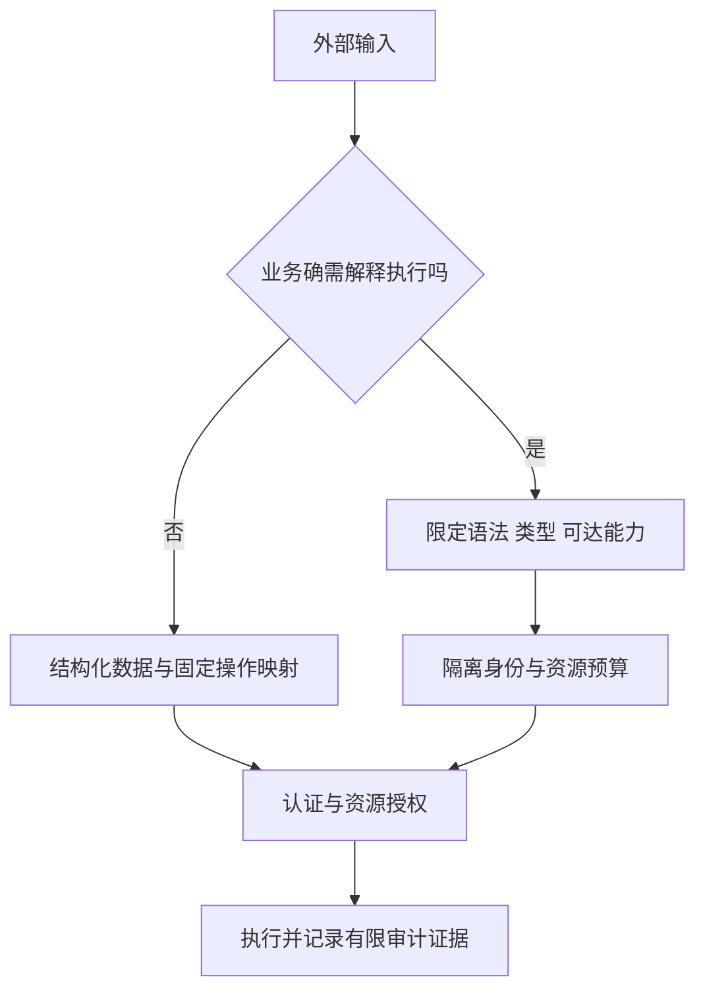

# 特殊函数

本章按原提纲的分类和子项顺序组织。左侧条目、正文标题与本文目录使用同一组标题和锚点。

::: info 适用与验证边界
平台行为需分别核对运行 OS、target SDK 和依赖版本；历史检查项已按正文依据限定条件。所有代码均为教学片段，未经过 Android 工程编译或真机执行；域名、容量阈值及业务规则为示例，不能直接作为生产策略。
:::

同一个字符串进入不同消费者，风险不同。文件路径交给文件 API，表达式交给脚本引擎，序列化对象交给对象恢复器，都可能使外部数据获得超出预期的能力。防护应在敏感操作之前完成，而不是在发生异常后统一忽略。



通用审计模型是“输入源 → 转换 → 可达能力 → 执行身份 → 结果”。仅看到 `exec`、`Serializable` 或 `Base64.decode` 不能判定可利用漏洞；反过来，输入来自本地缓存也不代表可信，缓存可能由外部响应或共享目录写入。

## 命令执行安全 {#s180}

优先使用 Android/Java 的文件、网络或压缩 API，避免为普通业务启动 shell。若确需外部工具，固定可执行文件与操作集合，限制参数的语义、长度和文件落点，并使用最小权限运行。

危险模式是把外部值拼接后传入 shell 的 `-c` 参数。shell 会进一步解释引号、替换、管道等语法。`Runtime.exec(String)` 本身也不能一概等同于 shell，它与显式执行 shell 的解释路径必须区分；其字符串拆分契约见 [Android Runtime.exec](https://developer.android.com/reference/java/lang/Runtime#exec(java.lang.String,java.lang.String%5B%5D,java.io.File))。

[`ProcessBuilder`](https://docs.oracle.com/en/java/javase/11/docs/api/java.base/java/lang/ProcessBuilder.html) 支持用参数列表表达程序及参数；下面只说明参数分离，不指定任何未核实工具或参数名：

```kotlin
// 教学片段：这些变量由应用内部固定策略提供，不直接采纳外部字符串。
val process = ProcessBuilder(
    trustedExecutablePath,
    reviewedOperationArgument,
    validatedResourceId
).start()
```

这不能自动消除**参数注入**：若目标程序把资源名解释成选项、响应文件或脚本，参数列表仍然危险。是否支持选项终止符及其含义，要查目标工具的实际文档，不能套用统一参数。可执行文件本身也必须位于可信、不可被其他主体替换的位置。

执行还要限制并发、输出总量和耗时，处理标准输出与错误输出，避免管道写满造成等待。终止父进程也不必然终止全部后代；不能把线程超时当作完整进程隔离。Android 应用启动的本地程序通常仍受其 UID、SELinux 和系统策略约束，调用命令不自动获得系统权限。

**验证路线**：在隔离工程使用固定测试程序记录收到的参数，测试空格、换行、选项样式值和超长输入，确认它们没有改变操作集合；再测试工具阻塞、异常退出和大量输出。不要在真实用户数据目录中验证破坏性副作用。

## 解压安全 {#s183}

Zip Slip 的核心是条目名控制最终落点；压缩炸弹则主要利用展开资源。阻止 `../` 不能阻止大量正常路径文件耗尽磁盘，限制压缩文件大小也不能推导展开后大小。

以下片段校验普通 ZIP 条目的目标路径：

```kotlin
// 教学片段：destination 是本次新建、仅本应用可写的私有暂存目录。
fun checkedDestination(destination: java.io.File, name: String): java.io.File {
    require(name.isNotEmpty() && !java.io.File(name).isAbsolute)
    val root = destination.canonicalFile
    val target = java.io.File(root, name).canonicalFile
    require(target.path.startsWith(root.path + java.io.File.separator))
    return target
}
```

末尾路径分隔符用于防止把同名前缀目录误判为子目录。该检查仍假设根目录及其父路径不受攻击者替换；若其他主体能并发修改符号链接，先规范化再写入会有竞态，不能承诺抵御所有路径替换。官方 [ZIP 路径遍历说明](https://developer.android.com/privacy-and-security/risks/zip-path-traversal)也明确了可信目标目录前提。

实现中还应限制条目数、单条目实际展开字节、累计展开字节、目录深度及耗时；不要只依赖 ZIP 元数据中的尺寸。拒绝重复落点、文件/目录冲突和非预期覆盖；按库和格式明确符号链接策略，不把解压出的链接作为后续写入路径。递归解压嵌套包会跨越原配额，默认不自动递归处理。

Android 14 且应用 target API 34+ 时，部分 `ZipFile`、`ZipInputStream` 路径检查会拒绝含 `..` 或以 `/` 开头的条目，见[版本行为变更](https://developer.android.com/about/versions/14/behavior-changes-14#zip-path-traversal)。这不替代其他库/格式、展开资源、覆盖和竞态防护，也不意味着旧设备具有相同行为。

**验证路线**：在独立临时根目录测试跨目录条目、绝对路径、同名前缀目录、重复条目、异常中断及资源超限。验证根目录之外未产生文件、失败后未发布半成品；符号链接和并发用例须按实际库与文件系统另测。

## getPathSegments 函数 {#s186}

Android [`Uri.getPathSegments()`](https://developer.android.com/reference/android/net/Uri#getPathSegments()) 返回已解码的路径片段。片段数可能不足，片段内容也未必是安全文件名。直接取 `[1]` 可能越界；将片段拼到文件系统路径还会跨入另一种语法。

对 `/notes/123` 这样的业务路由，先检查段数、固定段和 ID 格式，再使用它查询已授权资源。文件访问另按 [文件边界](/security/android/engineering/file-sharing.html) 检查真实落点，不能把 `UriMatcher` 或“最后一段”当路径净化器。Google 的[路径遍历说明](https://support.google.com/faqs/answer/7496913)特别指出，编码后的分隔符可能在解码后进入文件路径。

不要通过删除 `../`、检查字符串中是否包含 `/` 等局部替换来修补任意路径。更稳妥的模型是外部只传业务 ID，由应用从受控映射中取得文件。

## 序列化安全 {#s189}

反序列化不仅是“读取字段”。某些机制会实例化对象、执行恢复逻辑、触发嵌套解析，或形成异常大的对象图。风险成立取决于格式、可达类、库版本、输入来源和后续用途，不能把所有反序列化一律称为代码执行。

Android 的[不安全反序列化说明](https://developer.android.com/privacy-and-security/risks/unsafe-deserialization)覆盖 Java 对象序列化与 Parcel/Parcelable 相关风险。`Parcel` 主要用于 IPC，不适合作为长期持久化格式；`Parcelable` 也不是通用不可信输入沙箱。

对跨信任边界的数据，优先选择字段明确、版本化的协议：限制总字节、字段数量、字符串长度、数组长度、嵌套深度与允许类型；拒绝未知多态类型。即使采用 JSON、CBOR 或 Protobuf，也仍需资源配额与业务校验，不能因为格式不同就宣称没有拒绝服务风险。

Intent/Bundle 中读取到的对象要经过类型与语义双重检查。Android 新版的类型化读取接口可以缩小类型误用，但不能证明字段值、对象行为和调用方权限安全。具体 AndroidX 兼容接口按工程实际依赖核对，不套用未确认版本。

边界处处理已知格式异常并立即失败，避免先产生副作用再补校验。不要为了“兼容”而回退到更宽泛的对象恢复器，也不要把失败后的空对象当成已认证状态。

**验证路线**：围绕实际协议建立截断、缺字段、未知类型、深嵌套、大数组和非法枚举用例，验证失败无副作用且资源消耗受控；为历史版本保存兼容性样本，而不是只验证当前正常数据。

## JEXL 表达式注入 {#s192}

JEXL 可用于表达式和脚本求值。如果把不可信表达式与带文件、网络、反射或服务能力的对象绑定，引擎可能成为业务权限的代理。仅允许“算式外观”的输入，或简单过滤类名，并不能证明所有可达调用链安全。

Apache 的[配置与安全说明](https://commons.apache.org/proper/commons-jexl/apidocs/org/apache/commons/jexl3/package-summary.html)指出，自 3.7 起默认权限采用 `SECURE`；旧版本和显式恢复旧行为的配置可能不同。这是滚动文档中的版本说明，不是本文对某个项目依赖版本的测量。

对实际工程，应同时核对引擎版本、`JexlPermissions`、`JexlFeatures`、沙箱、命名空间与上下文对象。`RESTRICTED` 或 `SECURE` 都不是“任意用户脚本安全执行”的保证。能改成预定义规则或结构化条件时，不开放通用表达式。

确需执行时采用以下设计：

1. 只暴露纯数据和业务必需的有限函数，不把 `Context`、数据库连接、类加载器等广泛能力对象交给表达式。
2. 按实际版本配置允许列表，默认拒绝未知类型、方法和属性；限制语法功能，避免误用空列表语义。
3. 限制表达式长度、编译频率、执行资源和结果大小；缓存也设容量边界。
4. 对需要强隔离的不可信脚本使用独立信任域与可终止执行单元；不要只依赖同进程线程中断。

配置项的精确语义见 [`JexlSandbox`](https://commons.apache.org/proper/commons-jexl/apidocs/org/apache/commons/jexl3/introspection/JexlSandbox.html)。本文不提供脱离版本、复制即可保证安全的引擎配置。

**验证路线**：以业务允许的最小表达式集作正例，再逐项验证未授权类型访问、方法调用、循环或高成本计算、超大结果及配置迁移。拒绝测试不能替代对暴露对象完整可达能力的审查。

## TA 文件安全 {#s195}

原提纲只有“TA 文件安全”标题。**若此处 TA 指 Trusted Application**，审计对象属于 TEE 与设备平台信任链，不能直接套用普通插件的 `ClassLoader` 模型；也不能由这个缩写推断设备使用 Trusty。

以 AOSP Trusty 为例，它是与 Android 隔离运行的安全操作系统，通过驱动和用户态通信库连接 Android 与可信应用。Trusty 是一种 TEE 实现，不代表所有 Android 设备的安全世界都使用同一内核、文件格式或部署协议。[Trusty 架构](https://source.android.com/docs/security/features/trusty)

平台/OEM 审计应分别确认：

1. TA 镜像由谁签名、验证密钥由谁管理，加载链何时校验真实性和版本。
2. 安全启动、更新和回滚策略覆盖到哪一层，恢复流程是否允许旧的易受攻击组件。
3. 普通世界到可信应用的通信端点如何授权，消息长度、句柄、共享内存和状态机如何验证。
4. 调试接口、日志和错误码是否暴露密钥或受保护数据，资源耗尽是否影响其他可信服务。

这些是待查问题，不是对任一厂商实现的既定描述。签名加载不替代每条消息的输入验证；安全世界隔离也不意味着 TA 内部不会出现解析错误。普通 APK 通信能力不能被写成“可任意部署或加载 TA”。[Trusty IPC 的对象与端口模型](https://source.android.com/docs/security/features/trusty/trusty-ref)

