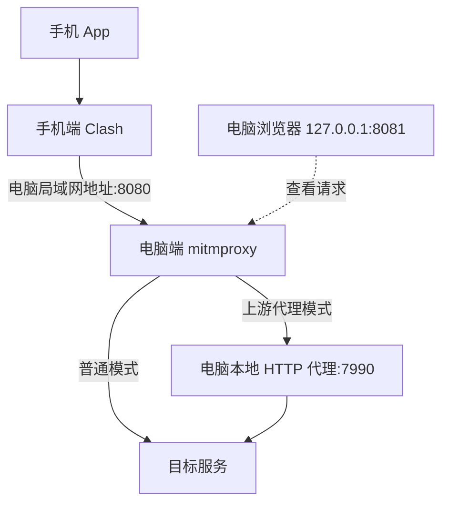

# App 网络请求抓包

手机端 Clash 负责将测试 App 的流量转交给电脑，mitmproxy 处理代理连接，mitmweb 提供请求与响应的查看界面。

## 准备与连接方式

- 手机已安装支持导入 YAML 配置的 Clash 客户端，电脑已安装 [mitmproxy](https://www.mitmproxy.org/)。
- 手机能够访问电脑的局域网地址及抓包监听端口。先检查连接与防火墙设置，再排查证书问题。
- 仅分析自己开发或已获授权测试的 App。HTTPS 内容是否可见，取决于目标 App 是否信任抓包证书。



`8080` 是手机连接的抓包端口，`8081` 是电脑本机查看流量的 Web 界面端口，`7990` 是原笔记中的电脑上游代理示例端口。上游端口需要按实际客户端设置替换；HTTP 代理模式与上游代理模式见 [mitmproxy 官方说明](https://docs.mitmproxy.org/stable/concepts/modes/)。

## 一、手机安装 Clash 并导入配置

下载原笔记中的配置文件，保存在手机可访问的位置。

<AttachmentDownload
  href="/attachments/app-network-capture/burp.yml"
  name="burp.yml"
  size="304 B"
  description="原笔记配置附件，导入前请核对服务地址与端口。"
/>

1. 在 Clash 客户端通过“添加文件”或本地配置导入入口，选择 `burp.yml`。
2. 将 `proxies` 中 `name: "burp"` 对应的 `server` 改为运行 mitmproxy 的电脑局域网 IP，保留或调整 `port: 8080`，使其与监听端口一致。
3. 原附件使用 `mode: Global`。在客户端的全局策略组 `GLOBAL` 中选择 `burp`；若选择的是附件中的手动策略组，还须将该组的出口选为 `burp`。全局模式不依靠附件末尾的 `MATCH` 规则分流，不能只改手动组就认定全局出口已改变。[Mihomo 对 Global 模式的说明](https://wiki.metacubex.one/en/config/general/#operation-mode)可用于理解兼容内核的选择语义，具体入口仍以实际客户端为准。
4. 开启客户端用于接管目标 App 流量的 VPN / TUN 模式，并确认目标 App 未被排除。仅启动手机本地 HTTP / SOCKS 监听端口，不会自动让其他 App 使用它；启动待观察的 App 后，仍需按第四节验证请求确实经过电脑。[Android VPN 的按应用路由边界](https://developer.android.com/develop/connectivity/vpn#per-app)

手机上的 `127.0.0.1` 指向手机自身，不能用它代替电脑的局域网 IP。不同 Clash 客户端的入口名称可能不同，以所用客户端界面为准。

## 二、安装并信任抓包证书

HTTPS 抓包涉及两条 TLS 连接：App 与代理建立一条，代理与服务器另建一条。代理用自己的 CA 签发站点证书，App 信任这个 CA 后才可能接受代理这一端的握手；代理仍需校验真实服务器的证书。仅把流量路由到代理不会自动得到明文。[mitmproxy 证书机制](https://docs.mitmproxy.org/stable/concepts/certificates/)

查看 HTTPS 明文前，需要在测试环境安装 mitmproxy 的 CA 证书，并确认目标 App 信任它。在支持 Network Security Configuration 的 Android 7.0 及以后平台，面向 API 24 及以上的应用默认仅信任系统 CA；面向 API 23 及以下的应用默认还信任用户 CA。应用显式配置、自定义 TLS 实现或证书固定仍可能改变结果。自有测试应用可按官方文档配置 `debug-overrides`，不能把安装用户 CA 当作所有 App 都能解密的充分条件。[Android 证书信任默认值与调试配置](https://developer.android.com/privacy-and-security/security-config)

自有 App 的调试构建优先使用上述 `debug-overrides` 配置受信测试 CA，避免改变生产版的信任配置。[mitmproxy 系统证书指南](https://docs.mitmproxy.org/stable/howto/install-system-trusted-ca-android/)讨论的是 Android 模拟器，实体设备需按自身证书存储与应用配置判断。

## 三、启动 mitmweb

`mitmweb` 同时启动抓包代理与 Web 界面。下面使用 `--set` 设置 HTTP/2，代理端口为 `8080`，本机 Web 界面端口为 `8081`。[配置选项](https://docs.mitmproxy.org/stable/concepts/options/)

### 电脑无需上游代理

```powershell
mitmweb --set http2=true --listen-port 8080 --web-host 127.0.0.1 --web-port 8081
```

优先使用 mitmweb 启动后自动打开或在终端显示的完整 Web 界面地址。当前 stable 文档描述的版本未配置 `web_password` 时会生成随机访问令牌，仅打开裸地址 `http://127.0.0.1:8081` 可能仍需认证；旧版行为可能不同，应以实际版本的启动输出为准，不要将令牌复制到公开笔记。`--web-host` 只控制 Web 界面绑定，不控制手机连接的代理监听地址；代理监听由 `listen_host` 等选项控制。[Web 界面认证与监听选项](https://docs.mitmproxy.org/stable/concepts/options/)

::: info 可选脚本
`-s` 用于加载本地 addon 脚本；需要自定义处理时再添加实际存在的脚本路径。本站附件只有 YAML 配置，不含原命令引用的 `mitmproxy.py`。
:::

### 电脑通过本地代理访问网络

如果电脑代理客户端提供 HTTP 或混合代理端口，可将 mitmproxy 的请求转交给它。原笔记使用 `7990`，请替换为客户端实际开放的端口：

```powershell
mitmweb --mode upstream:http://127.0.0.1:7990 --set http2=true --listen-port 8080 --web-host 127.0.0.1 --web-port 8081
```

这里的 `127.0.0.1:7990` 是电脑访问自身的上游代理。确认客户端已开启相应的 HTTP 代理服务；只有 SOCKS 服务的端口不能直接填入这个 HTTP 上游地址。

## 四、确认抓包链路

1. 先确认手机可以连到电脑的 `8080` 端口，且 Clash 使用了预期配置。
2. 在电脑打开 Web 界面，观察请求是否出现。没有请求时优先检查网络连通性、监听端口与手机代理选择。
3. 出现 HTTPS 请求但无法查看内容时，检查证书信任与目标 App 的证书校验方式。
4. 使用上游代理时，再单独确认其服务与端口可用，避免把上游连接失败误判为手机配置问题。

附件中的局域网 IP 需要按当前电脑地址修改。[原始笔记](https://alidocs.dingtalk.com/i/nodes/np9zOoBVBYGwx3bMHyAXn4rrW1DK0g6l)。
